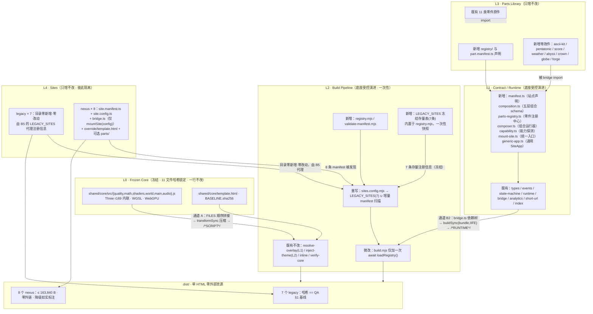
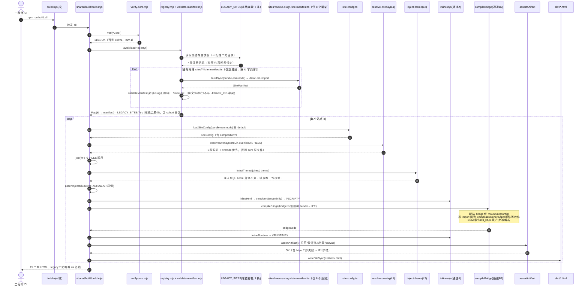
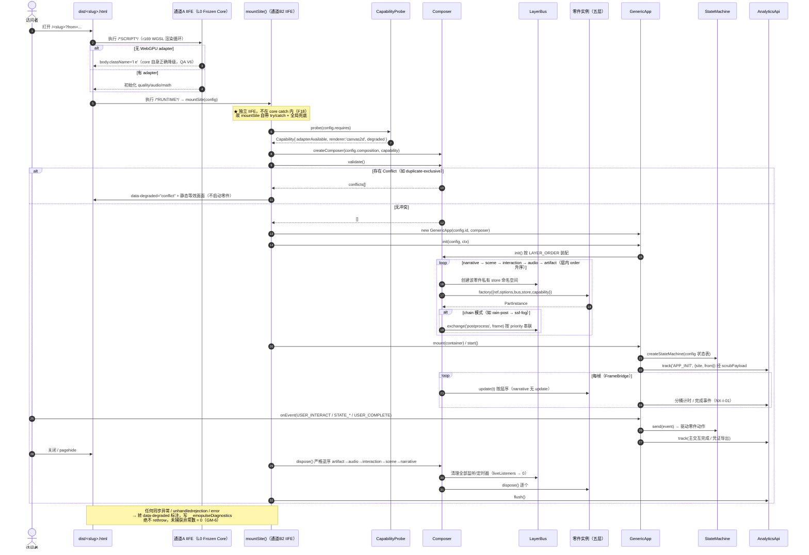
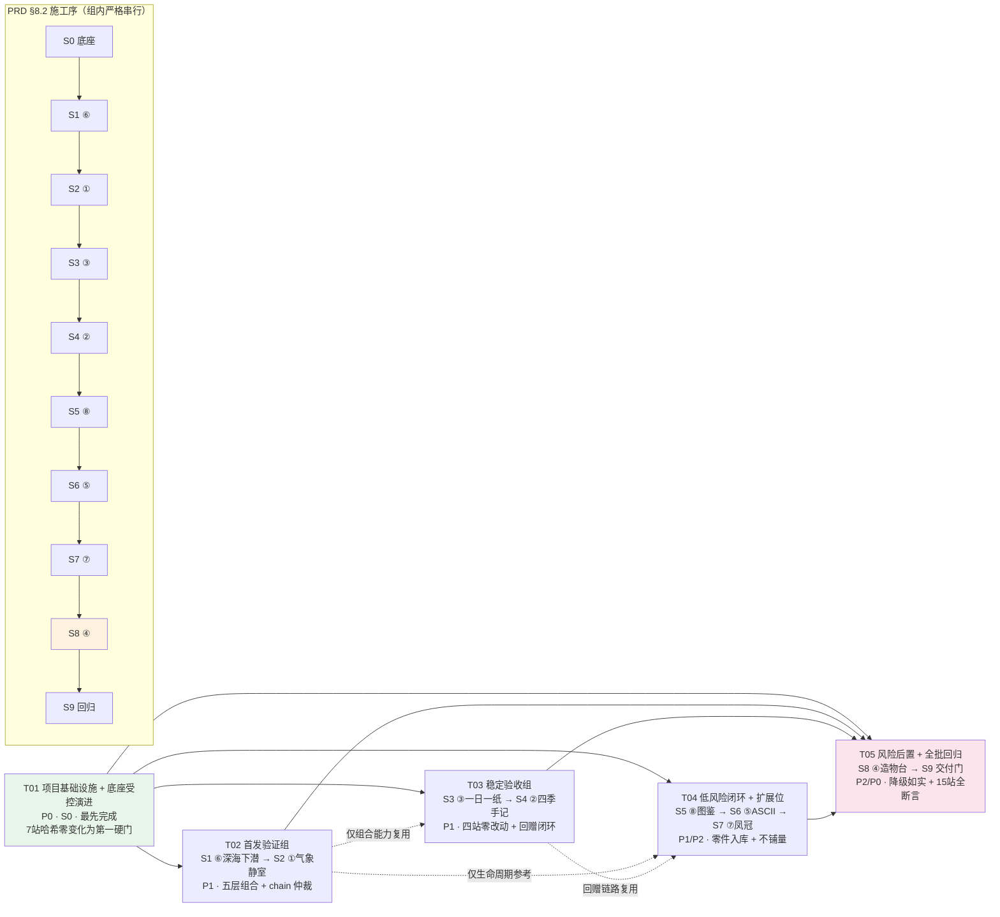

# emopulse-nexus 系统架构设计 + 任务分解（ARCHITECTURE-NEXUS）

> 版本 **v2.0** ｜ 2026-11-17 ｜ 阶段门 **G2** ｜ 架构师：高见远（Gao）
> 团队：`software-emopulse-nexus` ｜ 主理人：齐活林（Qi）
> 上游输入：`docs/PRD-NEXUS.md` v1.0（G1，472 行）、`docs/TEAM-SOP.md` v1.0、`docs/ARCHITECTURE.md` v1.1、`docs/QA-REPORT.md` v1.1、`shared/contract/*`、`shared/build/*`、`sites/still/*`、`sites/koi/shared/*`、`shared/parts-library/README.md`、`package.json`、`tsconfig.json`、`.reference/portal/*`、`.analysis/portal/full_tree.tsv`
> 下游：工程师寇豆码（G3）据此批量编码；QA 严过关（G4）据此验收。**本文只做设计与任务分解，不含实现代码。全文简体中文。**
>
> **本次逐份核实、未凭猜测**：四份文档 + 契约层 8 个 `.ts` + 构建层 6 个 `.mjs` + 站点范式（still 6 文件、koi/shared 2 文件）+ `BASELINE.sha256`（11 项）+ 参考资产 9 个文件 + `full_tree.tsv` 抽样 + `dist/*.html` 实际字节。凡本文出现的数字均给出处；无法从证据得到的结论一律标【假设】或【默认假设】。
>
> **v2.1 定点修订（主理人 D2 裁决，覆盖 v2.0 的原假设）**：撤销「既有 7 站各补 1 个 `site.manifest.ts`」方案，改为 **既有 7 站目录零新增、零改动**，其注册信息由 `shared/build/registry.mjs` 内置冻结快照 `LEGACY_SITES`（长度恒 7）提供；注册表 = `LEGACY_SITES` ∪ 增量 manifest 扫描。同步修订 §0.1 / §0.2 / §0.3 / §1.5 / §1.6 / §2 INV-3·INV-6 / §3.1 / §3.2 ADR-7 / §4.1 / §4.2 / §4.4 / §4.5 / §4.6 / §5.1 / §5.5 / §6.1 / §7.2 / §7.4 / §8 / §10.1 / §10.2 / 附 A。其余裁决（R1/R3/R4、160 KiB、slug、T01~T05）不变。
>
> **⚠️ 挂载链路为设计意图而非现状**：本文 §1.4 / §6.2 / INV-8 描述的 `mountSite()` / `composition` / `installParts()` 链路，2026-11-18 复核确认**产线未接通**（`mountSite()` 全仓零导入者、`installParts()` 零生产调用点、7 站 `site.config.ts` 无 `composition`）。见 `QUARANTINE.md` Q-01 / Q-02。**正文一字未改**。

---

## 0. 设计总纲（先给结论）

用户原话「底层架构考虑清楚，深度调整，后续的叠加组合可能会更加复杂，要保证复用、扩展、稳定」。据此，本次 **G2 的第一优先是底座**，8 个产品是这套底座的首批验证用例，不是 8 个并行站点开发任务。

### 0.1 一句话结论

> **不推翻已验证机制，而是把「已验证的 koi 范式」抽象成「注册中心 + 五层组合运行器」，并把所有叠加复杂度收敛到配置层；L0 Frozen Core 与既有 7 站产物字节一个都不动。**

具体落地为一条**双通道、单入口、零回归**的架构：

| 维度 | 结论 |
| --- | --- |
| **构建** | 沿用「6 文件拼接 IIFE + L1 同名替换 + L2 五常量锚点注入 + esbuild `transformSync` 压缩 + `/*SCRIPT*/` 内联」；**额外复用既有但未被点名的第二条通道**：`compileBridge` 的 `buildSync(bundle:true)` 承载全部站点/零件代码（见 §1.1） |
| **注册** | `sites.config.mjs` 硬编码 7 条 → 一次性重写为 **`LEGACY_SITES` 冻结存量（7 条，一次性快照） ∪ 扫描 `sites/**/site.manifest.ts`（可扩展增量）**；`types.ts` 的 `SiteId` 联合枚举 → 一次性放宽为开放字符串 + 三层校验（见 §5.5）。**既有 7 站目录零新增、零改动**；此后新增站点**只追加一个声明文件 + 站点目录**，不改任何底座文件（E1 / NX-A-01 / 主理人 D2 裁决） |
| **组合** | 新增 `Composer` + `GenericApp` + 零件注册中心，把 `scene / interaction / artifact / audio / narrative` 五层差异全部放进 `SiteConfig.composition`（**可选字段**）。新站**不写 glue**；既有 7 站 glue 一行不改（E2/E3/INV-7/INV-8） |
| **隔离** | `cohort: 'legacy' \| 'nexus'` 分区。增量声明文件与 `LEGACY_SITES` 冻结快照**都是构建元信息，不进入产物字节函数** → 既有 7 站产物哈希与 QA §1 基线逐字节一致（E4 / INV-3 / GM-1） |
| **冻结** | 「深度调整」严格限定在 **L1 / L2 / L3**；L0（`shared/core/`，11 文件哈希锁定）**一行不改，不开任何口子**（INV-1，PRD §6 边界） |

### 0.2 六个关键裁决速览

| # | 难题 | 裁决 | 详见 |
| --- | --- | --- | --- |
| **R1** | Three.js 版本三分（r169 / r185 / WebGPU r185） | **本期 0 个独立产物**。r185 CDN importmap、`shaders@4.0.7` 2.5MB ESM bundle **一律不进入构建输入**；8 站全部走主构建链 + Canvas 2D / 程序化等效实现（复用 koi 已验证范式）。禁止不同版本 Three.js 进入同一个 IIFE | §1.2 |
| **R3** | ESM 零件 vs `transformSync` 非 bundle | **分层复用既有双通道，不新增预打包子流程、不改写零件**。L0 通道冻结（永不放 ESM）；L3/L4 走既有 `compileBridge` bundle 通道，天然解析 `import`。`lib_kit.js`、`curtain-audio.ts` 可原件入库直接 bundle；`shaders.js`/`starfall`/`piano-score.ts`（依赖 `midi-file`）走等效实现 | §1.3 |
| **R4 / GM-6** | 降级态与未捕获异常 | `bridge` 的 `/*RUNTIME*/` 是**独立于 core catch 之外**的 IIFE（真实缺口，见 §1.4）。新增 `mountSite()` 统一入口自带能力探测 + try/catch + 全局异常兜底 + `data-degraded` 如实标注；**不改 `inline.mjs`**（改了会破坏 7 站产物字节） | §1.4 |
| **E1** | 注册表驱动去硬编码 | `LEGACY_SITES` 冻结存量 ∪ 增量 manifest 扫描 + `defineSite()` / `validateManifest()`；类型安全由「编译期 `satisfies` + 品牌放宽 + 构建期运行时 schema」三层保留，**不靠写死枚举** | §4.2 / §5.1 / §5.5 |
| **E2 / E6** | 五层组合 + 同层不互踩 | 固定层序 `narrative→scene→interaction→audio→artifact`；`dispose` 严格逆序；`PartClaim` 资源声明 + `exclusive` 互斥 / `chain` 优先级管线 + `LayerBus` 代理全局副作用 + 私有 `store` 命名空间 | §5.2 / §6.3 |
| **Q-N13** | 单产物体积硬阈值 | **推翻 256 KiB，定为 163,840 B（160 KiB）硬门 + 131,072 B（128 KiB）软观测**，依据最大基线 112,590 B 与「同一量级」要求 | §1.5 |

### 0.3 三个产品目标如何被机制保证

| 目标 | 机制 | 可自动断言 |
| --- | --- | --- |
| **稳定** | L0 哈希锁定 + `cohort` 分区 + 元信息不进入产物 + 构建期零写入 | 7 站产物哈希 == `tests/baseline-dist.sha256`；core 11/11 OK |
| **扩展** | `LEGACY_SITES` 冻结存量（恒 7）+ 增量 manifest 扫描 + 五层声明式组合 + 通用 `GenericApp` | 追加 1 个 dummy manifest 即可产出新站，`LEGACY_SITES` 长度与内容哈希不变，且 7 站目录零新增、7 站哈希零变化（SOP §7） |
| **复用** | 零件注册中心 + 五层全部来自注册中心 + 已验证 koi 范式泛化 | 8 站 `composition` 每层 `ref` 均命中注册中心；零件原件零改动 |

### 0.4 本次核实新增的两项事实（写入事实基线，供 G3/G4 使用）

| # | 事实 | 证据 | 对设计的影响 |
| --- | --- | --- | --- |
| **F15** | 现有构建**存在两条 esbuild 通道**：`inlineHtml` 的 `transformSync`（L0 拼接串，非 bundle）与 `compileBridge` 的 `buildSync({bundle:true,format:'iife'})`（站点 `bridge.ts` 依赖树）。后者**已能解析 ESM/TS import**；`loadSiteConfig` 亦为 `bundle:true` | `shared/build/build.mjs` L34-68、`shared/build/inline.mjs` L17-37；`sites/koi/shared/glue.ts` L3-6 已通过 bundle 通道 import 多层模块且 QA V1/V4/V7 通过 | **R3 无需新增构建子流程**，只需分层复用 |
| **F16** | 参考资产栈冲突为**硬冲突**：`starfall.html` L192-203 用 `importmap` 指向 `https://unpkg.com/three@0.185.0`（r185，WebGLRenderer）；`public_shaders_runtime_shaders.js` 首行自述 `shaders@4.0.7/js — ESM bundle for CDN consumption`，实测 **2,594,656 B**，含 12 个 `https://` 外链（fonts.googleapis.com / shaders.com telemetry 等）；`public_ascii-magic_lib_kit.js` 为**纯 ESM 无依赖 10,772 B**（导出 fbm/noise2/ramp/palette/project/bigText）；`piano-score.ts` L1 `import { parseMidi } from 'midi-file'` | `.reference/portal/*` 实测 + Grep | r185 / shaders runtime 若内联会被既有 `assertArtifact` 的 `/https?:\/\//i` **直接拦下**（`build.mjs` L82-86）；R1 走等效实现 |
| **F17** | `abyss` 5 段 jpg 合计 **1,317,378 B（≈1.26 MiB）**；凤冠 8 图合计 **16,027,340 B（≈15.29 MiB）**；现有产物实测 **107,773 ~ 112,590 B**；L0 六文件源码合计 **150,528 B**，`template.html` **7,727 B** | `.analysis/portal/full_tree.tsv` L23-27 / L1615-1622 逐项求和；`wc -c dist/*.html`；`wc -c shared/core/src/*.js` | **新发现**：⑥ 深海下潜的 5 段图虽「零新增场景资产」，但 1.26 MiB 同样撑破产物基线，须与 ⑦ 同走 R2 处置（见 §10 默认假设 D3） |
| **F18** | `inline.mjs` 的 `wrap` catch 只包住 `/*SCRIPT*/`（core 6 文件 IIFE）；`/*RUNTIME*/` 由 `inlineRuntime` 直接 `replace` 注入桥接 IIFE，**不在该 catch 作用域内** | `shared/build/inline.mjs` L6 / L32-37、`build.mjs` L133-135 | 新站桥接层异常会成为未捕获异常 → 需 `mountSite()` 自带兜底（§1.4），且不得改 `inlineRuntime` 以免破坏 7 站哈希 |

> **诚实边界**：core 渲染路径仍无 WebGPU adapter 可验证（QA §7 / F9）。本设计**不声称任何渲染已验证**，所有降级态按 NX-Q-02 / Q-N7 如实标注。

---

## 1. 实现方案与框架选型（含 R1 / R3 / R4 裁决）

### 1.1 事实基线：真实构建是「双通道 + 两级覆盖」，不是单通道

这是全部裁决的地基。读 `shared/build/build.mjs` 与 `inline.mjs` 后的完整链路（**逐行核实，非推测**）：

```
build.mjs
 ├─ verifyCore()                      ← verify-core.mjs，11 文件哈希
 ├─ loadSiteConfig(site)              ← buildSync({bundle:true, format:'esm', platform:'node'})
 │                                      → data URL import 取 default（★ 通道 B1，能解析 import）
 ├─ resolveOverlay(...)               ← L1：FILES 顺序，override/ 同名优先，否则 core 原文件
 ├─ join('\n')                        ← 6 文件拼接，共享作用域，无模块边界
 ├─ injectTheme(...)                  ← L2：5 常量锚点注入 + 唯一性校验（core 落盘恒不变）
 ├─ assertInjectedSource(...)         ← TANH/NEAR 原值未被误伤
 ├─ inlineHtml(...)                   ← transformSync(minify)【★ 通道 A：非 bundle，仅压缩 L0 拼接串】
 ├─ compileBridge(site)               ← buildSync({bundle:true, format:'iife', platform:'browser'})
 │                                      【★ 通道 B2：解析 bridge.ts 依赖树并 IIFE 化】
 ├─ inlineRuntime(html, bridgeCode)   ← 替换 /*RUNTIME*/，注入独立 IIFE（不在 core catch 内）
 └─ assertArtifact(...)               ← 占位符清零 / 零外链 / 5 常量已注入 / canvas 存在
```

| 通道 | 处理对象 | esbuild 用法 | 是否解析 `import` | 冻结状态 |
| --- | --- | --- | --- | --- |
| **A · L0 内核** | `FILES = [quality, math, shaders, world, main, audio].js` 拼接串 | `transformSync({minify:true})` | ❌ 否（且**必须否**：core 本就无 import，共享作用域靠拼接顺序） | **INV-1 冻结，一行不改** |
| **B1 · 站点配置** | `site.config.ts` 及其 import（content/、contract/） | `buildSync({bundle:true, format:'esm', platform:'node'})` | ✅ 是 | 受控演进 |
| **B2 · 站点运行时** | `bridge.ts` 依赖树（glue / state / parts / contract / 零件等效实现） | `buildSync({bundle:true, format:'iife', platform:'browser'})` | ✅ 是 | 受控演进 |

> **F15 的架构含义**：PRD / SOP 中「`transformSync` 非 bundle 解析不了 ESM 零件」这一担忧**只对通道 A 成立**。而 ESM 零件（ASCII `lib_kit.js`、凤冠 `curtain-audio.ts`、乐谱 TS）本就属于 L3/L4，天然该走通道 B2。**所以 R3 的答案不是「改造构建」，而是「把零件放对通道」。** 这是零改动、零回归的解法。

**已验证先例**：`sites/koi/{pond,ink,watercolor}` 三站正是「L0 六文件照常拼接 + `/*RUNTIME*/` 内 Canvas 2D 画锦鲤」的范式，产物 107,849~107,882 B（与基线同量级），QA V1/V4/V7 全部通过。本次 8 站是**把这个已验证范式泛化**，不是发明新机制 —— 这是「尊重既有资产、不推翻已验证机制」的最直接兑现。

### 1.2 R1 裁决 · Three.js 版本三分

**冲突证据（本次实测）**

| 栈 | 版本 / 形态 | 体积 | 外链 | 与底座关系 |
| --- | --- | --- | --- | --- |
| L0 `shared/core/src/main.js` | Three.js **r169** 内联源码 + WGSL / WebGPU | 46,049 B（六文件共 150,528 B） | 无 | 冻结、已验证 |
| `starfall.html` | **r185**，`<script type="importmap">` → `https://unpkg.com/three@0.185.0/...`，`import * as THREE from 'three'`，WebGLRenderer + OrbitControls | 74,077 B | ✅ 有 CDN | 违反 INV-2 |
| `public_shaders_runtime_shaders.js` | `shaders@4.0.7/js` ESM bundle（TypeGPU / WebGPU），自述 "for CDN consumption" | **2,594,656 B** | ✅ 12 个 `https://` | 违反 INV-2 + 体积 |
| Crystal / Vegetation / HK Building（④） | 同属 r185 / WebGPU 系（PRD §3.1，【未二次核验】栈归属按主理人登记） | — | — | 同 ④ 处置 |

**裁决（正面回答主理人「哪些产品走独立产物、哪些走程序化等效实现」）**

> **本期 8 个产品全部走「主构建链 + 程序化等效 / Canvas 2D 移植」，独立产物数 = 0。**
> **不允许**把 r169 与 r185 或任何 ESM Three.js 混进同一个 IIFE；也**不允许**为 r185 另开一条带 CDN importmap 的构建链。

**不启用独立产物的四条理由**（缺一即会破坏本次核心目标）：

1. **INV-2 硬约束**：starfall 的 importmap 与 shaders runtime 的 12 个外链会被既有 `assertArtifact`（`build.mjs` L82-86）直接判构建失败；为它们开口子等于破坏「零外部资源」。
2. **E1 单一真相源**：独立构建链 = 第二套注册表与产物命名，新增站点时无法保证「追加一条配置即可产出」，且 G4 的「仅新增站应有新产物」哈希比对失效。
3. **E4 / INV-3 零变化**：新链若共享 `shared/build/` 脚本，任何改动都抬升 7 站产物回归风险；不共享则形成第二份构建脚本副本，违背「底座不漂移」。
4. **R4 不可验证**：QA §7 已确认无 WebGPU adapter，r185 WebGL + shaders runtime 的 WebGPU 路径在当前环境**根本无法冒烟**，独立产物只会产出「无法验证」的交付物。

**逐产品实现映射（G3 照此编码）**

| 产品 | 上游栈 | 本期实现路径 | 上游运行时是否进入产物 | 依据 |
| --- | --- | --- | --- | --- |
| ② 四季手记 | Starfall r185 CDN、凤冠 TS、Grand Atelier `piano-score.ts`（`midi-file`） | Canvas 2D 四季 × 视角 × 昼夜等效 + 五声音阶 Web Audio 等效 + `compileScore`/`paginateScore` **无第三方依赖等效实现** | ❌ 否 | Q-N9「等效实现 / Canvas 2D 移植，原件入库供对照」 |
| ④ 造物台 | `shaders@4.0.7` 2.5MB ESM、Crystal/Vegetation r185 | Canvas 2D 程序化晶体（分形）/ 植被（L-system）/ 建筑（体块）等效；10 demo 由配置枚举；`CapabilityProbe` 如实降级 | ❌ 否 | Q-N7 / NX-Q-02 / ④ 排最后 |
| ⑤ ASCII 电台 | `lib_kit.js` **纯 ESM、无依赖、10,772 B** | **原件入库并直接经通道 B2 bundle**（`import { fbm } from ...` 被解析），不改写、不谎称内联 | ✅ 是（仅纯 ESM 工具库） | F16；Q-N9 允许的例外（无外链、无版本冲突） |
| ⑦ 凤冠七章 | `curtain-audio.ts` 纯 Web Audio TS（5,938 B，无第三方 import） | 原件入库经通道 B2 bundle（esbuild 剥离 TS 类型）；8 冠图**不内联**，走程序化氛围层 | ✅ 是（仅纯 Web Audio） | Q-N3 / N10 |
| ① 气象静室 | `rain-webgpu/*.ts`、micro-scenes 6 HTML、SSF-Fog | Canvas 2D 等效；Fog 与 rain post 由 `chain` 仲裁（§6.3） | ❌ 否 | NX-A-06 / INV-7 |
| ⑥ 深海下潜 | abyss 5 段 jpg（1,317,378 B） | **不内联原图**：Canvas 2D 分层渐变 + L2 五常量明度递减表达五状态；5 个真实文件名作状态标识 | ❌ 否 | F17 / NX-P-02 / D3 |
| ③ 一日一纸 | Looseleaf 纸组件数据 | 程序化 Canvas 纸容器；串站由**新增站点 + 配置**实现，四站 glue / 主交互 / 产物哈希零改动 | ❌ 否 | Q-N12（硬裁决） |
| ⑧ 微缩图鉴 | 6 个 micro-scenes HTML、Snow 雪效 | 6 个已入库零件经注册中心装配 + Canvas 2D 雪效；零件原件零改动 | ❌ 否 | F10 / SOP §7 |

**扩展位（本期不实现，仅写死边界）**：若未来用户**明确放宽 INV-2**，可启用 `isolated` profile —— 独立目录 `sites-isolated/<slug>/`、独立 IIFE、**不共享 L0 六文件**、产物前缀 `iso-`、不进入默认 `build:all` 注册表、单独体积预算与单独冒烟报告。该 profile 与默认注册表物理隔离，因此不会污染 E1/E4。本期代码量为 0，仅在此登记决策，避免 G3 擅自实现。

### 1.3 R3 裁决 · ESM 零件 vs 非 bundle 构建

主理人给出三选一：① 新增「零件预打包」子流程；② 把零件统一改写成无 import 等效实现；③ 两者分层。

> **裁决：选 ③「分层」，但不是新造两层，而是复用 F15 已经存在的 A / B 双通道。不新增构建子流程、不改写可复用的 ESM 零件、不改 `inline.mjs` 的压缩逻辑。**

| 零件类别 | 判定 | 处置 | 通道 |
| --- | --- | --- | --- |
| 纯 ESM、无第三方依赖、无外链（`lib_kit.js` 10,772 B；`curtain-audio.ts` 5,938 B） | **可原件复用** | 放入 `shared/parts-library/<id>/`，由站点 `bridge.ts` 依赖树 `import`；`compileBridge` 的 `bundle:true` 自动解析并 IIFE 化 | **B2** |
| 带第三方 npm 依赖（`piano-score.ts` → `midi-file`） | **不可直接 bundle** | 按 Q-N9 **等效实现**：抽出 `compileScore` / `paginateScore` 纯逻辑为无依赖模块（保留类型与函数签名），原件入库供对照，**不谎称已直接内联**、**不新增 npm 依赖** | **B2**（等效件） |
| 大体量 ESM bundle / 含外链 / 不同 Three 版本（`shaders@4.0.7` 2.5MB、`starfall` r185 importmap） | **禁止进入任何通道** | 仅作设计参考，程序化等效实现（§1.2） | 无 |
| L0 六文件（`quality/math/shaders/world/main/audio.js`） | **冻结** | 永不放 ESM 零件；`FILES` 顺序与拼接语义不变 | **A** |

**为什么否决另外两条**

| 方案 | 否决理由 |
| --- | --- |
| ① 新增「零件预打包」子流程 | 与既有 `compileBridge` 的 `bundle:true` 功能**完全重复**；新增脚本会改动 `build.mjs` 主流程，抬升 7 站产物回归风险；且引入第三个构建阶段，违反「尽量不改底座」。F15 证明能力已存在，重造即浪费 |
| ② 统一改写成无 import 等效实现 | 无谓地丢弃 `lib_kit.js`（fbm/noise2/ramp/palette/project/bigText 共 20+ 导出，10,772 B）与 `curtain-audio.ts` 这些**可直接复用且已验证无外链**的资产，违背「复用」目标与「尊重既有资产」；也把「等效实现」的口径滥用在本可真实复用的零件上 |
| ③ 分层（**采用**） | 零新增构建脚本、零改写可复用原件、零 `inline.mjs` 改动；`SiteConfig.composition` 声明 `ref` → 注册中心 `entry` → `bridge.ts` import 图 → B2 bundle，链路清晰可测 |

**代价（如实说明，纳入共享知识）**

1. 零件若从 `bridge.ts` 依赖树可达，才会被打进产物；**未被引用的零件不进产物**（这是优点，也要求 G3 保证 `entry` 与 import 一致）。
2. `.js` 原件（如 `lib_kit.js`）需 `tsconfig` 开 `allowJs: true` / `checkJs: false` 才能被 `tsc --noEmit` 纳入 import 图而不报错 —— 这是对 `tsconfig.json` 的**一次性受控演进**（T01）。
3. 通道 B2 产物为 IIFE，与通道 A 的 L0 IIFE **彼此独立作用域**；零件不得假设能访问 L0 的 `WCOL`/`EXPO` 等局部变量。跨通道数据只能经 `RuntimeContext` / `LayerBus` / L2 注入后的 DOM 与配置传递（写进 §8）。
4. `assertArtifact` 的零外链断言会扫描**整份 HTML**（含 B2 产物），因此任何零件携带 `https://` 字符串都会拦下构建 —— 这正好是 R1 的自动化护栏。

### 1.4 R4 / GM-6 裁决 · 降级态与未捕获异常

**真实缺口（F18）**：`inline.mjs` L6 的 `wrap(...).catch(...)` 只包住 `/*SCRIPT*/`（L0 六文件 IIFE，无 adapter 时置 `body.className='l e'`，QA §7 已确认是**正确降级**）。而 `/*RUNTIME*/` 由 `inlineRuntime` 直接 `replace` 注入，是**另一个独立 IIFE**，其抛出的异常不会被该 catch 捕获 → 会成为 `Uncaught`，直接违反 GM-6（未捕获异常数 = 0）。QA Round 1 的 `Minor-1`（hug 剪贴板 `writeText` 未捕获拒绝，`QA-REPORT.md` §10）已实证这类风险存在。

**不能改 `inlineRuntime` 包装逻辑**：一旦给 `bridgeCode` 统一包一层，7 个既有站点的产物字节都会变 → 破坏 INV-3 / GM-1。这是硬约束。

**裁决：把保护放进「新站统一入口」，既有站不动**

- 新增 `mountSite(config)`（`shared/contract/mount-site.ts`），作为**全部 8 个新站 `bridge.ts` 的唯一调用**；既有 7 站 `bridge.ts` 一行不改（其自身已无未捕获异常，QA V6 4/4 PASS + Minor-1 已修复）。
- `mountSite()` 内部按严格顺序执行（见 §6.2），且**自身整体包 try/catch，绝不 rethrow**：

| 环节 | 行为 | 产出给 G4 的可断言信号 |
| --- | --- | --- |
| ① `CapabilityProbe` | `navigator.gpu?.requestAdapter()` 探测；失败不抛错、不调用 WebGPU 路径 | `data-renderer="canvas2d"`、`data-degraded="no-webgpu-adapter"` |
| ② 冲突检测 | `composer.validate()` 非空则进入降级，不启动零件 | `data-degraded="conflict"`，诊断明细写入 `window.__emopulseDiagnostics` |
| ③ 正常装配 | `Composer.init()` + 帧桥 | `data-degraded` 不存在 |
| ④ 异常兜底 | try/catch 捕获同步异常；注册 `unhandledrejection` / `error` 监听把异步异常**转成降级标注**（不 rethrow、不吞掉诊断） | `window.__emopulseDiagnostics.uncaught[]` 计数 = 0 |
| ⑤ 降级渲染 | Canvas 2D 静态等效画面 + 中性提示文案，**措辞不声称「渲染通过」** | `data-degraded` 文案由 CDP 冒烟读取 |

- **诚实口径**：冒烟报告统一写「WebGPU 渲染**未验证**；已验证降级态与 glue 交互」，不写「渲染 PASS」（NX-Q-02 / Q-N7 / US-5 AC2）。
- **G4 断言**（`tests/verify-degradation.mjs`）：无头环境下 8 站逐一 `data-degraded` 存在、`uncaught[]` 长度 = 0、`data-renderer` 为 `canvas2d` 或 `static`、降级文案不含「rendered / passed / 渲染通过」类措辞；并注入 3 种 stub（同步抛错 / 异步拒绝 / 正常）复跑，未捕获异常恒为 0（沿用 QA §14 `regression-hug-share.mjs` 手法）。

### 1.5 Q-N13 裁决 · 单产物体积硬阈值

> **裁决：推翻主理人暂定的 256 KiB，定为 `163,840 B（160 KiB）` 硬门 + `131,072 B（128 KiB）` 软观测。**

**依据（全部本次实测 / QA 已有数据）**

| 项 | 数值 | 出处 |
| --- | --- | --- |
| 7 站产物区间 | 107,773 ~ **112,590 B** | `wc -c dist/*.html`；QA §1（105.2~110.0 KB） |
| L0 六文件源码 | 150,528 B（压缩后约 100 KB，构成产物主体） | `wc -c shared/core/src/*.js` |
| `template.html` | 7,727 B | `wc -c` |
| 新站增量来源 | 通用 `Composer` / `GenericApp` / `mountSite` + 单站 Canvas 2D 等效零件 + 文案配置，均经 B2 `minify` | 设计估算【假设】约 10~30 KiB |
| 误内联资产的量级 | abyss 5 图 1,317,378 B；shaders runtime 2,594,656 B；凤冠 8 图 16,027,340 B；9.6MB 音频 | F17 / F16 / PRD F12 |

**论证**

- 硬门 160 KiB = 1.455 × 最大基线 112,590 B，允许增量 **+51,250 B（+45.5%）**，足以容纳通用运行时与单站等效零件，且仍属 GM-7 要求的「F2 同一量级」。
- **256 KiB（262,144 B）= 2.33 × 最大基线**，已脱离「同一量级」，且无法及时拦住「渐进式膨胀」（例如误内联一张 ~200 KiB 压缩图仍会放行），护栏意义被稀释 → 故推翻。
- 任一被禁资产（最小者 abyss 1.26 MiB）都是硬门的 **8 倍**以上，误内联会被立即拦下，护栏灵敏度足够。
- 软观测 128 KiB 只记录中位数、不阻断，用于观察 8 站实现是否趋于臃肿（对应 GM-7「观测 + 待转硬」）。

**自动断言落地**（交 G4，T01 提供脚本）

```
tests/verify-size.mjs:
  读注册表 cohort（LEGACY_SITES 冻结存量 7 条 ∪ 增量 manifest 扫描 8 条）
  for each slug where cohort === 'nexus':
      size = Buffer.byteLength(dist/<slug>.html)
      assert size <= 163840            // 硬门，失败 exit 1
  记录 8 站中位数，输出报告（软观测 131072，仅告警）
  for each slug where cohort === 'legacy':
      assert sha256 == tests/baseline-dist.sha256   // INV-3，走哈希而非体积
```

> **边界**：既有 7 站**不受体积阈值约束**，只受「哈希逐字节相等」约束（INV-3）；若体积阈值与哈希同时满足才通过，避免用体积放宽掩盖字节变化。

### 1.6 框架选型与依赖

| 层 | 选型 | 变更 | 理由 |
| --- | --- | --- | --- |
| L0 内核 | abyssal-garden 原生 JS + Three.js r169 内联 + WGSL | **冻结** | INV-1 |
| L1 协议 | TypeScript（strict，`moduleResolution: Bundler`）+ 插件架构 / IoC / FSM / 适配器 | 受控演进（新增 `manifest.ts`、`composition.ts`、`composer.ts`、`parts-registry.ts`、`capability.ts`、`mount-site.ts`、`generic-app.ts`） | 沿用既有契约，不引入框架 |
| L2 构建 | Node ESM `.mjs` + esbuild（`transformSync` 用于 L0，`buildSync` 用于配置/桥接） | 受控演进（`sites.config.mjs` 重写为 `LEGACY_SITES` ∪ 增量扫描；新增 `registry.mjs`（内置冻结快照）、`validate-manifest.mjs`；`build.mjs` 仅加一次 `await loadRegistry()`） | 沿用已验证双通道 |
| L3 零件 | 纯 JS / TS 模块 + Canvas 2D + Web Audio | 只增 | 零运行时依赖、零外链 |
| L4 站点 | 极简 DOM + Canvas，无组件框架 | 只增 | 不引入 React / MUI / Tailwind / Vite（原架构 §8 已否决，本次维持） |
| 测试 | Node 原生断言 + 既有 CDP 冒烟 | 只增 | 沿用 QA 既有测试体系 |

**不新增任何运行时依赖**；`devDependencies` 亦不新增（详见 §9）。

---

## 2. 架构不变量落地清单（INV-1 ~ INV-8 逐条）

> 每条给出「由哪个机制保证 / 属于哪一层 / 如何验证 / 对应 G4 断言脚本」。这是 G4 的验收索引。

| # | 不变量 | 保证机制（本文章节） | 层 | 验证方式 | G4 断言 |
| --- | --- | --- | --- | --- | --- |
| **INV-1** | Frozen Core 一行不改，`BASELINE.sha256` 哈希锁定 | ① 既有 `verify-core.mjs` 在每次 `build:all` 前调用（`build.mjs` L25-31 / L146）；② **写死边界**：本次深度调整只作用于 L1/L2/L3，`shared/core/` 11 个文件不新增、不修改、不删除、不加白名单、不给 L0 开任何口子；③ `FILES` 顺序与拼接语义不变；④ L1 同名替换若替换 `shaders.js`/`main.js` 必须原样保留 5 常量声明锚点（原架构 §1.2.2 护栏，本次维持） | L0 | `cd shared/core && sha256sum -c BASELINE.sha256` → 11/11 OK；篡改 `math.js` 负向应 build exit=1（QA V2a 已验证）；**新增**构建前后 core 目录哈希比对，证明构建过程零写入 | `tests/verify-no-core-write.mjs`、`tests/verify-core-negative.sh` |
| **INV-2** | 单 HTML + 零外部资源 | ① 既有 `assertArtifact` 的 `/https?:\/\//i` 与 `<script\|link\|img\|iframe src/href>` 断言（`build.mjs` L77-102），**覆盖整份 HTML 含 B2 桥接产物**；② R1 禁入清单（§1.2）把 r185 importmap / shaders runtime 挡在构建输入之外；③ Q-N3/N10：15MB 冠图、9.6MB 音频、F17 的 1.26MB abyss 图一律不内联；④ Q-N13 体积硬门兜底 | L2 | 逐产物扫描外链 = 0；体积 ≤ 163,840 B；`target=_blank` / `form/input` = 0 | `tests/compliance.test.mjs`（扩展）、`tests/verify-size.mjs` |
| **INV-3** | 站点隔离 / 既有产物零变化 | ① `cohort: 'legacy' \| 'nexus'` 分区；② **核心不变量链**：`产物字节 = f(L0 六文件, override/*, site.config.ts, bridge.ts 依赖树, template.html, inject-theme, inlineHtml)`；增量 `site.manifest.ts` 与 `LEGACY_SITES` 冻结快照**均为构建元信息，不参与 f()**；③ 既有 7 站目录 **零新增、零改动**（`site.config.ts` / `bridge.ts` / `glue.ts` / `override/` 一行不改，亦不新增 `site.manifest.ts`；Q-N12 硬裁决：③ 串联亦不得改四站 glue）——主理人 D2 裁决；④ `LEGACY_SITES` 的 7 站 `dir/out/config/bridge/route` **与现 `sites.config.mjs` 硬编码 `SITES` 逐字段相同**（§4.2 对照表），`getSite()` 返回值不变 | L2/L4 | `build:all` 后对 7 个 legacy slug 逐一 `sha256sum -c tests/baseline-dist.sha256` → 7/7 OK；`git diff -- sites/license sites/praise sites/hug sites/still` **为空**；**负向**：追加一个 dummy manifest 并构建，7 站哈希仍零变化且 `LEGACY_SITES` 长度/哈希不变（SOP §7 / NX-A-05） | `tests/verify-legacy-hash.mjs`、`tests/verify-append-only.mjs`、`tests/site-isolation.sh`（复用扩展） |
| **INV-4** | 两级覆盖 L1 / L2 + 锚点唯一性 | `resolve-overlay.mjs` 与 `inject-theme.mjs` **本次不修改**；5 常量锚点唯一性校验、`TANH/NEAR` 二次确认、`assertInjectedSource` 全部保留；8 套新主题五值互不相同（NX-P-10） | L2 | 7 站 × 5 字段注入比对（QA V4 口径）扩展到 15 站；重复/缺失锚点负向抛错（QA V2b 已验证） | `tests/theme-injection.test.mjs`（扩展） |
| **INV-5** | 反向设计：无聊天 / 无任务 / 无消费引导 / 零 PII | ① `compliance.test.mjs` 147 项断言**覆盖到全部 15 个产物**；② `scrubPayload` / `bucketDuration` / 短 URL 既有实现不改；③ NX-I-01 新增 2 个匿名事件（主交互完成 / 凭证导出）经同一 `scrubPayload`；④ ③ 的日历 FSM **禁止**出现打卡 / 连续天数 / 补签 / 成就（US-4 AC3），⑤ 的 scene×shader 组合空间**禁止**做成收集进度（US-6 AC3）；⑤ ③/②/⑦ 的 `?from=` 仅含赠言/签文短句，不含身份 | L1/L4 | 禁止词 0 命中、`purchase` 仅否定式白名单、零 PII 字段、零 `form/input`、无任务化关键词 | `tests/compliance.test.mjs`（扩展）、`tests/verify-analytics.mjs` |
| **INV-6** | 新增站点不改底座（本次重构目标） | ① `sites.config.mjs` **一次性**重写为 `LEGACY_SITES` 冻结存量 ∪ 扫描 `sites/**/site.manifest.ts`；② `types.ts` 的 `SiteId` **一次性**从 7 项联合枚举放宽为开放字符串；③ 此后新增站点 = 追加 `sites/<slug>/site.manifest.ts` + 站点目录，**不改** `types.ts` / `sites.config.mjs` / `build.mjs` / `shared/core/` / 其他站点，也**不改 `LEGACY_SITES`**（长度恒 7、内容哈希恒定）；④ `defineSite()` 编译期形状校验 + `validateManifest()` 构建期运行时校验（含「新增 id 不得落入 `LEGACY_IDS`」） | L1/L2 | **判据**：新增第 9 个产品时 `git diff` 中底座文件改动数 = 0；`LEGACY_SITES` 长度 === 7 且内容哈希不变；新增站点必须出现在 manifest 扫描结果中；注册中心唯一性、slug 正则、必填文件存在、字段一致性断言 | `tests/verify-registry.mjs`、`tests/verify-append-only.mjs` |
| **INV-7** | 零件可组合，生命周期互不干扰 | 新增 `Composer`：固定层序 `init` / `dispose` 严格逆序；`PartClaim` 资源声明 + `exclusive` 互斥（重复即装配失败，不静默覆盖）+ `chain` 优先级管线；`LayerBus` 代理事件监听/定时器/管线交换并在 dispose 自动清理；每零件私有 `store` 命名空间；音频层统一 `masterGain`。产品 ① 的 Fog + rain post 同层走 `chain` 仲裁（§6.3） | L1 | 组合生命周期单测：同层 2 零件调用顺序、逆序 dispose、claim 冲突抛错、事件监听计数归零、无全局残留；① 完整渲染周期冒烟无异常/无泄漏 | `tests/verify-composition.mjs`、`tests/verify-lifecycle.mjs` |
| **INV-8** | 配置驱动，不写死在 glue | ① `SiteConfig.composition?`（**可选**，既有 7 站不提供 → 走原 glue，零回归）；② 新站统一 `GenericApp` + `mountSite()`，**不写站点专属 glue**；③ 场景/交互/凭证/音景/文案全部由 `composition` + `site.config.ts` 声明；④ theme 五值沿用 L2 注入 | L1/L4 | 只改配置（theme / scene / audio 开关）重建 → 产物随之变化，且 `sites/<slug>/glue.ts` 不存在或源码零改动；差异检查 | `tests/verify-config-driven.mjs` |

> **INV-1 边界再写死一次**（主理人要求）：PRD §6 明确「深度调整作用于 L1/L2/L3，不为 L0 开口子」。本文 §0.1 / §1.1 / §4.3 / §8 四处重复该约束；**任何以「底座深度调整」为由修改 `shared/core/` 的实现，一律判定 G3 不通过**。

---
## 3. 分层架构与关键决策记录

### 3.1 分层架构图



| 层 | 目录 | 本次变更类型 | 产物字节影响 |
| --- | --- | --- | --- |
| **L0** | `shared/core/` | **冻结** | 决定 legacy 与新站共用的 L0 段（恒定） |
| **L1** | `shared/contract/` | 底座受控演进（只增 7 个文件 + `types.ts` 放宽 1 处） | 仅当被 `bridge.ts` import 时影响新站；**不影响 legacy**（legacy bridge 依赖图不变） |
| **L2** | `shared/build/` | 底座受控演进（1 重写 + 2 新增 + 1 微改） | 构建元信息，**不进入产物字节** |
| **L3** | `shared/parts-library/` | **只增** | 仅被新站 import 时影响新站 |
| **L4** | `sites/` | legacy **目录零新增、零改动**（注册信息移至 L2 的 `LEGACY_SITES`）；nexus **只增目录** | legacy 零影响；新站由自身决定 |
| **新增 · 测试** | `tests/` | 只增 | 无 |

> **关键隔离论证**：L1 新增文件、L2 重写（含 `LEGACY_SITES` 冻结快照）、L3 新增声明、L4 仅 8 个新站新增目录，全部**不在 legacy 7 站的 `bridge.ts` 依赖图内，也不在 L0 拼接串内，也不在 `site.config.ts` / `template.html` 内**；且 **legacy 7 站目录自身零新增、零改动**。因此 `f()` 的输入集合对 legacy 7 站保持逐字节不变，且 `git diff -- sites/license sites/praise sites/hug sites/still` 为空 → INV-3 与 Q-N12 同时成立。这是 E4 的硬证据链。

### 3.2 关键决策记录（ADR）

| ADR | 决策 | 被否决方案 | 否决理由 |
| --- | --- | --- | --- |
| **ADR-1** | 保留「拼接 IIFE + 两级覆盖」，深度调整只加注册/组合层 | 换 Vite multi-page + singlefile | 原架构 §1.1 已否决：诱导多文件 chunk、额外重栈、破坏已验证机制；QA V1 已证明拼接 IIFE 逐字节可复现 |
| **ADR-2** | R1：8 站全部主构建链 + 程序化等效，独立产物 = 0 | 为 r185 / shaders runtime 开独立构建链 | INV-2 外链禁令、E1 单一真相源、E4 哈希比对、R4 环境不可验证（§1.2 四条理由） |
| **ADR-3** | R1：禁止不同版本 Three.js 进同一 IIFE | 把 r185 也内联进 L0 六文件 | 版本符号冲突 + core 落盘改动 → 直接违反 INV-1；且 r185 为 ESM + CDN importmap，与共享作用域拼接语义不兼容 |
| **ADR-4** | R3：分层复用既有 A/B 双通道 | ① 新增零件预打包子流程 / ② 全改无 import 等效 | F15 证明 B2 已能解析 import；①重复造轮子且改动主流程，②丢弃可复用原件（§1.3） |
| **ADR-5** | R3：`piano-score.ts` 走等效实现，不引 `midi-file` | 新增 `midi-file` npm 依赖 | 主理人「原则上不新增运行时依赖」；本项目无 MIDI 文件输入（五声音阶直接合成）；Q-N9 已定等效口径 |
| **ADR-6** | E1：`SiteId` **放宽**为开放字符串 + 三层校验 | 改为品牌类型 `string & { brand }` | 品牌类型**不接受裸字符串字面量赋值**，会使既有 7 站 `site.config.ts` 的 `id: 'still'` 全部 `tsc` 报错 → 破坏 legacy 零改动。放宽 + `satisfies` + 构建期 schema 是唯一零回归解（§5.5） |
| **ADR-7**（**v2.1 由主理人 D2 裁决覆盖**） | **既有 7 站目录零新增、零改动**；`registry.mjs` 内置**冻结存量快照** `LEGACY_SITES`（长度恒 7、内容哈希恒定），注册表 = `LEGACY_SITES` ∪ 增量 manifest 扫描 | ~~给 7 站各补 1 个 `site.manifest.ts`，`sites.config.mjs` 完全改为纯扫描~~（v2.0 原决策，**已撤销**） | ① 原方案与 §4.6 红线 / §7.4 S3 的 `git diff -- sites/license sites/praise sites/hug sites/still` **为空** 直接冲突，文件纳入版本控制后该硬门不可能成立；② PRD `NX-P-04` 第 230 行原文只要求「四站产物哈希零变化」，未要求目录零新增，但用户「稳定」优先，取更严口径；③ 这不等于倒退回硬编码：`LEGACY_SITES` 是**一次性存量快照**，长度恒 7、永不追加，新站一律走 manifest 扫描，E1 / INV-6 不受影响；④ 由 `verify-append-only.mjs` 断言长度/内容哈希恒定，堵住「悄悄把新站塞进存量表」的退化路径 |
| **ADR-8** | E2：`SiteConfig.composition?` 设为**可选**字段 | 把 `parts` 直接替换为 `composition` | 既有 7 站 `site.config.ts` 都用 `parts: PartRef[]`，替换会强制改 7 个配置文件 → 破坏 INV-3。可选字段实现「新站走 Composer、老站走原 glue」双轨零回归 |
| **ADR-9** | R4：保护放进 `mountSite()`，**不改 `inlineRuntime`** | 在 `inline.mjs` 给 `bridgeCode` 统一包 try/catch | 会改变全部 7 站 `/*RUNTIME*/` 段字节 → 产物哈希全变，违反 INV-3 / GM-1（§1.4） |
| **ADR-10** | Q-N13：160 KiB 硬门 | 主理人暂定 256 KiB | 2.33× 最大基线，脱离「同一量级」，拦不住渐进式膨胀（§1.5） |
| **ADR-11** | E4：靠「元信息不进入产物函数」保证零变化 | 构建后对 legacy 产物做字节裁剪/归一化以「对齐」基线 | 属于粉饰而非零变化；QA 要求逐字节一致，任何归一化都会掩盖真实回归 |
| **ADR-12** | ③ 一日一纸：串联由**新增站点 + 配置**实现 | 在四站 glue 里加跳转 / 共享容器逻辑 | Q-N12 主理人硬裁决「禁止改四站 glue / 主交互 / 产物哈希」；US-4 AC2 |

---

## 4. 完整文件清单

> 标注说明：**【只增】**= 新建文件，不修改任何既有文件；**【受控演进】**= 一次性修改底座文件（仅 L1/L2/L3，绝不触碰 L0）；**【冻结】**= 明确一行不改。
> 「影响 legacy 产物」列是 INV-3 的逐文件核对表，G3 必须逐行确认。

### 4.1 底座受控演进（L1 · `shared/contract/`）

| 路径 | 职责 | 层 | 变更 | 影响 legacy 产物 |
| --- | --- | --- | --- | --- |
| `shared/contract/types.ts` | `SiteId` 从 7 项联合枚举放宽为开放字符串；`SiteConfig` **追加可选** `composition?: CompositionConfig`；其余 8 个接口/字段**完全不变** | L1 | 【受控演进】 | ❌ 否（类型放宽不产生运行时字节；可选字段不参与既有配置） |
| `shared/contract/manifest.ts` | `SiteManifest` 接口 + `defineSite()` + `LAYER` 常量导出 | L1 | 【只增】 | ❌ 否（未被 legacy bridge import） |
| `shared/contract/composition.ts` | `PartLayer` / `LAYER_ORDER` / `PartClaim` / `PartBinding` / `CompositionConfig` / `Conflict` | L1 | 【只增】 | ❌ 否 |
| `shared/contract/parts-registry.ts` | `PartManifest` / `PartInstance` / `PartFactory` / `PartOptions` / `LayerBus` / `registerPart()` / `resolvePart()` | L1 | 【只增】 | ❌ 否 |
| `shared/contract/composer.ts` | `Composer`：冲突检测、层序 init/update、逆序 dispose、chain 管线、命名空间隔离、诊断输出 | L1 | 【只增】 | ❌ 否 |
| `shared/contract/capability.ts` | `CapabilityProbe`：`navigator.gpu.requestAdapter()` 探测 → `Capability` | L1 | 【只增】 | ❌ 否 |
| `shared/contract/mount-site.ts` | `mountSite(config)`：新站浏览器侧唯一入口，能力探测 → 冲突检测 → 装配 → 异常兜底 → 降级标注 | L1 | 【只增】 | ❌ 否 |
| `shared/contract/generic-app.ts` | `GenericApp implements SiteApp` 七方法，委托 `Composer`；新站无需自写 glue | L1 | 【只增】 | ❌ 否 |
| `shared/contract/index.ts` | 追加上述新模块的 `export *`（不改既有 8 行） | L1 | 【受控演进 · **高风险，须实测**】 | ⚠️ **可能改变 7 站 `bridge.ts` 的 bundle 字节**（`sites/still/glue.ts` 等经 `shared/contract/index` import，`export *` 集合变化可能改写 esbuild IIFE 的模块解析顺序/前缀）。**不预设「字节不变」**；G3 必须在 T01 第一硬门实测 7 站哈希，任一不符即按 D7 回退为「新站直接 import 具体模块，`index.ts` 保持原 8 行」 |
| `shared/contract/{events,state-machine,runtime,bridge,analytics,short-url}.ts` | 既有能力 | L1 | 【冻结】 | ❌ 否 |

> ⚠️ **`index.ts` 风险提示（写进共享知识 · 主理人第 6 点确认）**：`buildSync(bundle:true)` 会 tree-shake，但 `export *` 集合变化**确实可能**改写 IIFE 的模块解析顺序、初始化顺序或变量前缀，因此**不能假定 7 站 bundle 字节不变**。`sites/still/glue.ts` / `sites/koi/shared/glue.ts` 均经 `shared/contract/index` import，属受影响路径。**G3 必须在 T01 第一硬门把「index.ts 导出变化」列为必须实测项**：改完 index 立即 `build:all` 并逐站比对 `tests/baseline-dist.sha256`；**任一哈希不符即按 D7 回退**为「新站直接 `import { ... } from '../../shared/contract/composer'` 等具体模块，`index.ts` 恢复并保持原 8 行」，回退后重跑 7/7 哈希。此为 T01 的强制验收点，不得跳过。

### 4.2 底座受控演进（L2 · `shared/build/` 与根配置）

| 路径 | 职责 | 层 | 变更 | 影响 legacy 产物 |
| --- | --- | --- | --- | --- |
| `shared/build/sites.config.mjs` | **重写为 `LEGACY_SITES` 冻结存量 ∪ 增量扫描注册中心**：`LEGACY_SITES` 由 `registry.mjs` 提供（7 条一次性快照）；增量部分递归扫描 `sites/**/site.manifest.ts`，经 `buildSync(bundle,esm,node)` + data URL import 聚合；导出 `loadRegistry()`（async）/ `getSite()` / `listSites()` / `FILES` / `CORE_ANCHORS`；删除原 `SITES` 硬编码对象与 `FUTURE_SITES`（7 站信息改由 `LEGACY_SITES` 等价提供） | L2 | 【受控演进】 | ❌ 否（元信息，不参与 `f()`） |
| `shared/build/registry.mjs` | ① **内置 `LEGACY_SITES` 冻结存量快照（7 条）+ `LEGACY_IDS`**（见下方接口定义）；② 增量 `readdirSync` 递归扫描（深度 ≤3）、manifest 编译导入、按 `id` 字典序排序保证构建确定性；③ 合并时校验 `LEGACY_IDS` 与扫描结果无 id 交集，重复即抛错 | L2 | 【只增】 | ❌ 否 |
| `shared/build/validate-manifest.mjs` | 构建期 schema 校验：必填字段、slug 正则 `^[a-z][a-z0-9]*(?:-[a-z0-9]+)*$`、`id` 唯一、`route === '/' + id`、`out === id + '.html'`、`config/bridge` 文件存在、`cohort/engine` 枚举合法 | L2 | 【只增】 | ❌ 否 |
| `shared/build/build.mjs` | **仅追加一行** `await loadRegistry()`（在 `verifyCore()` 之前），并把 `listSites()/getSite()` 改为读缓存；`verifyCore/loadSiteConfig/resolveOverlay/injectTheme/compileBridge/inlineHtml/inlineRuntime/assertArtifact` **逻辑全部不变** | L2 | 【受控演进】 | ❌ 否（不参与产物字节） |
| `shared/build/{resolve-overlay,inject-theme,inline,verify-core}.mjs` | L1 覆盖 / L2 注入 / 压缩内联 / 哈希校验 | L2 | 【冻结】 | ❌ 否 |
| `package.json` | 追加 scripts：`verify:nexus`（G4 断言总入口）、`build:nexus`；**依赖零新增** | 根 | 【受控演进】 | ❌ 否 |
| `tsconfig.json` | `include` 追加 `shared/parts-library/**/*.ts`；开 `allowJs: true` / `checkJs: false`（供 `lib_kit.js` 进入 import 图）；`strict` 等既有项不变 | 根 | 【受控演进】 | ❌ 否 |
| `build.mjs`（根） | 转发入口 | 根 | 【冻结】 | ❌ 否 |

**`LEGACY_SITES` 存量快照字段对照表（G3 必须逐字段核对，这是 INV-3 的关键）**

> 下表即 `shared/build/registry.mjs` 内 `LEGACY_SITES` 的**完整且唯一**内容来源：7 个字段逐字段等于现 `sites.config.mjs` 硬编码 `SITES`。**既有 7 站目录不新增任何文件**；`cohort` 一列由 `LEGACY_SITES` 显式声明（原 `SITES` 无此字段，属新增元信息，不进产物）。

| id | dir | out | route | config | bridge | cohort |
| --- | --- | --- | --- | --- | --- | --- |
| `still` | `sites/still` | `still.html` | `/still` | `site.config.ts` | `bridge.ts` | legacy |
| `license` | `sites/license` | `license.html` | `/license` | `site.config.ts` | `bridge.ts` | legacy |
| `praise` | `sites/praise` | `praise.html` | `/praise` | `site.config.ts` | `bridge.ts` | legacy |
| `hug` | `sites/hug` | `hug.html` | `/hug` | `site.config.ts` | `bridge.ts` | legacy |
| `koi-pond` | `sites/koi/pond` | `koi-pond.html` | `/koi-pond` | `site.config.ts` | `bridge.ts` | legacy |
| `koi-ink` | `sites/koi/ink` | `koi-ink.html` | `/koi-ink` | `site.config.ts` | `bridge.ts` | legacy |
| `koi-watercolor` | `sites/koi/watercolor` | `koi-watercolor.html` | `/koi-watercolor` | `site.config.ts` | `bridge.ts` | legacy |

> `FILES` 与 `CORE_ANCHORS` 两个导出**逐字保留**（`inject-theme.mjs` 依赖 `CORE_ANCHORS`），不得因重写而改动。

#### 冻结存量映射表 `LEGACY_SITES`（主理人 D2 裁决 · G3 可直接照抄）

**裁决**：既有 7 站目录 **零新增、零改动**（含不新增 `site.manifest.ts`）。其注册信息由 `shared/build/registry.mjs` 内置一份**一次性存量快照** `LEGACY_SITES` 提供；**注册表 = `LEGACY_SITES`（冻结存量，7 条） ∪ 扫描 `sites/**/site.manifest.ts`（可扩展增量，8 条）**。

**这不等于倒退回硬编码**：`LEGACY_SITES` 长度**恒为 7**、内容哈希**恒定不变**，是一次性存量快照；所有新增站点**必须且只能**通过 manifest 扫描进入注册表，永不追加进 `LEGACY_SITES`。E1 / INV-6 不受影响（新站仍只追加 manifest，不改任何底座文件）。

**TypeScript 类型签名（`shared/contract/manifest.ts`，供 JSDoc 引用）**

```ts
/** 存量站点条目：与 SiteManifest 同形，但 cohort 固定 legacy、不含 requires。 */
export type LegacySiteEntry = Readonly<{
  id: string; dir: string; out: string; route: string;
  config: string; bridge: string;
  cohort: 'legacy'; engine: 'core-wgsl';
}>;

/** 冻结存量表：长度恒为 7，内容哈希恒定，禁止追加 / 修改 / 删除。 */
export type LegacySitesTable = Readonly<Record<string, LegacySiteEntry>>;
```

**JSDoc + 实现骨架（`shared/build/registry.mjs`）**

```js
/**
 * 既有 7 站的冻结存量注册信息。一次性快照：长度恒为 7，内容不得修改。
 * 字段值严格等于原 sites.config.mjs 硬编码 SITES（见 §4.2 对照表）。
 * 新增站点一律写入 sites/<slug>/site.manifest.ts，禁止追加到本表。
 * @typedef {import('../contract/manifest.js').LegacySiteEntry} LegacySiteEntry
 */

/** @type {Readonly<Record<string, LegacySiteEntry>>} */
export const LEGACY_SITES = Object.freeze({
  still:            Object.freeze({ id:'still',            dir:'sites/still',            out:'still.html',            route:'/still',            config:'site.config.ts', bridge:'bridge.ts', cohort:'legacy', engine:'core-wgsl' }),
  license:          Object.freeze({ id:'license',          dir:'sites/license',          out:'license.html',          route:'/license',          config:'site.config.ts', bridge:'bridge.ts', cohort:'legacy', engine:'core-wgsl' }),
  praise:           Object.freeze({ id:'praise',           dir:'sites/praise',           out:'praise.html',           route:'/praise',           config:'site.config.ts', bridge:'bridge.ts', cohort:'legacy', engine:'core-wgsl' }),
  hug:              Object.freeze({ id:'hug',              dir:'sites/hug',              out:'hug.html',              route:'/hug',              config:'site.config.ts', bridge:'bridge.ts', cohort:'legacy', engine:'core-wgsl' }),
  'koi-pond':       Object.freeze({ id:'koi-pond',         dir:'sites/koi/pond',         out:'koi-pond.html',         route:'/koi-pond',         config:'site.config.ts', bridge:'bridge.ts', cohort:'legacy', engine:'core-wgsl' }),
  'koi-ink':        Object.freeze({ id:'koi-ink',          dir:'sites/koi/ink',          out:'koi-ink.html',          route:'/koi-ink',          config:'site.config.ts', bridge:'bridge.ts', cohort:'legacy', engine:'core-wgsl' }),
  'koi-watercolor': Object.freeze({ id:'koi-watercolor',   dir:'sites/koi/watercolor',   out:'koi-watercolor.html',   route:'/koi-watercolor',   config:'site.config.ts', bridge:'bridge.ts', cohort:'legacy', engine:'core-wgsl' }),
});

/** @type {ReadonlySet<string>} 冻结 id 集合，供 validateManifest / verify-append-only 断言 */
export const LEGACY_IDS = Object.freeze(new Set(Object.keys(LEGACY_SITES)));
```

**冻结约束（4 条，写死）**

| # | 约束 |
| --- | --- |
| 1 | `Object.keys(LEGACY_SITES).length === 7`，id 集合恒等于 `{still, license, praise, hug, koi-pond, koi-ink, koi-watercolor}`；`Object.freeze` 双层冻结（表 + 每个 entry） |
| 2 | 每个 entry 的 7 个字段逐字段等于上节对照表；**不得**因新增站点而增行、改值或删值 |
| 3 | `LEGACY_IDS` 与增量扫描结果 **id 不得有交集**；若某 manifest 的 id 落入 `LEGACY_IDS`，`validateManifest()` 立即抛错（防止绕过快照重建存量站） |
| 4 | `FILES` / `CORE_ANCHORS` 仍由 `sites.config.mjs` 逐字保留导出，与 `LEGACY_SITES` 分离；`loadRegistry()` 合并后按 id 字典序排序，保证构建确定性 |

**G4 断言（并入 `tests/verify-append-only.mjs`，主理人指定）**：`LEGACY_SITES.length === 7` ∧ `sha256(JSON.stringify(LEGACY_SITES))` 恒定 ∧ 任一新增站点 id **必须**出现在 manifest 扫描结果中且**不在** `LEGACY_IDS` 中 ∧ 追加 dummy manifest 后 7 站产物哈希零变化 ∧ `git diff -- sites/license sites/praise sites/hug sites/still` 为空。

### 4.3 L3 零件注册中心（只增）

| 路径 | 职责 | 变更 |
| --- | --- | --- |
| `shared/parts-library/registry/index.ts` | 汇总导出全部 `PartManifest`，供 `resolvePart()` 查表 | 【只增】 |
| `shared/parts-library/registry/README.md` | 零件登记规范：`id / layer / origin / entry / claims / source` 六字段说明 + 「只增不改」纪律 | 【只增】 |
| `shared/parts-library/<id>/part.manifest.ts` | 每个零件一份声明（见 §5.3） | 【只增】 |
| `shared/parts-library/ascii-kit/lib_kit.js` | **原件复制**：`.reference/portal/public_ascii-magic_lib_kit.js`（10,772 B，纯 ESM 无依赖），供 ⑤ 直接 bundle，**一行不改** | 【只增 · 原件】 |
| `shared/parts-library/pentatonic/curtain-audio.ts` | **原件复制**：`.reference/portal/src_phoenix-crown_lib_curtain-audio.ts`（5,938 B，纯 Web Audio），供 ②⑦ | 【只增 · 原件】 |
| `shared/parts-library/pentatonic/index.ts` | 五声音阶等效合成（Web Audio，无第三方依赖），按 Q-N9「等效实现」 | 【只增 · 等效】 |
| `shared/parts-library/score/{piano-score,piano-sheet}.ts` | **原件入库供对照**；另出 `score-equivalent.ts` 抽出 `compileScore`/`paginateScore` 纯逻辑（去掉 `midi-file` 依赖） | 【只增 · 原件 + 等效】 |
| `shared/parts-library/score/score-equivalent.ts` | 等效件，`export type ScoreEvent/PianoScore` 与 `compileScore/paginateScore` 签名保持形状一致 | 【只增 · 等效】 |
| `shared/parts-library/weather/*` | ① 气象静室：6 微缩场景 Canvas 2D 等效、rain-post、fog、4 气象音景；含 `chain` claim 声明 | 【只增 · 等效】 |
| `shared/parts-library/abyss/*` | ⑥ 深海下潜：五状态渐变渲染 + 明度递减（L2 五常量驱动），**不内联 5 段 jpg** | 【只增 · 等效】 |
| `shared/parts-library/crown/*` | ⑦ 凤冠签：程序化冠形氛围层 + 字帘 + 签文 + Canvas 凭证；8 个真实英文文件名作技术标识 | 【只增 · 等效】 |
| `shared/parts-library/globe/*` | ⑧ 图鉴：6 个 micro-scenes 薄包装（原件零改动）+ 雪效 | 【只增 · 薄包装】 |
| `shared/parts-library/forge/*` | ④ 造物台：10 demo 程序化生成（晶体/植被/建筑）配置与 Canvas 2D 等效 | 【只增 · 等效】 |
| `shared/parts-library/paper/*` | ③ 一日一纸：纸容器 + 日历 FSM（**严禁打卡化**）+ 四站凭证薄包装 | 【只增 · 等效】 |
| `shared/parts-library/README.md` | 索引表追加新零件行（来源 / 装到哪站 / 处置说明）；既有 11 类条目**不改** | 【受控演进 · 仅追加行】 |

### 4.4 L4 站点（只增）

| 路径 | 说明 |
| --- | --- |
| `sites/{still,license,praise,hug,koi/*}/**`（既有 7 站） | **零新增、零改动**：**不写** `site.manifest.ts`，不新增任何文件。其注册信息由 §4.2 `LEGACY_SITES` 冻结快照代理（主理人 D2 裁决），`git diff` 恒为空 |
| `sites/<nexus-slug>/site.manifest.ts` | 8 个新站声明（§11 slug 表），`cohort:'nexus'`，`engine:'canvas2d'` |
| `sites/<nexus-slug>/site.config.ts` | 每站一份：`theme` 五值互不相同（NX-P-10）、`copy`（`locale:'zh-en'`，Q-N8）、`layout`、`composition`（五层声明）、`analytics`（NX-I-01 两事件） |
| `sites/<nexus-slug>/bridge.ts` | **每站仅 1 行有效代码**：`import { mountSite } from '../../shared/contract/mount-site'; import config from './site.config'; mountSite(config);` |
| `sites/<nexus-slug>/override/template.html` | 首屏 DOM（含 `#stage` canvas、`/*RUNTIME*/` 占位符），沿用 koi 站点模板形态；**沿用既有 L1 同名替换机制** |
| `sites/<nexus-slug>/content.ts`（可选） | 站点文案（签文 / 频道名 / 章节名 / 赠言），NX-P-09；或统一放 `content/nexus/<slug>.ts` |
| `sites/<nexus-slug>/glue.ts` | **不存在**。新站统一 `GenericApp`（INV-8 / E3） |

> **③ 特别约束（Q-N12 / 主理人 D2 裁决）**：`sites/daily-paper/` 目录内**不得**出现对 `sites/{license,praise,hug,still}/` 的源码 import 之外的任何修改；四站目录本身**零新增、零改动**（无任何例外条款，含不新增 `site.manifest.ts`），与 §4.6 红线完全一致。串联 purely 由 `daily-paper` 的 `composition` + `?from=` 配置表达，四站注册信息由 `LEGACY_SITES` 提供。G4 用 `git diff -- sites/license sites/praise sites/hug sites/still` 断言为空。

### 4.5 测试与产物（只增）

| 路径 | 职责 |
| --- | --- |
| `tests/verify-legacy-hash.mjs` | 7 站产物 `sha256 == tests/baseline-dist.sha256`（GM-1 / INV-3 / NX-A-04） |
| `tests/verify-no-core-write.mjs` | 构建前后 `shared/core/` 目录哈希一致（INV-1 / GM-2） |
| `tests/verify-registry.mjs` | manifest schema / 唯一性 / slug 正则 / 必填文件（INV-6 / NX-A-01） |
| `tests/verify-append-only.mjs` | 追加 dummy 站后 7 站哈希零变化；**`LEGACY_SITES.length === 7` 且 `sha256(JSON.stringify(LEGACY_SITES))` 恒定**；新增站点必须出现在 manifest 扫描结果且不在 `LEGACY_IDS`；`git diff -- sites/license sites/praise sites/hug sites/still` 为空；底座文件 diff = 0（NX-A-01/05 / SOP §7 / 主理人 D2） |
| `tests/verify-composition.mjs` | 五层 schema、claim 冲突检测、层序与逆序 dispose（NX-A-02/06 / INV-7） |
| `tests/verify-config-driven.mjs` | 只改配置重建 → 产物变化 + glue 源码零改动（NX-A-03 / INV-8） |
| `tests/verify-size.mjs` | Q-N13 硬门 163,840 B + 软观测 131,072 B（GM-7 / NX-P-14） |
| `tests/verify-degradation.mjs` | 无 adapter 降级标注 + 未捕获异常 = 0（GM-6 / NX-Q-02 / R4） |
| `tests/verify-esm-parts.mjs` | ESM 零件经 B2 可解析、产物无 `import`/`export` 残留、零外链（R3） |
| `tests/verify-analytics.mjs` | NX-I-01 两事件经 `scrubPayload` 无 PII、8 站口径一致（INV-5 / NX-I-01） |
| `tests/compliance.test.mjs` | 既有 147 项扩展覆盖 15 个产物（NX-Q-01 / GM-3/4/5） |
| `tests/theme-injection.test.mjs` | 既有 15 用例扩展到 15 站 × 5 字段（NX-P-10 / INV-4） |
| `tests/baseline-dist.sha256` | **既有基线，一行不改**（QA §1） |
| `dist/<legacy>.html` × 7 | **哈希零变化**（内容由构建复现，不手改） |
| `dist/<nexus-slug>.html` × 8 | 新增产物 |

### 4.6 明确冻结 / 零改动清单（G3 红线）

| 路径 | 约束 |
| --- | --- |
| `shared/core/**`（含 `BASELINE.sha256`、11 个文件） | **一行不改、不新增、不删除**；不为 L0 开任何口子 |
| `sites/{still,license,praise,hug}/**` | **目录零新增、零改动**（含不新增 `site.manifest.ts`；无任何例外条款）。注册信息由 §4.2 `LEGACY_SITES` 代理 |
| `sites/koi/{pond,ink,watercolor}/**` | **目录零新增、零改动**（同上） |
| `shared/build/{resolve-overlay,inject-theme,inline,verify-core}.mjs` | **零改动** |
| `tests/baseline-dist.sha256` | **零改动** |
| `shared/contract/{events,state-machine,runtime,bridge,analytics,short-url}.ts` | **零改动** |
| `build.mjs`（根）、`shared/core/build.mjs` | **零改动** |

---

## 5. 数据结构与接口定义（TypeScript）

> 全部签名可直接指导 G3 编码。设计原则：**新增可选字段、放宽类型、零破坏既有 7 站类型检查**。

### 5.1 站点声明 Schema（`shared/contract/manifest.ts`）

```ts
import type { SiteConfig } from './types';

/** 站点渲染策略：本期新站一律 canvas2d 等效；core-wgsl 仅表示 L0 既有能力占位。 */
export type SiteEngine = 'canvas2d' | 'core-wgsl';

/** 站点分组：legacy 受哈希基线约束，nexus 受体积硬门约束。 */
export type SiteCohort = 'legacy' | 'nexus';

/**
 * 站点声明 —— 追加一个本文件即可产出新站（NX-A-01 / E1 / INV-6）。
 * 适用范围：仅【新增站点】。既有 7 站目录零新增、零改动，
 * 其注册信息由 shared/build/registry.mjs 的冻结快照 LEGACY_SITES 提供（主理人 D2 裁决）。
 * 关键性质：这是「构建元信息」，不参与产物字节函数 f()，故新增/修改它不改变任何既有产物哈希。
 */
export interface SiteManifest {
  /** 小写连字符 slug，全站唯一；构建期正则 ^[a-z][a-z0-9]*(?:-[a-z0-9]+)*$ 校验 */
  id: string;
  /** 路由，必须 === '/' + id */
  route: string;
  /** 站点目录（相对仓库根），如 'sites/abyss-descent' */
  dir: string;
  /** 产物名，必须 === id + '.html' */
  out: string;
  /** 配置文件名，相对 dir，通常为 'site.config.ts' */
  config: string;
  /** 浏览器侧桥接文件名，相对 dir，通常为 'bridge.ts' */
  bridge: string;
  cohort: SiteCohort;
  engine: SiteEngine;
  /** 可选能力需求，驱动 CapabilityProbe 降级；缺省 'none' */
  requires?: 'webgpu' | 'none';
}

/** 恒等函数，仅用于编译期 `satisfies SiteManifest` 形状校验，运行时原样返回。 */
export function defineSite(m: SiteManifest): SiteManifest {
  return m;
}

/** 站点声明 + 已加载配置的绑定（仅构建期内存对象，不进产物）。 */
export interface RegisteredSite {
  manifest: SiteManifest;
  config: SiteConfig;
}
```

**站点声明示例（G3 照此写 8 份，仅新增站点）**

> **既有 7 站不写 `site.manifest.ts`**（目录零新增、零改动，主理人 D2 裁决）；其注册信息见 §4.2 `LEGACY_SITES` 冻结快照。因此 manifest 文件总数恒为 **8**，注册信息总数恒为 **7（存量）+ 8（增量）= 15**。

```ts
// sites/abyss-descent/site.manifest.ts  （nexus 新增站）
import { defineSite } from '../../shared/contract/manifest';
export default defineSite({
  id: 'abyss-descent', route: '/abyss-descent', dir: 'sites/abyss-descent',
  out: 'abyss-descent.html', config: 'site.config.ts', bridge: 'bridge.ts',
  cohort: 'nexus', engine: 'canvas2d', requires: 'none',
});
```

其余 7 个新站同形，slug 见 §11；`validateManifest()` 会拒绝任何 id 落入 `LEGACY_IDS` 的声明。

### 5.2 组合描述 Schema（`shared/contract/composition.ts`）

```ts
/** 五层固定枚举 —— 差异全部落在配置里（E2 / INV-8）。 */
export type PartLayer = 'scene' | 'interaction' | 'artifact' | 'audio' | 'narrative';

/**
 * 装配 / 更新层序（固定，不可由站点覆盖）：
 * narrative(纯数据/文案/FSM定义) → scene(建场景/画布) → interaction(绑事件/FSM)
 * → audio(音景，需 user gesture 解锁) → artifact(凭证导出，最后消费前面产物)
 * dispose 严格逆序：artifact → audio → interaction → scene → narrative。
 */
export const LAYER_ORDER: readonly PartLayer[] = [
  'narrative', 'scene', 'interaction', 'audio', 'artifact',
] as const;

/** 资源声明：解决「同层零件互相踩」的仲裁基础（E6 / INV-7）。 */
export interface PartClaim {
  /** 资源标识，建议命名域：'postprocess' | 'audio:master' | 'canvas:stage' | 'fsm:main' | 'timer:sit' */
  resource: string;
  /**
   * exclusive：同层内该 resource 只能有 1 个零件声明，重复即装配失败（不静默覆盖）
   * chain    ：允许多个，按 priority 升序串成管线，经 LayerBus.exchange 传递上游输出
   * shared   ：只读共享，多个零件可并存，禁止写入
   */
  mode: 'exclusive' | 'chain' | 'shared';
}

/** 单个零件绑定。 */
export interface PartBinding {
  /** 指向零件注册中心的 part id（必须命中 registry，否则构建/装配期报错） */
  ref: string;
  enabled: boolean;
  /** 同层 init/update 顺序，升序；缺省 0；同值时按 ref 字典序保证确定性 */
  order?: number;
  /** chain 模式管线优先级，升序；缺省 0 */
  priority?: number;
  /** 覆盖零件的默认 claims（用于按站点收紧） */
  claims?: PartClaim[];
  /** 零件私有参数，透传给 PartFactory */
  options?: Record<string, unknown>;
}

/** 五层组合描述：每层一个绑定数组，可为空数组。 */
export type CompositionConfig = Record<PartLayer, PartBinding[]>;

/** 冲突检测结果：非空即进入降级态，不启动零件。 */
export interface Conflict {
  layer: PartLayer;
  resource: string;
  refs: string[];
  reason: 'duplicate-exclusive' | 'unregistered-ref' | 'duplicate-ref' | 'invalid-claim';
}
```

**`SiteConfig` 的唯一改动（可选字段，向后兼容）**

```ts
// shared/contract/types.ts —— 仅追加 1 行，其余 8 字段与全部既有接口一字不改
export interface SiteConfig {
  id: SiteId;
  route: string;
  theme: ThemeConfig;
  copy: CopyConfig;
  layout: LayoutConfig;
  parts: PartRef[];                 // 既有 7 站继续使用，不删、不改
  analytics: AnalyticsConfig;
  composition?: CompositionConfig; // ★ 新增可选：nexus 8 站提供，legacy 不提供 → 走原 glue
}
```

**组合声明示例：① 气象静室（同时装配 5 层， Fog 与 rain post 同层 `chain`）**

```ts
// sites/weather-room/site.config.ts 片段
composition: {
  narrative:  [{ ref: 'weather-copy', enabled: true }],
  scene: [
    { ref: 'micro-scene', enabled: true, order: 0,
      options: { variant: 'rainy-store' }, claims: [{ resource: 'canvas:stage', mode: 'exclusive' }] },
    { ref: 'rain-post', enabled: true, order: 1, priority: 10,
      claims: [{ resource: 'postprocess', mode: 'chain' }] },
    { ref: 'ssf-fog', enabled: true, order: 2, priority: 20,
      claims: [{ resource: 'postprocess', mode: 'chain' }] },
  ],
  interaction: [{ ref: 'sit-fsm', enabled: true,
      claims: [{ resource: 'fsm:main', mode: 'exclusive' }] }],
  audio: [{ ref: 'weather-audio', enabled: true,
      options: { weather: 'rain' }, claims: [{ resource: 'audio:master', mode: 'exclusive' }] }],
  artifact: [{ ref: 'sit-timer', enabled: true }],
}
```

> `rain-post`(priority 10) → `ssf-fog`(20) 串成后处理链；二者**不直接写全局后处理通道**，只经 `LayerBus.exchange('postprocess', frame)` 传递，故生命周期与输出互不踩（§6.3）。

### 5.3 零件注册中心 Schema（`shared/contract/parts-registry.ts`）

```ts
import type { PartClaim, PartLayer } from './composition';

/** 零件来源类型：决定验收口径（Q-N9）。 */
export type PartOrigin = 'copy' | 'equivalent' | 'port';

/**
 * 零件声明 —— 每份 part.manifest.ts 一份（SOP §7「零件先入库」）。
 * 契约版本 v1：所有零件必须满足 createPart(opts) => { update?(t), dispose() }。
 */
export interface PartManifest {
  /** 全库唯一 id，小写连字符 */
  id: string;
  layer: PartLayer;
  origin: PartOrigin;
  /** 工厂模块路径（相对仓库根），被站点 bridge 依赖树 import 后经通道 B2 bundle */
  entry: string;
  /** 原件路径（相对 parts-library），仅供对照，永不参与构建；equivalent 件可省略 */
  source?: string;
  contract: 'v1';
  /** 默认资源声明，可被 PartBinding.claims 覆盖 */
  claims?: PartClaim[];
  requires?: 'webgpu' | 'none';
  /** 来源与处置说明，写入 registry/README.md 索引 */
  note?: string;
}

/** 零件实例契约（与 parts-library/README.md 既有约定一致，扩展可选方法）。 */
export interface PartInstance {
  /** 每帧回调，相对秒数；纯数据零件可不实现 */
  update?(seconds: number): void;
  /** 必须实现：释放监听/定时器/节点/画布；由 Composer 逆序调用 */
  dispose(): void;
  /** chain 模式：接收上游输出并返回本零件输出；非 chain 零件可不实现 */
  pipe?(input: unknown): unknown;
}

export interface PartOptions {
  ref: string;
  options: Record<string, unknown>;
  bus: LayerBus;
  /** 该零件私有命名空间，禁止写入其他零件命名空间 */
  store: Record<string, unknown>;
  capability: Capability;
}

export type PartFactory = (o: PartOptions) => PartInstance;

/** 受控总线：代理一切全局副作用，dispose 时自动清理。 */
export interface LayerBus {
  on(target: EventTarget, type: string, fn: EventListener): void;
  interval(fn: () => void, ms: number): void;
  /** chain 管线传递（同 resource 内按 priority 串联） */
  exchange(resource: string, value: unknown): unknown;
  get<T>(key: string): T | undefined;
  set<T>(key: string, value: T): void;
  readonly capability: Capability;
  /** 音频层统一主增益，零件只连自己的 GainNode */
  readonly masterGain: GainNode | null;
}

export interface Capability {
  adapterAvailable: boolean;
  renderer: 'webgpu' | 'canvas2d' | 'static';
  degraded: boolean;
  reason?: string;
}

export function registerPart(m: PartManifest, factory: PartFactory): void;
export function resolvePart(ref: string): { manifest: PartManifest; factory: PartFactory };
```

> **契约兼容**：既有 `PartRef { id, source, enabled, options? }` 与 `sites/still/glue.ts` 的 `PartInstance { update(t), dispose() }` 保持不变；新 `PartInstance` 是其超集（`update` 可选 + `pipe` 可选），既有 7 站零件包装**无需改写**。

### 5.4 组合运行器与统一入口（`composer.ts` / `generic-app.ts` / `mount-site.ts` / `capability.ts`）

```ts
// shared/contract/composer.ts
export interface ComposerDiagnostics {
  conflicts: Conflict[];
  initOrder: string[];      // ['narrative:weather-copy', 'scene:micro-scene', ...]
  updateOrder: string[];
  disposeOrder: string[];   // 严格逆序，供 G4 单测断言
  liveListeners: number;    // dispose 后必须归零
  degraded: boolean;
}

export interface Composer {
  readonly layers: CompositionConfig;
  /** 装配前静态冲突检测，不启动任何零件 */
  validate(): Conflict[];
  init(): void;
  update(seconds: number): void;
  dispose(): void;
  readonly diagnostics: ComposerDiagnostics;
}

export function createComposer(config: CompositionConfig, capability: Capability): Composer;

// shared/contract/capability.ts
export function probeCapability(requires: 'webgpu' | 'none'): Promise<Capability>;

// shared/contract/generic-app.ts
/** 通用 SiteApp：8 个新站共用，站点不再自写 glue（INV-8 / E3）。 */
export class GenericApp implements SiteApp {
  constructor(readonly id: SiteId, private readonly composer: Composer);
  init(config: SiteConfig, ctx: RuntimeContext): void;
  mount(container: HTMLElement): void;
  start(): void;
  pause(): void;
  getScene(): THREE.Scene;
  onEvent(event: AppEvent, payload?: unknown): void;
  dispose(): void;
}

// shared/contract/mount-site.ts
/**
 * 新站 bridge.ts 唯一入口。自带：
 *   CapabilityProbe → validate() → Composer.init() → 帧桥
 *   → 同步 try/catch + unhandledrejection/error 兜底 → data-degraded 如实标注
 * 绝不 rethrow；诊断写入 window.__emopulseDiagnostics 供 G4 CDP 读取。
 */
export function mountSite(config: SiteConfig): void;
```

**类型安全如何「不写死枚举」而保留（E1 关键论证）**

| 层 | 机制 | 保证 |
| --- | --- | --- |
| ① 编译期 | `SiteId = string`（**放宽**，不收紧）；`defineSite()` / `site.config.ts` 用 `satisfies SiteManifest` / `satisfies SiteConfig` | 形状、字段、枚举值（`cohort`/`engine`/`locale`/`PartLayer`）由 `tsc --noEmit` strict 检查；站点 ID 本身开放，不再需要改枚举 |
| ② 构建期 | `validate-manifest.mjs` 运行时 schema：必填、slug 正则、`id` 唯一、`route/out` 一致性、`config/bridge` 文件存在、`composition.ref` 全部命中注册中心、**新增 `id` 不得落入 `LEGACY_IDS`** | 兜住「编译期看不到的」跨文件一致性与唯一性；防止绕过冻结快照重建存量站 |
| ③ 测试期 | `tests/verify-registry.mjs` + `tests/verify-append-only.mjs`：追加 dummy 站后 `LEGACY_SITES` 长度/内容哈希不变、底座 diff = 0、7 站目录零新增、7 站哈希零变化 | 把 INV-6 与 D2 冻结约束变成可自动断言的门 |

> **ADR-6 再说明**：`SiteId` 若改为品牌类型 `string & { readonly __brand: unique symbol }`，既有 7 站 `id: 'still'` 这类**裸字符串字面量赋值会全部 `tsc` 报错**，必须改 7 个 `site.config.ts` → 直接破坏 INV-3。故「放宽 + 三层校验」是零回归的唯一解。

### 5.5 类图（Mermaid · 同时落盘 `docs/class-diagram.mermaid`）

```mermaid
classDiagram
    direction LR

    class SiteManifest {
        +string id
        +string route
        +string dir
        +string out
        +string config
        +string bridge
        +SiteCohort cohort
        +SiteEngine engine
        +string requires
    }
    class SiteRegistry {
        +loadRegistry() Promise~Map~
        +getSite(id) SiteManifest
        +listSites() string[]
        +validateManifest(m) void
    }
    class SiteConfig {
        +SiteId id
        +string route
        +ThemeConfig theme
        +CopyConfig copy
        +LayoutConfig layout
        +PartRef[] parts
        +AnalyticsConfig analytics
        +CompositionConfig composition
    }
    class CompositionConfig {
        +PartBinding[] narrative
        +PartBinding[] scene
        +PartBinding[] interaction
        +PartBinding[] audio
        +PartBinding[] artifact
    }
    class PartBinding {
        +string ref
        +boolean enabled
        +number order
        +number priority
        +PartClaim[] claims
        +Object options
    }
    class PartClaim {
        +string resource
        +string mode
    }
    class PartManifest {
        +string id
        +PartLayer layer
        +PartOrigin origin
        +string entry
        +string source
        +string contract
        +PartClaim[] claims
    }
    class PartInstance {
        <<interface>>
        +update(seconds) void
        +dispose() void
        +pipe(input) unknown
    }
    class PartFactory {
        <<interface>>
        +create(opts) PartInstance
    }
    class LayerBus {
        <<interface>>
        +on(target,type,fn) void
        +interval(fn,ms) void
        +exchange(resource,value) unknown
        +get(key) T
        +set(key,value) void
        +Capability capability
        +GainNode masterGain
    }
    class Composer {
        +CompositionConfig layers
        +validate() Conflict[]
        +init() void
        +update(seconds) void
        +dispose() void
        +ComposerDiagnostics diagnostics
    }
    class ComposerDiagnostics {
        +Conflict[] conflicts
        +string[] initOrder
        +string[] updateOrder
        +string[] disposeOrder
        +number liveListeners
        +boolean degraded
    }
    class CapabilityProbe {
        +probe(requires) Promise~Capability~
    }
    class Capability {
        +boolean adapterAvailable
        +string renderer
        +boolean degraded
        +string reason
    }
    class GenericApp {
        +SiteId id
        +init(config,ctx) void
        +mount(container) void
        +start() void
        +pause() void
        +getScene() Scene
        +onEvent(event,payload) void
        +dispose() void
    }
    class MountSite {
        +mountSite(config) void
    }
    class SiteApp {
        <<interface>>
        +init(config,ctx) void
        +mount(container) void
        +start() void
        +pause() void
        +getScene() Scene
        +onEvent(event,payload) void
        +dispose() void
    }
    class Runtime {
        +boot(siteId,env) Runtime
        +dispatch(event,payload) void
        +teardown() void
    }
    class StateMachine {
        +current() string
        +send(event,payload) string
        +onEnter(state,cb) void
        +onExit(state,cb) void
    }
    class BuildPipeline {
        +verifyCore() void
        +loadRegistry() void
        +build(site) string
        +assertArtifact(html,config) void
    }
    class FrozenCore {
        <<Frozen>>
        +quality
        +math
        +shaders
        +world
        +main
        +audio
    }
    class LegacySiteTable {
        <<Frozen Snapshot>>
        +LEGACY_SITES: Readonly~Record~
        +LEGACY_IDS: ReadonlySet~string~
        +length: 7
    }

    SiteRegistry --> SiteManifest : 增量扫描发现(8)
    SiteRegistry --> LegacySiteTable : 冻结存量(长度恒7)
    LegacySiteTable --> SiteManifest : 提供7条存量注册信息
    SiteRegistry --> BuildPipeline : 提供注册信息
    SiteConfig *-- CompositionConfig : 可选字段
    CompositionConfig *-- PartBinding
    PartBinding *-- PartClaim
    PartBinding ..> PartManifest : ref 查表
    PartManifest --> PartFactory : entry
    PartFactory ..> PartInstance : 创建
    PartInstance ..> LayerBus : 受控副作用
    Composer --> CompositionConfig : 装配
    Composer --> PartInstance : init/update/dispose
    Composer --> LayerBus : 持有
    Composer *-- ComposerDiagnostics
    CapabilityProbe --> Capability : 产出
    MountSite --> CapabilityProbe : 调用
    MountSite --> Composer : 创建并驱动
    MountSite --> GenericApp : 创建
    SiteApp <|.. GenericApp
    GenericApp --> Composer : 委托
    Runtime --> SiteApp : 驱动生命周期
    Runtime --> StateMachine : 持有
    BuildPipeline --> FrozenCore : 通道A 拼接(冻结)
    BuildPipeline --> SiteConfig : 通道B1 加载
    BuildPipeline --> MountSite : 通道B2 bundle 进 RUNTIME
```



---
## 6. 程序调用流程

### 6.1 构建期流程（注册发现 → 组合装配 → 单 HTML）



### 6.2 运行期流程（新站 boot → 能力探测 → 组合装配 → 降级兜底）



### 6.3 生命周期顺序与冲突仲裁规则（E6 / INV-7 · 产品 ① 实例化）

**固定顺序（不可由站点覆盖）**

| 阶段 | 顺序 | 说明 |
| --- | --- | --- |
| `validate()` | 装配**之前** | 静态冲突检测，不创建任何零件实例 |
| `init()` | `narrative → scene → interaction → audio → artifact`；层内 `order` 升序，同值按 `ref` 字典序 | narrative 先建 FSM 定义/文案；scene 建画布；interaction 绑事件；audio 需 user gesture 解锁故靠后；artifact 最后消费前面产物 |
| `update(t)` | `scene → interaction → audio → artifact`（narrative 无 update）；层内 `order` 升序 | 每帧由 `FrameBridge` 驱动；`chain` 零件在此经 `LayerBus.exchange` 串接 |
| `dispose()` | **严格逆序** `artifact → audio → interaction → scene → narrative`；层内 `order` **降序** | 保证依赖方先于被依赖方释放；`LayerBus` 最后统一清理 |
| `onEvent` | `state.send()` → 按 `state.current()` 派发给对应层零件 | 沿用既有 `Runtime.dispatch` 契约 |

**冲突仲裁七条规则（写死，G3 不得发明新机制）**

| # | 规则 | 违反后果 |
| --- | --- | --- |
| 1 | **资源声明制**：零件必须声明 `claims`，未声明的零件不得触碰共享资源 | `validate()` 报 `invalid-claim` → 降级 |
| 2 | **同层 `exclusive` 互斥**：同层内同一 `resource` 出现 2 个及以上 `exclusive` 声明 → **装配直接失败**（`duplicate-exclusive`），**禁止静默覆盖**（这正是「A 零件把 B 踩掉」的根因） | 进入降级态，不启动零件 |
| 3 | **`chain` 优先级管线**：同 `resource` 的多个 `chain` 零件按 `priority` 升序串联，每个只接收上游 `exchange()` 输出并返回自身输出；**不得直接写全局后处理/音频通道** | 仲裁为确定性顺序 |
| 4 | **`shared` 只读**：只可 `get()`，禁止 `set()` 同一 key（写入由 Composer 独占） | 抛错并记入诊断 |
| 5 | **禁止全局副作用**：零件不得写 `globalThis`（Composer 注入命名空间除外）、不得改 `document.body.className`、不得自行注册未登记的监听/定时器；全部经 `LayerBus.on/interval` 并由其统一清理 | 静态扫描 + 生命周期单测 |
| 6 | **命名空间隔离**：每零件只可写 `store[ref]` 私有槽；跨零件数据只能经 `LayerBus.get/set` 或 `exchange` | 单测断言无交叉写 |
| 7 | **音频统一主控**：`audio` 层多个零件只连到各自 `GainNode`，最终汇入 `LayerBus.masterGain`；总开关/音量由 Composer 控制，零件不得直接 `connect(destination)` | 冒烟无「音景互相盖」 |

**产品 ① 气象静室同层叠加的解法（NX-A-06 / US-2 AC2）**

| 层 | 零件 | `order` / `priority` | claim | 仲裁结果 |
| --- | --- | --- | --- | --- |
| scene | `micro-scene` | order 0 | `canvas:stage` / `exclusive` | 唯一持有主画布 |
| scene | `rain-post` | order 1 / priority 10 | `postprocess` / `chain` | 管线第 1 环 |
| scene | `ssf-fog` | order 2 / priority 20 | `postprocess` / `chain` | 管线第 2 环，接 rain-post 输出 |
| interaction | `sit-fsm` | order 0 | `fsm:main` / `exclusive` | 唯一 FSM |
| audio | `weather-audio` | order 0 | `audio:master` / `exclusive` | 唯一音景主控，气象切换只改 `options.weather`，不新建第二个零件 |

> 结果：**同层两个后处理零件不互相踩**（走 chain）、**音景不会互相盖**（exclusive + 配置切换）、**dispose 逆序释放**、`liveListeners` 归零。G4 用 `tests/verify-composition.mjs` 断言 `disposeOrder === reverse(initOrder)`、冲突注入（再挂一个 `postprocess/exclusive` 零件）应产出 `Conflict` 并进入降级。

### 6.4 时序图独立文件

以上 §6.2 时序图同时落盘 `docs/sequence-diagram.mermaid`（§5.5 类图落盘 `docs/class-diagram.mermaid`），与主文档内容一致，便于工具渲染与 G4 引用。

---

## 7. 有序任务列表（给工程师寇豆码 · G3）

> **任务粒度**：受架构任务上限约束，给出 **5 个主任务（T01–T05）**；每个主任务内按 PRD §8.2 实施序展开为**有序子步骤 S0–S8**，因此既满足「底座任务必须最先完成」，也严格遵循 `底座 0 → ⑥ → ① → ③ → ② → ⑧ → ⑤ → ⑦ → ④` 的顺序。
> **依赖原则**：T02/T03/T04 尽量只依赖 T01（可并行推进）；T05 为风险后置 + 全批回归，依赖前序全部。

### 7.1 PRD §8.2 序 → 任务/子步骤映射（G3 施工序）

| §8.2 序 | 内容 | 主任务 | 子步骤 | 依赖 | 优先级 |
| --- | --- | --- | --- | --- | --- |
| **0** | 底座演进 NX-A-01~06 / NX-I-01 / NX-Q-01/02 | **T01** | S0 | 无（**最先完成**） | P0 |
| **1** | ⑥ 深海下潜 NX-P-02 | **T02** | S1 | T01 | P1 |
| **2** | ① 气象静室 NX-P-03 / NX-A-06 | **T02** | S2 | S1 | P1 |
| **3** | ③ 一日一纸 NX-P-04 | **T03** | S3 | T01（四站零改动） | P1 |
| **4** | ② 四季手记 NX-P-05 | **T03** | S4 | S3 / T01 | P1 |
| **5** | ⑧ 微缩图鉴 NX-P-06 | **T04** | S5 | T01 | P1 |
| **6** | ⑤ ASCII 电台 NX-P-11 | **T04** | S6 | S5 | P2 |
| **7** | ⑦ 凤冠七章 NX-P-12 / NX-P-14 | **T04** | S7 | S6 | P2 |
| **8** | ④ 造物台 NX-P-13（压最后） | **T05** | S8 | T01~T04 | P2 |
| — | 全批护栏 / 冒烟 / 体积 / 合规 / `IS_PASS` | **T05** | S9 | S8 | P0 |

### 7.2 T01 · 项目基础设施 + 底座受控演进 【P0｜无依赖｜串行起点｜S0｜最先完成】

**定位**：对应「第一个任务必须是项目基础设施」—— 配置文件、入口、依赖声明、底座骨架全部放这一个任务，一次性做完，**之后任何叠加都不再改底座**。

- **涉及文件**
  - 根配置：`package.json`、`tsconfig.json`（`build.mjs` 根入口冻结不改）
  - L1 新增：`shared/contract/{manifest,composition,parts-registry,composer,capability,mount-site,generic-app}.ts`
  - L1 修改：`shared/contract/types.ts`（`SiteId` 放宽 + `composition?` 可选）、`shared/contract/index.ts`（追加导出，**先做哈希验证**）
  - L2 新增：`shared/build/{registry,validate-manifest}.mjs`
  - L2 重写：`shared/build/sites.config.mjs`（`LEGACY_SITES` 冻结存量 ∪ 增量 manifest 扫描注册中心，`FILES` / `CORE_ANCHORS` 逐字保留）
  - L2 微改：`shared/build/build.mjs`（仅 `await loadRegistry()` 一行）
  - L3 新增：`shared/parts-library/registry/{index.ts,README.md}` + 各零件 `part.manifest.ts` 骨架
  - L2 内置：`registry.mjs` 的 `LEGACY_SITES` 冻结存量快照（7 条）+ `LEGACY_IDS`（接口见 §4.2）；**L4 既有 7 站目录零新增、零改动，不写任何 manifest**
  - 测试：`tests/verify-registry.mjs`、`tests/verify-legacy-hash.mjs`、`tests/verify-no-core-write.mjs`、`tests/verify-composition.mjs`、`tests/verify-size.mjs`、`tests/verify-degradation.mjs`、`tests/verify-esm-parts.mjs`、`tests/verify-append-only.mjs`、`tests/verify-config-driven.mjs`、`tests/verify-analytics.mjs` 骨架
- **验收要点（缺一不可）**
  1. `npm run typecheck`（strict）**0 错误**，且既有 7 站 `site.config.ts` / `glue.ts` **一行未改**；
  2. `npm run build:all` 产出 **7 个 legacy 产物**，`sha256sum -c tests/baseline-dist.sha256` → **7/7 OK**（**这是 T01 的第一硬门，先于一切新站开发**）；**「`index.ts` 导出变化」必须列为该硬门的显式实测项**（主理人第 6 点，见第 4 条）；另断言 `git diff -- sites/license sites/praise sites/hug sites/still` 为空（D2）；
  3. `cd shared/core && sha256sum -c BASELINE.sha256` → **11/11 OK**；`tests/verify-no-core-write.mjs` 证明构建过程未写 core；
  4. **【必须实测 · 主理人第 6 点写死】`index.ts` 追加 `export *` 可能改变 7 站 `bridge.ts` 的 bundle 字节，不预设「不变」**：改完 `index.ts` 立即 `build:all` 并逐站比对 `tests/baseline-dist.sha256`；**任一哈希不符即按 D7 回退**为「新站直接 `import` 具体模块，`index.ts` 恢复并保持原 8 行」，回退后**重跑 7/7 哈希**直至全部 OK（§4.1 风险提示）。此项不得跳过、不得用「理论上 tree-shaking 不变」代替实测；
  5. `tests/verify-registry.mjs`：**8 条新增 manifest** 全部通过 schema，且 `LEGACY_SITES` 7 条与现 `sites.config.mjs` 硬编码 `SITES` 逐字段一致（共 15 条注册信息）；重复 id / 非法 slug / 缺失文件 / id 落入 `LEGACY_IDS` 四类负向均报错；
  6. `tests/verify-append-only.mjs`：追加 1 个 dummy manifest 后可产出 dummy 站，7 站哈希仍零变化，底座文件 `git diff` 为空；**并断言 `LEGACY_SITES.length === 7`、`sha256(JSON.stringify(LEGACY_SITES))` 恒定、新增站点 id 出现在 manifest 扫描结果且不在 `LEGACY_IDS`**（**NX-A-01/05 / INV-6 / E1/E5 / 主理人 D2**）；
  7. `tests/verify-composition.mjs`：`validate()` 冲突检测、层序、逆序 dispose、`liveListeners→0` 单测通过（**NX-A-02/06 / INV-7**）；
  8. `tests/verify-esm-parts.mjs`：`lib_kit.js`（ESM，`import { fbm }`）经通道 B2 可解析，产物无 `import`/`export` 残留、零外链（**R3**）；
  9. `mountSite()` 自带兜底验证：注入同步抛错 / 异步拒绝 / 正常三路径，未捕获异常 = 0，`data-degraded` 如实标注（**R4 / GM-6 / NX-Q-02**）；
  10. `tests/verify-size.mjs` 硬门 163,840 B 已实现并可对产物断言（**Q-N13**）。

### 7.3 T02 · 首发验证组：⑥ 深海下潜（S1）→ ① 气象静室（S2） 【P1｜依赖 T01｜S1→S2 串行】

- **涉及文件**
  - S1：`sites/abyss-descent/{site.manifest.ts,site.config.ts,bridge.ts,override/template.html}`、`shared/parts-library/abyss/{part.manifest.ts,index.ts}`、`content/nexus/abyss-descent.ts`
  - S2：`sites/weather-room/{site.manifest.ts,site.config.ts,bridge.ts,override/template.html}`、`shared/parts-library/weather/{part.manifest.ts,index.ts,micro-scene.ts,rain-post.ts,fog.ts,audio.ts}`、`content/nexus/weather-room.ts`
- **依赖**：S1 依赖 T01；S2 依赖 S1（复用其配置与生命周期能力）
- **验收要点**
  - **S1（⑥）**：5 状态 `surface→twilight→jellyfish→abyss→vent` 由配置枚举推进、明度单调递减（L2 五常量注入，QA V4 口径）；**不内联 abyss 5 段 jpg**（F17 / D3）；5 个真实英文文件名作状态标识；`shared/core/` 零改动；五层同时装配 ≥4 层（**NX-A-02 / NX-P-02 / US-1**）。
  - **S2（①）**：6 场景 × 4 气象可切换；Fog 与 rain post 同层 `chain` 叠加跑完 1 个完整渲染周期，**无生命周期冲突、无未捕获异常、无资源泄漏**；音景可开关；三档画质自适应（**NX-P-03 / NX-A-06 / US-2 AC2/AC3**）。
  - 两站 `bridge.ts` 均只含 `mountSite(config)`；**不存在 `glue.ts`**（**INV-8 / E3**）；只改 `site.config.ts` 的 theme/scene/audio 开关重建后产物变化且无 glue 源码可改（**NX-A-03**）。
  - 8 站主题五值互不相同（**NX-P-10**）；产物 ≤ 163,840 B、零外链。

### 7.4 T03 · 稳定验收组：③ 一日一纸（S3）→ ② 四季手记（S4） 【P1｜依赖 T01；S3→S4 串行】

- **涉及文件**
  - S3：`sites/daily-paper/{site.manifest.ts,site.config.ts,bridge.ts,override/template.html}`、`shared/parts-library/paper/*`、`content/nexus/daily-paper.ts`
  - S4：`sites/season-journal/{site.manifest.ts,site.config.ts,bridge.ts,override/template.html}`、`shared/parts-library/{pentatonic,score}/*`（含 `lib_kit.js` 之外的 `curtain-audio.ts` 原件与 `score-equivalent.ts`）、`content/nexus/season-journal.ts`
- **依赖**：S3 仅依赖 T01（**不依赖 T02**，四站已上线）；S4 依赖 S3 + T01
- **验收要点**
  - **S3（③）**：验收口径回归 PRD 原文（主理人 D2 裁决）：四站目录 **零新增、零改动**（`git diff -- sites/license sites/praise sites/hug sites/still` **为空**，无任何「允许新增 manifest」的例外条款）+ 四站产物哈希零变化（**Q-N12 / NX-P-04 / US-4 AC2 / INV-3**）；单会话可连续完成 ≥2 站；日历 FSM **不出现**打卡 / 连续天数 / 补签 / 成就 / 任务进度（**US-4 AC3 / §7.2 最高风险点**）；纸容器串联 purely 由 `composition` + `?from=` 实现，四站注册信息由 `LEGACY_SITES` 提供。
  - **S4（②）**：五声音阶 → `ScoreEvent` → `compileScore`（等效件，无 `midi-file`）→ `paginateScore` → 乐谱纸 Canvas 导出 → `?from=` 回赠三步埋点齐全；凭证为本地 Canvas、无上传、无付费解锁（**NX-P-05 / NX-P-07/08 / US-3**）；原件入库供对照，**不谎称已直接内联**（**Q-N9**）。
  - 两者 `locale:'zh-en'`（**Q-N8**）；`?from=` 仅含赠言/签文短句、零 PII（**INV-5**）。

### 7.5 T04 · 低风险闭环 + 扩展位组：⑧（S5）→ ⑤（S6）→ ⑦（S7） 【P1/P2｜依赖 T01｜组内 S5→S6→S7 串行】

- **涉及文件**
  - S5：`sites/snow-globe-atlas/*`、`shared/parts-library/globe/*`
  - S6：`sites/ascii-radio/*`、`shared/parts-library/ascii-kit/{part.manifest.ts,lib_kit.js,index.ts}`（**原件复制，一行不改**）
  - S7：`sites/phoenix-crown/*`、`shared/parts-library/crown/*`、`shared/parts-library/pentatonic/*`（复用 S4）、`content/nexus/phoenix-crown.ts`
- **依赖**：S5 仅依赖 T01；S6 依赖 S5；S7 依赖 S6（复用回赠链路与五声音阶）
- **验收要点**
  - **S5（⑧）**：6 个已入库 micro-scenes 原件**一行未改**，新增仅配置与薄包装（**SOP §7 / US-8 AC2 / F10**）；6 球全可翻阅、雪效可开关；闭环验证「零件先入库 → 装站只追加配置」。
  - **S6（⑤）**：`lib_kit.js` 纯 ESM 经通道 B2 直接复用（`fbm/noise2/ramp/palette/project/bigText` 可用）；复用 `/still` 静坐计时与分桶埋点；**仅 1 个原型页**，`scene × shader` 组合维度由配置声明、**不铺量**、不生成 974×209 页面（**NX-P-11 / O1 / R5 / US-6 AC2**）；**禁止**「收集进度 / 已解锁 N 个」任务化元素（**US-6 AC3**）。
  - **S7（⑦）**：8 图以资产库真实英文文件名作技术标识（**Q-N2**）；**不内联 16,027,340 B 原图**（**Q-N3 / NX-P-14 / F17**），走程序化氛围层；7 章为配置枚举、**不铺长尾页**（**NX-P-12**）；凤冠签本地 Canvas 导出 + `?from=` 回赠；无抽签次数限制 / 付费解签 / 集齐进度（**US-7 AC3**）；文案用中性表述、不臆造中文对应与「七章」取舍。
  - 三站产物均 ≤ 163,840 B、零外链、8 套主题互异。

### 7.6 T05 · 风险后置 + 全批回归：④ 造物台（S8）→ 交付门（S9） 【P2/P0｜依赖 T01~T04｜S8 压最后】

- **涉及文件**
  - S8：`sites/creation-desk/{site.manifest.ts,site.config.ts,bridge.ts,override/template.html}`、`shared/parts-library/forge/*`、`content/nexus/creation-desk.ts`
  - S9：`tests/compliance.test.mjs`（扩展至 15 产物）、`tests/theme-injection.test.mjs`（扩展至 15 站）、全量冒烟报告、`docs/QA-REPORT-NEXUS.md` 输入准备
- **依赖**：S8 依赖 T01~T04（待隔离方案与降级机制全部稳定后再上）；S9 依赖 S8
- **验收要点**
  - **S8（④）**：10 demo 由配置枚举、切换可进入完整渲染周期；`shaders@4.0.7` 2.5MB ESM / r185 栈**完全不进入构建输入**（**R1 / ADR-2**）；无 adapter 时进入正确降级态且冒烟报告**如实标注「WebGPU 渲染未验证」，不声称渲染通过**（**Q-N7 / NX-Q-02 / US-5 AC2 / GM-6**）；demo 全开放、无解锁 / 积分 / 素材商店（**§7.2**）。
  - **S9（交付门）**：`npm run typecheck` 0 错误；`npm run build:all` 产出 **15 个单 HTML**；逐一执行 G4 全部断言（下表）；输出 `IS_PASS: YES`；全局一致性审查逐项核对接口 / 命名 / 路径 / 导出。
  - **S9 硬门清单**：GM-1 既有 7 站哈希变化数 = 0｜GM-2 core 11 文件变化数 = 0｜GM-3 合规断言失败 = 0（147 项扩展覆盖 15 产物）｜GM-4 外链 = 0｜GM-5 PII / 消费 / 任务化元素 = 0｜GM-6 无 adapter 时未捕获异常 = 0 且如实标注｜GM-7 8 个新产物 ≤ 163,840 B｜GM-8 零交互退出率仅观测。**任一失败即 G4 不通过**。

### 7.7 任务依赖关系图



> **并行说明**：T02 / T03 / T04 均只硬依赖 T01（虚线为可选复用，不阻塞），可由工程师按 S1→S9 顺序推进，也可在同一批次内并行编码后统一按序构建；T05 的 ④ 压在最后（PRD §8.2 裁定：R1/R3/R4 三重叠加、当前环境无法冒烟，避免最不可验证的产品卡住整批交付）。

---

## 8. 共享知识（跨文件约定 · 工程师必读）

| # | 类别 | 约定 |
| --- | --- | --- |
| K1 | **L0 边界（最高纪律）** | `shared/core/` 11 文件一行不改、不增删、不加白名单；`FILES = ['quality','math','shaders','world','main','audio'].js` 顺序不可变；**任何以「底座深度调整」为由改 core 的实现，G3 判定不通过**。深度调整只在 L1/L2/L3 |
| K2 | **双通道纪律** | 通道 A（L0 拼接 → `transformSync`）**永不放 ESM 零件**；通道 B2（`bridge.ts` 依赖树 → `buildSync(bundle,iife)`）承载全部站点/零件代码。两个 IIFE **作用域独立**，零件不得假设能访问 L0 局部变量（`WCOL`/`EXPO` 等）；跨通道数据只经 `RuntimeContext` / `LayerBus` / L2 注入后的 DOM 与配置 |
| K3 | **元信息不进产物** | `site.manifest.ts`（仅 8 个新站）/ `part.manifest.ts` / `registry/` / **`LEGACY_SITES` 冻结快照** 都是构建元信息，**不参与产物字节函数 `f()`**。这是 INV-3 的根基：改它们不得改变任何既有产物哈希。G3 每次改完底座立即重建 7 站比对 |
| K4 | **legacy / nexus 分区** | `cohort:'legacy'`（7 站）走既有 glue + 哈希基线；`cohort:'nexus'`（8 站）走 `GenericApp` + `composition` + 体积硬门。`SiteConfig.composition?` 为**可选**，legacy 不提供 → 零回归 |
| K5 | **新增站点标准流程（SOP §7）** | ① 零件先入 `shared/parts-library/<id>/` 并写 `part.manifest.ts`；② 追加 `sites/<slug>/site.manifest.ts` + `site.config.ts` + `bridge.ts`（仅 `mountSite(config)`）+ `override/template.html`；③ **不改** `types.ts` / `sites.config.mjs` / `build.mjs` / `shared/core/` / 其他站点，**也不改 `LEGACY_SITES`**（存量 7 条冻结，新站一律走扫描）；④ `build:all` → 7 站哈希比对 + 四站 `git diff` 为空 + `LEGACY_SITES` 长度/哈希断言 → 合规 → 冒烟；⑤ 任一既有产物哈希变化即失败 |
| K6 | **slug 与命名** | 全小写连字符，正则 `^[a-z][a-z0-9]*(?:-[a-z0-9]+)*$`；`route === '/' + id`；`out === id + '.html'`；配置字段 camelCase；事件名全大写下划线，站点自定义 `STATE_<NAME>`；①~⑧ 仅 PRD 内部代号，**不作路由**（Q-N11） |
| K7 | **五常量注入** | `WCOL → PCOL → SUNC → EXPO → RAYS` 五字段顺序不变；前三落 `shaders.js` 的 `vec3f(...)`（`SUNC` 为 HDR 可 >1），后两落 `main.js:393` 浮点 token，同行的 `TANH=0.6` / `NEAR=0.1` 绝不动；每锚点唯一性校验；注入只在内存字符串与产物，**不回写 core** |
| K8 | **两级覆盖** | L1：`sites/<slug>/override/` 同名文件优先替换 `FILES` 内文件或 `template.html`；若替换 `shaders.js`/`main.js` 必须原样保留 5 常量声明锚点。L2：theme 五值经锚点注入，无需文件副本 |
| K9 | **组合生命周期** | 层序固定 `narrative→scene→interaction→audio→artifact`（init）、`scene→interaction→audio→artifact`（update）、**严格逆序**（dispose）；层内 `order` 升序（dispose 降序）；同值按 `ref` 字典序；`chain` 按 `priority` 升序 |
| K10 | **冲突仲裁** | `exclusive` 同层同 resource 重复即装配失败（禁止静默覆盖）；`chain` 走 `LayerBus.exchange`；`shared` 只读；零件禁写 `globalThis` / `document.body.className` / 未登记监听；每零件私有 `store[ref]`；音频统一 `masterGain` |
| K11 | **降级与异常** | 新站 `bridge.ts` 只调 `mountSite(config)`；`mountSite` 自带 try/catch + `unhandledrejection`/`error` 兜底，**绝不 rethrow**；诊断写 `window.__emopulseDiagnostics`；`data-degraded` / `data-renderer` 供 CDP 断言；**冒烟报告写「WebGPU 渲染未验证」，不写「渲染通过」**；**不改 `inline.mjs`**（改了 7 站哈希全变） |
| K12 | **体积与外链** | 产物 ≤ **163,840 B**（新站硬门）；`assertArtifact` 的 `/https?:\/\//i` 扫描整份 HTML（含 B2 桥接段）；15MB 冠图 / 9.6MB 音频 / 1.26MB abyss 图 / 2.5MB shaders runtime / r185 CDN importmap **一律不内联**；`?from=` 用 base64url JSON，零后端 |
| K13 | **埋点与反向设计** | 事件为扁平匿名对象、经 `scrubPayload`（丢 PII 键、字符串截断 200、时长分桶、localStorage 静默降级）；新增 `USER_COMPLETE`（主交互完成）与 `ARTIFACT_EXPORT`（凭证导出）两事件（NX-I-01），8 站口径一致；全站零聊天 / 零任务 / 零消费引导 / 零 PII；③ 日历与 ⑤ 组合空间**禁止**任务化（打卡 / 收集 / 解锁） |
| K14 | **文案与主题** | `copy.locale:'zh-en'`（英文主 + 中文副，Q-N8）；8 套 theme 五值互不相同（NX-P-10）；⑦ 用资产库真实英文文件名作技术标识、中文命名与七章取舍**不臆造**、文案中性（Q-N2） |
| K15 | **等效实现口径** | 凡按 Q-N9 走等效实现 / Canvas 2D 移植的零件，原件入库供对照，**文档与报告不得声称「已直接内联原件」**；`lib_kit.js` / `curtain-audio.ts` 属可直接 bundle 的真实复用，可如实表述 |
| K16 | **时间与编码** | 时间用毫秒时间戳 / 相对秒；`?from=<encoded>` base64url JSON；产物为「代码即资产」，每站独立持有、独立部署 |
| K17 | **类型与构建** | `SiteId = string`（开放，勿改品牌类型以免破坏 7 站字面量赋值）；`satisfies` 做编译期形状校验；`allowJs:true`/`checkJs:false` 供 `.js` 原件进入 import 图；`tsc --noEmit` strict 0 错误；**不新增任何 npm 依赖** |
| K18 | **验证优先** | 所有结论以本地 `typecheck` / `build:all` / 哈希比对 / CDP 冒烟实测为准；禁止以 HTTP 200 或「看起来没问题」代替实测（SOP §5.4） |

---

## 9. 依赖包列表

> **结论：本次不新增任何运行时依赖，也不新增 devDependencies。** 全部能力由既有工具链与新增自研契约层提供。

| 包 | 版本 | 用途 | 本次是否变更 |
| --- | --- | --- | --- |
| `three` | `^0.169.0` | L0 内联 r169（WGSL/WebGPU），**冻结** | ❌ 不变（r185 不引入，见 R1） |
| `esbuild` | `^0.23.0` | `transformSync`（通道 A）+ `buildSync`（通道 B1/B2） | ❌ 不变（复用既有 `bundle:true`，无需升级） |
| `typescript` | `^5.5.0` | `tsc --noEmit` strict 类型检查 | ❌ 不变 |
| `tsx` | `^4.16.0` | 开发期执行 TS 测试 | ❌ 不变 |
| `@types/three` | `^0.169.0` | Three 类型 | ❌ 不变 |
| `@webgpu/types` | `^0.1.5` | WGSL/WebGPU 类型 | ❌ 不变 |
| ~~`midi-file`~~ | — | `piano-score.ts` 的依赖 | ❌ **明确不引入**（ADR-5，走 `score-equivalent.ts`） |
| ~~`three@0.185`~~ / ~~`shaders@4.0.7`~~ | — | 参考资产栈 | ❌ **明确不引入**（R1 / INV-2 / 体积） |

`package.json` 仅追加 scripts（不改 dependencies / devDependencies）：

```
"build:nexus":  "node shared/build/build.mjs all && node tests/verify-legacy-hash.mjs",
"verify:nexus": "node tests/verify-legacy-hash.mjs && node tests/verify-no-core-write.mjs && node tests/verify-registry.mjs && node tests/verify-composition.mjs && node tests/verify-config-driven.mjs && node tests/verify-size.mjs && node tests/verify-degradation.mjs && node tests/verify-esm-parts.mjs && node tests/verify-analytics.mjs && node tests/compliance.test.mjs"
```

**运行时依赖为零**：产物 `dist/*.html` 不引用任何外部 URL（INV-2）。

---

## 10. 待明确事项（区分阻塞 / 默认假设）

> 主理人已拍板 Q-N1~N13，本节只列**架构层面新增**的待明确项。**当前无任何阻塞项，T01 可立即开工**；未经拍板者按默认假设执行并在 G4 报告标注。

### 10.1 阻塞项

| # | 项 | 状态 |
| --- | --- | --- |
| — | 无 | ✅ 全部解除。R1/R3/R4 已由主理人授权 G2 裁决；Q-N1~N13 已拍板；`Q-N11` slug 见 §11；`Q-N13` 阈值见 §1.5；**v2.1：D2 内部矛盾（7 站补 manifest vs `git diff` 为空）已由主理人裁决为「7 站目录零新增、零改动 + `LEGACY_SITES` 冻结快照」并全文同步修订，G3 开工阻塞项解除** |

### 10.2 默认假设（不阻塞，按此实现并标注）

| # | 默认假设 | 背景 / 证据 | 影响 | 需谁确认 |
| --- | --- | --- | --- | --- |
| **D1** | 8 站新产物**不复用 L0 的 WebGPU 渲染结果**，`/*RUNTIME*/` 的 Canvas 2D 等效实现是主视觉；L0 六文件仍照常拼接（保持已验证机制与产物量级） | koi 三站已验证该范式（F15 / QA V1/V4/V7） | 新站视觉与 core 渲染解耦；无 adapter 时仍能完整体验 | 主理人（如需改为「新站不拼接 L0」将改变体积基线，须重定 Q-N13） |
| **D2**（**已裁决 · 不再是待确认假设**） | **主理人裁决（按用户「稳定」优先，覆盖 v2.0 原 D2）**：**既有 7 站目录零新增、零改动**（含不写 `site.manifest.ts`）；`shared/build/registry.mjs` 内置冻结存量映射表 `LEGACY_SITES`，逐字段等于现 `sites.config.mjs` 硬编码 `SITES`；注册表 = `LEGACY_SITES`（冻结存量 7 条）∪ 增量 manifest 扫描（8 条）。`LEGACY_SITES` 长度恒 7、内容哈希恒定，是**一次性存量快照**，不等于倒退回硬编码；新增站点仍只追加 manifest，E1 / INV-6 不受影响 | 原 v2.0 方案与 §4.6 红线、§7.4 S3 的 `git diff 为空` 硬门直接冲突；PRD `NX-P-04` 第 230 行原文只要求「四站产物哈希零变化」，未要求目录零新增，取更严口径 | S3 验收口径回归 PRD 原文：四站 `git diff` 为空 + 产物哈希零变化 + 无打卡元素；`verify-append-only.mjs` 增加 `LEGACY_SITES` 长度/内容哈希断言 | **主理人已拍板，无需再确认**；接口定义与冻结约束见 §4.2 |
| **D3** | **⑥ 深海下潜的 abyss 5 段 jpg（合计 1,317,378 B）不内联**，走 Canvas 2D 分层渐变 + L2 五常量明度递减表达五状态，5 个真实文件名仅作状态标识 | 本次核实 F17；PRD §3.2 称「零新增场景资产」但未点名其 1.26 MiB 体积；Q-N3/N10 只点了 15MB 冠图与 9.6MB 音频 | ⑥ 的「5 段图映射 5 状态」验收口径调整为「5 状态由配置枚举 + 程序化等效视觉 + 常量注入」，不声称已内联原图 | 主理人（**建议采纳**；若要求真实图，须允许极小有损压缩 ≥8 倍并同步放宽 Q-N13，与 GM-7 冲突） |
| **D4** | `NX-I-01` 两个新事件命名为 `USER_COMPLETE`（主交互完成）与 `ARTIFACT_EXPORT`（凭证导出） | 沿用 `events.ts` 既有命名风格；PRD 只给中文语义未给事件名 | 埋点口径与 WCQS 计算 | 主理人 / QA（口径一致即可，名称可换） |
| **D5** | `CompositionConfig` 五层允许某层为空数组；「≥4 层」判据按**非空层数**计 | NX-A-02「至少 1 个产品同时装配 ≥4 层」 | ① / ② / ⑥ / ③ 均可满足 | QA |
| **D6** | `isolated` profile（§1.2 扩展位）**本期代码量为 0**，仅登记决策边界 | 主理人问「哪些走独立产物」，本文答 0 并给未来扩展位 | 若 G3 擅自实现独立构建链，会破坏 E1/E4 | 主理人（未来放宽 INV-2 时才启用） |
| **D7**（**主理人第 6 点确认：可能改变 bundle 字节，必须实测**） | `index.ts` 追加 `export *` 后**确实可能**改变 7 站 `bridge.ts` 的 bundle 字节（IIFE 模块解析顺序/前缀），**不得预设「字节不变」**；T01 第一硬门必须实测 7 站哈希，任一不符即回退为「新站直接 import 具体模块，`index.ts` 保持原 8 行」，回退后重跑 7/7 | `sites/still/glue.ts` / `sites/koi/shared/glue.ts` 经 `shared/contract/index` import，属受影响路径；未经实测不能断言 | 已在 §4.1 风险提示、§7.2 T01 验收要点第 2/4 条写死 | **已确认，G3 按此执行** |
| **D8** | 精确条目数（974 / 209 / 244 / 417 / 120 / 123 / 10 等）由 G3 以 `public/data/*.json` 与 `pieces/` 实际计数回填 | Q-N4 主理人裁决 | ⑤④③ 的配置枚举规模，PRD 与本文均不写死 | G3 回填 |
| **D9** | 指标目标值全部【假设】，上线 4 周后真实埋点校准；校准前**只验口径与事件可上报**，不验绝对数值 | Q-N6 / Q-N5；WCQS 定义 | 验收结论不得出现百分比目标 | 主理人 / 用户 |

### 10.3 已知限制（非缺陷，如实记录）

| # | 限制 | 口径 |
| --- | --- | --- |
| L1 | 无 WebGPU adapter，core 渲染路径**未运行时验证** | QA §7 / F9；`l e` 为正确降级；冒烟报告写「渲染未验证」，不声称通过 |
| L2 | ④ 造物台排最后（S8），待具备真实 GPU 环境补测 | Q-N7 / PRD §8.2 |
| L3 | 长尾铺量与全量组合空间（7 冠长尾页、974×209 落地页）范围外 | O1 / R5；⑤⑦ 仅单页原型 + 配置扩展位 |
| L4 | 用户级留存 / DAU / 渠道归因不可测 | F7 零 PII、无服务端、无跨会话 ID；仅「会话内跨产品衔接率」代理（Q-N5） |

---

## 11. 8 个新增站点 slug 定义表（Q-N11）

> 规则：全小写连字符；①~⑧ **仅 PRD 内部代号，不作路由**；`route = '/' + slug`；`out = slug + '.html'`；`?from=` 的 `site` 字段用 slug。与既有 7 个 slug（`still / license / praise / hug / koi-pond / koi-ink / koi-watercolor`）**无冲突**。

| PRD 序（§8.2） | 代号 | 产品 | **slug** | 命名依据 | `cohort` | `engine` | 主交互（唯一） | FSM 状态序列 |
| --- | --- | --- | --- | --- | --- | --- | --- | --- |
| 1 | ⑥ | 深海下潜 | `abyss-descent` | 资产库真实目录 `public/abyss/`（F11）+ 下潜语义 | nexus | canvas2d | 静坐下潜 | `surface → twilight → jellyfish → abyss → vent` |
| 2 | ① | 气象静室 | `weather-room` | 静室 + 气象切换 | nexus | canvas2d | 切换气象 + 静坐 | `scene-select → weather-on → sitting → leaving` |
| 3 | ③ | 一日一纸 | `daily-paper` | 一天一纸 / 纸容器 | nexus | canvas2d | 翻一天、取一纸 | `day → unfold → (stamp\|receipt\|plane) → archived` |
| 4 | ② | 四季手记 | `season-journal` | 四季 × 手记 | nexus | canvas2d | 拨帘取音 → 印谱 → 赠人 | `season/view → curtain → score → paginate → printed → shared` |
| 5 | ⑧ | 微缩雪晶球图鉴 | `snow-globe-atlas` | 6 个 micro-scenes + 雪效 + 图鉴 | nexus | canvas2d | 翻阅晶球 | `index → globe-active → snow → index` |
| 6 | ⑤ | ASCII 情绪电台 | `ascii-radio` | ASCII 场景 + 情绪频道 | nexus | canvas2d | 调一个频道 | `idle → channel → sitting → leaving` |
| 7 | ⑦ | 凤冠七章 | `phoenix-crown` | 资产库真实目录 `public/phoenix-crown/`（F12 / Q-N2） | nexus | canvas2d | 拨帘出签 | `chapter → curtain-pull → oracle → exported → shared` |
| 8 | ④ | 造物台 | `creation-desk` | 造物 / 生成工作台 | nexus | canvas2d | 切换 demo | `gallery → demo-active → demo-switch` |

| 项 | 约定 |
| --- | --- |
| 站点目录 | `sites/<slug>/` |
| 声明文件 | `sites/<slug>/site.manifest.ts`（**仅 8 个新增站点**；既有 7 站由 `LEGACY_SITES` 代理，目录零新增） |
| 产物 | `dist/<slug>.html` |
| 路由 / 短链来源 | `/<slug>`；`?from=` payload 的 `site` 字段取 slug |
| 主题 | 8 套 `theme` 五值互不相同（NX-P-10），沿用 L2 注入（QA V4 口径） |
| 文案 | `locale:'zh-en'`（Q-N8）；⑦ 章节名 / ② 赠言 / ⑤ 频道名由 `content/nexus/<slug>.ts` 提供（NX-P-09） |
| 中文命名 | **不臆造**：⑦ 的 8 冠中文对应与「七章」取舍按 Q-N2 交用户 / 内容方确认，本期文案中性表述 |

---

## 附 A：需求编号 → 架构机制 → G4 断言 追踪矩阵

| 需求 | 架构机制 | G4 断言 |
| --- | --- | --- |
| NX-A-01 / 05（注册表驱动 / 只追加配置） | `LEGACY_SITES` 冻结存量（7） ∪ 增量 manifest 扫描（8）+ `defineSite` + `validateManifest`（§4.2 / §5.1）；7 站目录零新增、零改动 | `verify-registry.mjs` + `verify-append-only.mjs`（底座 diff = 0；`LEGACY_SITES` 长度 === 7 且内容哈希不变；新增站点必在扫描结果中且不在 `LEGACY_IDS`） |
| NX-A-02（五层组合） | `CompositionConfig` + `LAYER_ORDER`（§5.2） | `verify-composition.mjs`（≥1 站非空层 ≥4） |
| NX-A-03（配置驱动不改 glue） | `GenericApp` + 新站无 `glue.ts`（§5.4 / K4） | `verify-config-driven.mjs` |
| NX-A-04（既有产物零变化） | `cohort` 分区 + 元信息（`manifest` 与 `LEGACY_SITES`）不进 `f()` + 7 站目录零新增、零改动（§2 INV-3 / K3 / 主理人 D2） | `verify-legacy-hash.mjs` 7/7 OK + `git diff -- sites/license sites/praise sites/hug sites/still` 为空 |
| NX-A-06（生命周期互不干扰） | `PartClaim` + `chain` + `LayerBus`（§6.3） | `verify-composition.mjs` / `verify-lifecycle.mjs` |
| NX-I-01（2 个匿名事件） | `USER_COMPLETE` / `ARTIFACT_EXPORT` 经 `scrubPayload`（K13） | `verify-analytics.mjs` |
| NX-Q-01（合规断言扩展） | `compliance.test.mjs` 覆盖 15 产物 | 147 项扩展、0 失败 |
| NX-Q-02（降级态如实标注） | `mountSite()` + `data-degraded`（§1.4） | `verify-degradation.mjs` |
| NX-P-01（8 站可运行单 HTML） | 主构建链 + `mountSite`（§1.2 / §6.1） | `build:all` 15 产物 + 8 站冒烟 |
| NX-P-02（⑥ 五状态 + 常量注入） | 配置枚举 + L2 五值 + D3 | 状态推进 + 明度递减 + `theme-injection` |
| NX-P-03 / NX-A-06（① 同层叠加） | `chain` 仲裁（§6.3） | 组合单测 + ① 冒烟 |
| NX-P-04（③ 四站零变化） | 新增站点 + 配置串联（ADR-12 / Q-N12）；四站注册信息由 `LEGACY_SITES` 代理，目录零新增（主理人 D2） | 四站 `git diff` 为空（无例外条款）+ 哈希零变化 + 无打卡关键词 |
| NX-P-05 / 07 / 08（② 全链路 / 凭证 / 回赠） | `score-equivalent.ts` + Canvas + `?from=`（§7.4） | 三步埋点 + 本地导出 |
| NX-P-06（⑧ 零件入库闭环） | `globe` 薄包装 + 注册中心（§7.5） | 6 原件零改动 + 6 球可翻阅 |
| NX-P-09 / 10（文案 / 8 套主题） | `content/nexus/*` + L2 注入（K14） | 文案齐备 + 15 站五值互异 |
| NX-P-11 / 12（⑤⑦ 扩展位不铺量） | 配置枚举、单页原型 | 产物数 = 8（无长尾页） |
| NX-P-13 / 14（④ 降级 / ⑦ 体积） | `CapabilityProbe` / 程序化氛围层 | 降级标注 + 体积硬门 |
| GM-1~GM-8 | §2 全表 | §7.6 S9 硬门清单 |
| R1 / R3 / R4 | §1.2 / §1.3 / §1.4 | `verify-esm-parts.mjs` / `assertArtifact` / `verify-degradation.mjs` |
| INV-1~INV-8 | §2 全表 | 逐条对应脚本 |

## 附 B：G2 准出自检（对照 TEAM-SOP §3 / 主理人 G2 交付要求）

| # | 要求 | 本文落点 | 状态 |
| --- | --- | --- | --- |
| 1 | 设计总纲（先给结论）+ 实现方案与框架选型（含 R1/R3/R4 裁决） | §0 / §1 | ✅ |
| 2 | 架构不变量落地清单（INV-1~8 逐条：机制 + 验证） | §2 | ✅ |
| 3 | 分层架构图 + 关键决策记录（含被否决方案与理由） | §3.1 / §3.2（ADR-1~12） | ✅ |
| 4 | 完整文件清单（路径 + 职责 + 层 + 只增/受控演进 + legacy 影响） | §4（含 §4.2 迁移对照、§4.6 红线） | ✅ |
| 5 | 数据结构与接口定义（注册表 / 组合 / 零件 / TS 签名 + 类图） | §5.1~§5.5 | ✅ |
| 6 | 程序调用流程（时序图 / 有序步骤 + 生命周期与冲突仲裁） | §6.1~§6.3 | ✅ |
| 7 | 有序任务列表（依赖 / 文件 / 验收；按 §8.2 序；底座最先） | §7（5 任务 / S0~S9 映射） | ✅ |
| 8 | 依赖关系图 + 共享知识 | §7.7 / §8（K1~K18） | ✅ |
| 9 | 依赖包列表（是否新增；不新增运行时依赖） | §9 | ✅ |
| 10 | 待明确事项（阻塞 / 默认假设） | §10（0 阻塞 / D1~D9 / L1~L4） | ✅ |
| 11 | 8 个新增站点 slug 定义表 | §11 | ✅ |
| 12 | 尊重既有资产，不推翻拼接 IIFE + 两级覆盖 | §0.1 / §1.1 / ADR-1 / K1/K7/K8 | ✅ |
| 13 | 不臆造数据、假设显式标注、可直接指导 G3 | 全文【事实 F15~F18】【假设】【默认假设 D1~D9】标注 | ✅ |
| 14 | 独立图文件 | `docs/class-diagram.mermaid`、`docs/sequence-diagram.mermaid` | ✅ |

---

> **G2 结论**：底座深度调整方案已闭环 —— **复用（注册中心 + 已验证 koi 范式泛化）、扩展（追加一条声明即出新品）、稳定（L0 冻结 + 元信息不进产物 + 7 站哈希逐字节零变化）** 三者同时成立，且 8 个产品全部落在同一套主构建链内、无独立产物、无新增运行时依赖、无 WebGPU 谎报。
> 落盘：`docs/ARCHITECTURE-NEXUS.md`（本文）｜`docs/class-diagram.mermaid`｜`docs/sequence-diagram.mermaid`。
