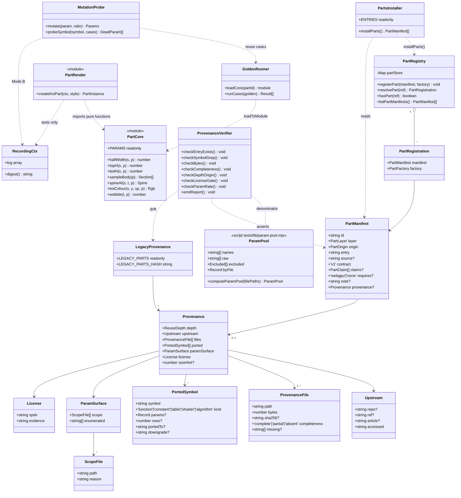
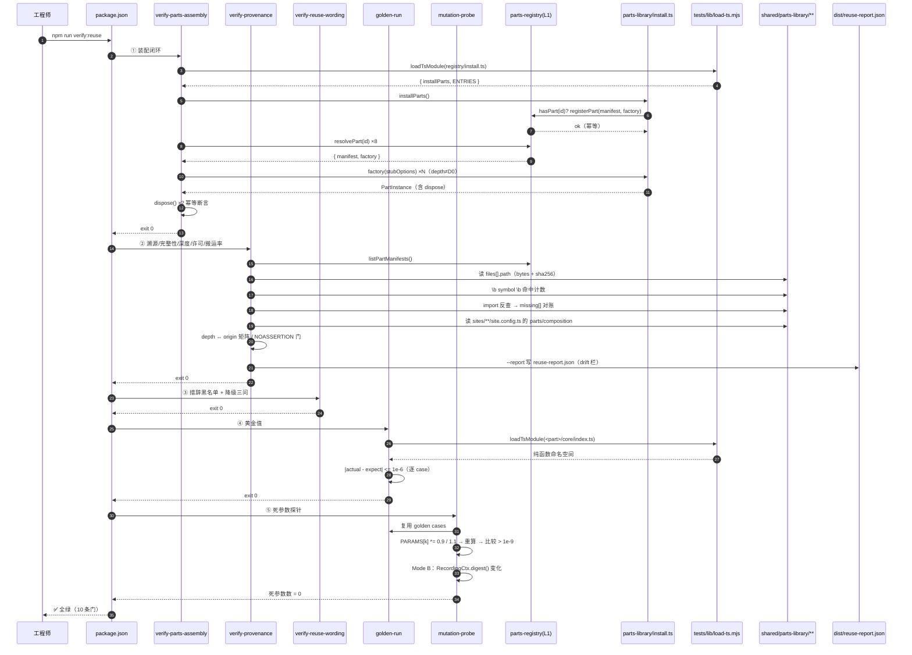
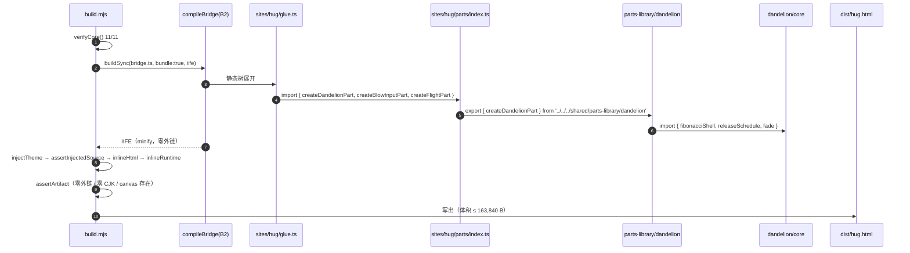
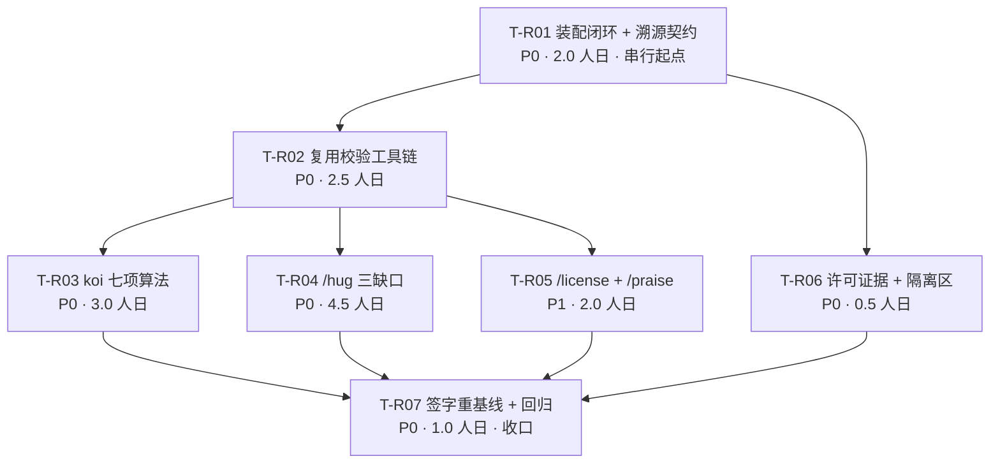

> ⛔ **本文档描述的是已推翻的 v1 复用体系**（D0–D4 深度分档 / 门 1–10 溯源门 / 许可四级普查 / 参数搬运率）。
> 当前权威文档：[`docs/HANDOFF.md`](./HANDOFF.md)。
>
> **为什么留在原位而不归档**：`shared/parts-library/*/part.manifest.ts`、`shared/contract/parts-registry.ts`、
> `tests/lib/*.mjs` 等 20+ 处注释按 §章节号引用本文；移动或删除会让这些引用全部悬空。
> 查阅遗留零件的溯源依据时仍需它 —— 但**产品方向与施工顺序以 HANDOFF 为准**。

> 文中提到的 `ARCHITECTURE-NEXUS.md` / `PRD-REFINE.md` / `TEAM-SOP.md` / `system_design.md` 已于 2026-11-18 移入 `docs/archive/2026-11-pre-pivot/`，本文内对它们的引用路径已失效，请按归档路径查找。

# ARCHITECTURE-REUSE · 零件复用专项架构设计 + 任务分解

> 版本 **v1.7-reuse** ｜ 2026-11-18 ｜ 架构师：高见远（Gao）
> 上游依据：`PRD-REUSE.md` v1.0-reuse（769 行，唯一需求依据）、`docs/PRD-REFINE.md` v2.1、`docs/ARCHITECTURE-NEXUS.md` v2.1
> 下游：工程师（T-R01..T-R07）→ QA（`verify:reuse` 全绿 + 全站回归）
> 同目录附带独立图文件：`class-diagram-reuse.mermaid`、`sequence-diagram-reuse.mermaid`（与正文 §9 一致）
> 本文只做设计与任务分解，不写实现代码。**不推翻 v2.1 任何裁决；不擅自裁决主理人未裁决项（见 §14）**。
> **修订轨迹**：v1.0 初稿 → v1.1 引入 AST 口径（N1–N4 / E1–E5）与 depth 分档门、分母改由脚本机械复算（§14.0 / §14.0b）→ **v1.2 E1–E7 全开 + 主门让位给门 9（算法覆盖门）+ depth pin 立即生效 + 分母冻结**（§14.0c / §14.0d），**v1.2b 计数改到行 + 假设值打标 + `wired` 铁律**（§14.0e），**v1.3 补 §7.5 dandelion D1–D10 与 §7.6 blow-input B0–B7 两张算法落点表（门 9 的清单来源扩为三处）**（§14.0f），**v1.4 `room-at-dawn` 收口为「合法 `D0` + 目标态 `D1`」、门 2 的「被引用」判定改为三条件 AND 且死引用独立报红、`ctx.store.partFactories` 恒 `undefined` 记入 `QUARANTINE.md` 待办（Q-01）**（§14.0g），**v1.5 落点列改函数名不写行号 + D10 定性为「检出力 0」+ B0 标 `⚠️ 需补进 ported[]` + 死引用重算（当时记「现状 11 / T-R03/T-R05 后 5」，**v1.6 订正为 10 / 5**）+ `QUARANTINE.md` 落盘**（§14.0h），**v1.6 新增 Q-02「零件实例化层在产线上从未执行」（四步链条含 build 入口与 `installParts()` 两条断点）+ 死引用拆 `FALSE`/`UNWIRED` 两码并订正现状为 10 条 + §0 F1/F2 过期事实订正 + §7.4 行号收尾**（§14.0i），**v1.7 Q-01 落「删除」（T-R05 前）+ Q-02 两选项代价补足并留待裁 + 两码互斥与「`D0` 被引用只认 `FALSE`」写死 + NEXUS 文件头加一行提示（正文零改动）**（§14.0j）。
> **本文件是唯一正文源**；`deliverables/` 下的同名文件是**快照，不再同步**（主理人 2026-11-18 裁决）。

---

## 0. 事实基线（我独立复核，不转引 PM 结论）

### 0.1 七条硬事实（逐条可复现）

| # | 事实 | 我的复核命令 / 证据 | 对设计的影响 |
|---|---|---|---|
| **F1** | **原复核：8/8 `part.manifest.ts` 的 `entry` 指向不存在的文件** → **现行（2026-11-18 复跑）：11 份里 10 份已存在，仅 `paper-plane` 仍缺**（T-R01/T-R02 已消解此项，`paper-plane` 待 T-R04） | `for p in {ascii-kit,crimson-loong,grand-atelier,koi,micro-scenes,rain-webgpu,room-at-dawn,sylva,dandelion,blow-input,paper-plane}; do test -f shared/parts-library/$p/index.ts; done` → 前 10 个 `OK`、`paper-plane` `MISS` | 「文件不存在」这层已闭环。**但"文件存在"≠"被实例化"**——现行产线上没有任何一处实例化它们，见 F2 与 **Q-02** |
| **F2** | **原复核：`registerPart()` 全仓 0 调用点** → **现行：`registerPart()` 有 1 处（`shared/parts-library/registry/install.ts:136`，由 `installParts()` 调用），而 `installParts()` 零生产调用点**——只有 `tests/verify-parts-assembly.mjs` 调它 | `grep -rn "installParts" sites/ shared/ tests/` → 生产侧（`sites/**`、各站 `bridge.ts`）**0 命中**；命中全在 `registry/install.ts` 自身与 tests | 注册表在产线上**恒空** ⇒ `resolvePart()` 抛「未注册」⇒ **即便填了 `composition` 也会降级 static**（Q-02 第 4 步）。**病名已从 `registerPart` 改到 `installParts`**——否则下一个人 grep `registerPart` 会找到那 1 处调用点、以为已经修好 |
| **F3** | 磁盘 8 个零件目录 / 8 份声明 / `registry/index.ts` 聚合 8 份 | `ls shared/parts-library/` | README 宣称 12 类（`dandelion` `paper-plane` `blow-input` `verdant-forest` 四目录不存在） |
| **F4** | 全库 0 个 LICENSE / COPYING | `find shared/parts-library -iname '*licen*' -o -iname 'COPYING*'` → 空 | REUSE-7 上线首日会判 7/10 零件 `NOASSERTION`（见 §3.4 —— 这是本专项最大的死锁点） |
| **F5** | `room-at-dawn` 1 文件 / 原件 7+ 模块；`grand-atelier` 3 文件 / 原件 9 模块 | `room-at-dawn/main.js` import 6 个本地模块全部未归集；`piano-action.ts` import 4 个同级模块全部未归集 | REUSE-3 的 `partial` + `missing[]` 有真实数据可填 |
| **F6** | koi 原件 12 个符号在 `koi/koi.js` 中 `grep -ow` **全部命中** | `halfWidth=3, topH=3, botH=2, close=4, S_END=4, bodyGeometry=2, frame=4, koiColour=3, fbm3=4, VARIETIES=2, RESIDENTS=1, wobble=5` | REUSE-1 的「符号必须可 grep」有机械可行性 |
| **F7** | **`/hug` 的 2D 零件画在 `#stage`（卡片内嵌画布），不是全屏叠层** | `sites/hug/override/template.html` 的 `#stage` 规则：`#stage{width:min(32em,86vw);height:min(12em,26vh)}`；全屏是 `canvas#c`（raymarcher）；`sites/hug/glue.ts` 逐帧段的顺序为 `dandelion.update → flight.update` | **C2 的焦点冲突不存在**（详见 §7.4） |

### 0.2 v2.1 与本专项的真实约束冲突（必须先看清，再谈设计）

`ARCHITECTURE-NEXUS.md` §4.6「明确冻结 / 零改动清单」写的是**无例外条款**：

| §4.6 原文冻结项 | 本专项 P0 是否必须碰 | 结论 |
|---|---|---|
| `sites/{still,license,praise,hug}/**` 零新增零改动 | **是**（P0-R5/R6/R7 改 `/hug`；P0-R8 改 `/praise`；P1-R1/R2 改 `/license`） | **物理冲突** |
| `sites/koi/{pond,ink,watercolor}/**` 零新增零改动 | **是**（P0-R4 七项算法必须进三条路由的产物） | **物理冲突** |
| `tests/baseline-dist.sha256` 零改动 | **是**（产物字节变了，哈希必然变） | **物理冲突** |

> **架构师判断（不粉饰）**：`git diff -- sites/hug sites/koi …` 恒为空 与 「koi 变 D3、`/hug` 装三个缺口零件」在**同一仓库里不可能同时成立**——产物字节是源码的纯函数 `f()`，源码零改动则产物零改动，则算法不可能进产物。
>
> PRD-REUSE §7.2 **C5 只对 koi 授权了重基线**，未覆盖 `hug / license / praise`。因此原设计**不能**自行宣告「7 站零改动成立」，只能给出一条**足迹可数、可签字、可机械验证**的最小改道（§1.3 + §14.1-CF-1）。
> **✅ 2026-11-18 主理人已批准该最小足迹改道**（4 个文件 + 零新增 + 签字台账 + `still` 永久零改动正对照）；同时批准 CF-5 四级许可证据与 CF-6 折纸双角色方案。施工以 §14.1 为准。

### 0.3 体积累账（实测，非估计）

| 站 | dist 实测 B | 门 163,840 − 实测 = 余量 |
|---|---|---|
| still.html | 107,773 | 56,067 |
| license.html | 112,590 | 51,250 |
| praise.html | 112,270 | 51,570 |
| hug.html | 111,961 | **51,879** |
| koi-pond.html | 107,851 | 55,989 |
| koi-ink.html | 107,849 | 55,991 |
| koi-watercolor.html | 107,882 | 55,958 |

---

## 1. 实现方案总览

### 1.1 一句话结论

> **复用不能靠"要求工程师更努力"，只能靠"把 `entry` 接上电、把 `provenance` 变成会失败的断言"。**
> 本设计的三个支点是：① **装配闭环**（P0-R0，让 `resolvePart()` 真能返回实例）；② **算法核/渲染壳分离**（让死参数探针能在 Node 里跑，无需浏览器）；③ **最小足迹改道 + 签字重基线**（让 legacy 改动从"偷偷改"变成"逐站逐文件签字"）。

### 1.2 三个系统级设计决策

| # | 决策 | 理由 | 被否决的方案 |
|---|---|---|---|
| **AD-1** | **算法核（`core/`）与渲染壳（`render/`）强制分离**：`core/*.ts` 纯函数 + 显式 `PARAMS` 注入，零 DOM / 零 canvas / 零 import 三方库 | REUSE-4/5（黄金值 + 死参数探针）必须能在 Node 里执行。仓库既有 `tests/lib/load-ts.mjs` 的 `loadTsModule()` 用 esbuild data-URL 装载 TS，**零新增依赖**即可跑纯核 | ① 用 node-canvas / skia 真像素渲染 → **新增依赖**，违反"依赖尽量为零"；② 只做静态 grep 证明"参数有出现" → 杀不死空壳（`const X=1.8` 出现一次但没接线也能过） |
| **AD-2** | **装配入口用「单点 install 聚合器」而非「改 registry/index.ts 去 import entry」** | 避免 `registry/index.ts ↔ entry ↔ part.manifest.ts` 循环依赖；`registry/index.ts` 保持"只聚合声明"的现状语义不变（零风险） | 直接让 `registry/index.ts` import 8 个 entry：会导致 `entry → manifest → registry/index → entry` 循环，且把"声明聚合"与"工厂装配"两个职责耦合 |
| **AD-3** | **legacy 改动走「薄适配文件」而非「新增文件」**：`sites/*/parts/index.ts` 从"149 行实现"改成"3–5 行 re-export"，函数名与签名逐字保留 | glue 的 import 名单不可动（`sites/{hug,license,praise}/glue.ts` **都在文件顶部按名导入**）。保住签名 = 保住 glue = 把 legacy 足迹压到 **4 个文件** | ① 在 legacy 目录**新增** `parts-v2/`：违反"零新增"，且 glue 仍指向旧实现（白干）；② 改 glue：足迹从 4 文件涨到 7 文件，风险翻倍 |

### 1.3 最小足迹改道（本专项唯一触碰 legacy 的地方，共 4 个文件 —— **已获主理人批准，见 §14.1-CF-1**）

| 文件 | 改法 | 改动行数【估计】 | 为什么必须改 |
|---|---|---|---|
| `sites/koi/shared/koi.ts` | 78 行实现 → 4 行 re-export（`createKoiPart` 签名不变） | −74 / +4 | 三条 koi 路由的产物要装 K1–K7 算法，唯一注入点 |
| `sites/hug/parts/index.ts` | 149 行三实现 → 3 个 re-export（`createDandelionPart` / `createBlowInputPart` / `createFlightPart`） | −149 / +6 | 蒲公英 + 吹气 + 折纸飞机三个缺口都装在这一站 |
| `sites/license/parts/index.ts` | 125 行四实现 → 4 个 re-export | −125 / +8 | atelier 击弦机 / loong 时间轴要进产物 |
| `sites/praise/parts/index.ts` | 93 行四实现 → 4 个 re-export | −93 / +8 | sylva 隔离后 `/praise` 拨纸层改自研（S3）必须显式声明 |

**零新增**：4 个 legacy 目录内**不新增任何文件**（算法全部落在 `shared/parts-library/`）。
**零改动**：`sites/still/**` 一字不动 → `still.html` 是唯一保持逐字节不变的站，作为"机制没有误伤全局"的正对照。
**零改动**：全部 `site.config.ts`、`override/template.html`、`glue.ts`、`index.ts`、`bridge.ts`、`state.ts`、`export.ts` 不动。

---

## 2. P0-R0 · 零件装配修复方案（前置，先修通）

### 2.1 故障精确定位

```
现状链路（断在最后一跳）：
  PartManifest.entry ──(只是字符串)──> ✗ 文件不存在
  registerPart(manifest, factory) ──(0 调用点)──> partStore 永远为空
  Composer.init() → resolvePart(ref) → throw「未注册的零件 ref」
  mountSite() → composer.validate() 报 unregistered-ref → markDegraded('conflict')
```
**结论：不是"零件没被用"，是"零件从来没有可被用的形态"。** README 里 12 行索引描述的是一个不存在于运行时的库。

### 2.2 修复三段式（全部只增，不碰 core / 不碰 legacy）

#### ① 每个零件有真实 entry：`shared/parts-library/<id>/index.ts`（8 个新文件）

统一形状（以 koi 为例）：

```ts
// shared/parts-library/koi/index.ts  —— 零件装配壳（契约 v1）
import manifest from './part.manifest';
import type { PartInstance, PartOptions } from '../../contract/parts-registry';
import { createKoiPart as createKoiPartImpl } from './render/koi';
import type { KoiStyle } from './core/style-params';

export { manifest };

/**
 * 契约 v1 工厂。**构造期不得触碰 DOM / canvas**（只允许登记引用与常量），
 * 首次 update() 才允许使用 ctx —— 这条约束使 tests/verify-parts-assembly.mjs
 * 能在 Node 里真实构造 + dispose，不需要浏览器。
 */
export function createPart(o: PartOptions): PartInstance {
  const ctx = (o.options.ctx ?? o.options.canvas) as CanvasRenderingContext2D | undefined;
  if (!ctx) throw new Error('[koi] createPart 需要 options.ctx（CanvasRenderingContext2D）');
  const style = (o.options.style ?? 'pond') as KoiStyle;
  return createKoiPartImpl(ctx, style);
}

export default createPart;
```

`D0` 零件（`micro-scenes` / `rain-webgpu` / `sylva`）的 entry **不提供可用绘制**，显式抛具名错误：

```ts
export function createPart(): never {
  throw new Error('[E_PART_NOT_MOUNTED] micro-scenes 为 D0 未装站零件，禁止被站点引用');
}
```

> 这一点是刻意设计：`E_PART_NOT_MOUNTED` 是**可断言的错误码**。装配校验对 D0 零件只断言"抛的就是这个码"——把"未装站"从"undefined 崩溃"变成"显式事实"。

#### ② 单点装配聚合器：`shared/parts-library/registry/install.ts`（1 个新文件）

```ts
import { hasPart, registerPart, listPartManifests, type PartManifest } from '../../contract/parts-registry';
import * as asciiKit from '../ascii-kit';
import * as crimsonLoong from '../crimson-loong';
/* … 8 个命名空间 import … */

const ENTRIES = [asciiKit, crimsonLoong, grandAtelier, koi, microScenes, rainWebgpu, roomAtDawn, sylva] as const;

/** 幂等装配：重复调用不重复注册（hasPart 守卫），返回最终声明列表。 */
export function installParts(): readonly PartManifest[] {
  for (const e of ENTRIES) {
    if (!hasPart(e.manifest.id)) registerPart(e.manifest, e.createPart);
  }
  return listPartManifests();
}
export { ENTRIES };
```

**为什么不是改 `registry/index.ts`**：`install.ts` 单向依赖 `contract/parts-registry.ts` + 各 entry，entry 只依赖自己的 `part.manifest.ts`，无环。`registry/index.ts`（声明聚合）保持现状零改动。

#### ③ 装配校验：`tests/verify-parts-assembly.mjs` + `tests/lib/stub-parts.mjs`

两级断言（这是 F1/F2 的唯一防线）：

| 级别 | 适用范围 | 断言 |
|---|---|---|
| **Tier-1 形状** | 全部 8 份 manifest | ① `manifest.entry` 指向的文件**在磁盘上存在**；② 该模块 `export default` 是函数；③ 导出 `manifest` 且 `deepEqual(module.manifest.id, registry 里的 id)`（防 entry 挂了别人的声明） |
| **Tier-2 可构造** | `provenance.depth !== 'D0'` 的零件 | ① `installParts()` 后 `resolvePart(id)` 返回 `{manifest, factory}`；② 用 stub `PartOptions`（stub bus/store/capability + 录制型 ctx）真实调 `factory()`，返回对象含 `dispose` 函数；③ 调 `dispose()` 不抛；④ 再调一次 `dispose()` 不抛（幂等） |
| **Tier-D0** | `depth === 'D0'` 的零件 | 调 `factory()` 必须抛 `E_PART_NOT_MOUNTED`（不是 TypeError） |

**禁用真实 canvas 的理由**：`tests/lib/stub-parts.mjs` 提供 `createRecordingCtx(w,h)`（见 §4.3），把 Canvas2D 调用录成指令数组。构造一个 D3 零件不是"画图"，是"登记"，所以录到的指令数应为 0 —— 顺带把 `AD-1` 的「构造期零 DOM」变成可断言事实。

### 2.3 为什么这套修复不破坏 core 与 7 站零改动

| 风险面 | 论证 |
|---|---|
| `shared/core/` 11 文件 | 新增文件全部在 `shared/parts-library/**` 与 `tests/**`；`verify:core` 的 `collectFiles(coreDir)` 只看 `shared/core/` → **仍 11/11 绿** |
| legacy 7 站产物字节 | `install.ts` 与 8 个 `index.ts` **不被任何 legacy `bridge.ts` 依赖树可达**（legacy 直接 `import './parts/index'`，不经 registry）→ `compileBridge` 静态树不变 → `/*RUNTIME*/` 段字节不变 → **dist 全部哈希不变**（T-R01 完成时即可验证） |
| `tsc --noEmit` | 需 1 处受控演进：`tsconfig.json` 的 `include` 追加 5 行（`shared/parts-library/*/index.ts`、`*/core/**/*.ts`、`*/render/**/*.ts`、`registry/install.ts`、`legacy-provenance.ts`）。否则新代码不在类型检查范围内 —— 这会让"移植代码"成为类型检查的盲区，是本专项最危险的隐性退化 |

---

## 3. provenance 契约落地

### 3.1 类型定义（`shared/contract/parts-registry.ts`，**纯追加**）

```ts
/** 复用深度（PRD-REUSE §1.3）。 */
export type ReuseDepth = 'D0' | 'D1' | 'D2' | 'D3' | 'D4';

/** 单个原件的完整性。 */
export interface ProvenanceFile {
  path: string;                    // 相对 shared/parts-library/
  bytes: number;                   // 必须与磁盘一致
  sha256?: string;                 // 建议填；填了就断言
  completeness: 'complete' | 'partial' | 'absent';
  missing?: readonly string[];     // partial 必填
}

/** 一个被移植的原件符号。 */
export interface PortedSymbol {
  symbol: string;                  // 必须能在 ProvenanceFile.path 中 \b 命中
  kind: 'function' | 'constant' | 'table' | 'shader' | 'algorithm';
  /** 已接线且影响输出的数值参数；键名 = 原件参数名。未接线的**不得**写在这里 */
  params?: Readonly<Record<string, number | string | readonly number[]>>;
  /** 原件参数面的分母（见 §3.3 搬运率） */
  rows?: number;                   // kind='table' 时填（行数算作参数单元）
  portedTo?: string;               // 'shared/parts-library/koi/core/profile.ts:halfWidth'
  downgrade?: string;              // 降级三问（REUSE-6）
}

/** 复用溯源（REUSE-1）。站点引用的零件必填。 */
export interface Provenance {
  depth: ReuseDepth;
  upstream: {
    repo?: string;
    ref?: string;
    article?: string;              // 公众号文章 id（无仓库时唯一依据）
    accessed: string;              // 'YYYY-MM-DD'
  };
  files: readonly ProvenanceFile[];
  ported: readonly PortedSymbol[];
  /**
   * 原件参数面（搬运率的分母**不由人填**，由脚本按 §3.3 的 AST 口径计算）。
   * 这里只声明「移植面」与「我方实际接线的参数名」。
   * ⚠️ v1.1 变更（2026-11-18 主理人裁决）：删除人工填写的 `total`。
   */
  paramSurface: {
    /** 移植面：files[] 的子集，逐文件给出纳入理由（决定分母的边界）。 */
    scope: readonly { path: string; reason: string }[];
    /** 我方实际接线的参数名（= 所有 ported[].params 键的并集，脚本断言二者相等）。 */
    enumerated: readonly string[];
  };
  license: { spdx: string; evidence: string };
  sizeHint?: number;               // 进产物字节增量估计
}

// PartManifest 追加一个可选字段（不改任何既有字段、不改 registerPart 逻辑）
provenance?: Provenance;
```

**与 PRD 的两处差异（必须写明，不能默默改）**：

| 差异 | PRD-REUSE | 本设计 | 理由 |
|---|---|---|---|
| `paramSurface` | 无此字段（搬运率分母隐含） | **新增**，且**只声明 scope 与 enumerated，不声明分母** | 分母若由人填，就会出现"把 `total` 填成 `enumerated.length`、搬运率恒 100%"的自证循环（本专项已实际发生，见 §3.3 事故记录）。分母必须由脚本算 |
| `PortedSymbol.rows` | 无 | **新增** | `kind:'table'`（`VARIETIES` 12 行、`RESIDENTS` 14 条）的"参数单元"如何计入搬运率必须有明确口径，否则表格类符号永远 0 分子 |

### 3.2 depth ↔ origin 一致性矩阵（REUSE-2，硬门）

| depth | 允许 origin | 禁止的 note 措辞（黑名单） |
|---|---|---|
| `D4` | `copy` | — |
| `D3` | `port` | 「真实复制原件」「逐字节一致」 |
| `D2` `D1` | `equivalent` | 「真实复制原件」「移植」「port」 |
| `D0` | `equivalent` | 「真实复制原件」+ **不得被任何站点引用** |

### 3.3 参数搬运率口径（REUSE-4）· v1.2（E1–E7 全开 + 主门让位）

> # ⚠️ 主门变更声明（主理人 2026-11-18 裁决，@anchor `主门变更`）
>
> ## 参数搬运率（REUSE-4）从本节起不再承担主门职责。主门是 §4.6 的「门 9 · 算法覆盖门」。
>
> **一句话结论（本轮最重要的设计判断）**：
> **搬运率对「圈得越小越有利」天然可被操纵，所以主门必须是结构性的算法覆盖。**
>
> 展开：搬运率衡量的是**"你圈进移植面的参数里，接了多少"**——分子分母都在被考核方手里：分母是我方圈定的 scope，分子是我方声明的 `enumerated`。**它对"把范围圈小"天然有利**，因此可以被合法地操纵（v1.0 事故是极端形态：直接把分母填成分子）。E6/E7 启用后分母又缩了一档（`koi` 的 `P_scope` 21→16），若没有对冲，就会退化成"用一把刻错的尺子换来更大的人为空间"。
>
> **对冲的结构性理由**：门 9 的清单来自 **§7.2 的原件符号表**——它由上游代码决定、由文档写死、由脚本解析，**既不由 manifest 提供，也不由 scope 圈定**。因此**它无法被"把分母圈小"影响**。这是"结构性"三个字的全部含义：不是更严，是**换了一个不可被操纵的量**。
>
> 所以：
> - **主门（门 9）**：`depth === 'D3'` 的零件，`ported[].symbol` 必须覆盖**该零件算法清单的 100%**，缺一项直接红，**不许用搬运率抵扣**，**不许"已在别处实现"豁免**。
> - **下限兜底（门 7b）**：`rate ≥ 60%`，位置从"主要指标"退为"防极端缩水的地板"。它的作用不再是证明复用做得好，而是**证明分母没有缩到无意义**（配合门 7c 的 `coverage ≥ 25%` 成对使用）。
> - **分母可复算（门 7a）**：`paramSurface.total` 字段永久删除，任何人填分母即红。
> - **分母冻结（§3.3.2）**：E1–E7 为终集，不再追加第 8 条规则——**加规则 = 改分母 = 改结论**。
>
> 一句话：**门 9 管"该搬的搬了没有"，门 7b 只管"分母没缩水"。** 前者不可抵扣，后者可被放弃而不影响结论——但两者都不得由被考核方自己填数。

#### 3.3.0 事故记录：v1.0 的口径为什么必须推翻

v1.0 把分母交给 manifest 里的 `paramSurface.total` 人工填写，并在 `evidence` 里让工程师写"怎么数出来的"。结果是 8 份 manifest **全部**把 `total` 填成 `enumerated.length`，搬运率恒等 100%：

| 零件 | v1.0 自报 total | 脚本实测全件池（AST 口径） | 自报率 | 真实率 |
|---|---|---|---|---|
| ascii-kit | 23 | 6（另 11 项为导出符号，非参数） | 100% | 口径错配，见 §3.3.5 |
| crimson-loong | 1 | 96 | 100% | **1.0%** |
| grand-atelier | 2 | 64 | 100% | **3.1%** |
| koi | 3 | 78 | 100% | **3.8%** |
| rain-webgpu | 4 | 60 | 100% | **6.7%** |
| room-at-dawn | 3 | 9 | 100% | **33.3%** |

更刺眼的是：工程师在自己的 `evidence` 里**如实写了"其余参数未接线"**，却在分母上把它抹掉了。这说明"人工分母"不是诚信问题，是**结构性问题**——只要分母由被考核方填写，指标必然失效。

> **v1.1 铁律：分母不得由 manifest 提供。`paramSurface.total` 字段删除，搬运率的所有输入必须可由一个纯 Node 脚本从磁盘内容复算出来。**

#### 3.3.1 为什么必须用 AST，而不是正则

同一份 `shared/parts-library/koi/koi.js`，四种数法给出四个互不相同的数：

| 数法 | 结果 | 失效原因 |
|---|---|---|
| 逐行正则（每行只取第一个匹配） | 7 | 压缩风格的单行长对象字面量（`VARIETIES` 一行含 13 个字段）只会计到 1 个 |
| 全文件正则（不按行切） | 35 | 无法区分"对象字段名"与"三元表达式/字符串内容" |
| 主理人的 grep 口径（全零件） | 61 | 同上，且无法排除局部变量 |
| **TypeScript AST（本设计采用，E1–E7 全开后）** | **16（scope=koi.js）/ 52（全件）** | 精确、与排版无关；E1–E5 已剔 `iu` `iv`（循环下标）等假阳性，E6/E7 再剔 22 个运行期状态 + 1 个库信封键 |

**正则口径不可复算，因此不能作为门的口径。** 采用 AST 的额外成本为零：`typescript` 已是既有 devDependency（`^5.5.0`），不新增任何依赖。

#### 3.3.2 「可调参数」的机械定义（写死，不得各件自创）

**参与文件**：`provenance.files[]` 中所有 `.js / .mjs / .ts` 文件（排除 `.d.ts`、`part.manifest.ts`、我方新增的 `index.ts / core/** / render/**`）。HTML 内联脚本**不计入**（`micro-scenes` / `sylva` 因此池为 0，见 §3.3.4）。

**抽取四类 AST 节点**，取标识符，全件去重（同名跨文件只计 1 次）：

| 记号 | AST 节点 | 例 |
|---|---|---|
| `N1` | `VariableDeclaration` 且初值 numeric-ish | `const MAXROLL = rad(5)` · `export const NSP = 16` |
| `N2` | `PropertyAssignment` 且初值 numeric-ish | `kohaku: { t1: 0.53, t2: 2, dorsal: 0.4 }` 三个都算 |
| `N3` | `PropertyDeclaration`（类字段）且初值 numeric-ish | `private fov = 55` |
| `N4` | `Parameter` 且默认值 numeric-ish | `function bodyGeometry(NS = 52, NT = 24)` |

**`numeric-ish` 的穷举定义（不许扩展）**：
1. `NumericLiteral`（含 `0x…`、`1e-3`）；
2. `PrefixUnaryExpression` 的 `+` / `−`，其操作数 numeric-ish；
3. `ParenthesizedExpression`，其表达式 numeric-ish；
4. `BinaryExpression`，**左右都是** numeric-ish（如 `0.5 * 1.2`）；
5. `PropertyAccessExpression`，对象文本为 `Math` 或 `THREE.MathUtils`（如 `Math.PI`）；
6. `CallExpression`，被调用者文本 ∈ `{rad, deg, clamp, Math.min, Math.max, Math.round, Math.floor, Math.ceil, Math.abs, Math.pow, Math.sqrt, Math.hypot}` **且全部实参 numeric-ish**。

**不计入**：字符串 / 布尔 / `null` / 数组字面量 / 颜色字符串（`'#f2eee4'`）/ 任何含自由标识符引用的表达式（如 `const X = Y * 2`，因为 `Y` 的类型不可静态判定）。

**五类去噪（每类必须有原因码，脚本输出 `excluded[]` 明细供复核）**：

| 码 | 规则 | 为什么排除 |
|---|---|---|
| `E1` | 数学常量白名单：`PI TAU E EPSILON LN2 LN10 SQRT2 SQRT1_2 TWO_PI HALF_PI DEG2RAD RAD2DEG` | 不是"可调"，改了会坏 |
| `E2` | 单字母标识符：`/^[A-Za-z]$/` | 循环变量 / 局部坐标（`x y z i j k s t`），不是参数 |
| `E3` | 颜色类键：`/^(colou?r\|c1\|c2\|base\|tint\|hue\|sat\|bg\|fin\|finroot\|water\|ink\|skin\|shade\|palette\|pal\|fg\|accent\|glow)$/i` | v2.1 R5 规定颜色必须来自 biome token，零件**不持有**颜色 → 它不在移植面内 |
| `E4` | 尺寸/运行时类键：`/^(resolution\|res\|width\|height\|size\|dpr\|pixelratio\|aspect\|scale\|viewport)$/i` | 是运行时量（canvas 尺寸、DPR），不是创作参数 |
| **`E5`** | **迭代变量**：`ForStatement` 的 `init`/`incrementor` 中声明的、`ForOfStatement`/`ForInStatement` 的 `initializer` 中声明的标识符 | **遍历下标（`for (let iv = 0; …)`），改它只会改变采样密度或越界，不是创作参数** |
| **`E6`** | **可变局部状态**：`let`/`var` 声明（可变），且同名标识符在文件内另有赋值 / 复合赋值 / `++` `--` | **运行期状态（`let ax = 0` 后 `ax += …`）不是常量语义，改它不只改参数、还会改状态机** |
| **`E7`** | **三方库信封键**：`value` `uniforms` `elements` `needsUpdate` | **`{ value: 0 }` 里的 `value` 是 THREE uniform 的信封键，不是参数名** |

**E5/E6/E7 的生效闸门（防止误伤同名真参数，措辞已按工程师实现收紧）**：以「**名字 + 文件**」分组；只有当该名字在本组内的**首个采集记录**命中可疑类别、**且同组内没有任何一条记录是"干净的真参数记录"**（如 `VARIETIES.*` 里的 `N2`）时才剔除。即：**同名标识符只要在原件里另有真实参数身份，就一律不剔。** 例：`const` 声明的 `maxB = 0.2` 属参数，E6 不会误伤它（E6 只认 `let`/`var` 且被改写过的）。

> **E1–E7 实测战果（`koi/koi.js`）**：E5 剔 `iu`、`iv`（`for (let iu = 0; …)` 的网格下标，L63/67）；E6 剔 `ax` `ay` `excite` `fd`（`let` 声明后被 `+=` / `=` 改写）；E7 剔 `value`（`uPitch: { value: 0 }` 的 THREE uniform 信封键）。**这是系统性假阳性，不是个例**——不修则池子对所有零件虚高。
> **E5/E6/E7 已获主理人核准启用**（理由不是"放宽尺度"，而是"原来那把尺子把刻度刻错了"：用刻错的尺子卡人，只会逼出把 `maxB`/`SHADOW` 这类主渲染参数硬塞进来凑数）。**启用后另加门 9（算法覆盖门）抵消分母放宽，且搬运率整体退为下限兜底**——见本节开头的「主门变更声明」与 §4.6。

##### E6 的已知盲区（@anchor `E6 盲区`，**接受，不再加规则**）

> **E6 的已知盲区**：`let x = 0.5` 紧跟 `x *= 0.5` 这种形状，AST 上无法区分「初值是算法参数、改写在算法里」与「纯运行期状态」。`amp` 在 fbm 里恰好是前者（起始振幅 0.5、每层衰减一半，**本应是参数**），`ax` 是后者（`let ax = 0` 后 `ax += …`，纯状态）。
> **处置：接受盲区，不再加规则。** 理由是 `ascii-kit` 为 D4（`rate` 记 `n/a`），误剔对任何门无影响；而再为单个名字加第 8 条规则，会把分母越切越碎——**分母每动一次，这个指标就再也当不了门**。

##### 口径冻结（@anchor `口径冻结`）· 硬裁决，写死在本文

> **【口径冻结 2026-11-18】`E1–E7` 为最终去噪集，不再追加任何规则。**
> **加规则 = 改分母 = 改结论。** 任何人（**含架构师与主理人**）提议第 8 条，必须经主理人**书面核准**，并说明它修的是「**数错的刻度**」还是「**让结论更好看**」。
> 具体到已讨论过的两个候选，结论是**不加**：
> - **`SHADOW`（`koi.js` 着色器宏）—— 留在分母**（`P_scope` 16 名之一），不因"它不是 2D 可调参数"而设 E8。理由同上：分母一动，门就废。它不进分子（`wired`）即可。
> - **`amp`（ascii-kit fbm 起始振幅）—— 接受被 E6 误剔**，见上「E6 的已知盲区」。
>
> **本专项此后不再就分母口径发起讨论。** 任何"某个参数算不算"的争议，一律回到本节：先看是否命中 E1–E7 已有规则，命中了就按规则走，没命中就留在分母里。

> **去噪是双向的**：被排除的名字也不能出现在 `params` 里（脚本对 `params` 同样跑 **E1–E7** 全套判定）。否则会一边排除分母、一边把同名的值算进分子。

#### 3.3.3 分母 = 移植面（scope）内的池，且覆盖度受硬约束

```
P_all     = AST(files[])                        // 全件池（E1–E7 去噪后）
P_scope   = AST(paramSurface.scope[].path)       // 移植面池（E1–E7 去噪后）
coverage  = |P_scope| / |P_all|
wired     = { ported[].params 的键 } ∩ P_scope
rate      = |wired| / |P_scope|                  // 门 7b：下限兜底
algoCov   = |ported[].symbol ∩ requiredAlgos| / |requiredAlgos|
                                                 // 门 9：主门，requiredAlgos 来自 §7.2，不可由 manifest 提供
requiredAlgos(koi) = {K1, K2, K3, K4, K5, K6, K7}
```

**为什么分母不是 `P_all`**：`files[]` 里存在**没有任何 2D 对应物**的模块（koi 的 `audio.js` 音频合成、`cdp.js` 调试协议、`main.js` 相机；rain-webgpu 的 `post.ts` 后处理；crimson-loong 的 95 个骨骼节点参数）。用 `P_all` 当分母，等于要求工程师把音频/相机/后处理的参数也"搬"进一个 2D 零件——不可能，且会逼出造假。

**但不能让 scope 变成任意缩水**，所以加**覆盖度下限**：

```
硬约束：coverage ≥ 0.25（25%）
```

- 低于 25% 直接红：说明 scope 被圈成了一个无关紧要的小文件。
- `reuse-report.json` 同时输出 `rateScoped`（上闸门）与 `rateWhole = |wired| / |P_all|`（**只报告，不上闸门**），任何人可以一眼看出"这个零件的复用面占原件的多少"。
- `scope[].reason` 必填且非空：每个被纳入的文件都要一句话说明"为什么它的参数应在 2D 移植面内"。

#### 3.3.4 零值语义（写死，防止 0/0 被算成 100%）

| 情形 | `rate` | 判定 |
|---|---|---|
| `ported.length === 0` 且 `depth ∈ {D3, D2}` | **0%** | **红**（D3/D2 要求 `ported.length ≥ 1`） |
| `P_scope === 0`（原件无 JS/TS，如三缺口只有文章、micro-scenes 只有 HTML） | **n/a** | 不走本指标，走 §3.3.6 的「文章锚定」替代门 |
| `depth ∈ {D4, D1, D0}` | **n/a** | 本指标不适用，走 §3.3.5 的分档门 |

> **"没移植任何函数却拿 100%" 这种形态从此不可能出现**：`ported.length === 0` 时 `wired` 必为空集，`rate` 恒为 0；即便有人把 depth 谎报成 D1 来逃门，D1 也有自己的门（§3.3.5）。

#### 3.3.5 按 depth 分档：搬运率到底在衡量什么（回答"文不对题"）

| depth | 搬运率适用？ | 该用哪个门 | 理由 |
|---|---|---|---|
| **D4** | ❌ `n/a` | 原件 `sha256` 逐字节一致 + 经 B2 可 bundle（`verify-esm-parts`）；**参数一个都不需要"搬"，它们原样就在产物里** | ascii-kit 的 23 个是**导出符号**（常量/函数/类），不是参数；用参数搬运率衡量 D4 是量纲错误 |
| **D3** | ✅ 适用 | `rate ≥ 60%` **且** `coverage ≥ 25%` **且** 死参数探针 = 0 **且** 黄金值 100% | 声称移植了算法，就必须把该算法的可调面真正接线 |
| **D2** | ✅ 适用 | 同上，且 `ported[].kind` 必须全为 `constant` | 只搬参数值 |
| **D1** | ❌ `n/a` | **前提：`depth` 必须与 pin 一致（门 2），否则本行不成立**。之后：**必须显式登记为低复用件**：`ported.length === 0` + `downgrade` 三问齐全 + 出现在 `reuse-report.lowReuse[]` + 若该件装站则必须在 `QUARANTINE.md`「低复用区」逐条可见 | D1 的定义就是"只沿用观感/常量，行为由我方重新实现"——**没有算法被移植，就没有"参数搬运率"这个东西**。用 D3 的尺子量 D1，只会逼出把 depth 谎报成 D3。**但"记 `n/a`"只对"真的只借观感"的件成立，不能用来逃避未完成的移植** |
| **D0** | ❌ `n/a` | `entry` 抛 `E_PART_NOT_MOUNTED` + 不被任何站点引用（**"被引用"的判定见下方三条件 AND**） | 未装站 |

###### `D0` 的「被引用」是一次可执行性证明，不是 grep 字符串（@anchor `D0 死引用`）

> 主理人 2026-11-18 裁决二。**这是门 2 的一个真实设计漏洞，必须写进定义里，不能留在实现细节里。**

**漏洞是什么**：v1.3 之前，门 2 对 `D0` 只做一件事——在 `sites/*/site.config.ts` 里 grep `source: '<id>'` 这个**字符串**。命中 ⇒ 判「被引用 ⇒ 门 2 红」；零命中 ⇒ 判「合法 `D0`」。
**它只看配置写了什么，完全不看那行配置会不会被执行。** 于是同一个信号既可能冤枉一个合法 `D0`，也可能给一个真被使用的零件背书——两种错都源于"把声明当事实"，与本专项要修的病同源。

**新判定 = 三条件 AND**（缺任一条 ⇒ 该 ref **不算引用**）：

| # | 条件 | 判据 | 落点 |
|---|---|---|---|
| **1** | `enabled === true` | 该 `parts[]` 项的 `enabled` 字段 | `sites/*/site.config.ts` |
| **2** | `ref.id` **不在该站 glue 的 skip 名单内** | `glue.ts` 里那句 `if (… includes(ref.id)) continue;` 的字面量数组 | `sites/license/glue.ts:51`、`sites/praise/glue.ts:48`、`sites/hug/glue.ts:46` |
| **3** | **工厂可取得** | `ctx.store.partFactories?.get(ref.source)` 求值不为 `undefined` | `shared/contract/runtime.ts:57` + 各站 `glue.ts` |

条件 2、3 不是形式主义——**它们正是"这行配置会不会真的生效"的唯一证据**。

> **⚠️ 落地时必须收紧一步：`E_SITE_REF_DEAD` 不能直接由上面三条条件取反生成（@anchor `死引用判定收紧`）**
>
> 我逐条核过三站的 `parts[]`：**全部 11 条**都落在各自的 skip 名单里——`hug` 3/3（`dandelion`/`blow`/`flight`）、`license` 4/4（`paper`/`timeline`/`stamp`/`plane`）、`praise` 4/4（`receipt-paper`/`layers`/`pointer`/`typewriter`）。
>
> **原因**：一个 `ref` 有**两条**挂载路径，skip 名单只说明"不走通用路径"，不说明"没被满足"：
>
> | 路径 | 机制 | 满足条件 |
> |---|---|---|
> | **A · 通用路径** | `for (const ref of config.parts)` → `ctx.store.partFactories.get(ref.source)` → `factory(c)` | 工厂可取得（条件 3）。**现状：`ctx.store.partFactories` 恒 `undefined` ⇒ 此路径对所有站永久失效（Q-01）** |
> | **B · 直接实例化路径** | `glue.ts` 里 `this.parts = { paper: createPaperPart(c), … }` 的**槽位**，按 `ref.id` 命中 | `this.parts[ref.id]` 存在，**且该槽位就是 `manifest.entry` 那个零件工厂的实例化**（不是"站点自己照着文档重写了一个等效实现"） |
>
> **B 的条件为什么必须写成「`manifest.entry` 的实例化」（主理人 2026-11-18 裁定，已纠正我的初版）**：
> 我最初把 B 写成"槽位实现与 `source` 相符"，结果只数出 **2 条**（`license.paper` / `praise.receipt-paper`）——**漏了 `hug` 的那条**：`sites/hug/site.config.ts:30` `{ id:'flight', source:'paper-plane' }` 的槽位是 `sites/hug/parts/index.ts:24` 的 `createFlightPart`，文件注释原文写着「**纸飞机不属于本轮移植范围，仍留在本文件**」。它与 `paper` / `receipt-paper` **是同一类**：`source` 写着上游零件，槽位跑的是本站本地实现。
> **「照着文档描述重写一个等效实现」不等于「装上了那个零件」**：前者是我们自己写的代码，`source` 只证明"读过原文"；后者才是 `provenance` 要声明的东西。二者的区别正是整个专项要守住的区别。

**逐条枚举（11 条 `parts[]` 项，其中 10 条是死引用；可复算）**：

| 站 | `ref.id` | `source` | B 槽位 | 原因码 | T-R03/T-R05 后 |
|---|---|---|---|---|---|
| `hug` | `dandelion` | `dandelion` | `sites/hug/parts/dandelion.ts: createDandelionPart`（**直接 import `core/meadow.ts`**） | **`E_SITE_REF_UNWIRED`** | **仍红** |
| `hug` | `blow` | `blow-input` | `sites/hug/parts/blow-input.ts: createBlowInputPart`（**直接 import `core/detector.ts`**） | **`E_SITE_REF_UNWIRED`** | **仍红** |
| `hug` | `flight` | `paper-plane` | `sites/hug/parts/index.ts: createFlightPart`（注释自述「不属于本轮移植范围」） | **`E_SITE_REF_UNWIRED`**（算法没搬，但也不是假声明——`paper-plane` 是本轮 D3 义务件，属"还没接上"） | **仍红** |
| `license` | `paper` | `room-at-dawn` | `sites/license/parts/index.ts: createPaperPart`（自写 2D 噪声纸纹） | **`E_SITE_REF_FALSE`** | **仍红**（改配置才消解） |
| `license` | `timeline` | `crimson-loong` | 同上文件 `createTimelinePart`（现为本地实现） | **`E_SITE_REF_UNWIRED`** | 转绿（CF-1 改为 re-export 库件） |
| `license` | `stamp` | `grand-atelier` | 同上文件 `createStampPart`（现为本地实现） | **`E_SITE_REF_UNWIRED`** | 转绿 |
| `license` | `plane` | `paper-plane` | 同上文件 `createPlanePart`（现为本地实现） | **`E_SITE_REF_UNWIRED`** | 转绿 |
| `praise` | `receipt-paper` | `room-at-dawn` | `sites/praise/parts/index.ts: createReceiptPaperPart`（自写热敏纸纹） | **`E_SITE_REF_FALSE`** | **仍红**（改配置才消解） |
| `praise` | `layers` | `paper-plane` | 同上文件 `createLayersPart`（现为本地实现） | **`E_SITE_REF_UNWIRED`** | 转绿 |
| `praise` | `pointer` | `sylva` | 同上文件 `createPointerPart`（现为本地实现） | **`E_SITE_REF_UNWIRED`** | 转绿 |
| `praise` | `typewriter` | `local-template` | 同上文件 `createTypewriterPart`（注释自述「**自研 glue，非复制零件**」） | **不计** | 不计 |

> **⚠️ 必须拆成两个原因码（主理人 2026-11-18 裁）——一个码报出来会让人以为 10 条是一种病、一种修法**
>
> | `code` | 含义 | 修法 | 现状 | T-R03/T-R05 后 |
> |---|---|---|---|---|
> | **`E_SITE_REF_FALSE`** | **假声明**：`source` 声称的零件与槽位实现**根本无关** | **改 `site.config.ts`** —— 配置问题 | **2**（`license.paper` / `praise.receipt-paper`） | **2**（不随改写消解） |
> | **`E_SITE_REF_UNWIRED`** | **未接线**：`source` 的算法**真的在用**，但 `manifest.entry` 没被实例化 | **接通底座** —— 架构问题，**属 Q-02** | **8**（`hug` 3 + `license` 3 + `praise` 2） | **3**（`hug` 3 条） |
>
> **混在一个码里的后果**：读者会以为"改配置就能修好全部"——而其中 8 条改配置根本修不掉，它们是 **Q-02 的可视化**（`mountSite()` 不在任何站的产物里，`manifest.entry` 从来没有调用方）。
>
> **⚠️ 两码互斥，一个 `ref` 只命中一个码，不许重复计数**：**`合计 = FALSE + UNWIRED`**（现状 2 + 8 = 10；T-R03/T-R05 后 2 + 3 = 5）。**`license.paper` / `praise.receipt-paper` 已算在 `FALSE` 里，不得再算进 `UNWIRED`**——这是最容易犯的一次重复计数（我在第九轮就犯过，把总数报成 11）。

**两个数字，必须分开记（这是最容易搞错的地方；我在第八轮曾把 11 当成现状，是错的——多算了 `typewriter`）**：

| 时点 | 预期 `deadRefs` | `FALSE` | `UNWIRED` |
|---|---|---|---|
| **现状**（CF-1 的 re-export 改写尚未执行，`license/parts/index.ts` 仍 125 行、`praise/parts/index.ts` 仍 93 行） | **10** | **2** | **8** |
| **T-R03 / T-R05 完成后**（`license` 125→8、`praise` 93→8 改为 re-export 库件） | **5** | **2** | **3** |

> **`praise.typewriter` 为什么不计**：它的 `source` 是 `'local-template'`，**不是任何一个零件的 id**，而且代码注释明写「自研 glue，非复制零件」——它**没有对任何上游零件做声明**，所以谈不上"声明与实际不符"。
>
> **`hug.dandelion` / `hug.blow` 为什么仍然算死引用（最容易被误认为"冤枉"的两条）**：它们的槽位**确实 import 了** `core/meadow.ts` / `core/detector.ts`，**算法真的搬了**。但 `part.manifest.ts` 声明的 `entry`（`shared/parts-library/dandelion/index.ts` 的 `createPart`）**从未被任何站实例化**。
> **注意它们归 `UNWIRED` 不归 `FALSE`**：`source` 没撒谎，撒谎的是"这个零件被装上了"这个默认假设。
> **「算法搬了」与「零件被装上了」是两回事**，而 `site.config.ts` 的 `source` 声称的是后者。这个缺口不是笔误——它正是 **Q-02** 的直接后果：`mountSite()` 不在任何站的产物里，`manifest.entry` 从来没有调用方（Q-01 的 `ctx.store.partFactories` 是同一座桥的另一根断柱）。
> **所以那 3 条 `UNWIRED` 红不是要工程师去改 `site.config.ts`，而是 Q-02 的可视化**：桥接通（或配置删除）之前，它们必然红。

> **这条收紧只改"怎么报红"，不改"谁被引用"**：门 2 判 `D0` 是否被引用时仍用三条件 AND（宁可判"没被引用"），因为对 `D0` 而言误判成"未被引用"的代价只是让它留在 `D0`，而误判成"被引用"会让一个真没被用的零件凭空背上 `D1` 的义务。**两个方向的错误代价不对称，所以两个判据也不该相同。**
> **门 2b 只认 `E_SITE_REF_FALSE`**（主理人 2026-11-18 裁）：`UNWIRED` 恰恰说明零件**确实在被使用**（算法在用），只是没走 `manifest.entry` —— 拿它当"被引用"的证据是错的，但拿它当"D0 被引用"也错。**它两边都不算，所以要单独报红。**

> **⚠️ 但「不算引用」不等于「当作不存在」——这条比上面三条更重要**
>
> 一段配置写着 `enabled: true`、实际永远走不到，**比 depth 谎报更隐蔽**：depth 谎报至少有一个可对账的 manifest 字段，而死引用让 `site.config.ts` 读起来像一份功能清单，实际什么都不是。后来人看到 `{ id: 'paper', source: 'room-at-dawn', enabled: true }` 会以为纸纹来自该零件，于是**既不敢动它、又查不出它为什么不起作用**——这正是 `room-at-dawn` 的矛盾拖了这么久才被发现的机制原因。
>
> **因此死引用必须独立报红，一码归一码**：
> - 每条形如 **`{ site, id, source, code, reason }`**，`code` 取 **`E_SITE_REF_FALSE`** 或 **`E_SITE_REF_UNWIRED`** 之一（两码含义与修法见上表，**不许合并成一个 `E_SITE_REF_DEAD`**）；
> - 输出到 `reuse-report.json` 的 **`deadRefs[]`**，与 `lowReuse[]` / `quarantine[]` 并列；**条数按上表两个时点、并按码分别断言：现状 10（`FALSE` 2 + `UNWIRED` 8）、T-R03/T-R05 后 5（`FALSE` 2 + `UNWIRED` 3）**。数字对不上即为新增缺陷或改写漏项，两种情况都要查；
> - **与「`D0` 是否合法」分开记账**：`room-at-dawn` 的 `D0` 可以是**合法**的，而 `sites/license/site.config.ts:28` 与 `sites/praise/site.config.ts:28` 那两条配置项**同时各记一条 `E_SITE_REF_FALSE`**；
> - 死引用**不因 depth 变更而自动消失**：`FALSE` 只在配置项被删掉/改正时转绿；`UNWIRED` 只在 Q-02 的「接通」分支落地（让 `manifest.entry` 被真正实例化）时转绿。**两条路的开关不是同一个。**

**D1 低复用件的防逃逸**：`depth` 不得随意下调。`verify` 断言 `depth` 与本文件 §7.2 的移植落点表、以及 PRD-REUSE 的 P0 清单一致——例如 `koi` 被 PRD 钉死为 D3，若 manifest 写 D1 直接红（这叫 depth 说谎，比 rate 造假更严重）。
> **⚠️ 生效时点：depth pin 自 T-R02 起立即生效（@anchor `depth pin 立即生效`；主理人 2026-11-18 硬裁决，推翻了本文 v1.1「T-R03/T-R05 完成后才生效」的写法）**
>
> **推翻理由（设计漏洞）**：若 pin 等到移植完成才生效，`koi` 只要写 `D1` 就能同时逃过三道门——
> - 门 7a/7b（搬运率）对 `D1` 记 `n/a`；
> - 门 9（算法覆盖）只对 `D3` 生效；
> - 只剩一条「D1 低复用登记」。
>
> 结果是：**什么都没移植的情况下，`verify:reuse` 全绿。** `D1` 就成了一个合法逃生舱口，这道门从头到尾废掉——与 v1.0「8 个 100%」的自证循环是同一类病。
>
> **现行规则**：`koi` 与 `grand-atelier` 的 depth pin **自 T-R02 起立即生效**。它们当前声明 `D1`、PRD 要求 `D3` ⇒ **门 2 现在就该红，且这是正确状态**。红的含义是「活还没干完」，由 T-R03 / T-R05 消解，T-R07 收口；**不得提前用 pin 去判红以外的任何放宽，也不得用"还没到我"当借口拖过 T-R07**。
> **`verify-provenance` 的输出必须显式打印「预期状态」字样**（对 `koi` / `grand-atelier` 的门 2 红行），供 QA 区分"预期红"与"缺陷红"。全绿是 **T-R07** 的验收条件。

#### 3.3.6 无仓库的零件（三缺口）：文章锚定替代门

`dandelion` / `blow-input` / `paper-plane` 只有公众号文章代码片段，`files[]` 为空 ⇒ `P_scope = 0` ⇒ 搬运率 `n/a`。替代门：

1. `upstream.article` 必填（文章标识 + 访问日期）；
2. 每个 `ported[].symbol` 必须能在**文章摘录**（`shared/parts-library/<id>/EXCERPT.md`，工程师摘录原文代码块）中命中；
3. `downgrade` 三问齐全；
4. **`paramSurface.scope` 必须为空数组**（不能凭空声明移植面）。

> **⚠️ articleMode 只替代「搬运率」，不替代「门 9」——这两件事必须分清。**
> articleMode 解决的是"没有仓库就没法机械抽参数池"，所以门 7b/7c 对三缺口记 `n/a`。但**门 9 照样生效**：`dandelion`（§7.5 的 D1–D10）与 `blow-input`（§7.6 的 B0–B7）都是 `depth:'D3'`，`ported[].symbol` 必须 100% 覆盖各自清单。
> **否则会开一个比 `D1` 更宽的洞**：只要声称"上游只有文章"，就能同时免掉搬运率（`n/a`）和算法覆盖（若被误判为不适用）——那就等于**三缺口零件完全不受约束**。`paper-plane` 暂无清单，因此它当前过不了门 9 是**正确状态**，须在 T-R04 补一份 §7.x 落点表后才允许绿。

> 这条替代门由 `verify-provenance.mjs` 的 `articleMode` 分支实现，与主门互斥（`files[]` 非空则走主门，反之走 articleMode）。

#### 3.3.7 逐件可行性核算（**E1–E7 最终口径**）

> **⚠️ 表头声明：本表为 E1–E7 口径；v1.1 的 E1–E5 版全表作废。**
> 数字来源 = 工程师 `tests/lib/param-pool.mjs --report` 实测，主理人 2026-11-18 复核。**本表不再给 E1–E5 旧列**——旧口径已随「口径冻结」（§3.3.2）永久退役，留旧列只会让后来人拿两套数打架。

**核算口径**：`P_all` = 全件池（E1–E7 去噪后）；`P_scope` = 移植面池（`paramSurface.scope[]` 圈定的文件，E1–E7 去噪后）；`coverage = |P_scope| / |P_all|`；`wired` = 在算法执行路径内、且能被 `mutation-probe` Mode A 证明"改它输出必变"的参数名数。

> **两个必须看清的限定**
> 1. **`depth` 列是「当前 manifest 声明值」，不是「应当在的值」。** `koi` / `grand-atelier` 现声明 `D1`，PRD 与 §7.2 要求 `D3` —— 按 §3.3.5 的「depth pin 立即生效」，**门 2 现在就是红的，这是预期状态**，由 T-R03/T-R05 消解。
> 2. **`P_scope = 0` 不等于门 7c 红**：`scope.length ≥ 1` 与 `coverage ≥ 25%` 两条断言**只对 `D3`/`D2` 生效**。`crimson-loong`/`rain-webgpu`/`room-at-dawn` 现在声明的是 `D1`/`D0`，搬运率整体 `n/a`，`P_scope = 0` 只是"没圈移植面"，不触发门 7c。

| 零件 | depth（现声明） | 适用 | `P_all` | `P_scope` | coverage | `wired` | `rate` | 该走哪道门 / 结论 |
|---|---|---|---|---|---|---|---|---|
| `ascii-kit` | **D4** | ❌ | **4** | 4 | 100.0% | — | `n/a` | D4 走原件 `sha256` 门；v1.0 报的 23 是**导出符号数**，量纲错误。E6 收 `amp norm` 后 6→**4**（`amp` 属已知盲区误剔，见 §3.3.2） |
| `crimson-loong` | **D1** | ❌ | **69** | 0 | 0.0% | 0 | `n/a` | D1 走低复用登记（`lowReuse[]` + `QUARANTINE.md`）。若强行升 D3：`60_dragon.js` 池 **59**，需 ≥36 条接线，九成是骨骼/时间轴参数，2D 无对应物 —— **做不到，因此不得升 D3** |
| `grand-atelier` | **D1**（pin 要求 D3） | ✅（升 D3 后） | **57** | **25** | **43.9%** ✅ | 24 | **96.0%** ✅（T-R05 后） | 击弦机几何+时序全在 `piano-action.ts` 内，T-R05 升 D3 天然达标。E6 收 `hi lo`（二分求根区间端点，纯运行期状态）+ 另 4 名，63→**57** |
| **`koi`** | **D1**（pin 要求 **D3**，PRD 钉死） | ✅（升 D3 后） | **52** | **16** | **30.8%** ✅ | **13** | **81.25%** ✅ | **E1–E7 后达标，余量 3 条**（60% × 16 = 9.6 ⇒ 需 ≥10，实有 13），见 §3.3.7.3。E6 收 23 条 + E7 收 1 条，75→**52** |
| `rain-webgpu` | **D0** | ❌ | **51** | 0 | 0.0% | 0 | `n/a` | 未装站。将来移植 `rain.ts`（池 19）时 coverage 可达 **37.3%**。E6 收 9 名（`frame`/`perfTier` 等性能计数器），60→**51** |
| `room-at-dawn` | **D0** ⚠️（**已裁决：合法 `D0`**；`D1` 为目标态） | ❌ | **4** | 0 | 0.0% | 0 | `n/a` | 3D GI 与 2D 纸纹无算法交集（§14.1-C4：**目标态 `D1`**、仅取材质观感；**当前态 `D0` 合法**，T-R05 真移植纸纹材质后升 `D1`）。红源是**门 2 判定信号缺陷**（两站配置项为死引用，§3.3.5 @anchor `D0 死引用`），**不是本件 depth 不可信**。E6 收 5 名（`lx ly meshes tris verts`），9→**4** |
| `micro-scenes` | **D0** | ❌ | 0 | 0 | — | 0 | `n/a` | HTML 内联脚本，无模块参数 |
| `sylva` | **D0** | ❌ | 0 | 0 | — | 0 | `n/a` | HTML 内联脚本；且许可证 L4 硬阻断（§3.4） |
| `dandelion` / `blow-input` | **D3** | ⚠️ articleMode | 0 | 空 | — | — | `n/a` | 无仓库 → 搬运率记 `n/a`（§3.3.6）；**但门 9 照常生效**：`dandelion` 须覆盖 §7.5 的 D1–D10、`blow-input` 须覆盖 §7.6 的 B0–B7。两件已由 `engineer-hug-gaps` 真实移植进 `core/meadow.ts` / `core/detector.ts` |
| `paper-plane` | **D3** | ⚠️ articleMode | 0 | 空 | — | — | `n/a` | 同上，但**目前文档里还没有它的 §7.x 落点表** ⇒ 门 9 对它**现在就该红**（正确状态），须在 T-R04 补齐清单后才允许绿 |

> **✅ `room-at-dawn` 的 `D0` vs 两站引用矛盾 —— 已裁决（主理人 2026-11-18）：合法 `D0`，红源为门 2 判定信号缺陷（见裁决二 / §3.3.5 @anchor `D0 死引用`）。**
> 证据链四步：① `shared/contract/runtime.ts:57` `store: Object.create(null) as Record<string, unknown>` —— **没有 `partFactories` 字段**；② 全仓 `shared/` 对 `partFactories` 零处代码引用；③ `sites/license/glue.ts:51` 的 skip 名单含 `'paper'`、`sites/praise/glue.ts:48` 含 `'receipt-paper'`；④ 于是 `glue.ts:52` / `:49` 取工厂恒得 `undefined`，`if (ref.enabled && factory)` 恒假。⇒ `source: 'room-at-dawn'` 是**纯装饰字符串**，该零件**功能上确实未被任何站使用**。
> **关键论断**：**`D1` 的前提是 Tier-2 可构造**（`depth !== 'D0'` ⇒ `factory()` 必须返回带 `dispose()` 的对象），而它的 `createPart` 现在恒抛 `E_PART_NOT_MOUNTED`。**不可构造就不能声明 `D1`——那是拿纸面 depth 换绿，与 `koi` 写 `D1` 逃三道门同源。** 因此 `D0` 是当前唯一诚实的声明，C4 原裁的 `D1` 降级为目标态。
> **那两条配置项仍然各记一条红**（`E_SITE_REF_FALSE`），与本件 `D0` 是否合法**分开记账**——一段写着 `enabled: true` 却永远走不到的配置，比 depth 谎报更隐蔽，不许因为"不算引用"就当它不存在。完整裁决见 §14.1-C4；底座缺陷见 §14.1-Q-01 / §14.1-Q-02。

> **`grand-atelier` 的 `96.0%` 有一处未定项**：E6 从它的 scope 池里剔掉了 `hi`、`lo`（27→25，`piano-action.ts:29` `let lo=0, hi=.35`，L32-33 `mid=(lo+hi)/2; lo=mid / hi=mid`，是**二分求根的区间端点**，纯运行期状态）。我**尚未取得**它 T-R05 的 24 条接线名单，无法判定 `hi`/`lo` 原本是否在 `wired` 内：在 ⇒ `22/25 = 88.0%`；不在 ⇒ `24/25 = 96.0%`。**两者都 ≥60%，不改变结论**，但工程师在 T-R05 填 `enumerated` 时必须逐条写明，不许只报一个百分数。

##### 被 E1–E7 剔除的名字（逐零件全列，供复核）

| 零件 | E1 数学常量 | E2 单字母 | E3 颜色 | E4 尺寸 | **E5 迭代变量** | **E6 可变状态** | **E7 库信封** | 合计剔除 |
|---|---|---|---|---|---|---|---|---|
| `ascii-kit` | `TAU` | `a b f i j n v x y` | — | `aspect` | — | `amp norm` | — | 13 |
| `crimson-loong` | `TAU` | `a b c e f g i j k o q r s t w x y z` | `glow` | `size` | `a0 it pass th` | `d1 d2 id nv ni vo io len bi sPhase ds sTot nSeat gSum wS qz sj su lookW lj lu gzW` | `value` | 48 |
| `grand-atelier` | — | `c i j x y z` | — | `size` | `offset` | `lo hi seed depth gx gz` | — | 14 |
| `koi`（全件） | — | `a A c C e h H i j k n r R s t w x y` | `base finRoot` | — | `iu iv` | `id rainLevel rainTimer musicTimer b0 b1 b2 deg nextFlute bar ax ay excite fd hintTimer idle time frames paintAcc inkDt s2 mx failed` | `value` | 46 |
| `rain-webgpu` | — | — | — | `height resolution width` | — | `frame perfTier perfWindowStart perfFrames perfMsSum perfLastChange frameIndex roadBakeTurn frameCounter` | — | 12 |
| `room-at-dawn` | — | `f i r` | — | — | — | `lx ly meshes tris verts` | — | 8 |

> **「合计剔除」列的口径**：该列是 `P_raw − P_all`，即**每个名字只按主因码归一次**的净剔除数（我的复核脚本按 E1→E7 优先级取首个命中码）。它与下面的「条数」不是同一个量，**不要混用**。

> **E5 的战果 7 个名字（脚本实测）**：`crimson-loong 4`（`a0 it pass th`）· `grand-atelier 1`（`offset`）· **`koi 2`（`iu iv`）** · 其余 0 = **7 名**。其中 `iu/iv` 原为 `for (let iu = 0; …) for (let iv = 0; …)` 的网格下标（`koi.js:63,67`），v1.0 把它们当参数是错的。
> **⚠️ `id` 属 E6，不属 E5（订正）**：`cdp.js:18` `let id = 0` + L20 `++id` —— `let` + 自增被改写，正是 E6 的定义；而 `main.js:266` 的 `for (const id of ['still','fps'])` 虽然出现在 for-of 的声明位，但那一处**根本没有采集记录**（初值是数组字面量，非 numeric-ish），所以 `id` 的唯一采集记录在 `cdp.js`、且落在 E6。**E5 判定在文件作用域内进行，不由别的文件里的 for-of 反向认定。**
> 这条订正同时消掉了一处内部矛盾：§4.6 验收点 ⑦ 的回弹台阶写的是「E5 剔 `iu iv` → 21」，本来就只剔了 2 个，与"E5 剔 `id iu iv` 三个"自相打架。现以脚本为准。
> **E6 / E7 的语义**：E6 命中的全是"`let`/`var` 声明后被改写"的运行期状态（`koi.js:415` `let ax = 0, ay = 0, excite = 0` → L423 `ax -= …`；L435 `let food = null, fd = 2.6` → 随后 `fd = d`；`piano-action.ts:29` `let lo=0, hi=.35` → L32-33 二分求根把 `lo`/`hi` 当区间端点改写；`crimson-loong` 的 `sPhase ds sTot` 等时间轴累加器）；E7 命中的 `value` 是 `uPitch: { value: 0 }` 这类 THREE uniform 信封键（`koi.js:389`、`koi.js:395`）。**改这两类名字改的不是"创作参数"，而是状态机或信封结构**，因此不属于移植面。

###### E6 / E7 的计数口径（写死，避免下一个人重算一遍）

| 口径 | 定义 | 脚本实测 |
|---|---|---|
| **「条」** | **(零件 × 名字 × 原因码) 三元组计数** —— 同一个名字若同时命中 E5 与 E6，脚本会输出**两条**（各带自己的 `code`），所以「条」≥ 名字数 | **E6 共 70 条**；E7 共 2 条（`koi` / `crimson-loong` 各 1 条 `value`） |
| **「跨件去重名」** | **跨零件**按名字去重后的计数 | **E6 = 69 名**（`id` 在 `crimson-loong` 与 `koi` 各一条，70 条按名去重为 69） |
| **「主因码归类名」** | 每件内按 E1→E7 优先级取**首个命中码**，每个名字只归一次 | **E6 = 67 名**（见下面逐件表）；E5 = 7 名；E7 = 2 名 |

**E6 逐件条数（脚本实测，主理人复核）**：`ascii-kit 2`（`amp norm`）· `crimson-loong 25` · `grand-atelier 6`（`depth gx gz hi lo seed`）· `koi 23` · `rain-webgpu 9` · `room-at-dawn 5` = **70 条**。

> **三个数怎么互相咬合（差 3 条，不是笔误）**
> - 逐件条数累加 = **70**；
> - 跨件按名去重（`id` 两件各一条）= **69**；
> - 按主因码归类（每名只归一次，是上表 E6 列的口径）= **67**（`ascii-kit 2 / crimson-loong 22 / grand-atelier 6 / koi 23 / rain-webgpu 9 / room-at-dawn 5`）；
> - **70 − 67 = 3**：这 3 条是 `crimson-loong` 里**同时命中 E5 与 E6** 的名字（既在 for 声明位、又是 `let` 后被改写），它们在条数里各占两条、在主因码里只归 E5 一次。**具体是哪 3 个以脚本 `excluded[]` 明细为最终判据**，我不替脚本点名。
> **本节主表 `P_all` 用的是「去重名」口径**（与 `param-pool` 的 `names.length` 一致），**不是条数**。

##### 3.3.7.1 `koi` 的 13 个 `wired` 逐名归属（**计划值**，每条都要能过探针）

> 13 个全部落在 `P_scope(E1–E7)` 的 16 个名字之内；**未接线的 3 个是 `SHADOW`、`maxB`、`uDepthMax`**（前两个与七项鱼体算法弱相关、第三个被裁决禁用）。
>
> **⚠️ 铁律：`wired` 列在任何时候都不得被引用为「已完成」的证据。** 它只表示"名字在算法路径内、有原件命中、可被接入"，是**计划**。理由：上一轮 **8 个 `paramSurface.total` 全部填成 `100%`** 的起点，就是"把计划做的事当成已经做了"——分母填成分子只是这个错误的算术形态。凡引用 `wired` 的场合（报告、验收、周报、对话），必须同时带上「计划值」三个字；唯一的"已完成"证据是 manifest 里真实填好的 `ported[].params` + `enumerated[]`，且要能过 `mutation-probe`。

| # | 参数名 | AST 规则 / 行号 | 归属算法 | 原件命中 |
|---|---|---|---|---|
| 1 | `S_END` | `N1` L15 `const S_END = 0.875` | K1 脊线终点 | 4 次 |
| 2 | `NS` | `N4` L24 `bodyGeometry(NS = 52, …)` | K2 体表采样 | ✓ |
| 3 | `NT` | `N4` L24 `…(NT = 24)` | K2 体表采样 | ✓ |
| 4 | `NSP` | `N1` L7 `export const NSP = 16` | K3 脊线点数 | ✓ |
| 5 | `t1` | `N2` `VARIETIES.*.t1` | K4/K5 红斑阈值 | 12 行 |
| 6 | `t2` | `N2` `VARIETIES.*.t2` | K4/K5 黑斑阈值 | 12 行 |
| 7 | `dorsal` | `N2` `VARIETIES.*.dorsal` | K4 背部分布偏置 | 12 行 |
| 8 | `head` | `N2` `VARIETIES.*.head` | K4 头部红斑 | 12 行 |
| 9 | `mode` | `N2` `VARIETIES.*.mode` | K4 三 mode（0 斑块/1 浅黄/2 丹顶） | 12 行 |
| 10 | `net` | `N2` `VARIETIES.*.net` | K4 网纹强度 | 12 行 |
| 11 | `metal` | `N2` `VARIETIES.*.metal` | K4 金属感 | 12 行 |
| 12 | `white` | `N2` `VARIETIES.*.white` | K4 乳白透明度 | 12 行 |
| 13 | **`tilt`** | `N1` L91 `const … tilt = 0.42` | **K2 尾鳍倾角**（`finGeometry` 内，L96 参与 `cos/sin`） | **3 次** |

> **`iv` 不是参数，永远不得进 `wired`**：v1.1 草案的 Option A 曾把 `iv` 当第二个参数——`iv` 是 `for (let iv = 0; …)` 的循环下标（`koi.js:67`），已由 E5 剔除。真正补上第 13 位的是 `tilt`（尾鳍倾角，L91，在七项算法的几何路径内）。
> **`tilt` 的命中数订正**：主理人先前 `grep -c "tilt"` 得 2 是**行数**；按 token 计为 3（L91 声明 + L96 的 `Math.cos(tilt)` 与 `Math.sin(tilt)`），与我的 3 一致。
> **`uDepthMax` 不用（主理人 2026-11-18 裁决，@anchor `uDepthMax`）**：它虽然进 `P_scope`（进分母），但**不许拿来当 `wired` 充数**——它是池深/水面子系统的量，与 K1–K7 七项鱼体算法无关。"为了再高一点去接一个跟七项算法无关的名字，就是凑数，方向错了。"
> **`maxTurn` / `slow` 不纳入移植面（主理人裁决）**：两者是 `main.js` 里行为转向/减速的系数（`main.js` L472/L494），不在 `koi.js` 的七项算法执行路径内。**宁可少一个参数，不许把不属于算法路径的名字拉进来充数。**

##### 3.3.7.2 `koi` 的 `P_all`：75 与 76 的对账（**边界名字 = `id`**）——**本节是过程留痕，已失效**

> **⚠️ 本节结论已失效，不得作为现行值引用。**
> E1–E7 口径下 `koi` 的 `P_all` 是 **52**（§3.3.7 主表，脚本实测）。本节记录的 75/76 之争属于 **E1–E5 时期**的对账过程，留在这里只为解释"`id` 到底算不算参数"这一件事，**不构成任何现行数字**。读到这里请直接跳到 §3.3.7 主表与 §附 C.2。

~~主理人脚本报 `P_all = 76`，我的脚本报 **75**，差恰好一个名字：`id`~~ **（已失效：E1–E7 口径下 `koi` 的 `P_all` 为 52，见 §3.3.7。此处仅留作对账过程的记录，不得作为现行值引用。）**

~~我的 E1–E5 池（75 个）+ { id } = 主理人脚本的 76 个~~ ← **【此式已作废，不作数】**

**现行值（唯一可引用的）**：

```
koi P_all(E1–E7) = 52    // 见上表与 §附 C.2
```

> 作废原因：E1–E5 口径随「口径冻结」退役；`id` 现今由 **E6** 剔除（`let` + `++`），不再归 E5。76 这个数**只存在于历史对账里**，任何人在任何文档、脚本、报告里引用 76 作为 `koi` 的参数池，都是错的。

**`id` 在 `koi/` 下的全部出现（逐条已核，五种身份没有一种是创作参数）——这一段仍然成立，可以引用**：

| 位置 | 代码 | 是否被采集 | 归属判定 |
|---|---|---|---|
| `audio.js:219` | `const id = setTimeout(() => {…}, …)` | ❌ **不采集**：初值是 `CallExpression`，被调用者 `setTimeout` 不在 `numeric-ish` 的调用白名单内 | 定时器句柄 |
| `cdp.js:18` | `let id = 0`（L20 `++id`） | ✅ **采集（`N1`）**，且被 `++` 改写 | 请求序号 → **E6** |
| `main.js:251` | `const $ = (id) => …` | ❌ **不采集**：`Parameter` 无默认值，`N4` 要求有初值 | DOM id 形参 |
| `main.js:266` | `for (const id of ['still','fps']) …` | ❌ 不采集（初值是数组字面量）；但 `id` 进入 `loopNames` | 迭代变量 → **E5** |
| `pond.js:63,82` | GLSL 里的 `float … id = 0.` | ❌ 在模板字符串内，不在 JS AST 上 | 着色器局部量 |

**结论（这一段仍然成立）**：`id` 的三种真实身份（定时器句柄、CDP 序号、DOM id 形参）**都不是创作参数**，无论走 E5 还是 E6 都该剔。所以 E1–E7 口径下它不在 `koi` 的池里。

> **`koi` 的 `P_all` 现行完整名单（E1–E7 口径 52 名，逐字）见 §附 C.2；§附 C.1 的 76 名是失效的 E1–E5 版，仅供追溯。**

##### 3.3.7.3 `rate` 的余量：从 0 变成 3（但余量不是"可以凑数"的许可）

| 口径 | `P_scope` | 60% 所需 | 计划 `wired` | `rate` | 可承受被探针判死的条数 |
|---|---|---|---|---|---|
| E1–E5 | 21 | ≥13 | 13 | 61.9% | **0** |
| **E1–E7（现行）** | **16** | **≥10** | **13** | **81.25%** | **3** |

**处置原则（写死，与余量多少无关）**：探针判死谁，就**从 `enumerated` 删掉谁**；删完仍 ≥60% 就照实报，**不许拿这个余量去补假参数**；若掉到 60% 以下，**不许下调 60%、不许改分母**，只能回 `koi.js` 另找**真参数**（三条同时满足：`\b` 命中 + 在 K1–K7 执行路径内 + Mode A 探针证明 ±10% 输出必变），找不到就报红。

> **不给"凑够 60%"留任何伪造空间**：`enumerated` 的每一项都要同时满足 ① 在 `koi.js` 的 `\b` 命中 ② `portedTo` 指向我方的接线点 ③ 探针证明改 ±10% 输出必变。三者缺一即红，红即删，不得改分母。

#### 3.3.8 E6 / E7 启用后的影响核对（**已核准，已启用**）

主理人 2026-11-18 裁决：**启用 E6/E7**，理由不是"放宽尺度"，而是"原来那把尺子把刻度刻错了——用刻错的尺子卡人，只会逼出把 `maxB`/`SHADOW` 这类主渲染参数硬塞进来凑数"。启用后**逐件核对影响面**（本节被要求交的第 3 项产出）：

| 零件 | `P_all` E1–E5→E1–E7 | `P_scope` E1–E5→E1–E7 | `rate` 变化 | 是否改变门结论 |
|---|---|---|---|---|
| `koi` | 75 → **52** | 21 → **16**（实测） | 61.9% → **81.25%** | ❌ 不变（都 ≥60%；余量 0→3） |
| `grand-atelier` | 63 → **57** | 27 → **25**（实测） | 88.9% → **96.0%**（若 `hi`/`lo` 原在 `wired` 内则 88.0%） | ❌ 不变（都 ≥60%） |
| `crimson-loong` | 92 → **69** | **0（实测**：现 `scope: []`）；**59（假设，非脚本输出**——仅当把它升 D3、把 `60_dragon.js` 圈进移植面时成立） | `n/a`（现 D1） | ❌ 不变（仍 D1，走低复用登记） |
| `rain-webgpu` | 60 → **51** | **0 → 0（实测**；现 `scope: []`。**`19` 是假设值**：仅当将来把 `rain.ts` 圈进移植面时成立，非脚本输出） | `n/a`（现 D0） | ❌ 不变 |
| `room-at-dawn` | 9 → **4** | **0 → 0（实测**；现 `scope: []`。**`4` 是假设值**：仅当把 `main.js` 圈进移植面时成立，非脚本输出） | `n/a`（现 D0 · **合法**，§14.1-C4） | ❌ 不变 |
| `ascii-kit` | 6 → **4** | 4 → **4**（实测，`scope` 非空） | `n/a`（D4） | ❌ 不变（D4 走 sha256 门） |
| `micro-scenes` / `sylva` | 0 → 0 | 0 → 0（实测） | `n/a` | ❌ 不变 |

> **⚠️ 本表 `P_scope` 列的口径必须看清**：**实测非零的只有 3 个**（`koi 16` / `grand-atelier 25` / `ascii-kit 4`），其余 4 件实测都是 **0**（它们的 `paramSurface.scope` 是空数组）。凡写"假设值"的单元格，都是"**假如**把某文件圈进移植面会是几"，**不是脚本输出**。上一版把 `rain-webgpu 19` / `room-at-dawn 9` 与实测值混排、没加标记，已订正——混排会让对账的人不知道该信哪一边。
> **⚠️ 标注位置铁律（主理人 2026-11-18 追加）：「假设值」三个字必须写进单元格本身，不许只写在表下。** 理由：**表格被单独复制到别处的那一天，表下说明就丢了**——留下来的只有一堆看起来很确定的数字。同理，任何"实测 vs 推断"的混排，标记都必须跟数字在同一个格子里。

**影响面结论**：E6/E7 只让**两个**真正受 60% 约束的零件（`koi`、`grand-atelier`）的分母变小，其余 6 件本来就走分档门、不受影响。**所以对冲只需要针对这两件**——这就是门 9 存在的全部理由。

> **抵消手段（主理人指定）**：门 9 要求 `depth === 'D3'` 的零件覆盖其算法清单 **100%**，`koi` = §7.2 的 K1–K7 全部七项。**这一条不可用搬运率抵扣，也不接受"已在别处实现"为豁免理由**——分母可以变小，但"该搬的算法"一个都不许少。

### 3.4 许可证门（REUSE-7）与它的死锁 —— 本专项最大风险

**实测许可证据**（`_source_probe/` 本地有上游副本，我逐份看过）：

| 零件 | 实测 | 证据 |
|---|---|---|
| grand-atelier | **MIT** | `_source_probe/Anionex_grand-atelier/LICENSE`（`Copyright (c) 2026 anionex`） |
| room-at-dawn | **MIT** | `_source_probe/Leonxlnx_room-at-dawn/LICENSE` |
| （core 上游 abyssal-garden） | **MIT** | `_source_probe/abyssal-garden/LICENSE` |
| crimson-loong | **NOASSERTION** | 仅 `vendor/LICENSE` = three.js MIT，**不覆盖仓库代码**；README 也只提 three |
| koi (zz85) | **NOASSERTION** | 无 LICENSE 文件 |
| sylva | **NOASSERTION** | 仅 `licenses/THREE-LICENSE.txt`；文章明确**不授予**再分发 |
| rain-webgpu / micro-scenes / ascii-kit | **NOASSERTION** | 无 LICENSE |
| dandelion / blow-input / paper-plane | **NOASSERTION** | 仅有公众号文章代码片段，无仓库可授权 |

**死锁**：REUSE-7 写「`NOASSERTION` 的零件**不得出现在任何站点的 parts / composition 中**」。而 P0-R4(koi)、P0-R5/R6/R7(三缺口)、P1-R1/R2(loong) **全部依赖 NOASSERTION 零件** → 门建成当天，所有 P0 立刻互相否决。

**架构师提出的解法 —— 把"沉默"与"明示禁止"分开（§14.1 CF-5 已裁决采纳）**：

| 证据级 | 情形 | 处置 | 是否阻断装站 |
|---|---|---|---|
| **L1** | 上游有 LICENSE 文件 | 复制进 `shared/parts-library/<id>/LICENSE`，`spdx` 填实值 | 放行 |
| **L2** | 上游无 LICENSE，但 README/文章**明示授权** | `evidence` 引用原文行 + 日期 | 放行 |
| **L3** | 上游无任何许可声明（"沉默"） | `spdx:'NOASSERTION'` + `evidence:'owner-waiver:<date>:<scope>'`，进**仓库根** `QUARANTINE.md` 的豁免区，并满足 §14.1 的四条硬约束 | 放行，但**逐件签字** |
| **L4** | 上游**明示不授权**（sylva） | `NOASSERTION` + 硬阻断，进隔离区 | **阻断** |

> 法理判断：本站是"单 HTML 展示、不分发源码仓库"，L3 的再分发风险显著低于 L4。把两者混为一条门，结果是**要么全部阻断（项目停摆），要么全部放行（无护栏）**。分开才有护栏。
> **✅ 主理人已裁决采纳本分级**（2026-11-18），L3 附四条硬约束，详见 §14.1-CF-5。

---

## 4. 机械校验设计（REUSE-1..8 的自动化实现）

### 4.1 脚本清单与门位

| 脚本 | 断言 | 门位 | 依赖 |
|---|---|---|---|
| `tests/verify-parts-assembly.mjs` | P0-R0 装配闭环（Tier-1/2/D0） | **硬门**（`npm run verify:reuse` 第 0 条） | 无 |
| `tests/verify-provenance.mjs` | REUSE-1/2/3/7 + drift/report | **硬门** | assembly |
| `tests/verify-reuse-wording.mjs` | REUSE-2 黑名单 + REUSE-6 降级三问 | **硬门** | provenance |
| `tests/golden-run.mjs` | REUSE-4 黄金值 1e-6 | **硬门** | assembly |
| `tests/mutation-probe.mjs` | REUSE-5 死参数 = 0 | **硬门** | golden-run |
| `tests/verify-baseline-signoff.mjs` | legacy 重基线必须逐站签字（§4.5） | **硬门** | 无 |
| `tests/lib/canvas-recorder.mjs` | 录制型 Canvas2D 桩（供上两者使用） | 库 | 无 |

`package.json` 只加一条（不改 `build.mjs`）：

```json
"verify:reuse": "node tests/verify-parts-assembly.mjs && node tests/verify-provenance.mjs && node tests/verify-reuse-wording.mjs && node tests/golden-run.mjs && node tests/mutation-probe.mjs"
```

> **为什么不改 `shared/build/build.mjs` 去产出 `dist/reuse-report.json`**：`§4.6` 对 `build.mjs` 极敏感。改为 `verify-provenance.mjs --report` 写 `dist/reuse-report.json`（REUSE-8），零构建主流程改动。

### 4.2 溯源命中率 100%（REUSE-1，A1 指标）

```
for manifest of PART_MANIFESTS:
  for pf of manifest.provenance.files where pf.completeness !== 'absent':
      断言 statSync(bytes) === pf.bytes
      断言 pf.sha256 ? sha256(file) === pf.sha256 : true
  for ps of manifest.provenance.ported:
      hits = countOccurrences(read(src), new RegExp(`\\b${escape(ps.symbol)}\\b`))
      断言 hits >= 1                       // A1：声明符号必须能在原件命中
      断言 ps.portedTo 指向的文件存在       // 反向查证：确实搬到了我这
      断言 ps.portedTo 里出现同名或注释里出现 ps.symbol   // 防止"改个名字就说移植了"
```

**额外一条机械化断言（自动抓 F5，不需要人工写死 6/4 项）**：

```
for pf of files where pf.path 是 JS/TS:
    for 每条 import 的相对路径 rel of 该文件:
        resolved = 从 parts-library 路径解析 rel
        断言 resolved 在 files[].path 清单内 或 rel 的 basename 出现在 pf.missing 里
```

→ `room-at-dawn/main.js` 的 6 条 import、`grand-atelier/piano-action.ts` 的 4 条 import 会**自动**被判出，`missing[]` 填错即失败。这就是 `GWT-6` 的数据驱动实现。

#### 4.2.1 分母的机械复算（REUSE-4 的输入由脚本产生，人不能填）

新增 `tests/lib/param-pool.mjs`（**纯函数，无副作用，无新依赖**：用既有 `typescript` 解析，`ts.createSourceFile` + `forEachChild`）：

```js
// 唯一对外接口
export function computeParamPool(filePaths) -> {
  names:    string[],                                    // 去噪后的参数名（字典序，去重）
  raw:      string[],                                    // 去噪前（raw 与 names 的差 = 全部被排除项）
  excluded: { name, code: 'E1'|'E2'|'E3'|'E4'|'E5'|'E6'|'E7' }[],  // 每条带原因码
  byFile:   Record<string, string[]>,                    // 逐文件贡献（供 scope 复核）
  loopVars: string[],                                    // E5 候选（供复核"哪些被当成迭代变量"）
  written:  string[],                                    // E6 候选（被赋值/自增的名字）
  envelope: string[],                                    // E7 命中（信封键）
}
```

**E5 / E6 / E7 的实现要点（必须按此写，否则会误伤）**：
1. **先遍历一遍整棵 AST**收集三张候选表：`ForStatement.initializer`/`incrementor`、`ForOfStatement.initializer`、`ForInStatement.initializer` 里声明的标识符 → `loopVars`（E5）；`let`/`var` 声明的名字 → `written` 的候选，再由赋值（`=` `+=` `-=` `*=` `/=` `%=` `**=`）、`++`、`--` 的**左操作数**补齐并求交 → 真正被判 E6 的集合；键名 ∈ `{value, uniforms, elements, needsUpdate}` → E7。
2. **再做 N1–N4 采集**。
3. **判定顺序固定 E1→E2→E3→E4→E5→E6→E7**，第一个命中的码为准（保证 `excluded[]` 里每个名字只有一个码，结果可逐位复现）。
4. **同名保护 guard**：以「名字 + 文件」分组，只有当该名字在本组内的首个采集记录命中可疑类别、**且同组内没有任何一条"干净真参数记录"**时才剔除。`const` 声明的 `maxB = 0.2` 因此不会被 E6 误伤；`VARIETIES.*` 里的 `beat` 不会被剔。
5. **逐级台阶必须可复现**（`koi/koi.js`）：`28 → 23(E1–E4) → 21(E5) → 17(E6) → 16(E7)`，脚本要能靠开关逐级回退，见 §10-T-R02 验收点 ⑦。

`verify-provenance.mjs` 对每个「`files[]` 非空」的零件执行：

```
P_all   = computeParamPool(files[] 的 js/ts)            // 全件池
P_scope = computeParamPool(scope[].path)                 // 移植面池
断言 scope[].path ⊆ files[].path                          // 移植面必须是原件的子集
断言 scope.length >= 1                                    // 不允许空 scope 逃门
断言 coverage = |P_scope| / |P_all| >= 0.25               // 防缩水（门 7c）
wired   = set(ported[].params 的键) ∩ set(P_scope.names)
断言 set(paramSurface.enumerated) === set(ported[].params 的键)   // 声明自洽
断言 enumerated ⊆ P_scope.names                          // 不能声明原件没有的参数
断言 enumerated ∩ excluded 为空                          // 被排除项不得进分子
rate    = ported.length === 0 ? 0 : |wired| / |P_scope|   // 门 7b（下限兜底）
断言 depth === 'D3' ⇒ 算法清单 ⊆ set(ported[].symbol)      // 门 9（主门，不可抵扣）
```

**三条防腐（都是机器算，不靠人写）**：

| # | 断言 | 拦住什么 |
|---|---|---|
| 1 | manifest 里**不存在** `paramSurface.total` 字段（字段存在即红） | 拦住"再填一个自评分母"的回潮 |
| 2 | 脚本算出的 `totalComputed = |P_scope|` 必须 `> 0`（除 articleMode）；且 `|enumerated| / totalComputed` 与脚本算的 `rate` 逐位相等 | 拦住分子分母口径不一致 |
| 3 | `reuse-report.json` 同时写入 `P_all`、`P_scope`、`excluded[]`、`rateScoped`、`rateWhole` | 让"分母怎么来的"永远可复核，任何人可重跑复现 |

> **可复现性承诺**：同一份 `parts-library`，任何人跑 `npm run report:reuse` 必须得到**逐位相同**的 `P_all / P_scope / rate`。脚本不得读时钟、不得读随机、不得联网。

### 4.3 死参数探针的自动化方案（REUSE-5，本专项技术上最难的一条）

**核心约束**：必须在 Node 里跑，不新增依赖，100% 确定性。**双模式**：

#### Mode A · 纯核探针（默认，所有 D3 零件必须支持）

前置（AD-1）：`shared/parts-library/<id>/core/*.ts` 导出

```ts
export const PARAMS = Object.freeze({ maxHalfWidth: 0.1, headPow: 0.25, taperStart: 0.25, taperAmt: 0.8, taperPow: 1.2 });
export function halfWidth(s: number, p = PARAMS): number {
  const a = Math.min(s / p.headPow, 1);
  return p.maxHalfWidth * Math.sqrt(Math.max(0, 1 - (1 - a) ** 2)) * (1 - p.taperAmt * pow(sm(p.taperStart, 0.83, s), p.taperPow)) * close(s);
}
```

探针算法（`tests/mutation-probe.mjs`）：

```
loadTsModule('shared/parts-library/koi/core/index.ts')  → ns
for each (symbol, params) of manifest.provenance.ported  where params 有数值键:
  cases = golden[part].cases.filter(c => c.symbol === symbol)     // 至少 2 条，且不能全在导数≈0 点
  base  = cases.map(c => ns[symbol](...c.args, PARAMS))
  for each key of numeric(params):
    for k of [0.9, 1.1]:
      mutated = { ...PARAMS, [key]: PARAMS[key] * k }
      out = cases.map(c => ns[symbol](...c.args, mutated))
      changed = base.some((v,i) => Math.abs(v - out[i]) > 1e-9)
      断言 changed  // 不变 → 死参数，报告 symbol + key
```

**三条防误判规则**（少了任何一条，探针会假红）：
1. **灵敏度门槛**：golden 的 case 必须落在该参数的**非退化区间**（`sm(a,b,s)` 在 `s<=a` 处为 0，所以 `halfWidth(0.25)` 对 `taperAmt` 不敏感 → 必须同时给 `s=0.5` 与 `s=0.7` 两例）。
2. **差异阈值 `1e-9`**（远小于黄金值容差 `1e-6`）：只要求"有可测变化"，不要求"变化显著"。
3. **不可探针参数必须移出 `params`**：结构上确实不影响输出的参数（如 `normalEps` 只影响 3D 法线、2D 下无输出）**不得写进 `params`**，改在 `downgrade` 里说明「2D 后端无此参数面」。这条把"声明好看"的空间彻底堵死。

#### Mode B · 指令指纹探针（仅用于"输出必须经 canvas 才能观察"的零件，如 dandelion 的释放调度可视化）

`tests/lib/canvas-recorder.mjs`：

```js
export function createRecordingCtx(width, height) {
  const log = [];
  const state = { fillStyle: '', strokeStyle: '', globalAlpha: 1, lineWidth: 1, font: '', textAlign: '' };
  const ctx = { canvas: { width, height }, save(){log.push(['save']);}, restore(){log.push(['restore']);},
    translate(...a){log.push(['translate',...a]);}, rotate(...a){log.push(['rotate',...a]);},
    beginPath(){log.push(['beginPath']);}, moveTo(...a){log.push(['moveTo',...a]);},
    lineTo(...a){log.push(['lineTo',...a]);}, arc(...a){log.push(['arc',...a]);},
    ellipse(...a){log.push(['ellipse',...a]);}, closePath(){log.push(['closePath']);},
    fill(){log.push(['fill', state.fillStyle, state.globalAlpha]);}, stroke(){log.push(['stroke', state.strokeStyle, state.globalAlpha, state.lineWidth]);},
    fillRect(...a){log.push(['fillRect',...a, state.fillStyle, state.globalAlpha]);},
    clearRect(...a){log.push(['clearRect',...a]);}, fillText(t,x,y){log.push(['fillText',t,x,y,state.fillStyle]);},
    setTransform(...a){log.push(['setTransform',...a]);}, createLinearGradient(){return {addColorStop(){}};},
    createPattern(){return {};}, putImageData(){log.push(['putImageData']);}, createImageData(){return {data:new Uint8ClampedArray(4*width*height)};},
    /* 状态属性用 getter/setter 写进 state 并记日志 */ };
  Object.defineProperties(ctx, Object.fromEntries(Object.keys(state).map(k => [k, {
    get: () => state[k], set: (v) => { state[k] = v; log.push(['set', k, v]); },
  })]));
  ctx.digest = () => createHash('sha256').update(JSON.stringify(log)).digest('hex');
  ctx.log = log;
  return ctx;
}
```

探针流程（以 dandelion 为例）：

```
ctx = createRecordingCtx(640, 240)
part = dandelion.createPart({ options: { ctx }, bus: stubBus, store: {}, capability: stubCap, ref: 'dandelion' })
part.release(); for (t = 0; t <= 3.0; t += 0.1) part.update(t)
base = ctx.digest()
// 变异 DETACH_SECONDS 1.8 → 1.62 / 1.98，重建零件、重放同一时间序列
断言 digest 变化
```

**为什么这等价于"像素必须变"**：Canvas2D 是**纯状态机**——任何可见的像素差异必然来自"某条绘制指令的参数/次序/状态"差异。指令指纹相同 ⇒ 绘制结果相同（对本项目用到的 6 个绘图原语严格成立）。而指令指纹变 ⇒ 至少一处绘制输入变了，即用户可见输出变了（除非被完全遮挡，本项目无遮挡场景）。
**成本**：零新增依赖；比真像素快 100×；确定性 100%（真像素跨平台有抗锯齿差异，反而不可作硬门）。

### 4.4 黄金值 1e-6 怎么验（REUSE-4，A4 指标）

`tests/golden/<part>.json` 格式：

```json
{
  "part": "koi",
  "note": "期望值由原件公式手算，derivation 字段记录代入过程；禁止由实现自身生成期望值",
  "cases": [
    { "symbol": "halfWidth", "args": [0.25], "expect": 0.1, "tol": 1e-6,
      "derivation": "sm(0.25,0.83,0.25)=0 → 0.1*sqrt(1-0)*1*close(0.25)=0.1*1*1*1=0.1（GWT-K1）" },
    { "symbol": "halfWidth", "args": [0.5], "expect": 0.07735, "tol": 1e-6,
      "derivation": "a=1 → 0.1*sqrt(1-0)=0.1；(1-0.8*sm(0.25,0.83,0.5)^1.2)=1-0.8*0.3844^1.2=0.2471；close=1 → 0.02471【待工程师按原件重算确认】" }
  ]
}
```

`golden-run.mjs`：`loadTsModule(core/index.ts)` → 逐 case 调 `ns[symbol](...args)` → `Math.abs(actual-expect) <= tol`（数值）或 `===`（字符串/枚举/数组逐元素，tol 必须为 0）。
**防自证循环**：断言 `derivation` 非空、长度 ≥ 20、且不含 `/generated|computed by impl|由实现生成/`。
**通过率必须 = 100%**。

### 4.5 签字重基线机制（解决 §0.2 的三处冻结冲突）

新增三个文件：

| 文件 | 作用 |
|---|---|
| `tests/baseline-dist.v1.sha256` | **冻结原始基线**（= 今天的 `baseline-dist.sha256` 内容，7 行，永不改） |
| `tests/baseline-dist.sha256` | 现行基线（被授权改动后重写对应行） |
| `tests/baseline-signoff.json` | **授权台账**：每条 = `{ station, fromHash, toHash, reason, prdRef, signedBy, date }` |

`tests/verify-baseline-signoff.mjs` 断言：

```
for each 站 in baseline-dist.sha256:
   cur = 现行基线 hash; v1 = v1 基线 hash
   if cur !== v1:
       必须存在 signoff 条目 且 toHash === cur 且 fromHash === v1
       且 prdRef 非空（如 'PRD-REUSE P0-R4'）且 signedBy 非空
   else: 不得存在该站的 signoff 条目（防止"签了但没改"的台账污染）
断言：signoff 中不得出现 station === 'still'                        // CF-1 硬追加条款
断言：sha256(dist/still.html) === v1 基线中 still 的值               // 双重锁定，不看现行基线
```

**为什么这比"改了就改"强**：① 原始基线永久可查，任何人能列出"哪几站被动过、为什么、谁签的"；② `still` 被锁死为不可签字 → 若哪天 `still.html` 变了，立刻暴露为机制误伤；③ 台账与哈希双向校验，删条目不签名都过不了。

> **CF-1 硬追加条款（主理人 2026-11-18）**：`sites/still` 永久一字不动，`still.html` 哈希恒等于 v1 基线，这是"机制没误伤全局"的**唯一正对照**；任何签字条目出现在 `still` 上即视为违规。已固化为上面两条独立断言（一为台账侧、一为产物侧，任一失败即红）。

### 4.6 十四道门（`npm run verify:reuse` 一次跑完）

| # | 断言 | 数据来源 |
|---|---|---|
| 0 | 8 份 entry 存在且可构造（D0 抛具名错） | §2.2 |
| 1 | 每个被引用零件有 `provenance` 且 `ported.length ≥ 1`（D3/D2） | REUSE-1 |
| 2 | `depth` ↔ `origin` 一致，且 **`depth` 不得低于 §7.2 落点表 / PRD P0 清单（depth pin，**自 T-R02 起立即生效**，见下方时序声明）** | REUSE-2 / §3.3.5 |
| **2b** | **`D0` 的「不被任何站点引用」必须是可执行性证明，不是 grep 字符串**：三条件 AND（`enabled === true` ∧ `ref.id` 不在该站 glue 的 skip 名单内 ∧ 工厂可取得），缺一不算引用。**死引用独立报红，且必须拆两个码**：`E_SITE_REF_FALSE`（假声明，改配置可解）／`E_SITE_REF_UNWIRED`（未接线，须接通底座，属 Q-02）。**`D0` 的"被引用"判定只认 `FALSE`**（`UNWIRED` 说明算法真在用，只是没走 `manifest.entry`）。**条数按两时点、两码分别断言：现状 10（2 + 8）／T-R03-T-R05 后 5（2 + 3）** | REUSE-2 / §3.3.5 @anchor `D0 死引用` / `死引用判定收紧` / §14.1-C4 / Q-02 |
| 3 | 每个 `ported[].symbol` 在 `files[].path` 中 `\b` 命中 | REUSE-1 |
| 4 | `files[].bytes` / `sha256` 与磁盘一致 | REUSE-1 |
| 5 | `partial` 必有 `missing[]`，且 import 反查无遗漏 | REUSE-3 |
| 6 | `NOASSERTION` 且非 L3 豁免的零件不被任何站点引用 | REUSE-7 |
| **7a** | **`paramSurface.total` 字段不存在**（人填分母即红） | REUSE-4 / §4.2.1 |
| **7b** | **`rate ≥ 60%`（下限兜底，非主门）**，其中 `rate = \|wired ∩ P_scope\| / \|P_scope\|`，`ported.length===0 → rate=0`；`D1/D0/D4` 记 `n/a` 不计 | REUSE-4 / §3.3 |
| **7c** | **`coverage = \|P_scope\| / \|P_all\| ≥ 25%`**（防 scope 缩水，仅对 `D3`/`D2` 生效）；`reuse-report` 输出 `rateWhole` | REUSE-4 / §3.3.3 |
| 8 | 死参数数 = 0 | REUSE-5 |
| **9** | **算法覆盖门（主门）：`depth === 'D3'` 的零件，`ported[].symbol` 必须覆盖该零件算法清单的 100%。** 清单三处：`koi` = **§7.2 的 K1–K7 全部七项**（`halfWidth/topH/botH/close`+`S_END`、`bodyGeometry(NS,NT)`、`frame(s)`、`koiColour`、`VARIETIES`、`RESIDENTS`、`wobble(t)`）；`dandelion` = **§7.5 的 D1–D10**；`blow-input` = **§7.6 的 B0–B7**。**缺任一项直接红，不许用搬运率抵扣，不许"已在别处实现"为理由豁免。** | §7.2 / §7.5 / §7.6 |
| 10 | 黄金值通过率 = 100%（容差 1e-6） | REUSE-4 |
| 11 | `drift.readmeRows === diskDirs === registryEntries`；`baseline-signoff` 自洽；`lowReuse[]` 与 D1 件双向一致 | REUSE-8 / §4.5 / §3.3.5 |

> **门号变更留痕**：原「门 9 = 黄金值」「门 10 = 漂移」顺延为**门 10 / 门 11**，腾出的**门 9 位给算法覆盖门**（主理人 2026-11-18 裁决，@anchor `门 9`）。凡引用旧门号的文档/脚本一律以本表为准。
>
> **为什么门 9 必须在门 7b 之上**：门 7b 的分母是"我方圈定的移植面"，天然可被缩小；E6/E7 启用后 `koi` 分母又小了一档（21→16）。若不设一道**不可被分母操纵**的门，衡量对象就会从"算法搬得全不全"退化成"我把分母圈得多小"。门 9 的清单来自 §7.2/§7.5/§7.6 的原件符号表，因此无法被被考核方调整——这才是本专项的主门。

###### 门 9 的实现硬要求：**清单必须从 §7.2 / §7.5 / §7.6 的表格解析出来，不许硬编码**（@anchor `门 9 解析`）

> **门 9 的算法清单必须从本文的三张落点表解析出来，不许写死在脚本常量里。**
> 实现形态（`verify-provenance.mjs`）：读 `docs/ARCHITECTURE-REUSE.md`，**按零件标题逐张解析**——
>
> | 零件 | 标题锚点 | 编号 | 次列符号 | 当前条数 |
> |---|---|---|---|---|
> | `koi` | `### 7.2` | `K1`…`K7` | 原件符号文本 | 7 |
> | `dandelion` | `### 7.5` | `D1`…`D10` | 原件符号文本 | 10 |
> | `blow-input` | `### 7.6` | `B0`…`B7` | 原件符号文本 | 8 |
>
> 每张表都取**标题后第一张 Markdown 表**，取首列编号与次列符号文本，生成 `requiredAlgos[partId]`。
> **某 D3 零件在文档里找不到对应标题 / 表被改坏 / 解析出 0 行 ⇒ 门 9 直接红，并打印"§7.x 无该零件的算法清单"**。
> **理由**：文档改了而脚本不知道，是这类门最常见的腐烂方式——门会慢慢变成"门 9 永远绿"。
> **代价与防护**：解析失败必须**报红并给出明确错误**，**禁止**静默降级为"清单为空 ⇒ 通过"。脚本里可以有"期望条数"的**断言**（7 / 10 / 8），但**不得**用它替代解析结果——断言只用来发现"表被删了"，不能用来顶替解析。

> **⚠️ 时序声明（主理人 2026-11-18 裁决，QA 必读）：T-R02 交付的是机器，不是绿；而且门 2 现在就红。**
> **`koi` / `grand-atelier` 的 depth pin 自 T-R02 起立即生效**（@anchor `depth pin 立即生效`）。它们当前声明 `D1`、PRD 要求 `D3`，因此：
> - **门 2 现在就该红，且这是正确状态。** 红的含义是"活还没干完"，由 **T-R03 / T-R05** 消解，**T-R07** 收口。
> - **`verify-provenance` 的输出必须显式打印「预期状态」字样**（对这两件的门 2 红行），供 QA 区分"预期红"与"缺陷红"。全绿是 **T-R07 的验收条件**。
> - 同时 `koi` 的诚实值是 `depth:'D1'` + `ported: []` → `rate` 按 §3.3.4 恒为 **0%**（不是 100%），门 7b / 门 9 记 `n/a`（只对 D3 生效）——**这三道门此时不会替它开绿灯，因为门 2 已经红了。**
> - **不许为了变绿去改 depth、塞假符号或改分母。** 红就是红。
> - **为什么不能等移植完再让 pin 生效**：若 pin 延后，`koi` 写 `D1` 就能同时逃过门 7a/7b（记 `n/a`）、门 9（只对 D3 生效）三道门，只剩一条低复用登记 —— **什么都没移植也能全绿**，`D1` 就变成合法逃生舱口。这正是 v1.0「8 个 100%」的自证循环在另一处的复现。
> - QA 若在 T-R02/T-R03 阶段看到门 2 或 REUSE-4 红，按"预期状态"记录，不得作为缺陷上报；只有 **T-R07 之后**仍红才是缺陷。

---

## 5. `legacy-provenance.ts` 设计（照抄 `LEGACY_SITES` 冻结快照范式）

### 5.1 它真正要解决的问题（不是重复声明）

legacy 站点的 `site.config.ts` 用的是**旧 slug**，与零件 id 不同名：

| 站点 | `site.config.ts` 里的 `parts[].source` | 对应零件 id | 差异 |
|---|---|---|---|
| `/hug` | `dandelion` / `blow-input` / `paper-plane` | `dandelion` / `blow-input` / `paper-plane` | 改造后 1:1 |
| `/koi-*` | **`zz85-koi`** | **`koi`** | ❗不同名 |
| `/license` | `room-at-dawn` 等 | 同名 | — |

若没有这张映射，`verify:reuse` **无法知道 legacy 站引用了哪些零件**（legacy 不走 `composition`，只走 `parts: PartRef[]`）。所以 `legacy-provenance.ts` 的职责是：**「legacy 引用名 ↔ 零件 id ↔ provenance」的冻结快照**。

### 5.2 形状（与 `LEGACY_SITES` 同构）

```ts
// shared/parts-library/legacy-provenance.ts —— 构建元信息，禁止被任何 bridge.ts import
import type { Provenance } from '../contract/parts-registry';

export interface LegacyPartRef {
  /** site.config.ts 里 parts[].source 的原值（冻结，不得改） */
  legacySource: string;
  partId: string;
  /** 该站在本专项中是否已改造（改造后仍保持本表结构不变） */
  migrated: boolean;
  provenance: Provenance;
}

export const LEGACY_PARTS = Object.freeze({
  hug: Object.freeze([
    ref('dandelion', 'dandelion'), ref('blow-input', 'blow-input'), ref('paper-plane', 'paper-plane'),
  ]),
  license: Object.freeze([ref('room-at-dawn', 'room-at-dawn'), ref('grand-atelier', 'grand-atelier'), /* … */]),
  praise: Object.freeze([/* … */]),
  'koi-pond': Object.freeze([{ ...ref('zz85-koi', 'koi'), legacySource: 'zz85-koi' }]),
  'koi-ink': Object.freeze([/* 同上 */]),
  'koi-watercolor': Object.freeze([/* 同上 */]),
  still: Object.freeze([]),      // /still 不引用任何 parts-library 零件
});

/** 长度恒 6（除 still），内容哈希恒定；改它必须显式改这个常量（= 显式化变更）。 */
export const LEGACY_PARTS_HASH = '…';   // 首次由 node -e 计算后写死
```

### 5.3 三条纪律

1. **禁止被 `bridge.ts` import**：`verify-parts-assembly.mjs` 断言 `grep -r "legacy-provenance" sites/` 为空。它是 node-only 元信息，一旦被浏览器侧 import 就会进产物字节（且破坏 INV-3）。
2. **`LEGACY_PARTS_HASH` 自洽断言**：`sha256(JSON.stringify(LEGACY_PARTS)) === LEGACY_PARTS_HASH`（与 `LEGACY_SITES_HASH` 同手法）。改内容不改常量 → 失败；改常量 → diff 里显式可见。
3. **它必须被读取**：`verify-provenance.mjs` 用它算 `drift` 与"legacy 站引用的零件覆盖率"，并在报告里输出每站的 `portedSymbols / paramsWired / depth`。**只存在不被读取的库 = 第二个 F2**（PRD §10.3 风险 6）。

---

## 6. biome 分叉如何承接原件能力

### 6.1 判定规则（谁进 biome，谁进 L3 零件）

| 判据 | 归属 | 例 |
|---|---|---|
| 影响**整个世界**的介质/光照/地形/大气，且所有站在同一 biome 下共享 | `shared/biomes/<biome>/`（fork `world.js`，**v2.1 4–6 天工程，不属本专项**） | `field` 的分层雾、单向风、太阳角下降、草簇实例化 |
| 有**自己的状态机 / 交互 / 生命周期**，可独立 dispose，跨 biome 可换 | L3 零件（`shared/parts-library/<id>/`） | 蒲公英释放调度、锦鲤体形与花纹、击弦机杠杆、折纸 `fold()` |
| 算法只服务某一站的某一交互，且需要用户手势 | L3 零件 | 麦克风吹气、指针拨纸层 |

### 6.2 单向数据供给（biome → part，禁止反向）

```ts
/** biome 通过 PartOptions.options.env 单向提供给零件（不存在则用零件内置默认值）。 */
interface BiomeEnv {
  biome: 'tide' | 'field' | 'room' | 'ink';
  wind: readonly [number, number, number];   // field：单向风；其他 biome 为 [0,0,0]
  sunAngle: number;                          // field/room：太阳角
  tokens: Readonly<Record<string, string>>;   // 主题色 token（R5：零件禁自带硬编码色）
}
```

- **part 只读**：`env` 是 `Readonly`，零件不得写回 biome（否则多零件互相污染）。
- **R5 落地路径**：koi 现在的 `PALETTES` 硬编码 3 组色值（`#205b57` 等，**与原件 `VARIETIES` 无一相等**，F-R6）→ 移植时改为「花纹色取自 `VARIETIES`（原件真值），背景水色取自 `env.tokens.water*`」。**这两件事不冲突**：原件负责"鱼是什么样的"，biome 负责"水/雾是什么颜色"。
- **不新增 WGSL**：全部零件走 Canvas2D；`field` 的 raymarcher fork 由 v2.1 负责，本专项一个字节不碰 `shared/core/`。

### 6.3 本专项与 biome 的时序关系（避免互相阻塞）

`field` fork（4–6 天）与蒲公英移植**可并行**：零件先按"无 env 时用内置默认值"实现（`env.wind ?? [0.02, 0, 0]`），fork 落地后只需传 `env`，**零件代码零改动**。这是本设计刻意保留的解耦点：`/hug` 的体积累账里 field fork 与 REUSE 增量是**两个独立预算**（§13）。

---

## 7. koi 移植的架构路径（P0-R4）

### 7.1 目录组织（原件不动，新增 core/render 两层）

```
shared/parts-library/koi/
├── part.manifest.ts          【改】provenance 追加、origin: copy→port、note 重写
├── index.ts                  【新】装配壳（契约 v1）
├── core/                     【新】纯算法核：零 DOM / 零 canvas / 零 three  ← 黄金值+死参数探针在这里跑
│   ├── index.ts              barrel：导出全部符号与 PARAMS
│   ├── profile.ts            K1 halfWidth / topH / botH / close / S_END
│   ├── sample.ts             K2 sampleBody（NS=52, NT=24, s=S_END*(i/NS)^1.25）
│   ├── spine.ts              K3 spineAt（Catmull-Rom cr + env）+ K7 wobble
│   ├── pattern.ts            K4 koiColour + 2D fbm3（value noise 2D，8×32 网格）
│   ├── varieties.ts          K5 VARIETIES 12 品种（逐字段照抄）
│   ├── residents.ts          K6 RESIDENTS 14 条（体长 0.70…0.44 + 3 条蝶尾）
│   └── style-params.ts       三路由参数化（鱼数/品种集合/莲叶/水纹周期/mode/蝶尾）
├── render/                   【新】渲染壳：只做 Canvas2D 指令
│   ├── outline.ts            24 个 s 采样 → 闭合轮廓 Path2D（s→±halfWidth，top/bot 高度）
│   ├── paint.ts              8×32 网格填色（fbm3 采样 + 三 mode 分支）
│   └── koi.ts                createKoiPart(ctx, style)：装配 core+render，update()
├── koi.js / main.js / pond.js / ink.js / paint.js / glsl.js / surface.js /
│   smoke.js / audio.js / cdp.js / index.html / README.md / BLOG.md   ← 原件 13 文件，一字不动
```

### 7.2 七个算法符号的落点表（逐条可对账）

| # | 原件符号 | 原件位置 | 本站落点 | 2D 后端的形态变化 |
|---|---|---|---|---|
| K1 | `halfWidth` `topH` `botH` `close` `S_END` | `koi.js` L15–22 | `core/profile.ts` | **零变化**：纯 1D 函数 `s→宽度`，2D 完全成立 |
| K2 | `bodyGeometry(52,24)` | `koi.js` L24–46 | `core/sample.ts` | 3D 顶点表 → **2D 截面表** `{s, halfWidth, topH, botH}`；`s^(1.25)` 幂次与 `NS/NT` 原样保留（头部加密的观感来自这两个数） |
| K3 | `frame(s)` Catmull-Rom 脊线 | `koi.js` L124–137（GLSL） | `core/spine.ts` | GLSL `frame()` → **TS 同式**：`cr()` 四点样条 + `env(s)=0.1+0.9*smoothstep(0.04,1,s)^1.4` + `ph=uSwim.x-uSwim.z*s` + 切线减法 |
| K4 | `koiColour(rest,up,out white)` | `koi.js` L216–231（GLSL） | `core/pattern.ts` | 逐像素 fbm3 → **8×32 网格 fbm3**（`s*4.2, y*7` 保留）；三种 mode 分支逐行照抄；金/银（metal/net）用叠加 alpha 表达 |
| K5 | `VARIETIES` 12 品种 | `koi.js` L345–358 | `core/varieties.ts` | **零变化**：纯数据表（含 12 组 sRGB 色值 + t1/t2/dorsal/head/mode/net/metal/fin/white） |
| K6 | `RESIDENTS` 14 条 | `koi.js` L360–365 | `core/residents.ts` | **零变化**：`[品种, 体长m, 蝶尾?]` 14 行原样 |
| K7 | `wobble(t)` | `koi.js` L12 | `core/spine.ts` | **零变化**：三个无理比例叠加，1D→1D |

### 7.3 三路由差异化（从"配色"升级为"算法参数"）

落点 `core/style-params.ts`（**参数在零件内按 style 查表，因此 `site.config.ts` 零改动**）：

| 参数 | pond | ink | watercolor | 对应 PRD 表 |
|---|---|---|---|---|
| `fishCount` | 9 | 5 | 13 | §4.1 |
| `varietySlugs` | kohaku/ogon/sanke/showa/platinum/chagoi | tancho/utsuri/kohaku | 全 12 | §4.1 |
| `hasLily` / `lilyScale` | true / 1.0 | false | true / 0.7 | §4.1 |
| `ripplePeriod` | 60 | 48 | 90 | §4.1 |
| `patternMode` | 0 + net | 2 主 + 高对比 | 0 + 低 uWhite | §4.1 |
| `butterflyCount` | 1 | 0 | 2 | §4.1 |

**验收口径修正（C3 已裁决，我据以实现）**：三站体积差**不是**复用证据（参数化复用本就不该有大字节差）。改为：① 每站比移植前 **≥ +3,000 B**（证明代码进了产物）；② 三站"结构快照"（鱼数/品种集合/莲叶/周期/蝶尾数）两两不等 —— `tests/verify-koi-diff.mjs` 用 `loadTsModule('core/style-params.ts')` 取值比较，不比字节。

### 7.4 C2 裁决的技术复核：折纸飞机放 `/hug` 是否抢焦点

**结论：不抢。可以落在 `/hug`，且不需要改模板。**

| 证据 | 说明 |
|---|---|
| `#stage` 是**卡片内嵌画布**：其 `template.html` 规则为 `#stage{width:min(32em,86vw);height:min(12em,26vh)}` | 折纸飞机画在这块 32em×12em 的卡面里，物理上不可能覆盖全屏草原 |
| 全屏层是 `canvas#c`，且 `body:not(.g)` 规则里带 `filter:blur(1vmax) brightness(.5)` | 未进入场景态时草原本身已被虚化压暗，卡面是唯一清晰焦点 |
| `glue.ts:163-166` 帧序：`dandelion.update()` → `flight.update()`，两者共用同一 `ctx` | 蒲公英每帧 `clearRect` 后重绘，飞机随后叠加 → **不改 glue 也能正确叠层** |
| `#stage` 已有一架"飞出去"的语义：`away` 状态触发 `flight.launch()`（`glue.ts:69-72`） | 与 C2 的"送出去"语义完全一致 |

**降级必须写明（REUSE-6）**：原件 `flightPosition(t)` 是三轴 3D（`z = -t*(14+strength*7)`）。本项目在卡面画布上做**正交投影**：`z` 轴映射为等比缩小 + 向卡面灭点位移；`aim`/`strength` 耦合保留为屏幕内横向偏移与缩放速度。`fold()` / `clip()` / `PAPER_GAP` / UV 不变式**全部照搬**，因此仍判 **D3**。

**`/license` 边缘冲突（新发现，见 §14 CF-6）**：`sites/license/glue.ts` 在顶部按名 import `createPlanePart`，并在按钮处理里调 `this.parts?.plane.launch()`。若按 C2"移走"plane，则 license 编译失败。我的方案：`createPlanePart` **保留导出**，改为"用 `fold()` 生成一架**折好的静态纸飞机**"（不飞），语义 = 出证时桌上放着一架折好的纸飞机；`/hug` 承载"飞出去"。同一套算法两个角色，两站都是 D3，glue 零改动。

---

### 7.5 dandelion 算法落点表（D1–D10 · 门 9 用）

> **解析契约（`verify-provenance.mjs` 必读，写死）**
> 本节的算法清单由脚本**从文档解析**，不许硬编码：
> 1. 定位标题 `### 7.5`，取**其后第一张 Markdown 表**（即下面这张 D 表）；
> 2. 取每行**首列编号**（`D1`…`D10`）与**次列「原件符号」**文本（去掉反引号）；
> 3. 生成 `requiredAlgos['dandelion']`；判定 = **每个编号的符号都必须在 `manifest.provenance.ported[].symbol` 里出现**。
>
> **⚠️ 失败必须报红，不许静默降级**：标题改名、`### 7.5` 找不到、表被改坏、解析出 0 行 —— 全部**报门 9 红并打印原因**。**禁止**"清单为空 ⇒ 视为通过"，那会把门 9 变成永远绿。

> **粒度铁律（主理人 2026-11-18 裁，不得自行放宽）**
> **本表只收「算法单元」，不收配置项 / 通用数学工具 / API 调用 / 状态标志。**
> 理由：门 9 的原话是「该搬的算法一个都不许少」，**不是「符号搬运清单」**。收进非算法项，门 9 就退化成符号搬运清单，等于自己把主门废了。
> 因此本件**明确不收**：`fract` / `smoothstep`（通用数学工具）、`uWind`（视觉参数）、`clamp01`、`Math.*`、以及渲染层的 LOD 抽稀（性能降级不是算法）。

> **⚠️ 行号不作判据（主理人 2026-11-18 裁，写死）**
> **本表的「落点」列一律写「函数名 / 常数名 + 首行特征」，不写行号。** 行号是**写作时快照**，不作判据；**判据只认函数名与常数名**。
> 理由（实测教训）：`core/meadow.ts` 在本表写完后因 `driftInto` 按画布高度归一化（新增 `DRIFT_REFERENCE_HEIGHT` / `DRIFT_SCALE_GAIN` / `DRIFT_SCALE_MIN` / `DRIFT_SCALE_MAX` 与 `driftHeightScale()`）整体下移约 38 行，**函数名全部命中、行号全部失效**。这份文档会被引用几个月，行号必然再烂一次——**靠人同步行号是无底洞，所以不写行号**。
> 脚本解析本表时只取首列编号 + 次列符号，**不解析落点列**，因此落点列的写法不影响门 9 判定；但人复核时请按函数名去找。

| 编号 | 原件符号 | 原件位置（公式 / 特征） | 落点（**函数名 + 首行特征**） | 降级 / 说明 |
|---|---|---|---|---|
| **D1** | `direction` | 原文 Fibonacci 球面采样：`ny = 1 - (i+0.5)/count*2` / `r = sqrt(1-ny²)` / `angle = i*2.39996323` / `nx = cos(angle)*r` / `nz = sin(angle)*r` | `core/meadow.ts: buildSeedField()` 的球面采样段，函数首行 `const count = SEED_COUNT;`，随后分配 `aHome/aAxis/aSize/aRandom` 四个 `Float32Array` | 球面均布算法。常数 `export const GOLDEN_STEP = 2.39996323;` **⚠️ 需补进 `ported[]`**。抖动幅度原文未给（±0.09 rad / ±0.015 / ±3.5%），属【本地补充】，已在 `EXCERPT.md` 登记 |
| **D2** | `line` | 原文 `line(a,b,shade)`：瘦果 1 段 + 细柄 1 段 + `for (let j=0;j<14;j++)` 每方向 3 段 | `core/meadow.ts: createSeedGeometry()`，函数首行 `const points: number[] = [];`，紧跟 `const line = (a: readonly number[], b: readonly number[], shade: number): void =>` | **「44 段 = 2 + 14×3 / 88 端点」本身是算法单元**（决定伞冠拓扑），不是绘图工具。常数 `export const SEGMENTS_PER_SEED = 44;` 与 `export const PAPPUS_DIRECTIONS = 14;` **⚠️ 需补进 `ported[]`** |
| **D3** | `aRelease` | 原文 `releases[i] = time + random()*DETACH_SECONDS`；着色器 `travel = age * flying` | `core/meadow.ts: releaseField()`，函数首行 `let latest = time;`，循环体 `const release = time + random() * DETACH_SECONDS;` ／ `readFrame()`，函数首行 `const release = field.aRelease[index]!;`，核心行 `const travel = age * flying;` | **量纲铁律：`travel` 是「离开花球后经过的秒数」，不是 0–1 进度。** 归一化会连带改掉 D4（`drift∝travel`）、D5（`sin(travel·1.1)`）、D6（`smoothstep(7,10,travel)`）三个单元的节奏。常数 `export const DETACH_SECONDS = 1.8;` 与 `aRelease` 均已在 `ported[]` |
| **D4** | `drift` | 原文 `x = travel*(0.35 + aRandom*1.6)` / `y = travel*(0.08 + fract(r*17)*0.7)` / `z = -travel*(0.5 + fract(r*31)*2.5)`，末尾整体 `*= (0.85 + uWind*0.25)` | `core/meadow.ts: driftInto(aRandom, travel, wind, out)` —— **注意形参列表以 `aRandom` 打头、`out` 收尾**（同名函数已因归一化改动过，**认形参不认行号**） | 三轴**异速**（1.6 / 0.7 / 2.5 三个不同量级）是原件观感来源，**不许统一成一个速度**。gust 系数 `0.85 + 0.25·uWind` 逐步保留。已在 `ported[]` |
| **D5** | `drift`（同一符号、不同单元） | 原文两条有界正弦：`sin(travel*1.1 + r*31)*0.24*min(travel,1)` / `sin(travel*0.9 + r*23)*0.22*min(travel,1)` | 同 D4 的 `driftInto()` —— 线性异速项之后的**两条正弦修正段** | 相位系数 **1.1 / 0.9**、随机相位乘子 **31 / 23**、幅度 **0.24 / 0.22**、以及 `min(travel,1)` 的封顶全是原件常数。**`min(travel,1)` 不可省**：省了会让放飞超过 1 秒的种子摆动幅度继续线性增长。与 D4 同符号但单元不同（线性异速项 vs 有界正弦项） |
| **D6** | `fade` | 原文 `fade = 1.0 - smoothstep(7.0, 10.0, travel)` | `core/meadow.ts: alphaOf()`，函数签名 `alphaOf(axisZ: number, travel: number, flying: number)`，首行 `const fade = 1 - smoothstep(FADE_START, FADE_END, travel);` | **进清单的是「7→10 秒淡出曲线」这个单元，不是 `smoothstep` 这个工具**（工具按粒度铁律不收）。常数 `export const FADE_START = 7.0;` / `export const FADE_END = 10.0;` **⚠️ 需补进 `ported[]`** |
| **D7** | `attachedAlpha` | 原文 `attachedAlpha = 0.19 + max(0, aAxis.z)*0.26`；`vAlpha = fade * mix(attachedAlpha, 0.62, flying)` | 同 D6 的 `alphaOf()`，第二行 `const attachedAlpha = ATTACHED_ALPHA_BASE + Math.max(0, axisZ) * ATTACHED_ALPHA_Z;`，return 行做 `mix` | 用径向 Z 近似前后明暗；原文自述**不是真透射**，我们照搬其局限。常数 `export const FLYING_ALPHA = 0.62;` / `ATTACHED_ALPHA_BASE = 0.19;` / `ATTACHED_ALPHA_Z = 0.26;` **⚠️ 需补进 `ported[]`**；`attachedAlpha` 已在 `ported[]` |
| **D8** | `aAxis` | 原文「放飞后会**在约 1.3 秒内**把径向朝向过渡到略微倾斜的向上方向」 | `core/meadow.ts: axisInto(field, index, travel, time, …)` —— 形参列表以 `field, index, travel, time` 打头；内部按 `TURN_SECONDS` 与 `easeInOut()` 过渡 | 原文只给「1.3 秒 + 目标方向倾向」，**过渡曲线形状与倾斜幅度属【本地补充】**（`easeInOut` + `upX/upZ` 由 `aRandom` 决定），已在 `downgrade` 三问里如实登记。常数 `export const TURN_SECONDS = 1.3;` **⚠️ 需补进 `ported[]`** |
| **D9** | `aHome` | 原文「10 株 / 共 1335 颗 / 近处花球大且种子多、远处更小」 | `core/meadow.ts: export const PLANT_LAYOUT: readonly PlantLayout[] = [` 起头，紧接着 10 行 `{ x, y, z, radius, seeds, lean }` 字面量；`export const SEED_COUNT = PLANT_LAYOUT.reduce((sum, plant) => sum + plant.seeds, 0);`；起点写入在 `buildSeedField()` 内 | **`seeds` 求和严格 = 1335**（401+310+212+140+96+61+44+31+22+18），这是可机械验的硬约束；逐株坐标/半径文章未给（【本地补充】）。`PLANT_LAYOUT` / `SEED_COUNT` **⚠️ 需补进 `ported[]`** |
| **D10** | `world` | 原文 `world = home + local + drift*flying`；`helper → right = normalize(cross(helper,axis)) → forward = cross(axis,right)`，且 `|axis.y| > 0.96` 时辅助轴换成 X 轴 | `core/meadow.ts: seedBasisInto()`，函数首行即 `const degenerate = Math.abs(axis.y) > 0.96;`，随后 `const hx = degenerate ? 1 : 0;` ／ `localPoint(px, py, pz, spin, …)`；world 合成在 `sites/hug/parts/dandelion.ts: draw()` | **正交基构造（含退化分支）是算法单元**：不处理 `|axis.y|>0.96` 会出现原件明确警告的「花球顶端几颗突然歪掉的种子」。`world` 已在 `ported[]`。**⚠️ 本行检出力为 0**：见下方专段。**LOD 抽稀（23/14/44/5/2 段 + 8 档透明度分桶）属性能降级、不是算法单元**，只在 `world` 的 `downgrade` 里登记 |

> **⚠️ D10 的真实作用：文档留痕，**不是**检出力（主理人 2026-11-18 裁，必须写死）**
>
> **本行检出力为 0。** 门 9 的判据是「编号对应的符号 ∈ `ported[].symbol`」，而 `world` 本来就因为「世界坐标合成」这一用途已经在 `ported[]` 里。**有人删掉 `seedBasisInto` 的退化分支，`world` 依然在 `ported[]`，门 9 依然绿。**
> 所以 D10 的价值是**让读者知道「这个分支必须存在」**，不是「删了会被抓」。
> **退化分支是否还在，唯一可验的机制是 golden 用例 `dandelion.seedBasis.pole`**（`axis = (0,1,0)` 精确极点，期望 `degenerate === true` 且辅助轴为 X）——已派工程师补这条 golden。
> **把「文档留痕」写成「检出力」是这类门最常见的自我欺骗**，所以这里把话说准：D10 **不增加**门 9 的检出力，它只是把一句口头约定变成可检索的文字。

> **符号去重规则**：**同一符号可以覆盖多个编号**（D4 / D5 都落 `drift`），因为它们是同一函数里的两个不同算法单元；门 9 的判据是"**每个编号的符号都能在 `ported[]` 里找到**"，不是"符号数 = 编号数"。反过来，**不许用一个符号给两个编号充数**——两个编号必须由各自的公式区分得开（D4 是线性异速项、D5 是有界正弦项）。
>
> **D10 的裁决结果（主理人 2026-11-18）：保留，但作用说准。** 我原先给的理由是「若不在清单里，将来删掉它门 9 也不会察觉」——**这个理由本身是错的**，因为加进去也一样不会察觉（`world` 早已在 `ported[]`）。真实价值是**文档留痕**，检出力为 0，已在上方专段写死；退化分支的可验机制是 golden 用例 `dandelion.seedBasis.pole`，不靠门 9。
>
> **本件 `ported[]` 的 16 个符号怎么分流（逐个数得清，便于对账）**
> - **进清单 9 个**（去重后；`drift` 一个符号覆盖 D4+D5 两行）：`direction` `line` `aRelease` `drift` `fade` `attachedAlpha` `aAxis` `aHome` `world` → 恰好覆盖 D1–D10 十行；
> - **不进清单 7 个**：`aSize` / `aRandom`（实例属性，服务于 D1/D4/D5 但不是独立算法单元，`aRandom` 只是随机源）、`DETACH_SECONDS` / `travel`（D3 的常量与派生量，已并入 D3 一行）、`smoothstep` / `fract`（通用数学工具）、`uWind`（视觉参数）。
> - 9 + 7 = 16 ✓。**未进清单不等于不重要**，只是不构成本表意义上的"算法单元"。

### 7.6 blow-input 算法落点表（B0–B7 · 门 9 用）

> **解析契约（与 §7.5 完全同构）**：脚本定位 `### 7.6`，取其**后第一张 Markdown 表**（即下面这张 B 表），取首列编号与次列符号，生成 `requiredAlgos['blow-input']`。**找不到标题 / 解析出 0 行 / 表被改坏 ⇒ 报门 9 红并打印原因，禁止"清单为空 ⇒ 通过"。**

> **粒度铁律（同上，不得放宽）**：只收算法单元。本件**明确不收**：
> - `echoCancellation` / `noiseSuppression` / `autoGainControl`（`getUserMedia` constraints，见 §7.6.1 前置条件）
> - `fftSize` / `smoothingTimeConstant`（`AnalyserNode` 配置，见 §7.6.1）
> - `getByteTimeDomainData`（**API 调用**——但紧随其后的 RMS 换算公式是算法，见 B0，两者必须分清）
> - `calibrating`（状态标志，属 B2 的一部分）

> **⚠️ 行号不作判据（同 §7.5，写死）**：本表「落点」列一律写**函数名 / 常数名 + 首行特征**，不写行号。**判据只认函数名与常数名。**
> 本件暂无「写完即被改动」的教训，但同一份文档里两种写法会让人以为其中一种更权威——**统一不写行号**。

| 编号 | 原件符号 | 原件位置（公式 / 特征） | 落点（**函数名 + 首行特征**） | 降级 / 说明 |
|---|---|---|---|---|
| **B0** | `rms` | 原文 `const v = (value - 128) / 128`，逐点平方求均值再开方 | `core/detector.ts: rmsOfWave(wave: Uint8Array)` —— 函数签名以 `wave: Uint8Array` 为唯一形参 | 整条链路的**输入端换算**：不迁就无从谈 B2–B5。常数 `WAVE_OFFSET = 128` / `WAVE_SCALE = 128`。**⚠️ 需补进 `ported[]`：`rms`**（现 `ported[]` 里只有 API 名 `getByteTimeDomainData`，**两者不是同一件事**；B0 一进清单，门 9 立刻红，这正是"该收"与"已经在了"的区别）。主理人 2026-11-18 裁定：**收，但必须带此标记** |
| **B1** | `hzPerBin` | 原文 `const hzPerBin = context.sampleRate / 2048`；`hz = index * hzPerBin`；`hz < 180` 记 low、`180 ≤ hz ≤ 4200` 记 high | `core/detector.ts: bandEnergy(...)` —— 函数内部按 `hzPerBin` 换算并累计 low/high 两个字节值 | 累计的是**频谱字节值、不是物理能量**（原文自述，已照抄进代码注释）。常数 `LOW_BAND_HZ = 180` / `HIGH_BAND_START_HZ = 180` / `HIGH_BAND_END_HZ = 4200`。已在 `ported[]` |
| **B2** | `baseline` | 原文 `baseline = baseline*0.94 + rms*0.06`，且「先安静 **1.2 秒**估底噪，期间不触发放飞」 | `core/detector.ts: BlowDetector.push(frame: BlowFrame)` 的**校准分支**（该方法首行取 `frame` 解构，先判 `calibrateLeft`） | 指数滑动平均 + 校准窗口。常数 `CALIBRATION_SECONDS = 1.2` / `BASELINE_DECAY = 0.94` / `BASELINE_GAIN = 0.06`。已在 `ported[]`（`calibrating` 只是本单元的状态标志，按铁律不进清单） |
| **B3** | `threshold` | 原文 `threshold = Math.max(0.025, baseline * 2.8)` | `core/detector.ts: thresholdOf(baseline: number)` | 经验门限、**非物理声压阈值**（原文自述）。常数 `THRESHOLD_FLOOR = 0.025` / `THRESHOLD_BASELINE_FACTOR = 2.8`。已在 `ported[]` |
| **B4** | `broadband` | 原文 `broadband = Math.min(1, high / Math.max(1, low * 2.5))` | `core/detector.ts: broadbandOf(low: number, high: number)` | **分母的 `Math.max(1, …)` 不能省**：`low ≈ 0` 时防除零/防结果爆到 inf。常数 `BROADBAND_LOW_FACTOR = 2.5`。已在 `ported[]` |
| **B5** | `strength` | 原文 `max(0, min(1, (rms - threshold) / 0.16)) * broadband` | `core/detector.ts: strengthOf(rms, threshold, broadband)` —— **三个形参的顺序就是公式的求值顺序** | 常数 `STRENGTH_SPAN = 0.16`。**`broadband` 是乘子不是加项**——改成加项会退化成"声音大就吹"，丢掉宽频判决的降噪意义。已在 `ported[]` |
| **B6** | `breath` | 原文 `breath = level > 0.12 ? breath + dt : max(0, breath - dt*2)`；`breath > 0.12` 且武装中才成立 | `core/detector.ts: BlowDetector.push()` 的**积分门控段**（同在 `push` 内，紧跟 `strength` 之后；与 B2 同一方法的不同算法单元） | 积分门控，抑制瞬时尖峰（不是声音分类器）。阈值与判据共用 `BREATH_LEVEL = 0.12`，衰减 `BREATH_DECAY = 2`，触发强度 `Math.max(0.4, level)`（`MIN_BLOW = 0.4`）。已在 `ported[]` |
| **B7** | `requestToken` | 原文第八节权限竞态：`token = ++requestToken`；返回后 token 不等即 `stop()` 并丢弃；停止/卸载同样递增让在途请求过期 | `sites/hug/parts/blow-input.ts: enable()` / `teardown()` —— 站点层，**不在 `core/`** | **落点在站点层不在 `core/`**（涉及 `getUserMedia` 生命周期，属浏览器侧）。这是并发失效算法（让在途请求过期），**不是状态标志**。已在 `ported[]` |

> **B0 的裁决结果（主理人 2026-11-18）：收下。** 理由：`rms` 是 `(v−128)/128` 平方均值开方，是整条检测链的第一步，缺了它 `baseline` / `threshold` 全是无根之水。**但"该收"和"已经在了"是两件事**——`blow-input` 现 `ported[]` 14 个符号里**没有 `rms`**，所以 B0 一进清单**门 9 立刻红**，已按 B 表同款标 `⚠️ 需补进 ported[]`，工程师正在补。`getByteTimeDomainData` 本身确实只是 API 调用，**已按铁律排除**。
>
> **另一处我按铁律排除了、但你可能想确认的**：`calibrating`。它是 B2 的**状态标志**（`calibrateLeft > 0`），不是独立算法；B2 的"1.2 秒窗口"已经覆盖其语义。
>
> **本件 `ported[]` 的 14 个符号怎么分流**
> - **进清单 7 个**：`hzPerBin` `baseline` `threshold` `broadband` `strength` `breath` `requestToken` → 覆盖 B1–B7；
> - **B0 的 `rms` 不在 `ported[]` 里**（⚠️ 需补，见上）；
> - **不进清单 7 个**：`echoCancellation` / `noiseSuppression` / `autoGainControl` / `fftSize` / `smoothingTimeConstant`（→ §7.6.1 前置条件）、`getByteTimeDomainData`（API 调用）、`calibrating`（状态标志）。
> - 7 + 7 = 14 ✓，B0 是第 15 个待补符号。

#### 7.6.1 前置条件（**非算法，不算进门 9 的清单**，但漏了效果全废）

| 前置项 | 原件值 | 落点（常数名，**不写行号**） | 漏了会怎样 |
|---|---|---|---|
| `fftSize` | `2048` | `core/detector.ts: export const FFT_SIZE = 2048;` | 频点宽 `sampleRate/fftSize` 随之变化 → `bandEnergy` 的 180/4200 Hz 边界全部错位，宽频判决失真 |
| `smoothingTimeConstant` | `0.65` | `core/detector.ts: export const SMOOTHING_TIME_CONSTANT = 0.65;` | 频谱跳变剧烈 → `broadband` 逐帧抖动 → `breath` 积分被噪声喂饱，误触发 |
| `echoCancellation` | `false` | `sites/hug/parts/blow-input.ts: AUDIO_CONSTRAINTS` | 回声消除会把吹气的宽带噪声当回音削掉，**振幅测量直接失真** |
| `noiseSuppression` | `false` | 同上 | 降噪把吹气本身当噪声抑制，RMS 掉到门限以下，**吹了不响** |
| `autoGainControl` | `false` | 同上 | **AGC 一开，振幅测量直接失真**：它会把强弱自动拉平，而 B5 全靠 `(rms - threshold)/0.16` 的绝对幅度 → **整条链路白给** |

> **为什么单列一节而不进清单**：这五项是**前置约束**（"必须这样配置，否则算法失效"），不是"要搬的算法"。把它们塞进门 9 会让清单里混入配置项，正是粒度铁律要防的事。
> **但它们必须被别的门管住**：`verify-provenance` 对 `blow-input` 增加一条**非门 9 的断言**——`sites/hug/parts/blow-input.ts` 的 `AUDIO_CONSTRAINTS.audio` 必须**显式**含 `echoCancellation: false` / `noiseSuppression: false` / `autoGainControl: false`（缺键即红，不能靠默认值碰运气，因为各浏览器默认值不一致）。

---

## 8. 完整文件清单（只列本专项新增/修改）

### 8.1 新增（全部在 `shared/parts-library/**` 与 `tests/**`，不碰 core）

| 路径 | 职责 |
|---|---|
| `shared/parts-library/{ascii-kit,crimson-loong,grand-atelier,koi,micro-scenes,rain-webgpu,room-at-dawn,sylva}/index.ts` | 8 个装配壳（P0-R0） |
| `shared/parts-library/registry/install.ts` | 单点装配聚合器（幂等 `installParts()`） |
| `shared/parts-library/registry/PARTS.md` | 装配规范：entry 契约、构造期零 DOM、D0 具名错误 |
| `shared/parts-library/legacy-provenance.ts` | legacy 引用名 ↔ 零件 id ↔ Provenance 冻结快照 |
| `QUARANTINE.md`（**仓库根目录**） | **已由架构师建出**「底座缺陷·待裁」分区，含 **`Q-01`**（`ctx.store.partFactories` 恒 `undefined`）与 **`Q-02`**（零件实例化层在产线上从未执行）；**L1 / L2 / L3 豁免台账 / L4 硬阻断 四类由 T-R06 补**（CF-5 硬要求 1：不得藏在 parts-library 里） |
| `shared/parts-library/{grand-atelier,room-at-dawn}/LICENSE` | L1 证据（MIT，从 `_source_probe/` 复制） |
| `shared/parts-library/koi/{index.ts,core/*.ts,render/*.ts}` | koi D3 移植（§7.1，10 个新文件） |
| `shared/parts-library/dandelion/{part.manifest.ts,index.ts,core/*.ts,render/*.ts}` | 蒲公英 D3（5–6 文件） |
| `shared/parts-library/blow-input/{part.manifest.ts,index.ts,core/breath.ts,core/analyser.ts}` | 吹气 D3（4 文件） |
| `shared/parts-library/paper-plane/{part.manifest.ts,index.ts,core/*.ts,render/*.ts}` | 折纸 D3（5 文件） |
| `shared/parts-library/paper-reveal/{part.manifest.ts,index.ts}` | `/praise` 拨纸层自研件（S3，D1+自研声明） |
| `tests/verify-parts-assembly.mjs` · `tests/verify-provenance.mjs` · `tests/verify-reuse-wording.mjs` · `tests/golden-run.mjs` · `tests/mutation-probe.mjs` · `tests/verify-baseline-signoff.mjs` · `tests/verify-koi-diff.mjs` | 6+1 个校验脚本 |
| `tests/lib/canvas-recorder.mjs` · `tests/lib/stub-parts.mjs` · **`tests/lib/param-pool.mjs`** | 录制型 canvas 桩 + PartOptions 桩 + **参数池 AST 计算器（分母唯一来源，§3.3.2/§4.2.1）** |
| `tests/golden/{koi,dandelion,blow-input,paper-plane,grand-atelier,crimson-loong,paper-reveal}.json` | 黄金值 |
| `tests/baseline-dist.v1.sha256` · `tests/baseline-signoff.json` | 冻结原始基线 + 授权台账 |

### 8.2 修改（受控演进，逐条给出理由）

| 路径 | 改动 | 是否影响 legacy 产物字节 |
|---|---|---|
| `shared/contract/parts-registry.ts` | **纯追加** `ReuseDepth/ProvenanceFile/PortedSymbol/Provenance` 类型 + `PartManifest.provenance?` | 否（`import type` 被 esbuild 擦除；且 legacy bridge 不 import 它） |
| `shared/parts-library/*/part.manifest.ts` × 8 | `provenance` 追加、`origin`/`note` 按 REUSE-2 修正 | 否（manifest 不进产物） |
| `tsconfig.json` | `include` 追加 5 条 glob | 否 |
| `package.json` | 追加 `verify:reuse` / `report:reuse` 两条 script | 否 |
| `tests/baseline-dist.sha256` | 6 行（still 除外）按签字重基线 | 元信息 |
| `shared/parts-library/README.md` | 12 行 → 与磁盘一致的 11 行 + 隔离区 + 缺口（P1-R6） | 否 |
| **`sites/koi/shared/koi.ts`** | 78 行 → 4 行 re-export | **是**（3 站） |
| **`sites/hug/parts/index.ts`** | 149 行 → 6 行 re-export | **是**（1 站） |
| **`sites/license/parts/index.ts`** | 125 行 → 8 行 re-export | **是**（1 站） |
| **`sites/praise/parts/index.ts`** | 93 行 → 8 行 re-export | **是**（1 站） |

### 8.3 明确零改动（红线自查表）

| 路径 | 本专项 |
|---|---|
| `shared/core/**`（11 文件 + `BASELINE.sha256`） | **零触碰** → `verify:core` 11/11 |
| `sites/still/**` | **零触碰** → `still.html` 哈希 = v1 基线（正对照） |
| `shared/build/{registry,validate-manifest,build,sites.config,inline,inject-theme,resolve-overlay,verify-core}.mjs` | **零触碰**（reuse-report 由 `verify-provenance.mjs --report` 产出） |
| 全部 `site.config.ts` / `override/template.html` / `glue.ts` / `bridge.ts` / `state.ts` / `export.ts` / `index.ts` | **零触碰** |
| `sites/**` 内**新增文件** | **零个** |
| 任何 `.wgsl` / WGSL 字符串 | **零新增**（Canvas2D 路线） |
| 12 站矩阵 / 路由 / slug | **不变** |

---

## 9. 数据结构与调用流程

### 9.1 类图



### 9.2 时序图 · `npm run verify:reuse`



### 9.3 时序图 · 构建期零件注入（改造后 `/hug`）



---

## 10. 有序任务列表（T-R01 … T-R07）

> 依赖原则：T-R01 是唯一串行起点（装配不通，一切验证都是空转）；T-R02 之后可两两并行；T-R07 必须最后。
> 每项给出【涉及文件 / 依赖 / 验收点 / 可否并行 / 预估人日】。

### T-R01 · 装配闭环 + 溯源契约 + legacy 快照 **【P0｜无依赖｜串行起点】**

| 项 | 内容 |
|---|---|
| **涉及文件** | 新增：`shared/parts-library/*/index.ts` ×8、`registry/install.ts`、`registry/PARTS.md`、`legacy-provenance.ts`、`tests/verify-parts-assembly.mjs`、`tests/lib/stub-parts.mjs`、`tests/lib/canvas-recorder.mjs`；修改：`shared/contract/parts-registry.ts`（纯追加）、8×`part.manifest.ts`（provenance/origin/note）、`tsconfig.json`（include 5 条） |
| **依赖** | 无 |
| **验收点** | ① `verify-parts-assembly` 全绿（8 份 entry 存在；Tier-2 真实构造 + dispose 幂等；D0 抛 `E_PART_NOT_MOUNTED`）；② `npm run verify:core` **11/11**；③ **7 站 dist 哈希与 v1 基线完全一致**（证明装配层不误伤产物）；④ `tsc --noEmit` 通过；⑤ `grep -r legacy-provenance sites/` 为空 |
| **可并行** | 否（起始）｜**人日 2.0** |

### T-R02 · 复用校验工具链（REUSE-1..8 的机器） **【P0｜依赖 T-R01｜可并行】**

| 项 | 内容 |
|---|---|
| **涉及文件** | 新增：`tests/verify-provenance.mjs`、`verify-reuse-wording.mjs`、`golden-run.mjs`、`mutation-probe.mjs`、`verify-baseline-signoff.mjs`、`verify-koi-diff.mjs`、**`tests/lib/param-pool.mjs`（分母 AST 计算器）**、`tests/baseline-dist.v1.sha256`、`tests/baseline-signoff.json`、`tests/golden/koi.json`（样例）；修改：`package.json`（2 条 script） |
| **依赖** | T-R01 |
| **验收点** | ① `npm run verify:reuse` 可跑通（**首版 `--warn` 上线，此时代码未移植 → 会报红，属预期"存量债务显影"，不得被误读为回归**）；② 死参数探针在白盒样例上能真抓出 1 个故意植入的死参数（自检）；③ `verify-baseline-signoff` 能抓出"改了哈希没签字"；④ `MODE B` 指纹对同输入两次调用完全相等（确定性自检）；⑤ **`param-pool.mjs` 复算稳定（E1–E7 全开）**：同一份源码连跑两次 `P_all/P_scope` 逐位相同；单独算 `koi/koi.js` 必须得 **16**（= §3.3.7 表和 `P_scope` 列）、算整个 `koi/` 必须得 **52**（= 其 `P_all`）；任何偏差即为口径漂移，须先对齐口径再动业务代码；⑥ **7a 生效**：给任一份 manifest 塞回 `paramSurface.total` 必须报红；⑦ **去噪自检（逐级回弹台阶，每一级都要对得上）**：`koi/koi.js` 单文件实测台阶为 `raw(N1–N4) 28 →（E1–E4）23 →（E5 剔 iu iv）21 →（E6 剔 ax ay excite fd）17 →（E7 剔 value）16`。脚本必须能逐级关掉 E5 / E6 / E7 复现这四级数字；`loopVars` 必须含 `iu`/`iv` 且二者不在 `names` 内；`ax`/`ay`/`excite`/`fd` 必须以 `E6` 原因码、`value` 必须以 `E7` 原因码出现在 `excluded[]`。**任何一级对不上即为口径漂移，须先对齐口径再动业务代码**；⑧ **门 9 自检**：故意从 `koi` 的 `ported[]` 删掉 K3（`frame(s)`），`verify:reuse` 必须报**门 9 红**，且**不得**因为 `rate` 仍 ≥60% 而变绿 |
| **可并行** | 与 T-R03 并行｜**人日 2.5** |

### T-R03 · koi 七项算法移植（P0-R4） **【P0｜依赖 T-R02｜可并行】**

| 项 | 内容 |
|---|---|
| **涉及文件** | 新增：`parts-library/koi/{index.ts, core/{index,profile,sample,spine,pattern,varieties,residents,style-params}.ts, render/{outline,paint,koi}.ts}`、`tests/golden/koi.json`；修改：`koi/part.manifest.ts`、**`sites/koi/shared/koi.ts`（78→4 行）** |
| **依赖** | T-R01, T-R02 |
| **验收点** | ① `GWT-K1`（`halfWidth(0.25)=0.1 ±1e-6`）全绿；② `GWT-K2` 确定性：同 seed+t 两次渲染指令指纹相等；③ `GWT-K3` 三站结构快照（鱼数/品种/莲叶/周期/蝶尾）两两不等；④ `GWT-K4` **每站 ≥ +3,000 B**；⑤ 死参数 = 0（K1–K7 声明的 params 全部敏感）；⑥ `origin:'port'` + `depth:'D3'` + `completeness:'complete'`；⑦ **门 9 必须绿：`ported[].symbol` 100% 覆盖 §7.2 的 K1–K7 七项**（`reuse-report.algorithmCoverage.missing` 必须为空数组）；⑧ **门 7b 必须绿且报出真数**：`P_scope = 16`、`enumerated = 13`（探针判死则相应减少并如实报），`rate ≥ 60%`，**不得为了凑 60% 写入任何 `uDepthMax` / `maxTurn` / `slow` / 循环变量** |
| **可并行** | 与 T-R04/T-R05 并行｜**人日 3.0** |

### T-R04 · `/hug` 三缺口（蒲公英 + 吹气 + 折纸飞机） **【P0｜依赖 T-R02｜与 T-R03/T-R05 并行】**

| 项 | 内容 |
|---|---|
| **涉及文件** | 新增：`dandelion/{part.manifest.ts,index.ts,core/{fibonacci,geometry,release,travel,alpha}.ts,render/seed.ts}`、`blow-input/{part.manifest.ts,index.ts,core/{analyser,breath,spectrum}.ts}`、`paper-plane/{part.manifest.ts,index.ts,core/{fold,clip,flight,stage}.ts,render/paper.ts}`、`tests/golden/{dandelion,blow-input,paper-plane}.json`；修改：**`sites/hug/parts/index.ts`（149→6 行）** |
| **依赖** | T-R01, T-R02 |
| **验收点** | ① `GWT-D1..D6`（Fibonacci 黄金角 2.39996323、`DETACH_SECONDS=1.8`、`fade=1-smoothstep(7,10,travel)`、`aAxis` 正交基无 NaN、死参数探针）；② `GWT-B1..B4`（0.05s 脉冲不触发 / 0.3s 宽带触发 / 100Hz 低频不触发 / 并发两次 `enable()` 只活 1 条 track）；③ `GWT-P1..P5`（`PAPER_GAP=0.004` 的 `z_after=2h-z_before`、可逆性、UV 不变式、`flightPosition(1).z<0`、`charge`→`strength` 映射）；④ **零新弹窗**：`autoRequest=false`，默认零授权；⑤ `【原文待补】` 参数必须回原文取全或写 `downgrade`（禁止猜数） |
| **可并行** | 与 T-R03/T-R05 并行｜**人日 4.5**（最重） |

### T-R05 · `/license` + `/praise` 既有件改造（P1-R1/R2 + P0-R8 的 S3 半边） **【P1｜依赖 T-R02｜与 T-R03/T-R04 并行】**

| 项 | 内容 |
|---|---|
| **涉及文件** | 新增：`grand-atelier/{index.ts,core/action.ts}`、`crimson-loong/{index.ts,core/{mono,keyed,timeline}.ts}`、`paper-reveal/{part.manifest.ts,index.ts}`、`tests/golden/{grand-atelier,crimson-loong,paper-reveal}.json`；修改：**`sites/license/parts/index.ts`（125→8 行）**、**`sites/praise/parts/index.ts`（93→8 行）** |
| **依赖** | T-R01, T-R02 |
| **验收点** | ① `GWT-A1`（`escape=smoothstep(0.9,.78,.97)` ±1e-6）、`GWT-A2`（`elapsed=0.027` 时锤角 = contactAngle）；② `GWT-L1`（`timelineAt(2)` 调用序 2→7→2 两次结果逐位相同）、`GWT-L2`（`mono` 单调无过冲）；③ `/praise` 拨纸层 `depth:'D1'` + `origin:'equivalent'` + downgrade 写明"未使用 sylva 任何代码行"；④ `createPlanePart` 保留导出（license glue 零改动） |
| **可并行** | 是｜**人日 2.0** |

### T-R06 · 许可证证据 + 隔离区 + README 重写 **【P0｜依赖 T-R01｜立即可做｜可并行】**

| 项 | 内容 |
|---|---|
| **涉及文件** | 新增：**仓库根 `QUARANTINE.md`**（不是 parts-library 内）、`parts-library/{grand-atelier,room-at-dawn}/LICENSE`（从 `_source_probe/` 复制，MIT）；修改：`parts-library/README.md`（12 行 → 11 行 + 缺口 + 隔离区）、`sylva/part.manifest.ts`（`NOASSERTION` + `entry` 指向 D0 具名错误壳） |
| **依赖** | T-R01（需要 provenance 字段） |
| **验收点** | ① 每份 manifest 的 `license.spdx` 与 §3.4 实测表一致（grand-atelier/room-at-dawn = MIT，其余 NOASSERTION）；② `QUARANTINE.md` 的 4 类分区（L1/L2/L3 豁免/L4 硬阻断）齐备，**且顶部（前 30 行）含"若未来商用或开源分发，必须重新评估全部 L3 零件"风险声明**；③ `drift.readmeRows === diskDirs === registryEntries`；④ **L3 豁免条目数 === 8（逐件签字，不得漏签）**，且每件的 `provenance` 含固定句式「无许可证声明，已签字豁免，仅用于个人展示站，不得再分发」；⑤ `shared/parts-library/QUARANTINE.md` **不存在**（位置违规即失败）；⑥ **`QUARANTINE.md` 已由架构师建出「底座缺陷·待裁」分区并含 `Q-01` / `Q-02`，T-R06 只补其余四个分区**（L1 / L2 / L3 豁免 / L4 硬阻断），且**不得删改 `Q-01` / `Q-02` 正文**（除非主理人已裁「接通」「删除」「降级声明」，届时改为「已消解 + 落地方式 + 日期」保留，**不得整条删除**）——**底座缺陷不许留在 `glue.ts` 注释或 README 里冒充已完成的能力**；`Q-01` / `Q-02` 的存在本身即门 2b 记红的依据之一 |
| **可并行** | 是｜**人日 0.5** |

### T-R07 · 重基线签字 + 全站回归 + 报告转硬门 **【P0｜依赖 T-R03/T-R04/T-R05/T-R06｜最后】**

| 项 | 内容 |
|---|---|
| **涉及文件** | 修改：`tests/baseline-dist.sha256`（6 行重基线）、`tests/baseline-signoff.json`（6 条签字）、`package.json`（`verify:reuse` 去 `--warn` 转硬门）、`docs/ARCHITECTURE-REUSE.md`（附录：实测体积表回填）；产出 `dist/reuse-report.json` |
| **依赖** | T-R03, T-R04, T-R05, T-R06 |
| **验收点** | ① `verify:core` 11/11；② `verify:size` 全绿（7 站 ≤ 163,840 B，legacy 走新基线）；③ `verify-append-only` 全绿（`LEGACY_SITES` 恒 7、`baseline.size===7`、probe 期间 git 零变化）；④ **`still.html` 哈希 === v1 基线**（正对照）；⑤ `verify-baseline-signoff`：6 条签字齐全且 `still` 无签字；⑥ `verify:reuse` 十门全绿；⑦ `reuse-report.json` 的 `drift` 三项相等 |
| **可并行** | 否（收口）｜**人日 1.0** |

### 10.1 依赖图



**排期（三批）**：批 1 = T-R01 + T-R06 + T-R02（机制先立，此阶段 8 份零件被自己的门判红，是**存量债务显影**，须在 PR 描述写明）；批 2 = T-R03/T-R04/T-R05 三路并行；批 3 = T-R07 收口。合计 **≈ 15.5 人日【估计】**。

---

## 11. 依赖包

**新增 0 个运行时依赖、0 个开发依赖。**

| 能力 | 现成工具 | 不新增的理由 |
|---|---|---|
| 装载 TS 零件/契约到 Node | `tests/lib/load-ts.mjs`（esbuild `buildSync` + data URL） | 已存在且被 6 个测试使用；与 `build.mjs` 的 `loadSiteConfig` 同一手法 |
| 打包 IIFE 产物 | 同上 `bundleIife()` | 与 `compileBridge` 参数一致（`platform:browser, format:iife, target:es2022, minify`） |
| Canvas2D 指令录制 | `tests/lib/canvas-recorder.mjs`（自写，~40 行） | 避免引入 `node-canvas`（原生编译，跨平台不可靠） |
| **参数池 AST 解析（分母）** | **`typescript`（既有 devDependency `^5.5.0`）的 `ts.createSourceFile`** | 已是既有依赖（`npm run typecheck` 在用）；正则口径不可复算（§3.3.1） |
| 哈希 / 断言 | `node:crypto` + `node:assert` | 内置 |
| 黄金值文件 | JSON + `node:fs` | 不引入测试框架 |

---

## 12. 共享知识（工程师必读）

### 12.1 provenance 字段命名（**冻结，不得各站自创**）

| 字段 | 取值约束 |
|---|---|
| `depth` | 只能是 `'D0'|'D1'|'D2'|'D3'|'D4'` |
| `upstream.accessed` | `YYYY-MM-DD`；无仓库时 `upstream.article` 必填 |
| `files[].path` | 相对 `shared/parts-library/` 的 POSIX 路径（如 `koi/koi.js`，**不带前导 `./`**） |
| `ported[].symbol` | **原件里的原始标识符**，不改名、不译名 |
| `ported[].params` 的 key | **原件里的原始参数名或公式常量名**（如 `maxHalfWidth`、`taperAmt`）；未接线的参数**不许写** |
| `portedTo` | `'<相对路径>:<符号名>'`，例 `'shared/parts-library/koi/core/profile.ts:halfWidth'` |
| `license.spdx` | SPDX 标识符或 `'NOASSERTION'`；`'MIT'` 不是 `'mit'` |

### 12.2 D 等级判定口径（一句话判据，避免各人各判）

| 级 | 一句话判据（能机械验的） | **主门：算法覆盖（门 9）** | 次门：搬运率（门 7b/7c，下限兜底） |
|---|---|---|---|
| **D4** | 原件**文件**被逐字节复制进产物（`sha256` 相等） | `n/a`（整文件进来了，算法天然 100% 覆盖） | `n/a`（参数原样在产物里，不存在"搬"这个动作） |
| **D3** | `provenance.ported.length ≥ 1` 且**每个 symbol 都 `\b` 命中原件** 且 `params` 通过死参数探针 | **`ported[].symbol` 必须 100% 覆盖该件算法清单**（`koi` = K1–K7），缺一项红，**不许用搬运率抵扣** | `rate ≥ 60%` + `coverage ≥ 25%`（只作地板） |
| **D2** | 只搬了参数值（`ported[].kind === 'constant'` 或只有 `params` 无算法结构），算法自写 | `n/a`（无算法可覆盖） | `rate ≥ 60%`（同 D3） |
| **D1** | 只借观感；`ported` 为空，`downgrade` 写"仅观感参考" | `n/a` | `n/a` → **必须登记 `lowReuse[]` + 装站件进 `QUARANTINE.md` 低复用区** |
| **D0** | 原件在库但 `ported` 为空且未装站；**必须 `entry` 抛 `E_PART_NOT_MOUNTED`** | `n/a` | `n/a`（不得被任何站引用） |

> **一句话记法**：**门 9 问"该搬的算法搬全了没有"，门 7b 只问"分母没缩水"。** 前者不可抵扣、不可豁免；后者是可以被放弃的下限。
> 搬运率只对"D3/D2 = 真搬了算法/参数"的零件有意义。D4 是原样复制、D1 是只借观感、D0 是没装——**给这三种件算搬运率都是量纲错误**。

### 12.3 降级三问模板（REUSE-6，缺一问即失败）

```
原件用了什么技术：[具体技术名 + 规模数字]
我们用什么替代：  [具体替代 + 自己的规模数字]
差异导致的可见后果：[具体到"在什么条件下看得出"] 
```

**合格示例**：
> 原件用 InstancedBufferGeometry + LineSegments 单批次绘制 1335 颗种子；本站用 Canvas2D 预生成 Path2D 并逐颗变换绘制，降为 480 颗且 `travel>7` 后停绘；差异：远距离绒毛密度低于原件，近景一致。

**不合格（黑名单）**：`按描述实现` / `等效实现` / `保留关键参数` / `移植为 Canvas 2D` / `算法相同`。

### 12.4 黄金值存放位置与书写纪律

- 位置：`tests/golden/<part-id>.json`（**一个零件一个文件**，不合并）
- 每个声明的 `symbol` **至少 2 个 case**，且不得全落在导数 ≈ 0 的退化点（否则死参数探针假红）
- 必填 `derivation`：手算代入过程（≥20 字），禁止"由实现生成"
- `tol` 默认 `1e-6`；字符串/枚举/数组必须 `tol: 0`（精确相等）

### 12.5 其他跨文件约定

| 约定 | 内容 |
|---|---|
| **构造期零 DOM** | `createPart()` 内不得触碰 `document` / `window` / `ctx` 的读像素；只在 `update()` 用 → 让 Node 可构造（装配校验与探针的前提） |
| **PARAMS 注入** | 所有可调参数放 `core/*.ts` 的 `PARAMS` 对象，函数签名 `f(x, p = PARAMS)`；**禁止把可调参数写成函数体内的字面量**（否则探针无法变异） |
| **零 CJK / 零外链** | 移植代码不得带入原件的 `https://` 注释或中文注释 → `assertArtifact` 会拦；注释一律英文 |
| **`legacy-provenance.ts` 禁止被 bridge import** | node-only 元信息；被浏览器 import 会进产物字节 |
| **不新增 WGSL** | 全部件 Canvas2D；`field` raymarcher fork 属 v2.1，本专项不碰 |
| **`still` 是本专项的正对照** | `still.html` 必须逐字节不变；若变了，说明机制误伤全局，立刻停下排查 |
| **`reuse-report.json` 必备字段** | 每个零件：`P_raw` `P_all` `P_scope` `coverage` `wired[]` `rateScoped` `rateWhole` `excluded[{name,code}]` `lowReuse` **`algorithmCoverage: { required[], covered[], missing[] }`**。缺 `algorithmCoverage` 即视为门 9 未实现。**另加两栏：`deadRefs[{site, id, source, code, reason}]`（门 2b；`code ∈ {E_SITE_REF_FALSE, E_SITE_REF_UNWIRED}`，`reason` 写 A/B 各自失效原因；**条数按两时点两码分别断言：现状 10 = 2+8、T-R03/T-R05 后 5 = 2+3**）与 `quarantine[]`（`D0` 未装站件）；`deadRefs` 为空数组也必须输出该键** —— 缺键与"空"是两件事，缺键说明这道门没实现 |
| **算法清单的唯一来源是本文 §7.2 / §7.5 / §7.6 三张落点表** | `koi` = §7.2（K1–K7）、`dandelion` = §7.5（D1–D10）、`blow-input` = §7.6（B0–B7），**由 `verify-provenance` 从文档解析得到，不许硬编码在脚本常量里**（见 §4.6「门 9 的实现硬要求」）。被考核方改不了它——这是门 9 不可被操纵的前提；而写死在脚本里则是这道门最常见的腐烂方式 |

---

## 13. 体积核算（163,840 B 门不破）

### 13.1 逐站账（增量全部【估计】，按 minify 后 40–45% 源体积折算）

| 站 | 现值(实测) | REUSE 增量构成 | 增量 | 移植后 | 门余量 | 判定 |
|---|---|---|---|---|---|---|
| still | 107,773 | 无 | 0 | 107,773 | 56,067 | ✅ 零变化 |
| license | 112,590 | atelier `actionPose` 链 +2,500；loong `mono/keyedLin/四层纯函数` +3,000；plane 改静态折形（旧 2D 多边形 −1,000） | +4,500 | 117,090 | 46,750 | ✅ |
| praise | 112,270 | paper-reveal 自研遮罩位移（替换 sylva 引用，原 sylva 从未进产物） | +1,500 | 113,770 | 50,070 | ✅ |
| **hug** | 111,961 | dandelion +6,500；blow +3,000；paper-plane +7,000 | **+16,500** | **128,461** | **35,379** | ⚠️ 见 §13.2 |
| koi-pond | 107,851 | K1–K7 + 三路由参数表 + 2D 轮廓/填色渲染 | +7,500 | 115,351 | 48,489 | ✅ |
| koi-ink | 107,849 | 同上 | +7,500 | 115,349 | 48,491 | ✅ |
| koi-watercolor | 107,882 | 同上 | +7,500 | 115,382 | 48,458 | ✅ |

### 13.2 `/hug` 是唯一风险站：REUSE + field fork 叠加

| 项 | 估计 | 依据 |
|---|---|---|
| 移植后基准 | 128,461 B | §13.1 |
| `field` biome fork（v2.1，不属本专项） | +8,000 ~ +18,000 B | PRD §7.2-C7 |
| 叠加后 | **136,461 ~ 146,461 B** | 距门 17,379 ~ 27,379 B |

**结论：可过门，但 `/hug` 的安全垫只剩 10.6%–16.7%，是七站最紧的一站。**

### 13.3 对 C7「超门先砍株数」的一处技术修正（**主理人已采纳**）

> **2026-11-18 裁决**：采纳"砍株数不省字节"的纠正，字节杠杆按本节排序执行。
> **追加指示（主理人）**：体积门不放宽；实施中若 `/hug` 逼近 160 KiB，**先砍折纸段数与伞冠段数，不砍采样与 1.8s 错峰**，并在 `dist/reuse-report.json` 里记录降级项。
> **已告知用户的已知风险**：`/hug` 叠加 field fork 后安全垫仅 10.6%–16.7%。

> **砍株数不省字节。** 株数是运行时常量（`const PLANTS = 10` → `6`），字节差 **< 5 B**；蒲公英的 1335/480 颗种子同理（是循环上界，不是数据表）。C7 假设"砍株数可换体积"，在**字节层面不成立**——它省的是 CPU/GPU 时间，不是产物体积。

**超门时真正有效的字节杠杆（按性价比排序）**：

| 手段 | 省字节【估计】 | 代价 |
|---|---|---|
| ① paper-plane 从 4 段折叠降到 2 段（**保留 `fold()` 与 UV**，只减阶段调用） | −1,500 ~ −2,000 | `GWT-P2` 覆盖段数减少，`downgrade` 写明 |
| ② dandelion 伞冠 44 段 → 24 段 | −200 ~ −400 | 观感略稀；采样方式与比例不变 |
| ③ paper-plane 的六阶段状态机合并为四阶段 | −600 | 状态语义变化，`downgrade` 写明 |
| ④ koi 的 8×32 网格降到 6×24（**不属 /hug，仅作 koi 备援**） | −300 | 花纹略粗 |
| ⑤ **砍株数** | **≈ 0** | 只省 CPU（保留为**性能**手段，不是体积手段） |

**保底红线**：无论怎么砍，`fold()` / `clip()` / `PAPER_GAP` / UV 不变式、Fibonacci 采样与黄金角、`DETACH_SECONDS=1.8`、`fade` 曲线**一律不砍**——那是复用本体，砍了就不是 D3。

### 13.4 关于「每站 REUSE 增量 ≤ 15,000 B【估计】」（PRD §9-M6）

`/hug` 的 +16,500 B 略超该**软观测**。判定：该值在 PRD 中是【估计】且是软观测，**硬门只有 163,840 B**。本设计不调整它，只在 `reuse-report.json` 里如实输出 `sizeHint` 与实际增量，让越界可见。

---

## 14. 裁决记录与剩余假设

> **2026-11-18 主理人裁决：CF-1 / CF-5 / CF-6 三条阻塞项全部按架构师推荐方案批准，C7 技术前提修正已采纳。**
> 本节从"待裁决"改为"已裁决"，裁决内容即为施工依据；工程师按 §10 任务表执行时**以本节为最高优先级**，与 v2.1 §4.6 冲突处以本节为准。

### 14.0 裁决记录 · 2026-11-18 追加 · REUSE-4 分母自评缺陷（P0）

> **主理人指令要点（本条为复核锚点，grep `REUSE-4 分母` 可命中）**：
> ① 工程师交付的 8 份 `part.manifest.ts` 全部把 `paramSurface.total` 填成 `enumerated.length`，搬运率恒等 100%，而零件自己的 `evidence` 又写着"其余参数未接线"——**分母自评使 REUSE-4 失效**；
> ② 架构师须把「可调参数」写成**可机械复算**的定义（落到 §3.3 与 §4.2）；
> ③ **收回人工填写分母的权力**：manifest 只保留 `enumerated`，分母由脚本算（`totalComputed`），人填与脚本不一致必须红；
> ④ **`ported.length === 0` 时搬运率必须为 0%，不得为 100%**，写死；
> ⑤ 逐个核对 60% 可行性，不够就**给选项让主理人裁，不许改分母凑数**；
> ⑥ 说明 `D1` 件用搬运率衡量是否文不对题，必要时按 depth 分档设门。
>
> **架构师交付**：§3.3（定义 + 零值语义 + D 分档 + 事故记录）、§3.3.7（逐件可行性核算 + 三选项）、§4.2.1（分母机械复算脚本接口与三条防腐）、§4.6（门 7 拆为 7a/7b/7c）、§12.2（D 等级 × 搬运率适用性）、§14.2-A-4（原"无法自动数出"的弃权**已撤回**）。
> **待主理人裁决的开口项**：`koi` 的 60% 缺口（52% → 需 60%）请从 §3.3.7 的 A / B / C 三选项中选一，我按所选执行；未选之前 `koi` 的 `verify` 会报红（这是预期状态，不是回归）。

### 14.0b 裁决记录 · 2026-11-18 追加（第二轮）· E5 迭代变量去噪

> **主理人指令要点（复核锚点，grep `E5` 可命中 §3.3.2 / §4.2.1 / §14.0b）**：
> ① v1.1 的诊断与分档门**全部认可**，`ported.length===0 → rate=0` 特别认可；
> ② **`iv` 不是参数，是 `for (let iv = 0; …)` 的循环下标，必须从 Option A 剔除**——把它算进 `wired` 等于把"分母填成分子"的错误换了个位置再犯一次；
> ③ 要求新增 **E5 去噪：迭代变量**，并保持双向约束（被 E5 剔除的名字同样不得进 `params`）；
> ④ 要求用 E5 口径**重算 §3.3.7 全表**，且必须给出 `P_all` / `P_scope` / `wired` 三者各自对应的 AST 规则与被剔除名单，**不接受只给最终数字**；
> ⑤ 若仍不达标，从七项算法内部找真参数，**探针过不了的不许写进 `enumerated`**；
> ⑥ **时序裁决：T-R02 交付的是机器不是绿**，`koi`/`grand-atelier` 移植完成前 REUSE-4 门必然红且正确，全绿是 T-R07 的验收条件；
> ⑦ **`deliverables/` 不再同步**——`docs/` 为唯一正文源，`deliverables/` 按快照处理，两份都活着必然漂移。
>
> **架构师认错并纠正**：v1.1 草案把 `iv` 当 Option A 的第二个参数是错的。真实补位参数是 **`tilt`**（`N1` L91 `const … tilt = 0.42`，在 `finGeometry` 内、L96 参与 `cos/sin`，属 K2 尾鳍几何路径，`koi.js` token 命中 3 次）。
>
> **架构师交付**：§3.3.2（E5 规则 + 生效条件 + 实测战果）、§4.2.1（E5 实现三要点 + `loopVars` 字段）、§3.3.7（E1–E5 全表重算 + 逐零件剔除名单 + `koi` 13 个 `wired` 逐名归属）、§3.3.8（新发现的两类假阳性 E6/E7，**当时未启用** → 已于第三轮核准，见 §14.0c）、§4.6（时序声明）、§3.3.5（pin 的时序限定）。
>
> **重算结果**：`koi` `P_scope` 23 → **21**，`P_all` 78 → **75**，`wired` **13**（12 项七算法 + `tilt`），`rate` **61.9% ≥ 60% ✓**（余量为 0）。`grand-atelier` 88.9% ✓。其余 6 件按分档门记 `n/a`。
>
> **仍待主理人裁的一件事（已裁，见 §14.0c）**：E6（可变局部累加器）/ E7（THREE `value` 信封键）是否启用。启用后 `koi` 池 21→16、`rate` 61.9%→**81.25%**；因方向上是**放松门**，架构师**不擅自启用**（§3.3.8）。

### 14.0c 裁决记录 · 2026-11-18 追加（第三轮）· E6/E7 核准启用 + 补门 9（主门让位）

> **复核锚点（grep `门 9` 或 `E6/E7` 可命中本节 / §3.3 开头的主门变更声明 / §3.3.2 / §3.3.7 / §3.3.8 / §4.6）**：
>
> **主理人指令要点**：
> ① **E6 / E7 核准启用**。理由**不是"放宽尺度"**，而是"**原来那把尺子把刻度刻错了**——用刻错的尺子卡人，只会逼出把 `maxB`/`SHADOW` 这类主渲染参数硬塞进来凑数"。同时明确表扬"架构师停手请示"这一动作本身（"比这两个发现本身更值钱"），因为上一轮事故的根因就是"有人手里握着能影响自己结论的口径、然后顺手调了"。
> ② **补一道门 9 · 算法覆盖门**抵消分母放宽：`depth === 'D3'` 的零件，`ported[].symbol` 必须覆盖该零件算法清单的 **100%**；`koi` 的清单 = §7.2 的 K1–K7 全部七项；**缺任一项直接红，不许用搬运率抵扣，不许"已在别处实现"为理由豁免**。
> ③ **60% 退回它该在的位置：下限兜底，不是主门。**
> ④ **`uDepthMax` 不用**——"为了再高一点去接一个跟七项算法无关的名字，就是凑数，方向错了"。
> ⑤ `tilt` **纳入**移植面（主理人自认先前 `grep -c "tilt"` 得 2 是行数、按 token 是 3，架构师的 3 正确）；`maxTurn` / `slow` **不纳入**——"宁可少一个参数，不许把不属于算法路径的名字拉进来充数"。
> ⑥ `koi` 的 `P_all` 75 vs 76 的分歧，**必须逐字列出成立名单**，且"**我不接受「大概」「可能」**"，以脚本可复算结果为准。
> ⑦ 边界：**只改 `docs/ARCHITECTURE-REUSE.md`**，`shared/**`、`tests/**`、`sites/**` 一律不碰。
>
> **架构师交付**：
> - **门 9 原文**写入 §4.6（门表新增第 9 行，原门 9/10 顺延为 10/11，标题改「十四道门」），并在 §3.3 开头新增「**主门变更声明**」，写明搬运率从此只是下限兜底。
> - **`koi` `P_all` 完整名单**写入 **§附 C**（E1–E5 口径 **76 名逐字** + 现行 E1–E7 口径 **52 名逐字**），边界名字 **`id`** 的五处出现逐条列证（§3.3.7.2）。
> - **E6/E7 启用后逐件重算表**写入 §3.3.8：`koi` `P_scope` 21→**16**、`rate` 61.9%→**81.25%**（余量 0→3）；`grand-atelier` 27→**25**、88.9%→**96.0%**（另有 `hi`/`lo` 未定项，两种情形都 ≥60%）；`crimson-loong` 92→69 / 76→59；`rain-webgpu` 60→51 但 scope 池 **19 无变化**；`room-at-dawn` 9→4；`ascii-kit` 6→4；**其余件的门结论一律不变**。
> - `T-R02` 验收点同步扩为 8 条（新增**去噪逐级回弹台阶**自检 28→23→21→17→16，与**门 9 自检**）。
>
> **架构师声明**：本轮**没有**为凑绿动过任何分母、depth 或符号；`wired` 一列已明确标注为 **T-R03/T-R05 的计划值**（8 份 manifest 现状全是 `ported: []` + `enumerated: []`，逐份核过），不是实测值。
>
> **当前状态**：`docs/ARCHITECTURE-REUSE.md` v1.2 定稿；架构师**停在此处**，等工程师 E6/E7 实测数字回来后对账，再进 T-R02 第 2 批。

### 14.0d 裁决记录 · 2026-11-18 追加（第四轮）· 数字定稿 + 口径冻结 + depth pin 提前

> **复核锚点（grep `E6 盲区` / `口径冻结` / `depth pin 立即生效` / `门 9 解析` / `14.0d`）**
>
> **主理人指令要点**：
> ① 工程师按批准的 E6/E7 落地后，**§3.3.7 全表数字变更**，`v1.1` 的 E1–E5 版作废，须按实测值重算并写进表头；
> ② 核准两处偏差并**要求写进文档**：`grand-atelier` 的 `hi lo` 剔除（`piano-action.ts:29` 二分求根区间端点）、`ascii-kit` 的 `amp norm` 剔除 —— 后者要写成 **E6 已知盲区**，并声明"接受，不再加规则"；
> ③ **分母冻结**：`E1–E7` 为最终去噪集，**不再追加任何规则**；任何人（含架构师与主理人）提议第 8 条须书面核准，并说明它修的是「数错的刻度」还是「让结论更好看」；**本专项此后不再就分母口径发起讨论**；`SHADOW` 裁决留在分母，不加 E8；
> ④ **depth pin 改为自 T-R02 起立即生效**（推翻本文 v1.1 的"T-R03/T-R05 完成后生效"）—— 否则 `D1` 会成为同时逃过门 7a/7b/门 9 的合法逃生舱口，什么都没移植也能全绿；
> ⑤ **门 9 的算法清单必须从 §7.2 表格解析，不许硬编码在脚本里**；
> ⑥ 订正三处：E6 计数（脚本实测**70 条 / 去重 69 名**，非 66）、`75 + {id} = 76` 那句推理**标注失效**、版本声明三处不一致统一为 `v1.2-reuse`；
> ⑦ 边界：**只改 `docs/ARCHITECTURE-REUSE.md`**；现有**两个工程师并行**（一个写 `verify-provenance.mjs`、一个写 `dandelion/**` + `sites/hug/parts/*`），碰脚本目录会直接撞车。
>
> **架构师交付**：§3.3.2（E6 盲区 + 口径冻结 + `SHADOW`/`amp` 结论）、§3.3.5（pin 立即生效 + 推翻理由）、§3.3.7（E1–E7 最终口径全表，表头声明 E1–E5 版作废）、§3.3.7 剔除表下新增**计数口径表**（条 vs 去重名）、§3.3.7.2（整节标注失效）、§4.6（门 2 加 pin 说明；新增「门 9 的实现硬要求：从 §7.2 解析，不许硬编码」；时序声明重写为"门 2 现在就红"）、§12.5（清单来源改为解析 §7.2）、附 C.1（标注失效）/ 附 C.4（对账已通过）、版本行统一 `v1.2-reuse` + 变更摘要。
>
> **架构师新发现、需主理人收口的一处矛盾 → 已于第七轮收口（见 §14.0g / §14.1-C4）**：`room-at-dawn` 的 manifest 声明 **`D0`**，而 `sites/license/site.config.ts:28` 与 `sites/praise/site.config.ts:28` 写着 `source: 'room-at-dawn'`。**裁定结果：`D0` 合法**（两站配置是死引用），C4 原裁的 `D1` 降级为**目标态**。
>
> **仍未定的一项**：`grand-atelier` T-R05 的 24 条接线名单未到手，`hi`/`lo` 是否原在 `wired` 内无法判定（在 ⇒ 88.0%，不在 ⇒ 96.0%，两者都 ≥60%）。要求 T-R05 填 `enumerated` 时逐条写明。

### 14.0e 裁决记录 · 2026-11-18 追加（第五轮）· 计数改到行 + 假设值打标 + `wired` 铁律

> **复核锚点（grep `14.0e`）**
>
> **主理人指令要点**：
> ① 版本行已改对，过关；
> ② **`param-pool.mjs` 现在能跑**（幂等，连跑三次逐字节一致；`grep exclusionCode` 无引用）。那句"跑不起来"是抓到重构中间态，**必须删掉或改为"曾有一次中间态报错，现已修复"**——留着一个已不成立的故障描述，比没有更误导；
> ③ **E5 战果应为 7 个名**，`id` **不属 E5、属 E6**（`cdp.js:18` `let id = 0` + L20 `++id`；E5 只认 for 结构中真正被采集到的名字）。这条与 §4.6 验收点 ⑦ 的「E5 剔 `iu iv` → 21」内部矛盾，必须改；
> ④ `P_all` 75+{id}=76 那句必须带删除线 + 失效说明，让读者一眼看出它不作数；
> ⑤ §3.3.8 表的 `rain-webgpu`（19）与 `room-at-dawn`（9）是**假设值**、不是实测（两者 `scope: []`，实测 `P_scope = 0`），必须像 `crimson-loong` 那样打上假设标记；
> ⑥ `wired` 列**任何时候都不得被引用为「已完成」的证据**——这正是上一轮 8 个 100% 的起点：把"计划做"当成"已经做"；
> ⑦ 认可门 9 的三条实现约束，并要求「搬运率对『圈得越小越有利』天然可被操纵，所以主门必须是结构性的算法覆盖」这条判断在 §3.3 开头写得**足够显眼**。
>
> **架构师交付**：
> - §3.3 开头的主门变更声明升级为**大标题块**，把上述判断作为"一句话结论"放在最前，并补一段「**对冲的结构性理由**」：门 9 的清单由上游代码决定、由文档写死、由脚本解析，**既不由 manifest 提供也不由 scope 圈定，因此无法被"把分母圈小"影响**——这是"结构性"三个字的全部含义：不是更严，是**换了一个不可被操纵的量**。
> - §3.3.7 剔除表：`koi` 的 `id` 从 E5 列移入 E6 列（E5 `iu iv` 2 个；E6 23 个）。
> - §3.3.7「E5 战果」改为 **7 个名**（crimson 4 / grand 1 / koi 2），并加一段「**`id` 属 E6 不属 E5**」的订正说明，含"E5 判定在文件作用域内进行，不由别的文件里的 for-of 反向认定"。
> - §3.3.7 计数口径表扩为**三行**（条 / 跨件去重名 / 主因码归类名），把 70 / 69 / 67 三个数**怎么互相咬着 3 条差**写清（3 条是 `crimson-loong` 里同时命中 E5 与 E6 的名字，具体是哪 3 个以脚本 `excluded[]` 为准、我不替脚本点名）。
> - §3.3.7.2：`75 + {id} = 76` 改为真删除线 + 「**【此式已作废，不作数】**」，并加"任何人在任何文档/脚本/报告里引用 76 作为 `koi` 参数池都是错的"。
> - §3.3.7.1：加**铁律**——`wired` 任何时候不得被引用为「已完成」的证据；唯一"已完成"证据是 manifest 里真实填好的 `ported[].params` + `enumerated[]` 且过 `mutation-probe`。
> - §3.3.8 表：`P_scope` 列区分**实测 / 假设值**，加注"实测值只有 4 个（`koi 16`/`grand-atelier 25`/`ascii-kit 4`/其余 0）"。
> - 附 C.1 / C.3 / C.4：`id` 的归属改正、C.1 标"历史值已作废"、C.4 改为"曾有一次重构中间态报错，现已修复"并写明幂等。
>
> **架构师声明**：这一轮**没有**新增任何口径、规则或分母；只把已有数字**改到行、钉到口径**。

### 14.0f 裁决记录 · 2026-11-18 追加（第六轮）· 补 §7.5 / §7.6 算法落点表

> **复核锚点（grep `14.0f` / `§7.5` / `§7.6`）**
>
> **起因**：`engineer-hug-gaps` 已把 `dandelion` 与 `blow-input` 真实移植进 `shared/parts-library/`，两件声明 `depth:'D3'` / `origin:'port'` / `completeness:'complete'`。门 9 的判定是「D3 ⇒ `ported[].symbol` 必须 100% 覆盖 §7.x 清单」，而文档里原来只有 §7.2 的 koi K1–K7 ⇒ 这两件一注册进 `PART_MANIFESTS` 就会因"无清单"被判红。**补表是架构师的活，不是工程师的。**
>
> **主理人裁的粒度铁律（已写进两节表头，不得放宽）**：**只收「算法单元」，不收配置项 / 通用数学工具 / API 调用 / 状态标志。** 理由：门 9 的原话是「该搬的算法一个都不许少」，**不是「符号搬运清单」**；收进非算法项，门 9 就退化成符号搬运清单，等于自己把主门废了。
>
> **架构师交付**：
> - **§7.5 dandelion（D1–D10）** 与 **§7.6 blow-input（B0–B7）**，列格式严格对齐 §7.2（`编号 | 原件符号 | 原件位置 | 落点 | 降级/说明`）；
> - 两节表头都写了**解析契约**（定位 `### 7.5` / `### 7.6` 后第一张表，取首列编号 + 次列符号；**解析失败/0 行必须报红，禁止"清单为空 ⇒ 通过"**）；
> - **§7.6.1 前置条件**（`fftSize` / `smoothingTimeConstant` / 三个 `false` 的 constraints）单列、**不算进门 9**，但补了一条非门 9 断言（`AUDIO_CONSTRAINTS` 必须显式含三个 `false`，不许靠默认值）；理由写明「**AGC 一开振幅测量直接失真，整条链路白给**」；
> - 符号归属：次列符号全部取自两件**已存在**的 `ported[]`；确实只在 core、未进 `ported[]` 的（`GOLDEN_STEP` / `SEGMENTS_PER_SEED` / `PAPPUS_DIRECTIONS` / `FADE_START` / `FADE_END` / `FLYING_ALPHA` / `ATTACHED_ALPHA_BASE` / `ATTACHED_ALPHA_Z` / `TURN_SECONDS` / `PLANT_LAYOUT` / `SEED_COUNT` / `rms`）**逐条标「⚠️ 需补进 `ported[]`」，一个编号都没删**；
> - 两份分账：`dandelion` 16 个符号 = 进清单 9（去重，`drift` 覆盖 D4+D5）+ 不进清单 7；`blow-input` 14 个 = 进清单 7 + 不进清单 7，`rms` 为第 15 个待补符号。**数字可对账。**
>
> **架构师增列、请主理人确认的两条（不自行决定）**：
> - **D10 · `world`（`seedBasisInto` 正交基退化分支）**：主理人原给 9 条，我加了第 10。理由：`|axis.y| > 0.96` 换辅助轴是原件明确警告过的真算法，不进清单则删掉它门 9 也察觉不到。
> - **B0 · `rms`（`(v-128)/128` 平方均值开方）**：主理人原给 B1–B7，我加了第 0 条。理由：B1–B7 全在 `core/detector.ts`，但输入端换算不在其中，没有它 B2–B5 的输入无定义。
> - 两条都写了「**若认为越界，裁掉即可，我按裁示改**」。
>
> **顺带补的一致性**：§4.6 门 9 行与「解析硬要求」从"只认 §7.2"扩为三表（并列了 7 / 10 / 8 的条数表）；§12.5 同步；§3.3.6 增加「**articleMode 只替代搬运率、不替代门 9**」——否则"上游只有文章"就会变成比 `D1` 更宽的洞（同时免掉搬运率与算法覆盖），`paper-plane` 因此当前过不了门 9 是**正确状态**；§3.3.7 表把三缺口拆成 `dandelion`/`blow-input`（已移植）与 `paper-plane`（无清单、记红）两行。

### 14.0g 裁决记录 · 2026-11-18 追加（第七轮）· `room-at-dawn` 收口为合法 `D0` + 门 2 判定漏洞 + 底座缺陷入 `QUARANTINE.md`

> **复核锚点（grep `14.0g` / `D0 死引用` / `Q-01` / `C4`）**
>
> **核过项（主理人已逐条核对上一轮四处订正）**：
> - **E5 的 `id`**：主理人跑 `param-pool.mjs --report` 复核 —— `koi` 的 **E5 = 2 名 / 8 处（`iu`, `iv`）**、**E6 = 23 名（含 `id`）**，与本节一致。**「E5 判定在文件作用域内进行，不由别的文件里的 for-of 反向认定」这句话必须长期留在文档里**——以后一定有人拿 `main.js:266` 的 `for (const id of [...])` 来质疑（已留在 §3.3.7 的 `id` 订正段）。
> - **E6 三口径**：`2+25+6+23+9+5 = 70`，逐件条数全对；`70 − 67 = 3` 的差解释成立（`crimson-loong` 同时命中 E5/E6 的三个名）。
> - **§3.3.8 打标**：已改对方向，但**主理人追加了一条更严的要求** —— **「假设值」三个字必须写进单元格本身，不能只写在表下**。理由：**表格被单独复制出去的那天，说明就丢了。** 已按此改写 `rain-webgpu` / `room-at-dawn` 两行 + 新增「标注位置铁律」（§3.3.8）。
>
> **裁决一 · `room-at-dawn` 的 depth 保持 `D0`，C4 裁的 `D1` 降级为目标态**
> 主理人追到的证据链：`sites/license/glue.ts:51` 的 skip 名单含 `'paper'`、`sites/praise/glue.ts:48` 含 `'receipt-paper'`，而 `shared/contract/runtime.ts:57` 的 `store: Object.create(null)` 里**根本没有 `partFactories` 字段**（全仓 `shared/` 零处引用）⇒ `ctx.store.partFactories?.get(...)` **恒 `undefined`** ⇒ `source: 'room-at-dawn'` 是纯装饰字符串，该零件**功能上确实未被任何站使用**。
> **关键论断（必须留在文档里）**：**`D1` 的前提是 Tier-2 可构造**（`depth !== 'D0'` ⇒ `factory()` 必须返回带 `dispose` 的对象），而它的 `createPart` 现在抛 `E_PART_NOT_MOUNTED`。**不可构造就不能声明 `D1`——那是拿纸面 depth 换绿，与 `koi` 写 `D1` 逃三道门同源。**
>
> **裁决二 · 门 2 的「被引用」判定必须排除死引用，且死引用本身独立报红**
> 现行判定只 grep `source: '<id>'` 这个**字符串**，没验证这个 ref 会不会真被实例化 —— 这是门 2 的一个**真实设计漏洞**。
> 新判定 = **三条件 AND**（`enabled === true` ∧ `ref.id` 不在该站 glue 的 skip 名单内 ∧ 工厂可取得），缺一不算引用。
> **但不许因为「不算引用」就当它不存在**：一段配置写着 `enabled: true`、实际永远走不到，**比 depth 谎报更隐蔽**——它让 `site.config` 读起来像功能清单，其实什么都不是。**所以死引用要单独报红，一码归一码**（`code = E_SITE_REF_DEAD`，输出 `reuse-report.json.deadRefs[]`）。（**注：该单一码已于第九轮按主理人裁定拆为 `E_SITE_REF_FALSE` / `E_SITE_REF_UNWIRED`，见 §14.0i**；此处保留当日原文。）
>
> **⚠️ 架构师落地时收紧的一处（已被主理人在第八轮纠正一次，此处保留全过程）**
> 我第一版把槽位路径 B 写成「槽位实现与 `source` 相符」，据此只数出 **2 条**（`license.paper` / `praise.receipt-paper`）——**漏了 `hug.flight`**。主理人指出：`sites/hug/site.config.ts:30` `{ id:'flight', source:'paper-plane' }` 的槽位是 `sites/hug/parts/index.ts:24` 的 `createFlightPart`，注释原文「**纸飞机不属于本轮移植范围，仍留在本文件**」，与 `paper`/`receipt-paper` 是同一类。
> **纠正后的 B 判据**：槽位**必须是 `manifest.entry` 那个零件工厂的实例化**；「照着文档描述重写一个等效实现」不算装上该零件。据此**现状 11 条、T-R03/T-R05 完成后 5 条**（`hug.dandelion` / `hug.blow` / `hug.flight` / `license.paper` / `praise.receipt-paper`）。（**注：现状 11 已于第九轮订正为 10——多算了 `typewriter`；并已拆为 `FALSE`/`UNWIRED` 两码，见 §14.0i**。此处保留当日原文。）
> **我此前判断「`hug.dandelion`/`hug.blow` 是误报」也是错的**：它们的槽位确实 import 了 `core/meadow.ts` / `core/detector.ts`（**算法真的搬了**），但 `manifest.entry` **从未被任何站实例化**。「算法搬了」与「零件被装上了」是两回事，`source` 声称的是后者。这 5 条红本质上是 **Q-01 的可视化**，不是要工程师去改 `site.config.ts`。
> **门 2 判 `D0` 是否被引用仍用三条件 AND**，不与报红判据合并（两类错误代价不对称，见 §3.3.5）。
> **两个判据不该相同，因为两类错误的代价不对称**：门 2 把"被引用"误判成"未被引用"，代价只是让一个零件留在 `D0`；把它误判成"被引用"，代价是让一个真没被用的零件凭空背上 `D1` 的义务。所以**引用判定宁可严（三条件 AND），报红判定必须准（A/B 双路径）**。现状预期 `deadRefs` **恰好 2 条**（`license.paper`、`praise.receipt-paper`），第 3 条即为新增缺陷。（**注：这句"恰好 2 条"是当日漏掉 `hug.flight` 的错误结论，已于同日纠正；现行为 2 条 `FALSE` + 8 条 `UNWIRED`，见 §14.0i 与 §3.3.5 主表**。）已写入 §3.3.5 @anchor `死引用判定收紧` / 门 2b / §12.5。
>
> **裁决三 · `ctx.store.partFactories` 恒 `undefined` 是底座级缺陷，进 `QUARANTINE.md`（T-R06 交付）**
> 三站 `for (const ref of config.parts)` 上方那句注释「`// P2 增量零件：site.config.ts.parts 中后续启用的项由此挂载，底座不改。`」**是假的，挂不上**。`sites/still/glue.ts:18` 用的是模块级 `const partFactories = new Map(...)`，与 `ctx.store.partFactories` 是两个东西。主理人要求工程师给「**接通 vs 删掉**」的取舍分析、由主理人裁；**裁决落地前，这个机制必须被记录为「声明存在、实际失效」，不许留在注释里冒充已完成的能力**。
>
> **架构师交付**：
> - **§14.1-C4**（新）：把「C4 裁的是目标态 `D1`，当前态合法 `D0`，T-R05 真移植纸纹材质后升 `D1`」写成正式裁决记录，附四步证据链 + 施工口径表（manifest / 两站配置 / `reuse-report` 三行「现在 vs 之后」）。
> - **§3.3.5**：新增小节 **`D0` 的「被引用」是一次可执行性证明，不是 grep 字符串**（@anchor `D0 死引用`）—— 漏洞描述 + 三条件 AND 表 + **`E_SITE_REF_DEAD` 的 A/B 双路径收紧**（@anchor `死引用判定收紧`，含 skip 名单全命中的实测证据）+ 「不算引用 ≠ 当作不存在」+ `deadRefs[]` 落点 + 「死引用不因 depth 变更而自动消失」。（**注：`E_SITE_REF_DEAD` 已于第九轮拆为 `FALSE`/`UNWIRED`**。）
> - **§4.6**：新增 **门 2b**（`D0` 引用判定 + 死引用独立报红 + `deadRefs` 预期恰好 2 条）。
> - **§12.5**：`reuse-report.json` 必备字段追加 `deadRefs[{site,id,source,pathA,pathB}]` 与 `quarantine[]`，并写明「空数组也必须输出该键，缺键说明这道门没实现」。
> - **§8 文件清单**：`QUARANTINE.md` 从 4 类分区扩为 **5 类**（+「底座缺陷·待裁」）。
> - **T-R06**：验收点追加 **⑥ `QUARANTINE.md` 含第 5 类分区且 `Q-01` 原文与 §14.1-Q-01 逐字一致**（不是可选项）。
> - **§3.3.7**：`room-at-dawn` 行 depth 单元格改为 `**D0** ⚠️（**已裁决：合法 D0**；D1 为目标态）`，结论列写明**红源是门 2 判定信号缺陷，不是本件 depth 不可信**；表下原「需主理人收口」块改写为「**已裁决**」，附四步证据链。
> - **§14.1-Q-01**（新）：`QUARANTINE.md` 待办条目**完整原文**（现象 / 三站逐行位置 / 五条根因 / 四条影响 / 接通-or-删除的待裁与代价 / 裁决前明确不许做的事 / 判据），编号 `Q-01` 为拟号待核准。
> - **§14.0d** 的「架构师新发现」块标注为**已于本轮收口**，避免留下一个已不成立的开口项。
> - **§3.3.8**：`rain-webgpu` / `room-at-dawn` 的假设数字改为**单元格内标注**，并加「标注位置铁律」。
>
> **⚠️ 明确不代为裁决的事**：`QUARANTINE.md` 是 **T-R06 的交付物**，且本轮我的可改文件仅限本文档，因此 **我没有在仓库根目录创建该文件**，而是把待抄入的条目原文落在 §14.1-Q-01。若主理人希望我直接建文件，请明确授权（会越过「只改本文档」的边界）。
> **仍挂待确认**：§7.5 的 **D10（`world`）** 与 §7.6 的 **B0（`rms`）** 是我在主理人给定条数之外**增列**的两条（§14.0f 已声明「若认为越界，裁掉即可」），本轮主理人未就此表态，**仍为待确认状态**；裁掉即删行，不影响其余编号。

### 14.0h 裁决记录 · 2026-11-18 追加（第八轮）· 行号纪律 + D10/B0 定性 + 死引用重算为 5 + `QUARANTINE.md` 落盘

> **复核锚点（grep `14.0h` / `行号不作判据` / `D10 的真实作用` / `死引用判定收紧` / `Q-01`）**
>
> 主理人逐条核过 §7.5 / §7.6：**内容对得上**——D1–D10 的公式与常数、`ported` 16 符号的 9+7 分流、`1335` 的十株分解（`401+310+212+140+96+61+44+31+22+18` 手算复核 = 1335）全部成立。**`D10` 保留，`B0` 收下**，另提五点更正。
>
> **① 行号全部失效，原因不在架构师**
> `shared/parts-library/dandelion/core/meadow.ts` 在本表写完后被 `engineer-hug-gaps` 按要求改过（`driftInto` 按画布高度归一化，新增 `DRIFT_REFERENCE_HEIGHT` / `DRIFT_SCALE_GAIN` / `DRIFT_SCALE_MIN` / `DRIFT_SCALE_MAX` 与 `driftHeightScale()`），文件多出约 38 行，**表里所有 L 引用整体偏移**。实测：`createSeedGeometry()` L177→**215**、`buildSeedField()` L240→**262**、`releaseField()` L287→**325**、`readFrame()` L311→**349**、`alphaOf()` L328→**366**、`driftInto()` L341→**383**、`seedBasisInto()` L419→**469**、`localPoint()` L453→**503**、`PLANT_LAYOUT` L81→**119**、`SEED_COUNT` L95→**133**。**函数名全部命中，行号全部错**；常数行反而还准（位置在偏移区之前）——**这恰恰证明行号是最先烂的东西**。
> **处置（写死）**：§7.5 / §7.6 / §7.6.1 的「落点」列**一律改为「函数名 / 常数名 + 首行特征」**，并加一句 **「行号为写作时快照，不作判据；判据只认函数名与常数名」**。**不再靠人同步行号**——文档会被引用几个月，行号必然再烂一次，同步是无底洞。
>
> **② `D10` 保留，但必须写明它不增加门 9 的检出力**
> 架构师原给的理由（「不在清单里，将来删掉它也察觉不到」）**本身是错的**：加进去一样察觉不到——`world` 早已因「世界坐标合成」在 `ported[]` 里，删掉 `seedBasisInto` 的退化分支，门 9 依然绿。
> **处置**：D10 行内 + 表下专段写死「**本行检出力为 0**」，真实价值是**文档留痕**；退化分支的唯一可验机制是 golden 用例 `dandelion.seedBasis.pole`（`axis = (0,1,0)`，期望 `degenerate === true` 且辅助轴为 X），已派工程师补。**把「文档留痕」写成「检出力」是这类门最常见的自我欺骗。**
>
> **③ `B0` 收下，但必须标「⚠️ 需补进 `ported[]`」**
> `blow-input` 现 `ported[]` 14 个符号里**没有 `rms`**（只有 API 名 `getByteTimeDomainData`，两者不是同一件事）。B0 一进清单**门 9 立刻红**，已按 D1/D2/D6/D7/D8/D9 同款标注，工程师正在补。**「该收」与「已经在了」是两件事。**
>
> **④ 死引用是 5 条，不是 2 条 —— 架构师的重算错在把 B 路径写宽了**
> 架构师第一版 B 判据是「槽位实现与 `source` 相符」，据此只数出 2 条，**漏了 `hug.flight`**（`sites/hug/site.config.ts:30` → 槽位 `sites/hug/parts/index.ts:24` `createFlightPart`，注释原文「纸飞机不属于本轮移植范围，仍留在本文件」）。主理人指出它与 `paper` / `receipt-paper` 同类：**`source` 写着上游零件，槽位跑的是本站本地实现**。
> **处置**：B 判据收紧为「槽位**必须是 `manifest.entry` 的实例化**」；并据此给出**两个时点的条数**：**现状 11 条**（CF-1 的 re-export 改写尚未执行，`license/parts/index.ts` 仍 125 行、`praise/parts/index.ts` 仍 93 行）、**T-R03/T-R05 完成后 5 条**（`hug.dandelion` / `hug.blow` / `hug.flight` / `license.paper` / `praise.receipt-paper`）。（**注：现状 11 于第九轮订正为 10**——`typewriter` 本就不计入。此处保留当日原文。）
> **架构师同时自查并纠正了第二处**：此前说「`hug.dandelion` / `hug.blow` 是误报」也是错的——它们的槽位确实 import 了 `core/meadow.ts` / `core/detector.ts`（**算法真的搬了**），但 `manifest.entry` **从未被实例化**。**「算法搬了」与「零件被装上了」是两回事**，`source` 声称的是后者。**这 5 条红本质上是 Q-01 的可视化**，不是要工程师去改 `site.config.ts`。
>
> **⑤ `QUARANTINE.md` 授权创建**
> 主理人授权架构师在仓库根目录创建，**只放 `Q-01` 一条**（三站死代码：现象 / 行号 / 根因 `runtime.ts:57` / 影响 / 待裁「接通 or 删除」），**不许顺手加别的条目**——「这份文件的信用来自每条都是真事」。
> **处置**：已建 `QUARANTINE.md`，文件头写明「当前只有底座缺陷一个分区，L1/L2/L3/L4 由 T-R06 补」，避免有人误以为文件已完整；并在判据段写明「T-R06 完成前，L3 条目数与顶部风险声明两条断言会红，是预期状态」。
>
> **⑥ §3.3.8 的「假设值」还差一步**
> `rain-webgpu 0→0（实测）` / `room-at-dawn 0→0（实测）` 已对；但 `crimson-loong` 那格的 `59` 仍只是括号里的 `（假设值…）`。
> **处置**：改为 `**0（实测**：现 scope: []）；**59（假设，非脚本输出**——仅当升 D3 且把 60_dragon.js 圈进移植面）`，**「假设」两字与数字同格**。
>
> **架构师声明**：本轮**没有**新增口径、规则或分母；没有改动任何数字的定义，只把**行号换成函数名**、把**D10/B0 的作用说准**、把**死引用判据收紧到可复算**、把**一处假设值挪进格子**。

### 14.0i 裁决记录 · 2026-11-18 追加（第九轮）· Q-02 落盘 + 死引用拆两码 + §7.4 行号收尾

> **复核锚点（grep `14.0i` / `Q-02` / `E_SITE_REF_FALSE` / `E_SITE_REF_UNWIRED`）**
>
> **主理人已核过第八轮五点**：`QUARANTINE.md` 62 行 / 6,174 B、只一条；§7.5/§7.6 内 `L\d{2,3}` 残留 **0**（此前 grep 窗口取错，把 §7.4 的 `template.html L37` 算进去了）；`license/parts/index.ts` 125 行、`praise/parts/index.ts` 93 行与两时点数字对得上；`crimson-loong` 的「假设」已进格子。
>
> **① Q-02（新，比 Q-01 更严重）：零件实例化层在产线上从未执行**
> 主理人追出：`mount-site.ts:231` 的 `config.composition` 在 7 站全为空 ⇒ 恒 `createEmptyComposition()` ⇒ `composer.ts:196` `bindings` 恒空 ⇒ `composer.ts:248` 的工厂调用**永不执行**。
> **架构师复核后补了两条同方向断点**（主理人原链条只有 1、2 步）：
> - **第 3 步**：`mountSite()` **没有任何站点 import**——构建入口只有 `site.config.ts`（`build.mjs:38`）与 `bridge.ts`（`build.mjs:57`），全仓唯一调用方是 `tests/verify-degradation.mjs` 的 vm 沙箱。**整条链连产物都进不去**，这比"填了配置没生效"更进一步。
> - **第 4 步**：即便将来填了 `composition`，`registerPart()` 只在 `install.ts:136` 被 `installParts()` 调用，而 **`installParts()` 零生产调用点** ⇒ 注册表恒空 ⇒ `resolvePart()` 抛「未注册」⇒ 仍降级 static。
> **结论**：「可插拔底座」现在是**三层声明、零层承重**（`composition` / `parts[].enabled` / `ctx.store.partFactories`），而主理人最初那句「底层架构一定要搭建好」正是被这条打穿的。
> **处置**：`QUARANTINE.md` 新增 `Q-02`（四步链条 + 三处文档/代码互相冒充 + 两条待裁及代价 + 判据"产线证据"断言）；本文 §14.1-Q-02 保留摘录。
>
> **② 顺带订正 §0 两条已过期的事实基线（架构师自查，主理人未提）**
> - **F1** 原写「8/8 `entry` 指向不存在的文件」——**已消解**：T-R01/T-R02 之后 11 份里 **10 份存在**，仅 `paper-plane` 仍缺（待 T-R04）。补一句：**"文件存在"≠"被实例化"**，见 F2 / Q-02。
> - **F2** 原写「`registerPart()` 全仓 0 调用点」——**病名错了**：现在 `install.ts:136` 有一处。**真正零调用点的是 `installParts()`**。结论（注册表恒空）不变，但**必须改名**，否则下一个人 grep `registerPart` 会找到那 1 处、以为已修好。**这是"留着一个已不成立的故障描述比没有更误导"的同类问题。**
>
> **③ 死引用拆成两个原因码，并订正条数：现状是 10 条，不是 11**
> 主理人裁：三站 `parts[]` 的 11 条里（其中 10 条是死引用）混了**两种不同的病**，一个码报出来会让人以为是一种修法 →
> - **`E_SITE_REF_FALSE`（假声明）**：`source` 与槽位实现根本无关，**修法=改配置**（`license.paper` / `praise.receipt-paper`，现状 2 条、T-R03/T-R05 后**仍 2 条**）；
> - **`E_SITE_REF_UNWIRED`（未接线）**：算法真在用但 `manifest.entry` 没被实例化，**修法=接通底座**，属 Q-02（现状 8 条、T-R03/T-R05 后 3 条）。
> **门 2b 的 `D0 是否被引用` 只认 `FALSE`**：`UNWIRED` 说明零件确实在被使用，只是没走入口。
> **架构师自查出一处算错**：我上一轮把现状写成 **11**，实际是 **10**——多算了 `praise.typewriter`（`source: 'local-template'`，没有对任何上游零件做声明，本来就不计入）。**两个时点的正确数是：现状 10（2+8）、T-R03/T-R05 后 5（2+3）。**
> 同时把 `hug.flight` 归到 `UNWIRED` 而非 `FALSE`：`paper-plane` 是本轮 D3 义务件，`source` 没撒谎，缺的是"接上"。
>
> **④ §7.4 行号收尾**
> `template.html L37` / `L14` / `glue.ts:7`+`L86` 三处改成**特征描述**（`#stage` 规则内容、`body:not(.g)` 规则、顶部按名 import + 按钮处理里调 `plane.launch()`）。顺手把 §0 的 F7 与 AD-3 两行里的 glue 行号一并去掉——**同一份文档里两种写法会让人以为其中一种更权威，这句用在 §7.4 上同样成立。**
>
> **⑤ docs 中"站点已通过可插拔底座装配"的表述（供主理人逐条裁）**
> 本文档自身**没有**这类错误表述（§3.3 只说「legacy 不走 `composition`」，§9 的时序图写的是"读 `parts`/`composition`"，属读取而非声称已装配）。
> **有问题的三处**都在别处：`shared/parts-library/README.md:28-29`、`shared/parts-library/registry/index.ts:4-5`、`docs/ARCHITECTURE-NEXUS.md`（§28 / §49 / §153 / §177 / §195 / §247-248 / §474 / §480 等，把 `composition` 当"8 站已提供"写验收）。
> **我的建议**：NEXUS 是 v2.1 设计文档、那些条目是**验收目标**，不必逐条改文，但**应在文件头加一句"本文的 `composition` 验收项为目标态，2026-11-18 复核时 7 站均未提供，见 `QUARANTINE.md` Q-02"**——一句话的成本，换掉整份文档被误读为"现状"的风险。**这属于跨文档改动，我不越界，等裁。**

### 14.0j 裁决记录 · 2026-11-18 追加（第十轮）· Q-01 落「删除」+ Q-02 留待裁 + NEXUS 提示行

> **复核锚点（grep `14.0j` / `Q-01 落删除` / `A 路径的变化`）**
>
> **主理人独立复核了第九轮补的第 3、4 步，结论比我说的更彻底**：
> `grep -rn "mount-site|mountSite" sites/ shared/` → **除该文件自身外，命中全是别的文件里的注释，零 import**；`grep -rn "installParts(" ` → `install.ts:118` 定义、`:163` 自调用、`tests/verify-parts-assembly.mjs`。并结合 `build.mjs`：浏览器侧只 `compileBridge(site)`（`bridge.ts` → iife），`site.config.ts` 走 `loadSiteConfig` **只读不打包** ⇒ **`mountSite()` 全仓零导入者，底座入口函数根本不在 bundle 里**。
>
> **① 主理人先认了一个错，我按他的更正落数**：上一条「`UNWIRED` 共 9 条」应为 **8**（`license.* 4 + praise.* 4 − typewriter = ... = 8`，其中 `paper`/`receipt-paper` 归 `FALSE`）。**我给的 2/8/10/5 这一组数全部正确**，已按此写死。
> **同时写死三条防误用**：**两码互斥、一个 ref 只命中一个码**（`合计 = FALSE + UNWIRED`，不得重复计数）；**门 2b 判 `D0 被引用` 只认 `FALSE`**（**不许写成"任一码成立即视为被引用"**）；`UNWIRED` 两边界都不进，只单独报红。
>
> **② Q-01 已裁：选「删除」**（落地时机 **T-R05 之前**）。`QUARANTINE.md` 的 Q-01 状态行与本文 §14.1-Q-01 同步改为「已裁决 / 选删除」，并把「接通」降为**未采纳选项留档**；「裁决前不许做的事」改为「落地前不许做的事」。删除落地并验证后改为「已消解 + 落地 commit + 日期」，**正文永久保留**。
> **架构师补的一条执行推论**：Q-01 落删除 ⇒ 通用路径 A **按设计永久不存在** ⇒ `deadRefs.reason` 的 A 一项统一写「已按 Q-01 删除」，判据实际只剩 B（槽位是否 `manifest.entry` 的实例化），**条数不变**（`FALSE` 2 / `UNWIRED` 8→3）。不写这一条，下一个人会以为 A 还等着被修。
>
> **③ Q-02 留待裁，两个选项都给代价、不预设立场**（主理人明示"这不是能顺手补的洞"）：
> **A 接通** 的代价补足四条（**7 站产物全变 ⇒ 7 条签字** / CF-1 重开豁免 / **`mount-site`+`composer` 进 bundle 使 `dist` 体积增加**，`/hug` 已逼近 160 KiB / `installParts()` 必须在 bridge 真被调用）；**B 降级声明** 的代价补足两笔（**`quarantine` 长期挂一条** / 必须删掉所有"站点已通过可插拔底座装配"的表述）。
> **禁止事项补到三件**，第三件是主理人加的、也是最坏的：**把 `mountSite()` 硬塞进某个 `bridge.ts` 让它"至少被 import 了"**——它会让第 3 步的"零导入者"证据消失，而链路依旧不通。
> **写死 Q-01 与 Q-02 相互独立**：主理人纠正了自己此前"两半"的说法——删 `parts[]` 挂载循环不影响 `composition` 链路，两条并行推进，不必互相等待。
>
> **④ NEXUS 文件头加提示行（主理人授权"只批一行，正文一字不许动"）**
> 在 `docs/ARCHITECTURE-NEXUS.md` 版本块后加入：挂载链路为**设计意图而非现状**，点名 **§1.4 / §6.2 / INV-8** 三个锚点（`INV-8` 那句「新站统一 `GenericApp` + `mountSite()`，**不写站点专属 glue**」是全文最容易被读成"已经这样了"的一句），并注明复核依据与 `QUARANTINE.md` Q-01/Q-02。**`git diff --stat` = 2 insertions（一个引用续行 `>` + 那一行），正文零改动。**
>
> **⑤ 三处 `docs` 表述的处理结果**
> - `docs/ARCHITECTURE-NEXUS.md` → **已加提示行**（主理人授权，仅一行）。
> - `shared/parts-library/README.md:28-29` → **已转派工程师，架构师未动**。
> - `shared/parts-library/registry/index.ts:4-5` → **已转派工程师，架构师未动**。
> **理由记录（主理人给的）**：Q-01 已裁「删除」，删完之后这两句描述的是一个**已经不存在、且从未工作过**的机制，必须同步改成真话，**否则删了代码却留着说法，比不删更糟**。
>
> **⑥ §7.4 行号收尾**：`template.html L37` / `L14` / `glue.ts:7`+`L86` 三处改为特征描述（`#stage` 规则内容 / `body:not(.g)` 规则 / 顶部按名 import + 按钮处理里调 `plane.launch()`），机器校验 `§7.4 内 L 行号: []`。§0 的 F7 与 AD-3 两行一并去掉行号。
>
> **架构师声明**：本轮**没有**新增口径、规则或分母；只把 Q-01 状态从「待裁」改到「已裁删除」、把 Q-02 的两个选项代价补足、把两码互斥与「只认 `FALSE`」写死、并按授权在 NEXUS 加了一行提示。

### 14.0j 裁决记录 · 2026-11-18 追加（第十轮）· Q-01 裁「删除」+ NEXUS 提示行 + 三处收尾

> **复核锚点（grep `14.0j` / `Q-01 已裁` / `挂载链路为设计意图`）**
>
> **主理人独立复核了四步链条**：`grep -rn "mount-site|mountSite" sites/ shared/` → 除该文件自身外命中全是注释、**零 import**；`grep -rn "installParts(" …` → 只有 `install.ts:118` 定义、`:163` 自调用、`tests/verify-parts-assembly.mjs`。并指出浏览器侧只 `compileBridge(site)`、`site.config.ts` 走 `loadSiteConfig` **只读不打包** ⇒ **`mountSite()` 全仓零导入者，底座入口函数不在任何 bundle 里**。
>
> **① 主理人自认一处算错，并确认架构师这组数对**：`UNWIRED` 正确是 **8**（`license` 4 + `praise` 4 − `typewriter`），其中 `paper`/`receipt-paper` 归 `FALSE`。**`2 / 8 / 10 / 5` 全部成立**，按此写。
> **并追加两条硬约束（已写进门 2b 与 §3.3.5 / §14.1-Q-01）**：
> - **两码互斥**，一个 `ref` 只命中一个码，**不许重复计数**——`license.paper` / `praise.receipt-paper` 已算在 `FALSE` 里，不得再算进 `UNWIRED`；
> - **门 2b 判「`D0` 是否被引用」只认 `FALSE`**，**不许写成"任一码成立即视为被引用"**。
>
> **② Q-01 裁「删除」（落地时机 T-R05 之前）**：删 3 站 `for (const ref of config.parts)` 循环 + **把假注释改成真话** + `parts[]` 语义收敛为「**声明本站装了什么，不承诺可挂载**」。**工程师落地并验证后**再改为「已消解 + 落地 commit + 日期」；**条目正文永久保留，已消解后也不得整条删除**。
> **架构师顺带推出一条判据变化**：删循环后**通用路径 A 按设计永久不存在** ⇒ `deadRefs[].reason` 的 A 一项统一写「已按 Q-01 删除」，判据实际只剩 B，**条数不变**（`FALSE` 2 / `UNWIRED` 8→3）。这条不写，下一个读 `reason` 的人会以为 A 还没接。
>
> **③ Q-02 维持「待裁」，不预设立场**：两个选项（接通 / 降级声明）各附**四条与两笔**代价（接通：7 站产物全变 ⇒ 7 条签字、CF-1 重开豁免、`dist` 体积增加、`installParts()` 必须真被调一次；降级：`quarantine` 长期挂一条、必须删掉所有"已装配"表述）。**「裁决前不许做的事」补到三件**，并把第三件写成最坏的一种：**把 `mountSite()` 硬塞进某个 `bridge.ts` 让它"至少被 import 了"**——它会让"零导入者"这个证据消失，而链路依旧不通。
> **并写明 Q-01 与 Q-02 相互独立**：删 `parts[]` 挂载循环**不影响** `composition` 链路，两者不必等对方。
>
> **④ 三处 docs 表述的处理结果（架构师不越界）**：
> - `docs/ARCHITECTURE-NEXUS.md` 文件头 —— **已加一行提示**（主理人只批一行）：说明 §1.4 / §6.2 / INV-8 描述的 `mountSite()` / `composition` / `installParts()` 链路**产线未接通**，见 `QUARANTINE.md` Q-01 / Q-02，并注明「**正文一字未改**」。`git diff` 校验：**2 insertions（1 空引用行 + 1 内容行），0 deletions**。特别点名 **INV-8（`:250`）「新站统一 `GenericApp` + `mountSite()`，不写站点专属 glue」**——这是全文最容易被读成"已经这样了"的一句，而实际 7 站全部写了专属 glue。
> - `shared/parts-library/README.md:28-29` —— **已转派工程师，架构师未改**（`shared/` 是工程师施工区，`registry/` 正在动）。
> - `shared/parts-library/registry/index.ts:4-5` —— **同上，已转派**。
> **转派的理由（架构师认可）**：Q-01 裁「删除」后，这两句描述的是一个**已经不存在、且从未工作过**的机制，必须同步改成真话——**删了代码却留着说法，比不删更糟**。
>
> **⑤ §7.4 行号**：三处 `template.html L37` / `L14` / `glue.ts:7`+`L86` **已于第九轮改为特征描述**。主理人上次 grep 窗口落在 §7.2 的 K 表上（那里的 `koi.js L15–22` 是**上游冻结文件**的行号，稳定、不需改）。**已复核：`§7.4` 内 `L\d{1,3}` 命中 0。**
>
> **架构师声明**：本轮**没有**新增口径、规则或分母；只把**裁决状态改到行**、把**一条已批的提示行落盘**、把**两条互斥约束与一条判据变化写死**、并**清掉 Q-02 里一处重复的「不许做的事」**。

### 14.1 已裁决（原阻塞项，现为施工依据）

#### ✅ CF-1 · 授权最小足迹改道（已批准）

> **裁决原文要点**：批准改 4 个文件、零新增；批准配套三件（冻结原始基线 + 签字台账 + 校验脚本）。
> **理由记录**：v2.1 的"7 站零改动"本意是防止重构导致产物漂移，不是禁止一切源码修改。不改源码算法就进不了产物，这是物理事实。最小足迹 + 签字台账把"改"变成可数可签可验，比一刀切更可靠。

| 项 | 裁决后的确定内容 |
|---|---|
| 允许修改的 legacy 文件（**仅此 4 个**） | ① `sites/koi/shared/koi.ts`（78 → 4 行同签名 re-export）<br>② `sites/hug/parts/index.ts`（149 → 6 行）<br>③ `sites/license/parts/index.ts`（125 → 8 行）<br>④ `sites/praise/parts/index.ts`（93 → 8 行） |
| legacy 目录内新增文件 | **仍然为零**（算法全部落 `shared/parts-library/`） |
| 配套机制 | `tests/baseline-dist.v1.sha256`（冻结原始）+ `tests/baseline-signoff.json`（逐站签字台账）+ `tests/verify-baseline-signoff.mjs`（改了哈希没签字即失败） |
| **硬追加条款** | **`sites/still` 永久一字不动，`still.html` 哈希恒等于 v1 基线**——这是"机制没误伤全局"的唯一正对照。**任何签字条目出现在 `still` 上即视为违规**，`verify-baseline-signoff.mjs` 必须硬失败 |
| 仍不可触碰 | `shared/core/**` 11 文件、全部 `site.config.ts` / `override/template.html` / `glue.ts` / `bridge.ts` / `state.ts` / `export.ts` / `index.ts`、`shared/build/*.mjs` |

**对校验脚本的落地要求**：`verify-baseline-signoff.mjs` 除 §4.5 原定断言外，追加两条：
```
断言 signoff 条目中不得存在 station === 'still'
断言 sha256(dist/still.html) === baseline-dist.v1.sha256 中 still 的值   // 双重锁定，不看现行基线
```

#### ✅ CF-5 · 接受四级证据，L3「沉默」可签字豁免（已批准）

> **裁决原文要点**：批准 L1/L2/L3/L4 分级；sylva 仍 L4 硬阻断，按 S1+S3 执行。
> **理由记录**：本站是单 HTML 展示站、不分发源码仓库，L3 风险显著低于 L4。混为一条门的结果只能是"全阻断项目停摆"或"全放行无护栏"。

**L3 豁免必须同时满足以下全部四条（缺一条即失败）**：

| # | 要求 | 校验落点 |
|---|---|---|
| **1** | `QUARANTINE.md` 放在**仓库根目录**（`./QUARANTINE.md`），**不是**藏在 `shared/parts-library/` 里 —— 任何人 clone 下来第一眼能看到 | `verify-provenance.mjs` 断言 `existsSync(REPO_ROOT/QUARANTINE.md)`，且 `!existsSync(shared/parts-library/QUARANTINE.md)` |
| **2** | `provenance` 逐件写明固定句式：「无许可证声明，已签字豁免，仅用于个人展示站，不得再分发」 | `verify-reuse-wording.mjs` 对每个 L3 零件断言该句式四个要素（无声明 / 已豁免 / 仅个人展示 / 不得再分发）齐备 |
| **3** | L3 豁免清单**可枚举** | `verify-provenance.mjs` 断言 `QUARANTINE.md` 豁免区条目数 === L3 零件数（按 §3.4 实测表：**L3 = 8 件**：`ascii-kit` `crimson-loong` `koi` `micro-scenes` `rain-webgpu` `dandelion` `blow-input` `paper-plane`；`L1 = 2 件`：`grand-atelier` `room-at-dawn`；`L4 = 1 件`：`sylva`。合计 11，**不得漏签**） |
| **4** | `QUARANTINE.md` **顶部**写风险声明：「若未来商用或开源分发，必须重新评估全部 L3 零件」 | `verify-reuse-wording.mjs` 断言该句出现在文件前 30 行内 |

**L4（sylva）执行口径不变**：`NOASSERTION` + 隔离区 + `entry` 抛 `E_PART_NOT_MOUNTED`；`/praise` 的拨纸层改自研 `paper-reveal`（S3），`downgrade` 写明"未使用 sylva 任何代码行"。

#### ✅ CF-6 · 接受折纸飞机双角色方案（已批准）

| 站点 | 角色 | 算法 | 判级 |
|---|---|---|---|
| `/license` | 保留 `createPlanePart` 导出，改为"用 `fold()` 生成一架**折好的静态纸飞机**（不飞）" | `fold()` / `clip()` / `PAPER_GAP` / UV 不变式 | **D3** |
| `/hug` | 承载"飞出去"：六阶段 + `flightPosition(t)` | 上述 + `flightPosition` / `charge`→`strength` | **D3** |

**收益**：零新增足迹、零 `glue.ts` 改动、两站同判 D3、语义成立（"出证时桌上有一架折好的纸飞机"）。

#### ✅ C4 · `room-at-dawn` 的 depth 归属（2026-11-18 主理人收口：原裁 `D1` → 现裁「**目标态 `D1` + 当前态合法 `D0`**」）

> **裁决原文要点**：`room-at-dawn` 的 depth **保持 `D0`**；C4 原裁的 `D1` **降级为「目标态」**；**T-R05 真移植纸纹材质后升 `D1`**。
>
> **理由记录**：`D0` 的两条要求里，「`entry` 抛 `E_PART_NOT_MOUNTED`」它是满足的；「不被任何站点引用」在**功能意义**上也是满足的（两站那两条配置是死引用，证据见下表）。反过来看 `D1`：**`D1` 的前提是 Tier-2 可构造**——只要 `depth !== 'D0'`，`factory()` 就必须返回一个带 `dispose()` 的对象；而它的 `createPart` 现在恒抛 `E_PART_NOT_MOUNTED`。
> **不可构造就不能声明 `D1`。那是拿纸面 depth 换绿，与 `koi` 写 `D1` 同时逃过门 7a/7b + 门 9 是同一个病。** 声明 `D0` 反而更难：`D0` 要自证"没人用我"，而 `D1` 什么也不用证。

**证据链（四步，每步都可复跑）**：

| # | 证据 | 位置 / 复核命令 |
|---|---|---|
| 1 | `store` 初始化时**根本没有 `partFactories` 字段** | `shared/contract/runtime.ts:57`：`store: Object.create(null) as Record<string, unknown>` |
| 2 | 全仓 `shared/` 对 `partFactories` **零处代码引用**（唯一一处在 `shared/parts-library/README.md:28` 的说明文字里，而那句话描述的是一个不存在的机制，见 Q-01） | `grep -rn partFactories shared/` |
| 3 | 两个引用站把该 `id` **都 skip 掉了** | `sites/license/glue.ts:51`：`if (ref.id === 'paper' \|\| ref.id === 'timeline' \|\| ref.id === 'stamp' \|\| ref.id === 'plane') continue;`；`sites/praise/glue.ts:48`：`if (['receipt-paper', 'layers', 'pointer', 'typewriter'].includes(ref.id)) continue;` |
| 4 | 于是取工厂恒得 `undefined`，装载分支**一次都不执行** | `sites/license/glue.ts:52` / `sites/praise/glue.ts:49`：`(ctx.store.partFactories as …)?\.get(ref.source)`；下一行 `if (ref.enabled && factory)` |

**结论**：`source: 'room-at-dawn'` 是**纯装饰字符串**；该零件**功能上确实未被任何站使用** ⇒ **`D0` 声明成立**，门 2 对它红是**信号缺陷**而不是声明缺陷（缺陷记在 Q-01/Q-02，红账记在 §3.3.5 的 `E_SITE_REF_FALSE`）。

**施工口径（T-R05 / T-R06 / T-R07 照此执行）**：

| 项 | 现在 | 之后 |
|---|---|---|
| `shared/parts-library/room-at-dawn/part.manifest.ts` 的 `depth` | **`'D0'`（合法）** | **T-R05** 真移植纸纹材质观感后升 **`'D1'`**，并补 `downgrade` 三问；同时进 `reuse-report.lowReuse[]` + `QUARANTINE.md` 低复用区 |
| `sites/license/site.config.ts:28` / `sites/praise/site.config.ts:28` 两条 `parts[]` | **各记一条 `E_SITE_REF_FALSE`**（与 `D0` 是否合法**分开记账**，§3.3.5 @anchor `D0 死引用`） | 由主理人在 Q-01 的「接通 or 删除」里一并裁；**未裁前不许因为它是 `D0` 就把这两条红抹掉** |
| `reuse-report.json` | `D0` 进 `quarantine[]` / `deadRefs[]` 各一条，**不进** `lowReuse[]`（`D0` 是未装站件，不是低复用件） | 升 `D1` 后 `deadRefs[]` 依 Q-01 裁决消解、`lowReuse[]` 新增一条 |

---

#### 📌 Q-01 · 底座缺陷：`ctx.store.partFactories` 恒 `undefined` —— 三站增量零件挂载机制「声明存在、实际失效」

> **状态：已裁决（2026-11-18，主理人）：选「删除」。** 落地内容：删 3 站 `for (const ref of config.parts)` 循环 + 把假注释改成真话 + `parts[]` 语义收敛为「**声明本站装了什么，不承诺可挂载**」。**落地时机：T-R05 之前。** **落地前本条仍有效**——机制现在依旧「声明存在、实际失效」，不许留在注释里冒充已完成的能力。工程师落地并验证后再改为「已消解 + 落地 commit + 日期」，**条目正文永久保留**。
> **⚠️ Q-01（删除）与 Q-02 相互独立**：删掉 `parts[]` 挂载循环**不影响** `composition` 链路是否可用。两者都坏、但坏在哪一段不同，修法也不同，**不要合并处理**。
>
> **交付状态：已落盘。** 权威副本在仓库根 `QUARANTINE.md` 的 `Q-01`（含两选项当日评估与落地前禁止事项）。本文保留同文副本，作用有两个：① 让读设计文档的人不必跳文件就知道这个洞；② 万一两份漂移，**以 `QUARANTINE.md` 为准**、本文跟随修正。编号 `Q-01` 已由主理人核准。

**待抄入 `QUARANTINE.md` 的条目原文** ↓

> ### Q-01 · 零件增量挂载机制「声明存在、实际失效」
>
> **现象**：`license` / `praise` / `hug` 三站的 `for (const ref of config.parts)` 循环**永不执行**。其上方注释宣称的
> `// P2 增量零件：site.config.ts.parts 中后续启用的项由此挂载，底座不改。`
> **这句话是假的，挂不上。**
>
> **位置（三站，逐行）**：
> - `sites/license/glue.ts:49`（注释）→ `:50`（`for (const ref of config.parts)`）→ `:51`（skip）→ `:52`（取工厂）→ `:53`（`if (ref.enabled && factory)`）
> - `sites/praise/glue.ts:47`（循环）→ `:48`（skip）→ `:49`（取工厂）→ `:50`（装载）
> - `sites/hug/glue.ts:45`（循环）→ `:46`（skip）→ `:47`（取工厂）→ `:48`（装载）
>
> **根因**：`ctx.store.partFactories` 恒为 `undefined`。
> 1. `shared/contract/runtime.ts:57` 把 `store` 初始化为 `Object.create(null)`，**没有 `partFactories` 字段**；
> 2. 全仓 `shared/` **零处**写入该字段（唯一一处在 `shared/parts-library/README.md:28` 的说明文字里）；
> 3. `sites/still/glue.ts:18` 用的是**模块级** `const partFactories = new Map<string, PartFactory>()`，与 `ctx.store.partFactories` 是**两个不同的东西**；
> 4. `sites/still/glue.ts:21` 的 `registerPartFactory()` **全仓零调用点**（只有定义，没有一处调用）⇒ 那个模块级 Map 也始终是空的；
> 5. 于是 `(ctx.store.partFactories as …)?.get(ref.source)` 恒得 `undefined`，`if (ref.enabled && factory)` 恒假。
>
> **影响**：
> 1. `site.config.ts` 的 `parts[]` 读起来像一份功能清单，实际只有 glue 里 `this.parts = { … }` 硬编码的那几个零件生效——**配置声明与实际行为不符**。三站 `parts[]` 里**唯一真正被读取的字段是 `options`**（`sites/hug/glue.ts:36` `config.parts.find((p) => p.source === 'blow-input')` 取 `options.autoRequest`），`source` / `enabled` 都只是文字；
> 2. **掩盖了 `room-at-dawn` 的真实引用状态**：`sites/license/site.config.ts:28` / `sites/praise/site.config.ts:28` 写着 `source: 'room-at-dawn'` + `enabled: true`，让人以为它在被使用（详见 §14.1-C4）；
> 3. `shared/parts-library/README.md:28` 的「接入约定」第 2 条也在描述这个不存在的机制（`registerPartFactory(id, factory)` 挂到 `ctx.store.partFactories`）——**文档与代码一起在冒充**；
> 4. 任何人按 README 的约定新增零件（即"不改 glue、只加 `parts[]` 一项"），都会得到「**配置写了、页面不出现、且无任何报错**」的结果——**这正是"底座不改"那句注释承诺的能力，而它从未成立**。
>
> **裁决：已裁「删除」**（主理人 2026-11-18，落地时机 **T-R05 之前**）。两选项的当日评估留档如下，**「接通」未采纳**：
> - **接通（未采纳）**：`Runtime` 构造 `ctx` 时把 `partFactories` 注入 `store`；`sites/still` 的模块级 Map 改为读写该字段；让 `config.parts` 真正驱动装载。**代价**：要改 `shared/contract/runtime.ts`（§4.6 高敏感文件）+ 四个站的 `glue.ts`，与 CF-1「最小足迹」直接冲突，需重新开豁免。
> - **删除（采纳）**：删掉三站循环 + 把假注释改成真话 + `registerPartFactory`（连带 `README` 该条约定，已转派工程师）；`parts[]` 语义收敛为「**声明本站装了什么，不承诺可挂载**」；「增量零件」列入 v2.1 scope。**代价**：`site.config.ts` 少一层扩展点，`room-at-dawn` 的两条 `FALSE` 死引用顺着消失。
> - **落地前明确不许做的事**：给 `store.partFactories` 打一个空 `Map` 让它"看起来能跑"——那只会把「失效」变成「**静默失效**」，比现状更难查。
>
> **判据（落地后由 T-R06 补）**：`verify-provenance.mjs` 对三站 `parts[]` 输出 `deadRefs[{site, id, source, code, reason}]`，`code` 取 `E_SITE_REF_FALSE` / `E_SITE_REF_UNWIRED` 之一，`reason` 写清**通用路径 A** 与**槽位路径 B**（`this.parts[ref.id]` 不是 `manifest.entry` 的实例化）各自的失效原因——见 §3.3.5 @anchor `死引用判定收紧`。**两码互斥、合计 = `FALSE` + `UNWIRED`**：现状 **10**（2 + 8）、T-R03/T-R05 后 **5**（2 + 3）。**门 2b 判 `D0 是否被引用` 只认 `FALSE`**，不许写成"任一码成立即视为被引用"。
> **A 路径的变化**：Q-01 落「删除」后通用路径按设计永久不存在 ⇒ `reason` 的 A 一项统一写「已按 Q-01 删除」，判据实际只剩 B，**条数不变**。
> `QUARANTINE.md` 存在该条目 = 本条未裁；删除落地并验证后改为「已消解 + 落地 commit + 日期」，**不得整条删除**。

↑ **条目原文到此结束**。**同文已落盘 `QUARANTINE.md`（仓库根目录）**；两份若出现漂移，**以 `QUARANTINE.md` 为准**，本文跟随修正。

---

#### 📌 Q-02 · 零件实例化层在产线上从未执行 —— 「可插拔底座」三层声明、零层承重

> **本条比 Q-01 更严重**：Q-01 坏的是"零件怎么被挂上"，Q-02 坏的是「**零件实例化这条产线本身从未通电**」。
> **状态：待裁（接通 / 降级声明，二选一）**。落地前必须记录为「**声明存在、实际失效**」。
> **权威副本在仓库根 `QUARANTINE.md` 的 `Q-02`**（含逐条代价与判据）。本节保留摘录，便于读设计文档的人不跳文件。

**四步链条（每步可复跑；第 3、4 步是架构师在 Q-01/Q-02 之外追出来的同方向断点）**：

| # | 事实 | 位置 / 复核 |
|---|---|---|
| 1 | 7 站 `site.config.ts` **全无 `composition`** ⇒ 恒「五层皆空」 | `mount-site.ts:231`；实测 `grep -rn "composition" sites/*/site.config.ts` → **空** |
| 2 | 空 composition ⇒ `bindings` 恒空 ⇒ **工厂调用不可达** | `composer.ts:196`（`layers` 全空）⇒ `composer.ts:248` `const instance = factory({ … })` **永不执行** |
| 3 | **`mountSite()` 没有任何站点 import** —— 整条链连产物都进不去 | 构建入口只有 `site.config.ts`（`build.mjs:38`）与 `bridge.ts`（`build.mjs:57`）；全仓唯一调用方是 `tests/verify-degradation.mjs` 的 vm 沙箱 |
| 4 | **即便填了 `composition`，也会在 `resolvePart()` 抛「未注册」** | `registerPart()` 只在 `install.ts:136` 被 `installParts()` 调，而 **`installParts()` 零生产调用点**（只有 `tests/verify-parts-assembly.mjs` 调）⇒ 注册表恒空 |

**后果（最关键的一句）**：**新增站点只能照抄 glue 硬编码**，因为底座那条路从未通电。这与主理人最初的「底层架构一定要搭建好，基础坚实的架构方便后续不断增加新应用」**正面冲突**。

**三层声明全部落空**：

| 声明 | 实际情况 | 编号 |
|---|---|---|
| `site.config.composition` | 从未填写 → composer 恒空 → `createPart` 从未调用 | **Q-02** |
| `site.config.parts[].enabled` | 只有 `options` 被真读（`sites/hug/glue.ts:36`），挂载循环恒假 | Q-01 |
| `ctx.store.partFactories` | `Object.create(null)`，全仓零写入 | Q-01 |

**待裁两条（主理人明示不预设立场，两个选项都给代价）**：

- **A · 接通**：7 站填 `composition` + 把 glue 硬编码槽位改写成 `PartBinding` + 各站 `bridge.ts` 改走 `mountSite()`。
  **代价四条叠加**：① **7 站产物全变 ⇒ 7 条签字**；② 与 CF-1「最小足迹」直接冲突，**需重开豁免**；③ `mount-site` + `composer` + `generic-app` 进浏览器 bundle ⇒ **`dist` 体积增加**（`/hug` 已逼近 160 KiB）；④ `installParts()` 必须在 bridge 里真正被调用一次，否则第 4 步照样断。
  **收益**：唯一让底座真正承重的做法，也是"新增站点不必写 glue"唯一能成立的前提。
- **B · 降级声明**：统一写「`composition` / `mountSite` / `createPart` / 7 方法契约是**预留 API，未经产线验证**」，并把 `tests/verify-composition.mjs` 定位从"验底座"改为"验预留 API 的单元行为"。
  **代价两笔**：① **`quarantine` 长期挂一条**（本条不消解，只从"待裁"变"已定性"）；② **必须同时删掉文档里任何"站点已通过可插拔底座装配"的表述**，否则降级声明就是自欺。

**裁决前明确不许做的事（三件，全是把「失效」变成「静默失效」）**：① 给 `composition` 填空壳让它"看起来能跑"；② 给 `store.partFactories` 打空 `Map`；③ **把 `mountSite()` 硬塞进某个 `bridge.ts` 让它"至少被 import 了"**——第三件最坏，它会让第 3 步的"零导入者"证据消失，而链路依旧不通，将来再查得从头查。

**⚠️ Q-02 与 Q-01 相互独立**：Q-01 已裁「删除挂载循环」，但**删循环不影响 `composition` 链路是否可用**。两者都坏、坏在不同段，**不要合并处理，也不必等对方**。

**连带影响（已核实、需一并处理）**：

- `shared/parts-library/README.md:28-29`（「挂到 `ctx.store.partFactories`」，机制不存在）；
- `shared/parts-library/registry/index.ts:4-5`（「站点接线方式：`import { createPart }` + `registerPart(…)`」，**没有任何站点这样做**）；
- `docs/ARCHITECTURE-NEXUS.md` 多处把 `composition` 当"8 站已提供"来写验收（如「新站不写 glue」「8 站 `composition` 每层 `ref` 均命中注册中心」）—— **那是 v2.1 的目标态，不是现状**；
- **测试给了虚假信心**：`verify-composition.mjs` / `verify-degradation.mjs` / `verify-config-driven.mjs` 都在工装里跑通装配链，但工装里的 config 是**测试自己造的**，没有一个来自真实站点。**绿灯证明"API 可用"，不证明"站点在用"。**

---

### 14.2 非阻塞（我按假设推进，标注即可）


| # | 假设 | 影响面 |
|---|---|---|
| A-1 | 蒲公英三轴系数 `y=0.08+【原文待补】`、`z=-0.5-【原文待补】` 无法从现有材料取全 → 工程师取全或写 `downgrade`（**禁止猜数**） | T-R04，`GWT-D6` 不受影响（探针只需参数敏感） |
| A-2 | 折纸 `KEEL` 值缺失 → 按 4.2 纸宽"机身占 1/3"反推（=1.4）+ `downgrade` 说明 | T-R04 |
| A-3 | minify 后增量按源体积 40–45% 估算，误差 ±30% | §13 全部数字 |
| A-4 | ~~`paramSurface.total` 由工程师逐一枚举，脚本只能校验"名字在原件命中 + 数量自洽"，无法自动数出原件参数总数~~ → **此弃权已于 2026-11-18 撤回**：分母改由 `tests/lib/param-pool.mjs` 用 TypeScript AST 机械计算（§3.3.2 / §4.2.1），`typescript` 是既有 devDependency，零新增依赖 | REUSE-4 搬运率分母 |
| A-5 | 三缺口零件无仓库 → `files[].completeness:'absent'` + `upstream.article` 为唯一依据 | REUSE-1 对三缺口放宽 `files[]` 非空要求，改为 `article` 必填 |

### 14.3 我明确不建议做的事（防止范围蔓延）

| 不建议 | 理由 |
|---|---|
| 给 `PartOrigin` 加 `'self'`（C8） | 已在 C8 裁决不加；`depth:'D1'` + `downgrade` 足以表达"自研"，改枚举有类型风险、收益为零 |
| 删除 `micro-scenes` / `rain-webgpu`（P2-R1） | 8.2 MB 不可恢复；`reuse-report.json` 的 `quarantine`/`D0` 栏已让"归集不用"可见 |
| 给 `field` raymarcher 写 WGSL 承接蒲公英 | 违反"不新增 WGSL"；且 `field` fork 属 v2.1 的 4–6 天工程，与本专项解耦 |
| 现在就把 `part.biome` 变成硬门（v2.1 R1/R2） | 属 v2.1 scope；本专项只在 `BiomeEnv` 接口里预留 `env.biome`，硬门留给 T02–T05 落地 |

---

## 附 A · 我复核过但未写入设计的两个"看起来能省事"的方案

| 方案 | 为什么看起来能省事 | 为什么否决 |
|---|---|---|
| 让 `registry/index.ts` 直接 import 8 个 entry 并注册 | "一个文件搞定装配" | ① 产生 `entry → part.manifest → registry/index → entry` 循环；② 把"声明聚合"（构建期只读）与"工厂装配"（运行期单例）两个生命周期耦合；③ 任何 entry 的构造副作用（如读 `document`）会在**任何** import `registry/index` 的地方触发 |
| 在 `shared/build/build.mjs` 里产出 `reuse-report.json` | "构建即出报告，不会忘" | `build.mjs` 是 `§4.6` 高敏感文件（历史上为"加一行 `await loadRegistry()`"专门立过条款）。改为 `package.json` 的 script 链，零构建主流程改动，收益相同 |

---

## 附 B · 本设计的自检（对照主理人 10 项产出要求）

| # | 要求 | 落点 |
|---|---|---|
| 1 | provenance 契约落地 | §3.1（含与 PRD 的 2 处差异说明） |
| 2 | P0-R0 装配修复（文件路径 + 判定逻辑 + 为何不破坏 core/7 站） | §2.1–2.3 |
| 3 | 机械校验设计（命中率/搬运率/死参数探针/1e-6/许可门） | §4.1–4.6（死参数探针双模式见 §4.3） |
| 4 | `legacy-provenance.ts` 设计 | §5（真正职责 = legacy 引用名映射，非重复声明） |
| 5 | biome 分叉 ↔ 零件 | §6（判定规则 + 单向 `BiomeEnv`） |
| 6 | koi 七项算法路径 | §7.1–7.3（逐符号落点表） |
| 7 | 有序任务列表 T-R01..T-R07 | §10（含依赖图 + 三批排期） |
| 8 | 依赖包 | §11（新增 0） |
| 9 | 共享知识 | §12（命名/口径/模板/黄金值位置） |
| 10 | 风险与体积核算 | §13（逐站表 + C7 修正 + 字节杠杆排序） |

> **本文档不修改任何代码。** 三处与既有裁决的冲突已在 §14.1 由主理人裁决（CF-1 / CF-5 / CF-6 全部按推荐方案批准，C7 技术前提修正已采纳），§14.1 现为施工依据，优先于 v2.1 §4.6 的对应条款。

---

## 附 C · `koi` 的 `P_all` 逐字名单（对账用，@anchor `koi P_all 名单`）

> 主理人 2026-11-18 指令："把 76（或 75）个名字**逐字**列出来……我不接受「大概」「可能」——以脚本可复算的结果为准。"
> 本附录给出**两份**名单：C.1 是 E1–E5 旧口径（用于和主理人脚本 `P_all=76` 对账，含边界名字 `id`）；C.2 是 E1–E7 现行口径（**现行门用这一份**）。

### C.1 E1–E5 口径 · 76 名（**已失效，仅作对账过程追溯；现行值见 C.2**）

> **⚠️ 本节数字已失效。** E1–E5 口径随「口径冻结」（§3.3.2）永久退役，`koi` 现行 `P_all` = **52**（C.2）。本节保留只为回答一个历史问题："当年 75 / 76 之争差的是谁" —— 答案是 `id`。**不得把 76 当现行值引用。**

排序 = 脚本内 `Array.prototype.sort()` 默认字典序。**第 38 号 `id` 就是那 1 个边界名字。**

```
 1 EL_MAX             20 b0                 39 idle               58 pr
 2 FOV                21 b1                 40 inkDt              59 rainLevel
 3 MAXF               22 b2                 41 land               60 rainTimer
 4 MAXR               23 bar                42 lastCheck          61 s2
 5 NF                 24 beat               43 lastShake          62 sx
 6 NS                 25 deg                44 maxB               63 sy
 7 NSP                26 deviceScaleFactor  45 metal              64 t1
 8 NT                 27 dorsal             46 mode               65 t2
 9 NU                 28 dt                 47 ms                 66 tilt
10 NV                 29 ema                48 musicTimer         67 time
11 PORT               30 excite             49 mx                 68 tx
12 SHADOW             31 failed             50 net                69 ty
13 S_END              32 fd                 51 nextFlute          70 uDepthMax
14 acc                33 frames             52 notch              71 value
15 age                34 head               53 paintAcc           72 vol
16 ax                 35 hintTimer          54 pan                73 vr
17 ay                 36 hx                 55 peak               74 vx
18 az                 37 hy                 56 pointerId          75 vy
19 azT                38 id                 57 port               76 white
```

权威形态（空格分隔，`split(' ')` 后长度必须为 76）：

```
EL_MAX FOV MAXF MAXR NF NS NSP NT NU NV PORT SHADOW S_END acc age ax ay az azT b0 b1 b2 bar beat deg deviceScaleFactor dorsal dt ema excite failed fd frames head hintTimer hx hy id idle inkDt land lastCheck lastShake maxB metal mode ms musicTimer mx net nextFlute notch paintAcc pan peak pointerId port pr rainLevel rainTimer s2 sx sy t1 t2 tilt time tx ty uDepthMax value vol vr vx vy white
```

**合计 76（历史值，已作废）。** 其中 `id` 是当年 75/76 之争的唯一差异名。**注意：`id` 不应归 E5，它由 E6 剔除**（`cdp.js:18` `let id = 0` + L20 `++id`；`main.js:266` 的 for-of 那一处根本没有采集记录），判定依据见 §3.3.7.2。

### C.2 E1–E7 现行口径 · 52 名（**现行门用这一份**）

```
 1 EL_MAX              14 acc                 27 lastCheck           40 sx
 2 FOV                 15 age                 28 lastShake           41 sy
 3 MAXF                16 az                  29 maxB                42 t1
 4 MAXR                17 azT                 30 metal               43 t2
 5 NF                  18 beat                31 mode                44 tilt
 6 NS                  19 deviceScaleFactor   32 ms                  45 tx
 7 NSP                 20 dorsal              33 net                 46 ty
 8 NT                  21 dt                  34 notch               47 uDepthMax
 9 NU                  22 ema                 35 pan                 48 vol
10 NV                  23 head                36 peak                49 vr
11 PORT                24 hx                  37 pointerId           50 vx
12 SHADOW              25 hy                  38 port                51 vy
13 S_END               26 land                39 pr                  52 white
```

**为避免手工排版出错，C.2 的权威形态是下面这一行空格分隔串**（复制进任何脚本 `split(' ')` 即可复算）：

```
EL_MAX FOV MAXF MAXR NF NS NSP NT NU NV PORT SHADOW S_END acc age az azT beat deviceScaleFactor dorsal dt ema head hx hy land lastCheck lastShake maxB metal mode ms net notch pan peak pointerId port pr sx sy t1 t2 tilt tx ty uDepthMax vol vr vx vy white
```

**合计 52。** 上表排版仅为方便眼读，**以这一行串为准**（52 个 token，`|P_all| = 52`）。

### C.3 从 76 → 52 离开的 24 个名字（逐个带原因码）

| 码 | 名字（逐字，共 24 个） | 个数 | 为什么离开 |
|---|---|---|---|
| **E6** | `ax` `ay` `excite` `fd` `b0` `b1` `b2` `s2` `mx` `bar` `deg` `time` `frames` `idle` `failed` `hintTimer` `musicTimer` `nextFlute` `paintAcc` `rainLevel` `rainTimer` `inkDt` **`id`** | **23** | `let`/`var` 声明后被赋值 / 复合赋值 / `++` ⇒ 运行期状态机，不是创作常量。**`id` 归此类**：`cdp.js:18` `let id = 0` + L20 `++id` |
| **E7** | `value` | **1** | `uPitch: { value: 0 }` / `uShadowK: { value: 1 }` 的 THREE uniform 信封键 |

> **23 + 1 = 24，76 − 24 = 52 ✓**（`beat` 未离开：它是 `VARIETIES` 的 `N2` 真参数，被 guard 正确保护）。
> **订正**：上一版把 `id` 单独列为「E5 边界 1 个」，**这是错的**——E5 只认 `ForStatement` 的 init/update 与 `ForOf`/`ForIn` 的 left 里**真正被采集到**的名字；`main.js:266` 的 `for (const id of ['still','fps'])` 初值是数组字面量，**不构成采集记录**，所以 `id` 的唯一采集记录在 `cdp.js`、且落在 **E6**。E5 对 `koi` 只剔 `iu`/`iv` 两个（见 §3.3.7 表下与 §4.6 验收点 ⑦ 的台阶 `21`）。
> **对账口径以脚本 `excluded[]` 输出为准**，本表只供人眼核对。

### C.4 复核命令（任何人可重跑，结果必须与 C.2 逐字相同）

```bash
cd emopulse_station_cluster
# 入库版（工程师维护）：逐零件打印 P_all / P_scope / 剔除明细
node tests/lib/param-pool.mjs --report
```

> **状态：已对账通过（2026-11-18），脚本幂等。**
> 说明留痕：我曾在 T-R02 第 1 批期间抓到过一次**重构中间态**报 `ReferenceError: exclusionCode is not defined`（`param-pool.mjs:319`）—— 工程师当时正把该函数拆成 `nameCode` + `recordCode`，我读到了半成品。**该报错现已不复存在**（`grep exclusionCode tests/lib/param-pool.mjs` 无引用），连跑三次输出逐字节一致。**此处保留这句只为解释历史，不要再去找这个 bug。**
>
> 实测（主理人复核）：
> - `koi/koi.js` 单文件 `P_scope` = **16**
> - `koi/` 全件 `P_all` = **52**
> - 逐级回弹台阶 `28 → 23(E1–E4) → 21(E5) → 17(E6) → 16(E7)` 四级全部对上（§4.6 验收点 ⑦ / T-R02 ⑦）
>
> **以脚本为准**：今后任何数字与本节不一致，一律以 `node tests/lib/param-pool.mjs --report` 的输出为唯一判据，并立刻回头改 §3.3.7 与本节。
