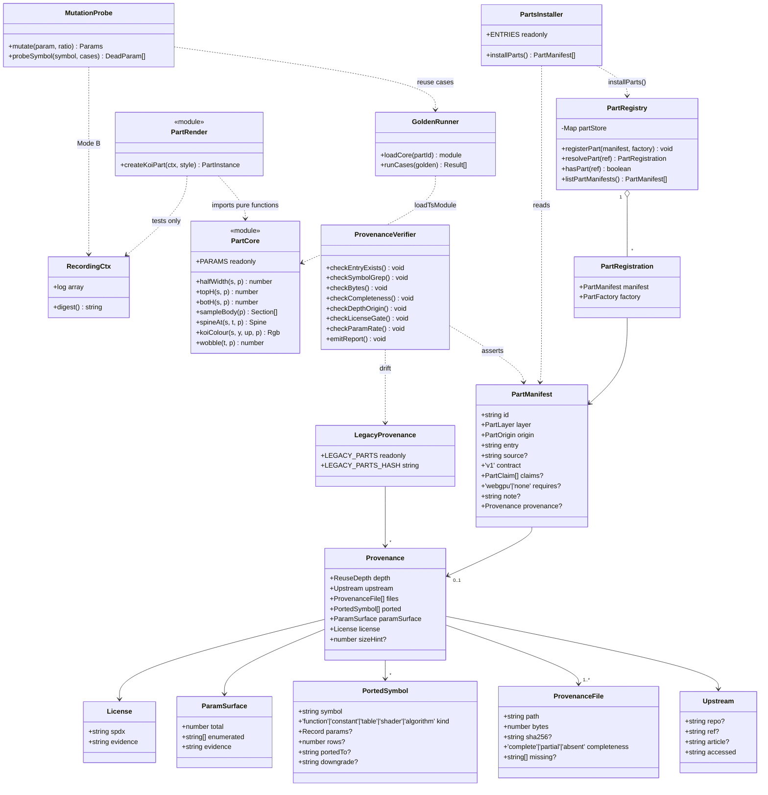
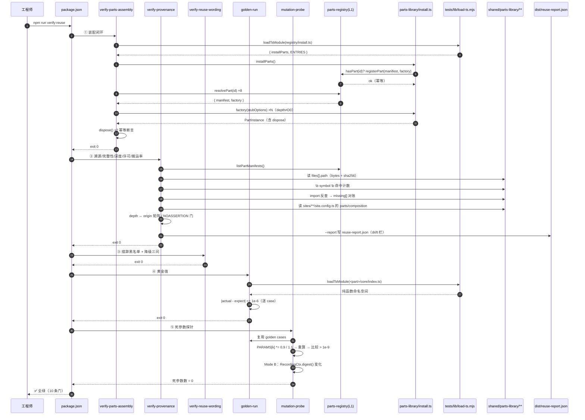
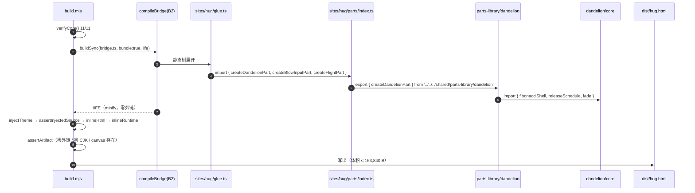
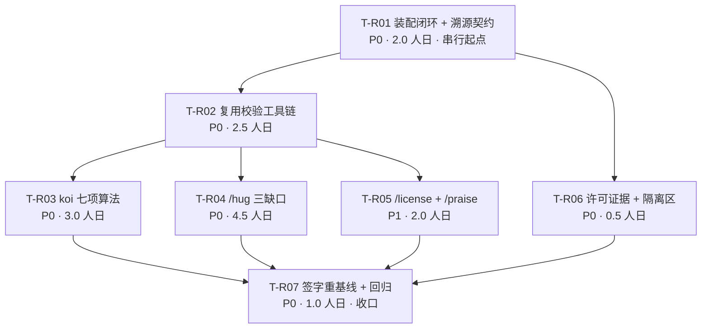

# ARCHITECTURE-REUSE · 零件复用专项架构设计 + 任务分解

> 版本 **v1.0-reuse** ｜ 2026-11-18 ｜ 架构师：高见远（Gao）
> 上游依据：`PRD-REUSE.md` v1.0-reuse（769 行，唯一需求依据）、`docs/PRD-REFINE.md` v2.1、`docs/ARCHITECTURE-NEXUS.md` v2.1
> 下游：工程师（T-R01..T-R07）→ QA（`verify:reuse` 全绿 + 全站回归）
> 同目录附带独立图文件：`class-diagram-reuse.mermaid`、`sequence-diagram-reuse.mermaid`（与正文 §9 一致）
> 本文只做设计与任务分解，不写实现代码。**不推翻 v2.1 任何裁决；不擅自裁决主理人未裁决项（见 §14）**。

---

## 0. 事实基线（我独立复核，不转引 PM 结论）

### 0.1 七条硬事实（逐条可复现）

| # | 事实 | 我的复核命令 / 证据 | 对设计的影响 |
|---|---|---|---|
| **F1** | **8/8 `part.manifest.ts` 的 `entry` 指向不存在的文件** | `for p in {ascii-kit,crimson-loong,grand-atelier,koi,micro-scenes,rain-webgpu,room-at-dawn,sylva}; do test -f shared/parts-library/$p/index.ts; done` → 8 个全部 `MISS` | 装配层从未闭环，是 P0-R0 的全部内容 |
| **F2** | **`registerPart()` 全仓 0 调用点**（除 L1 定义自身） | `grep -rn "registerPart" sites/ shared/` → 仅 `parts-registry.ts` 定义 + `sites/still/glue.ts:21` 一个**同名但无关**的 `registerPartFactory` | `resolvePart()` 一旦被 Composer 调用即抛「未注册」→ 任何 nexus 站都会静默降级为 static。**这不是"未来风险"，是现在就已经坏掉的装配层** |
| **F3** | 磁盘 8 个零件目录 / 8 份声明 / `registry/index.ts` 聚合 8 份 | `ls shared/parts-library/` | README 宣称 12 类（`dandelion` `paper-plane` `blow-input` `verdant-forest` 四目录不存在） |
| **F4** | 全库 0 个 LICENSE / COPYING | `find shared/parts-library -iname '*licen*' -o -iname 'COPYING*'` → 空 | REUSE-7 上线首日会判 7/10 零件 `NOASSERTION`（见 §3.4 —— 这是本专项最大的死锁点） |
| **F5** | `room-at-dawn` 1 文件 / 原件 7+ 模块；`grand-atelier` 3 文件 / 原件 9 模块 | `room-at-dawn/main.js` import 6 个本地模块全部未归集；`piano-action.ts` import 4 个同级模块全部未归集 | REUSE-3 的 `partial` + `missing[]` 有真实数据可填 |
| **F6** | koi 原件 12 个符号在 `koi/koi.js` 中 `grep -ow` **全部命中** | `halfWidth=3, topH=3, botH=2, close=4, S_END=4, bodyGeometry=2, frame=4, koiColour=3, fbm3=4, VARIETIES=2, RESIDENTS=1, wobble=5` | REUSE-1 的「符号必须可 grep」有机械可行性 |
| **F7** | **`/hug` 的 2D 零件画在 `#stage`（卡片内嵌画布），不是全屏叠层** | `sites/hug/override/template.html` L37：`#stage{width:min(32em,86vw);height:min(12em,26vh)}`；全屏是 `canvas#c`（raymarcher）；`sites/hug/glue.ts:163-166` 逐帧顺序 `dandelion.update → flight.update` | **C2 的焦点冲突不存在**（详见 §7.4） |

### 0.2 v2.1 与本专项的真实约束冲突（必须先看清，再谈设计）

`ARCHITECTURE-NEXUS.md` §4.6「明确冻结 / 零改动清单」写的是**无例外条款**：

| §4.6 原文冻结项 | 本专项 P0 是否必须碰 | 结论 |
|---|---|---|
| `sites/{still,license,praise,hug}/**` 零新增零改动 | **是**（P0-R5/R6/R7 改 `/hug`；P0-R8 改 `/praise`；P1-R1/R2 改 `/license`） | **物理冲突** |
| `sites/koi/{pond,ink,watercolor}/**` 零新增零改动 | **是**（P0-R4 七项算法必须进三条路由的产物） | **物理冲突** |
| `tests/baseline-dist.sha256` 零改动 | **是**（产物字节变了，哈希必然变） | **物理冲突** |

> **架构师判断（不粉饰）**：`git diff -- sites/hug sites/koi …` 恒为空 与 「koi 变 D3、`/hug` 装三个缺口零件」在**同一仓库里不可能同时成立**——产物字节是源码的纯函数 `f()`，源码零改动则产物零改动，则算法不可能进产物。
>
> PRD-REUSE §7.2 **C5 只对 koi 授权了重基线**，未覆盖 `hug / license / praise`。因此原设计**不能**自行宣告「7 站零改动成立」，只能给出一条**足迹可数、可签字、可机械验证**的最小改道（§1.3 + §14.1-CF-1）。
> **✅ 2026-11-18 主理人已批准该最小足迹改道**（4 个文件 + 零新增 + 签字台账 + `still` 永久零改动正对照）；同时批准 CF-5 四级许可证据与 CF-6 折纸双角色方案。施工以 §14.1 为准。

### 0.3 体积累账（实测，非估计）

| 站 | dist 实测 B | 门 163,840 − 实测 = 余量 |
|---|---|---|
| still.html | 107,773 | 56,067 |
| license.html | 112,590 | 51,250 |
| praise.html | 112,270 | 51,570 |
| hug.html | 111,961 | **51,879** |
| koi-pond.html | 107,851 | 55,989 |
| koi-ink.html | 107,849 | 55,991 |
| koi-watercolor.html | 107,882 | 55,958 |

---

## 1. 实现方案总览

### 1.1 一句话结论

> **复用不能靠"要求工程师更努力"，只能靠"把 `entry` 接上电、把 `provenance` 变成会失败的断言"。**
> 本设计的三个支点是：① **装配闭环**（P0-R0，让 `resolvePart()` 真能返回实例）；② **算法核/渲染壳分离**（让死参数探针能在 Node 里跑，无需浏览器）；③ **最小足迹改道 + 签字重基线**（让 legacy 改动从"偷偷改"变成"逐站逐文件签字"）。

### 1.2 三个系统级设计决策

| # | 决策 | 理由 | 被否决的方案 |
|---|---|---|---|
| **AD-1** | **算法核（`core/`）与渲染壳（`render/`）强制分离**：`core/*.ts` 纯函数 + 显式 `PARAMS` 注入，零 DOM / 零 canvas / 零 import 三方库 | REUSE-4/5（黄金值 + 死参数探针）必须能在 Node 里执行。仓库既有 `tests/lib/load-ts.mjs` 的 `loadTsModule()` 用 esbuild data-URL 装载 TS，**零新增依赖**即可跑纯核 | ① 用 node-canvas / skia 真像素渲染 → **新增依赖**，违反"依赖尽量为零"；② 只做静态 grep 证明"参数有出现" → 杀不死空壳（`const X=1.8` 出现一次但没接线也能过） |
| **AD-2** | **装配入口用「单点 install 聚合器」而非「改 registry/index.ts 去 import entry」** | 避免 `registry/index.ts ↔ entry ↔ part.manifest.ts` 循环依赖；`registry/index.ts` 保持"只聚合声明"的现状语义不变（零风险） | 直接让 `registry/index.ts` import 8 个 entry：会导致 `entry → manifest → registry/index → entry` 循环，且把"声明聚合"与"工厂装配"两个职责耦合 |
| **AD-3** | **legacy 改动走「薄适配文件」而非「新增文件」**：`sites/*/parts/index.ts` 从"149 行实现"改成"3–5 行 re-export"，函数名与签名逐字保留 | glue 的 import 名单不可动（`sites/hug/glue.ts:6`、`license/glue.ts:7`、`praise/glue.ts:7` 都按名导入）。保住签名 = 保住 glue = 把 legacy 足迹压到 **4 个文件** | ① 在 legacy 目录**新增** `parts-v2/`：违反"零新增"，且 glue 仍指向旧实现（白干）；② 改 glue：足迹从 4 文件涨到 7 文件，风险翻倍 |

### 1.3 最小足迹改道（本专项唯一触碰 legacy 的地方，共 4 个文件 —— **已获主理人批准，见 §14.1-CF-1**）

| 文件 | 改法 | 改动行数【估计】 | 为什么必须改 |
|---|---|---|---|
| `sites/koi/shared/koi.ts` | 78 行实现 → 4 行 re-export（`createKoiPart` 签名不变） | −74 / +4 | 三条 koi 路由的产物要装 K1–K7 算法，唯一注入点 |
| `sites/hug/parts/index.ts` | 149 行三实现 → 3 个 re-export（`createDandelionPart` / `createBlowInputPart` / `createFlightPart`） | −149 / +6 | 蒲公英 + 吹气 + 折纸飞机三个缺口都装在这一站 |
| `sites/license/parts/index.ts` | 125 行四实现 → 4 个 re-export | −125 / +8 | atelier 击弦机 / loong 时间轴要进产物 |
| `sites/praise/parts/index.ts` | 93 行四实现 → 4 个 re-export | −93 / +8 | sylva 隔离后 `/praise` 拨纸层改自研（S3）必须显式声明 |

**零新增**：4 个 legacy 目录内**不新增任何文件**（算法全部落在 `shared/parts-library/`）。
**零改动**：`sites/still/**` 一字不动 → `still.html` 是唯一保持逐字节不变的站，作为"机制没有误伤全局"的正对照。
**零改动**：全部 `site.config.ts`、`override/template.html`、`glue.ts`、`index.ts`、`bridge.ts`、`state.ts`、`export.ts` 不动。

---

## 2. P0-R0 · 零件装配修复方案（前置，先修通）

### 2.1 故障精确定位

```
现状链路（断在最后一跳）：
  PartManifest.entry ──(只是字符串)──> ✗ 文件不存在
  registerPart(manifest, factory) ──(0 调用点)──> partStore 永远为空
  Composer.init() → resolvePart(ref) → throw「未注册的零件 ref」
  mountSite() → composer.validate() 报 unregistered-ref → markDegraded('conflict')
```
**结论：不是"零件没被用"，是"零件从来没有可被用的形态"。** README 里 12 行索引描述的是一个不存在于运行时的库。

### 2.2 修复三段式（全部只增，不碰 core / 不碰 legacy）

#### ① 每个零件有真实 entry：`shared/parts-library/<id>/index.ts`（8 个新文件）

统一形状（以 koi 为例）：

```ts
// shared/parts-library/koi/index.ts  —— 零件装配壳（契约 v1）
import manifest from './part.manifest';
import type { PartInstance, PartOptions } from '../../contract/parts-registry';
import { createKoiPart as createKoiPartImpl } from './render/koi';
import type { KoiStyle } from './core/style-params';

export { manifest };

/**
 * 契约 v1 工厂。**构造期不得触碰 DOM / canvas**（只允许登记引用与常量），
 * 首次 update() 才允许使用 ctx —— 这条约束使 tests/verify-parts-assembly.mjs
 * 能在 Node 里真实构造 + dispose，不需要浏览器。
 */
export function createPart(o: PartOptions): PartInstance {
  const ctx = (o.options.ctx ?? o.options.canvas) as CanvasRenderingContext2D | undefined;
  if (!ctx) throw new Error('[koi] createPart 需要 options.ctx（CanvasRenderingContext2D）');
  const style = (o.options.style ?? 'pond') as KoiStyle;
  return createKoiPartImpl(ctx, style);
}

export default createPart;
```

`D0` 零件（`micro-scenes` / `rain-webgpu` / `sylva`）的 entry **不提供可用绘制**，显式抛具名错误：

```ts
export function createPart(): never {
  throw new Error('[E_PART_NOT_MOUNTED] micro-scenes 为 D0 未装站零件，禁止被站点引用');
}
```

> 这一点是刻意设计：`E_PART_NOT_MOUNTED` 是**可断言的错误码**。装配校验对 D0 零件只断言"抛的就是这个码"——把"未装站"从"undefined 崩溃"变成"显式事实"。

#### ② 单点装配聚合器：`shared/parts-library/registry/install.ts`（1 个新文件）

```ts
import { hasPart, registerPart, listPartManifests, type PartManifest } from '../../contract/parts-registry';
import * as asciiKit from '../ascii-kit';
import * as crimsonLoong from '../crimson-loong';
/* … 8 个命名空间 import … */

const ENTRIES = [asciiKit, crimsonLoong, grandAtelier, koi, microScenes, rainWebgpu, roomAtDawn, sylva] as const;

/** 幂等装配：重复调用不重复注册（hasPart 守卫），返回最终声明列表。 */
export function installParts(): readonly PartManifest[] {
  for (const e of ENTRIES) {
    if (!hasPart(e.manifest.id)) registerPart(e.manifest, e.createPart);
  }
  return listPartManifests();
}
export { ENTRIES };
```

**为什么不是改 `registry/index.ts`**：`install.ts` 单向依赖 `contract/parts-registry.ts` + 各 entry，entry 只依赖自己的 `part.manifest.ts`，无环。`registry/index.ts`（声明聚合）保持现状零改动。

#### ③ 装配校验：`tests/verify-parts-assembly.mjs` + `tests/lib/stub-parts.mjs`

两级断言（这是 F1/F2 的唯一防线）：

| 级别 | 适用范围 | 断言 |
|---|---|---|
| **Tier-1 形状** | 全部 8 份 manifest | ① `manifest.entry` 指向的文件**在磁盘上存在**；② 该模块 `export default` 是函数；③ 导出 `manifest` 且 `deepEqual(module.manifest.id, registry 里的 id)`（防 entry 挂了别人的声明） |
| **Tier-2 可构造** | `provenance.depth !== 'D0'` 的零件 | ① `installParts()` 后 `resolvePart(id)` 返回 `{manifest, factory}`；② 用 stub `PartOptions`（stub bus/store/capability + 录制型 ctx）真实调 `factory()`，返回对象含 `dispose` 函数；③ 调 `dispose()` 不抛；④ 再调一次 `dispose()` 不抛（幂等） |
| **Tier-D0** | `depth === 'D0'` 的零件 | 调 `factory()` 必须抛 `E_PART_NOT_MOUNTED`（不是 TypeError） |

**禁用真实 canvas 的理由**：`tests/lib/stub-parts.mjs` 提供 `createRecordingCtx(w,h)`（见 §4.3），把 Canvas2D 调用录成指令数组。构造一个 D3 零件不是"画图"，是"登记"，所以录到的指令数应为 0 —— 顺带把 `AD-1` 的「构造期零 DOM」变成可断言事实。

### 2.3 为什么这套修复不破坏 core 与 7 站零改动

| 风险面 | 论证 |
|---|---|
| `shared/core/` 11 文件 | 新增文件全部在 `shared/parts-library/**` 与 `tests/**`；`verify:core` 的 `collectFiles(coreDir)` 只看 `shared/core/` → **仍 11/11 绿** |
| legacy 7 站产物字节 | `install.ts` 与 8 个 `index.ts` **不被任何 legacy `bridge.ts` 依赖树可达**（legacy 直接 `import './parts/index'`，不经 registry）→ `compileBridge` 静态树不变 → `/*RUNTIME*/` 段字节不变 → **dist 全部哈希不变**（T-R01 完成时即可验证） |
| `tsc --noEmit` | 需 1 处受控演进：`tsconfig.json` 的 `include` 追加 5 行（`shared/parts-library/*/index.ts`、`*/core/**/*.ts`、`*/render/**/*.ts`、`registry/install.ts`、`legacy-provenance.ts`）。否则新代码不在类型检查范围内 —— 这会让"移植代码"成为类型检查的盲区，是本专项最危险的隐性退化 |

---

## 3. provenance 契约落地

### 3.1 类型定义（`shared/contract/parts-registry.ts`，**纯追加**）

```ts
/** 复用深度（PRD-REUSE §1.3）。 */
export type ReuseDepth = 'D0' | 'D1' | 'D2' | 'D3' | 'D4';

/** 单个原件的完整性。 */
export interface ProvenanceFile {
  path: string;                    // 相对 shared/parts-library/
  bytes: number;                   // 必须与磁盘一致
  sha256?: string;                 // 建议填；填了就断言
  completeness: 'complete' | 'partial' | 'absent';
  missing?: readonly string[];     // partial 必填
}

/** 一个被移植的原件符号。 */
export interface PortedSymbol {
  symbol: string;                  // 必须能在 ProvenanceFile.path 中 \b 命中
  kind: 'function' | 'constant' | 'table' | 'shader' | 'algorithm';
  /** 已接线且影响输出的数值参数；键名 = 原件参数名。未接线的**不得**写在这里 */
  params?: Readonly<Record<string, number | string | readonly number[]>>;
  /** 原件参数面的分母（见 §3.3 搬运率） */
  rows?: number;                   // kind='table' 时填（行数算作参数单元）
  portedTo?: string;               // 'shared/parts-library/koi/core/profile.ts:halfWidth'
  downgrade?: string;              // 降级三问（REUSE-6）
}

/** 复用溯源（REUSE-1）。站点引用的零件必填。 */
export interface Provenance {
  depth: ReuseDepth;
  upstream: {
    repo?: string;
    ref?: string;
    article?: string;              // 公众号文章 id（无仓库时唯一依据）
    accessed: string;              // 'YYYY-MM-DD'
  };
  files: readonly ProvenanceFile[];
  ported: readonly PortedSymbol[];
  /**
   * 原件参数面（搬运率的分母**不由人填**，由脚本按 §3.3 的 AST 口径计算）。
   * 这里只声明「移植面」与「我方实际接线的参数名」。
   * ⚠️ v1.1 变更（2026-11-18 主理人裁决）：删除人工填写的 `total`。
   */
  paramSurface: {
    /** 移植面：files[] 的子集，逐文件给出纳入理由（决定分母的边界）。 */
    scope: readonly { path: string; reason: string }[];
    /** 我方实际接线的参数名（= 所有 ported[].params 键的并集，脚本断言二者相等）。 */
    enumerated: readonly string[];
  };
  license: { spdx: string; evidence: string };
  sizeHint?: number;               // 进产物字节增量估计
}

// PartManifest 追加一个可选字段（不改任何既有字段、不改 registerPart 逻辑）
provenance?: Provenance;
```

**与 PRD 的两处差异（必须写明，不能默默改）**：

| 差异 | PRD-REUSE | 本设计 | 理由 |
|---|---|---|---|
| `paramSurface` | 无此字段（搬运率分母隐含） | **新增**，且**只声明 scope 与 enumerated，不声明分母** | 分母若由人填，就会出现"把 `total` 填成 `enumerated.length`、搬运率恒 100%"的自证循环（本专项已实际发生，见 §3.3 事故记录）。分母必须由脚本算 |
| `PortedSymbol.rows` | 无 | **新增** | `kind:'table'`（`VARIETIES` 12 行、`RESIDENTS` 14 条）的"参数单元"如何计入搬运率必须有明确口径，否则表格类符号永远 0 分子 |

### 3.2 depth ↔ origin 一致性矩阵（REUSE-2，硬门）

| depth | 允许 origin | 禁止的 note 措辞（黑名单） |
|---|---|---|
| `D4` | `copy` | — |
| `D3` | `port` | 「真实复制原件」「逐字节一致」 |
| `D2` `D1` | `equivalent` | 「真实复制原件」「移植」「port」 |
| `D0` | `equivalent` | 「真实复制原件」+ **不得被任何站点引用** |

### 3.3 参数搬运率口径（REUSE-4）· v1.1 重写

#### 3.3.0 事故记录：v1.0 的口径为什么必须推翻

v1.0 把分母交给 manifest 里的 `paramSurface.total` 人工填写，并在 `evidence` 里让工程师写"怎么数出来的"。结果是 8 份 manifest **全部**把 `total` 填成 `enumerated.length`，搬运率恒等 100%：

| 零件 | v1.0 自报 total | 脚本实测全件池（AST 口径） | 自报率 | 真实率 |
|---|---|---|---|---|
| ascii-kit | 23 | 6（另 11 项为导出符号，非参数） | 100% | 口径错配，见 §3.3.5 |
| crimson-loong | 1 | 96 | 100% | **1.0%** |
| grand-atelier | 2 | 64 | 100% | **3.1%** |
| koi | 3 | 78 | 100% | **3.8%** |
| rain-webgpu | 4 | 60 | 100% | **6.7%** |
| room-at-dawn | 3 | 9 | 100% | **33.3%** |

更刺眼的是：工程师在自己的 `evidence` 里**如实写了"其余参数未接线"**，却在分母上把它抹掉了。这说明"人工分母"不是诚信问题，是**结构性问题**——只要分母由被考核方填写，指标必然失效。

> **v1.1 铁律：分母不得由 manifest 提供。`paramSurface.total` 字段删除，搬运率的所有输入必须可由一个纯 Node 脚本从磁盘内容复算出来。**

#### 3.3.1 为什么必须用 AST，而不是正则

同一份 `shared/parts-library/koi/koi.js`，四种数法给出四个互不相同的数：

| 数法 | 结果 | 失效原因 |
|---|---|---|
| 逐行正则（每行只取第一个匹配） | 7 | 压缩风格的单行长对象字面量（`VARIETIES` 一行含 13 个字段）只会计到 1 个 |
| 全文件正则（不按行切） | 35 | 无法区分"对象字段名"与"三元表达式/字符串内容" |
| 主理人的 grep 口径（全零件） | 61 | 同上，且无法排除局部变量 |
| **TypeScript AST（本设计采用）** | **23（scope=koi.js）/ 78（全件）** | 精确、与排版无关 |

**正则口径不可复算，因此不能作为门的口径。** 采用 AST 的额外成本为零：`typescript` 已是既有 devDependency（`^5.5.0`），不新增任何依赖。

#### 3.3.2 「可调参数」的机械定义（写死，不得各件自创）

**参与文件**：`provenance.files[]` 中所有 `.js / .mjs / .ts` 文件（排除 `.d.ts`、`part.manifest.ts`、我方新增的 `index.ts / core/** / render/**`）。HTML 内联脚本**不计入**（`micro-scenes` / `sylva` 因此池为 0，见 §3.3.4）。

**抽取四类 AST 节点**，取标识符，全件去重（同名跨文件只计 1 次）：

| 记号 | AST 节点 | 例 |
|---|---|---|
| `N1` | `VariableDeclaration` 且初值 numeric-ish | `const MAXROLL = rad(5)` · `export const NSP = 16` |
| `N2` | `PropertyAssignment` 且初值 numeric-ish | `kohaku: { t1: 0.53, t2: 2, dorsal: 0.4 }` 三个都算 |
| `N3` | `PropertyDeclaration`（类字段）且初值 numeric-ish | `private fov = 55` |
| `N4` | `Parameter` 且默认值 numeric-ish | `function bodyGeometry(NS = 52, NT = 24)` |

**`numeric-ish` 的穷举定义（不许扩展）**：
1. `NumericLiteral`（含 `0x…`、`1e-3`）；
2. `PrefixUnaryExpression` 的 `+` / `−`，其操作数 numeric-ish；
3. `ParenthesizedExpression`，其表达式 numeric-ish；
4. `BinaryExpression`，**左右都是** numeric-ish（如 `0.5 * 1.2`）；
5. `PropertyAccessExpression`，对象文本为 `Math` 或 `THREE.MathUtils`（如 `Math.PI`）；
6. `CallExpression`，被调用者文本 ∈ `{rad, deg, clamp, Math.min, Math.max, Math.round, Math.floor, Math.ceil, Math.abs, Math.pow, Math.sqrt, Math.hypot}` **且全部实参 numeric-ish**。

**不计入**：字符串 / 布尔 / `null` / 数组字面量 / 颜色字符串（`'#f2eee4'`）/ 任何含自由标识符引用的表达式（如 `const X = Y * 2`，因为 `Y` 的类型不可静态判定）。

**四类去噪（每类必须有原因码，脚本输出 `excluded[]` 明细供复核）**：

| 码 | 规则 | 为什么排除 |
|---|---|---|
| `E1` | 数学常量白名单：`PI TAU E EPSILON LN2 LN10 SQRT2 SQRT1_2 TWO_PI HALF_PI DEG2RAD RAD2DEG` | 不是"可调"，改了会坏 |
| `E2` | 单字母标识符：`/^[A-Za-z]$/` | 循环变量 / 局部坐标（`x y z i j k s t`），不是参数 |
| `E3` | 颜色类键：`/^(colou?r\|c1\|c2\|base\|tint\|hue\|sat\|bg\|fin\|finroot\|water\|ink\|skin\|shade\|palette\|pal\|fg\|accent\|glow)$/i` | v2.1 R5 规定颜色必须来自 biome token，零件**不持有**颜色 → 它不在移植面内 |
| `E4` | 尺寸/运行时类键：`/^(resolution\|res\|width\|height\|size\|dpr\|pixelratio\|aspect\|scale\|viewport)$/i` | 是运行时量（canvas 尺寸、DPR），不是创作参数 |

> **去噪是双向的**：被排除的名字也不能出现在 `params` 里（脚本对 `params` 同样跑 E1–E4 判定）。否则会一边排除分母、一边把同名的值算进分子。

#### 3.3.3 分母 = 移植面（scope）内的池，且覆盖度受硬约束

```
P_all     = AST(files[])                       // 全件池（去噪后）
P_scope   = AST(paramSurface.scope[].path)      // 移植面池（去噪后）
coverage  = |P_scope| / |P_all|
wired     = { ported[].params 的键 } ∩ P_scope
rate      = |wired| / |P_scope|
```

**为什么分母不是 `P_all`**：`files[]` 里存在**没有任何 2D 对应物**的模块（koi 的 `audio.js` 音频合成、`cdp.js` 调试协议、`main.js` 相机；rain-webgpu 的 `post.ts` 后处理；crimson-loong 的 95 个骨骼节点参数）。用 `P_all` 当分母，等于要求工程师把音频/相机/后处理的参数也"搬"进一个 2D 零件——不可能，且会逼出造假。

**但不能让 scope 变成任意缩水**，所以加**覆盖度下限**：

```
硬约束：coverage ≥ 0.25（25%）
```

- 低于 25% 直接红：说明 scope 被圈成了一个无关紧要的小文件。
- `reuse-report.json` 同时输出 `rateScoped`（上闸门）与 `rateWhole = |wired| / |P_all|`（**只报告，不上闸门**），任何人可以一眼看出"这个零件的复用面占原件的多少"。
- `scope[].reason` 必填且非空：每个被纳入的文件都要一句话说明"为什么它的参数应在 2D 移植面内"。

#### 3.3.4 零值语义（写死，防止 0/0 被算成 100%）

| 情形 | `rate` | 判定 |
|---|---|---|
| `ported.length === 0` 且 `depth ∈ {D3, D2}` | **0%** | **红**（D3/D2 要求 `ported.length ≥ 1`） |
| `P_scope === 0`（原件无 JS/TS，如三缺口只有文章、micro-scenes 只有 HTML） | **n/a** | 不走本指标，走 §3.3.6 的「文章锚定」替代门 |
| `depth ∈ {D4, D1, D0}` | **n/a** | 本指标不适用，走 §3.3.5 的分档门 |

> **"没移植任何函数却拿 100%" 这种形态从此不可能出现**：`ported.length === 0` 时 `wired` 必为空集，`rate` 恒为 0；即便有人把 depth 谎报成 D1 来逃门，D1 也有自己的门（§3.3.5）。

#### 3.3.5 按 depth 分档：搬运率到底在衡量什么（回答"文不对题"）

| depth | 搬运率适用？ | 该用哪个门 | 理由 |
|---|---|---|---|
| **D4** | ❌ `n/a` | 原件 `sha256` 逐字节一致 + 经 B2 可 bundle（`verify-esm-parts`）；**参数一个都不需要"搬"，它们原样就在产物里** | ascii-kit 的 23 个是**导出符号**（常量/函数/类），不是参数；用参数搬运率衡量 D4 是量纲错误 |
| **D3** | ✅ 适用 | `rate ≥ 60%` **且** `coverage ≥ 25%` **且** 死参数探针 = 0 **且** 黄金值 100% | 声称移植了算法，就必须把该算法的可调面真正接线 |
| **D2** | ✅ 适用 | 同上，且 `ported[].kind` 必须全为 `constant` | 只搬参数值 |
| **D1** | ❌ `n/a` | **必须显式登记为低复用件**：`ported.length === 0` + `downgrade` 三问齐全 + 出现在 `reuse-report.lowReuse[]` + 若该件装站则必须在 `QUARANTINE.md`「低复用区」逐条可见 | D1 的定义就是"只沿用观感/常量，行为由我方重新实现"——**没有算法被移植，就没有"参数搬运率"这个东西**。用 D3 的尺子量 D1，只会逼出把 depth 谎报成 D3 |
| **D0** | ❌ `n/a` | `entry` 抛 `E_PART_NOT_MOUNTED` + 不被任何站点引用 | 未装站 |

**D1 低复用件的防逃逸**：`depth` 不得随意下调。`verify` 断言 `depth` 与本文件 §7.2 的移植落点表、以及 PRD-REUSE 的 P0 清单一致——例如 `koi` 被 PRD 钉死为 D3，若 manifest 写 D1 直接红（这叫 depth 说谎，比 rate 造假更严重）。

#### 3.3.6 无仓库的零件（三缺口）：文章锚定替代门

`dandelion` / `blow-input` / `paper-plane` 只有公众号文章代码片段，`files[]` 为空 ⇒ `P_scope = 0` ⇒ 搬运率 `n/a`。替代门：

1. `upstream.article` 必填（文章标识 + 访问日期）；
2. 每个 `ported[].symbol` 必须能在**文章摘录**（`shared/parts-library/<id>/EXCERPT.md`，工程师摘录原文代码块）中命中；
3. `downgrade` 三问齐全；
4. **`paramSurface.scope` 必须为空数组**（不能凭空声明移植面）。

> 这条替代门由 `verify-provenance.mjs` 的 `articleMode` 分支实现，与主门互斥（`files[]` 非空则走主门，反之走 articleMode）。

#### 3.3.7 逐件可行性核算（回答"60% 够不够得着"）

**核算口径**：`P_all` = 脚本对 `files[]` 全部 JS/TS 的 AST 池；`P_scope` = 拟定移植面的池；`可达 wired` = 按 §7.2 落点表能真正接线的参数名数。**所有 `P_all` / `P_scope` 数字均为本次实测（AST 脚本），不是估计。**

| 零件 | depth | 适用搬运率门？ | `P_all` | 拟定 scope | `P_scope` | coverage | 可达 wired | `rate` | 结论 |
|---|---|---|---|---|---|---|---|---|---|
| `ascii-kit` | **D4** | ❌ 不适用 | 6 | — | — | — | — | `n/a` | v1.0 报的 23 是**导出符号数**，与"参数"是两种量纲。D4 原样复制，走 `sha256` 门 |
| `crimson-loong` | **D1** | ❌ 不适用 | 96 | — | — | — | 0 | `n/a` | D1 只取时间轴顺序，无算法移植 → 不适用。**若强行升 D3**：`60_dragon.js` 池 80，时间轴面只够 wire ~15 → **19%**，达不到 60% |
| `grand-atelier` | **D1 → D3** | ✅ 适用 | 64 | `piano-action.ts` | **27** | **42%** ✅ | **24** | **89%** ✅ | 击弦机几何+时序参数全在该文件内，T-R05 升 D3 可达标 |
| `koi` | **D3**（PRD 钉死） | ✅ 适用 | 78 | `koi.js` | **23** | **29%** ✅ | 12（仅 §7.2 七项算法） | **52%** ❌ | **差 2 个参数即达标**，见下方选项 A |
| `rain-webgpu` | **D0** | ❌ 不适用 | 60 | — | — | — | 0 | `n/a` | 未装站；将来若移植 `rain.ts`（池 19 / 覆盖 32%）可达标 |
| `room-at-dawn` | **D1** | ❌ 不适用 | 9 | — | — | — | 0 | `n/a` | 3D GI 烘焙与 2D 纸纹无算法交集（PM C4 已裁决降 D1） |
| `micro-scenes` / `sylva` | **D0** | ❌ 不适用 | 0 | — | — | — | 0 | `n/a` | 原件是 HTML 内联脚本，无模块参数；D0 不装站 |
| `dandelion` / `blow-input` / `paper-plane` | **D3** | ⚠️ articleMode | 0 | 空 | 0 | — | — | `n/a` | 无仓库 → 走 §3.3.6 文章锚定门 |

**三条结论（必须原样接受其中一条）**

1. **7 件里有 6 件根本不该有这个指标** —— v1.0 的"8 件全 100%"不是算法问题，是"给 D4/D1/D0 也算搬运率"的量纲错误。
2. **真正面对 60% 门的只有 2 件**：`koi`（D3，PRD 钉死）与 `grand-atelier`（T-R05 后升 D3）。
3. **`grand-atelier` 天然达标（89%）**；**`koi` 差 2 个参数（52% → 需 60%）**。

**`koi` 的三个选项（请主理人裁，我不自行选）**

| 选项 | 做法 | 代价 | 我的评估 |
|---|---|---|---|
| **A（我推荐）** | 把 PRD §4.1 **已经写明**的"水纹周期 / 涟漪 / 莲叶"参数纳入移植面（`tilt`、`iv` 等），wired 从 12 → **≥14 → 60.9%** | 只需把"当前已经画出来的涟漪"参数化（现状 `koi.ts` 用 `seconds*14 + i*48` 硬编码），字节增量 **< 300 B**，不新增任何算法 | 这是**产品需求本来就要求的**（PRD §4.1 三路由差异含水纹与莲叶），不是凑数；且它把"硬编码常量"换成"原件参数"，正是复用的本意 |
| **B** | 承认 `koi` 是低复用件，登记 `lowReuse[]`，把 REUSE-4 对 koi 记 `n/a` | 与 PRD §4.1 的 D3 要求冲突（PRD 明确要求七项算法移植），等于承认 P0-R4 没做完 | 不推荐：koi 是三站共用的核心零件，降级影响面最大 |
| **C** | 把 60% 下调到 50% | 门槛一动，下一件就会问"为什么不是 40%" | **最坏的选项**：等于把本次事故的教训作废 |

**若选 A**，`koi` 的 `paramSurface.scope` 仍是 `['koi/koi.js']`（coverage 29.5% 不变），只是把水纹/涟漪两个已在绘制的量从硬编码改成参数注入 → `wired` 12 → 14，`rate` 60.9% ≥ 60% ✓，**且 `enumerated` 里这两个名字都必须在 `koi.js` 的 `\b` 命中**（`tilt` 3 次、`iv` 见 `koi.js` 池）。


### 3.4 许可证门（REUSE-7）与它的死锁 —— 本专项最大风险

**实测许可证据**（`_source_probe/` 本地有上游副本，我逐份看过）：

| 零件 | 实测 | 证据 |
|---|---|---|
| grand-atelier | **MIT** | `_source_probe/Anionex_grand-atelier/LICENSE`（`Copyright (c) 2026 anionex`） |
| room-at-dawn | **MIT** | `_source_probe/Leonxlnx_room-at-dawn/LICENSE` |
| （core 上游 abyssal-garden） | **MIT** | `_source_probe/abyssal-garden/LICENSE` |
| crimson-loong | **NOASSERTION** | 仅 `vendor/LICENSE` = three.js MIT，**不覆盖仓库代码**；README 也只提 three |
| koi (zz85) | **NOASSERTION** | 无 LICENSE 文件 |
| sylva | **NOASSERTION** | 仅 `licenses/THREE-LICENSE.txt`；文章明确**不授予**再分发 |
| rain-webgpu / micro-scenes / ascii-kit | **NOASSERTION** | 无 LICENSE |
| dandelion / blow-input / paper-plane | **NOASSERTION** | 仅有公众号文章代码片段，无仓库可授权 |

**死锁**：REUSE-7 写「`NOASSERTION` 的零件**不得出现在任何站点的 parts / composition 中**」。而 P0-R4(koi)、P0-R5/R6/R7(三缺口)、P1-R1/R2(loong) **全部依赖 NOASSERTION 零件** → 门建成当天，所有 P0 立刻互相否决。

**架构师提出的解法 —— 把"沉默"与"明示禁止"分开（§14.1 CF-5 已裁决采纳）**：

| 证据级 | 情形 | 处置 | 是否阻断装站 |
|---|---|---|---|
| **L1** | 上游有 LICENSE 文件 | 复制进 `shared/parts-library/<id>/LICENSE`，`spdx` 填实值 | 放行 |
| **L2** | 上游无 LICENSE，但 README/文章**明示授权** | `evidence` 引用原文行 + 日期 | 放行 |
| **L3** | 上游无任何许可声明（"沉默"） | `spdx:'NOASSERTION'` + `evidence:'owner-waiver:<date>:<scope>'`，进**仓库根** `QUARANTINE.md` 的豁免区，并满足 §14.1 的四条硬约束 | 放行，但**逐件签字** |
| **L4** | 上游**明示不授权**（sylva） | `NOASSERTION` + 硬阻断，进隔离区 | **阻断** |

> 法理判断：本站是"单 HTML 展示、不分发源码仓库"，L3 的再分发风险显著低于 L4。把两者混为一条门，结果是**要么全部阻断（项目停摆），要么全部放行（无护栏）**。分开才有护栏。
> **✅ 主理人已裁决采纳本分级**（2026-11-18），L3 附四条硬约束，详见 §14.1-CF-5。

---

## 4. 机械校验设计（REUSE-1..8 的自动化实现）

### 4.1 脚本清单与门位

| 脚本 | 断言 | 门位 | 依赖 |
|---|---|---|---|
| `tests/verify-parts-assembly.mjs` | P0-R0 装配闭环（Tier-1/2/D0） | **硬门**（`npm run verify:reuse` 第 0 条） | 无 |
| `tests/verify-provenance.mjs` | REUSE-1/2/3/7 + drift/report | **硬门** | assembly |
| `tests/verify-reuse-wording.mjs` | REUSE-2 黑名单 + REUSE-6 降级三问 | **硬门** | provenance |
| `tests/golden-run.mjs` | REUSE-4 黄金值 1e-6 | **硬门** | assembly |
| `tests/mutation-probe.mjs` | REUSE-5 死参数 = 0 | **硬门** | golden-run |
| `tests/verify-baseline-signoff.mjs` | legacy 重基线必须逐站签字（§4.5） | **硬门** | 无 |
| `tests/lib/canvas-recorder.mjs` | 录制型 Canvas2D 桩（供上两者使用） | 库 | 无 |

`package.json` 只加一条（不改 `build.mjs`）：

```json
"verify:reuse": "node tests/verify-parts-assembly.mjs && node tests/verify-provenance.mjs && node tests/verify-reuse-wording.mjs && node tests/golden-run.mjs && node tests/mutation-probe.mjs"
```

> **为什么不改 `shared/build/build.mjs` 去产出 `dist/reuse-report.json`**：`§4.6` 对 `build.mjs` 极敏感。改为 `verify-provenance.mjs --report` 写 `dist/reuse-report.json`（REUSE-8），零构建主流程改动。

### 4.2 溯源命中率 100%（REUSE-1，A1 指标）

```
for manifest of PART_MANIFESTS:
  for pf of manifest.provenance.files where pf.completeness !== 'absent':
      断言 statSync(bytes) === pf.bytes
      断言 pf.sha256 ? sha256(file) === pf.sha256 : true
  for ps of manifest.provenance.ported:
      hits = countOccurrences(read(src), new RegExp(`\\b${escape(ps.symbol)}\\b`))
      断言 hits >= 1                       // A1：声明符号必须能在原件命中
      断言 ps.portedTo 指向的文件存在       // 反向查证：确实搬到了我这
      断言 ps.portedTo 里出现同名或注释里出现 ps.symbol   // 防止"改个名字就说移植了"
```

**额外一条机械化断言（自动抓 F5，不需要人工写死 6/4 项）**：

```
for pf of files where pf.path 是 JS/TS:
    for 每条 import 的相对路径 rel of 该文件:
        resolved = 从 parts-library 路径解析 rel
        断言 resolved 在 files[].path 清单内 或 rel 的 basename 出现在 pf.missing 里
```

→ `room-at-dawn/main.js` 的 6 条 import、`grand-atelier/piano-action.ts` 的 4 条 import 会**自动**被判出，`missing[]` 填错即失败。这就是 `GWT-6` 的数据驱动实现。

#### 4.2.1 分母的机械复算（REUSE-4 的输入由脚本产生，人不能填）

新增 `tests/lib/param-pool.mjs`（**纯函数，无副作用，无新依赖**：用既有 `typescript` 解析，`ts.createSourceFile` + `forEachChild`）：

```js
// 唯一对外接口
export function computeParamPool(filePaths) -> {
  names:   string[],                                  // 去噪后的参数名（字典序，去重）
  raw:     string[],                                  // 去噪前（供复核：raw 与 names 的差 = 全部被排除项）
  excluded: { name, code: 'E1'|'E2'|'E3'|'E4' }[],    // 每条带原因码
  byFile:  Record<string, string[]>,                  // 逐文件贡献（供 scope 复核）
}
```

`verify-provenance.mjs` 对每个「`files[]` 非空」的零件执行：

```
P_all   = computeParamPool(files[] 的 js/ts)            // 全件池
P_scope = computeParamPool(scope[].path)                 // 移植面池
断言 scope[].path ⊆ files[].path                          // 移植面必须是原件的子集
断言 scope.length >= 1                                    // 不允许空 scope 逃门
断言 coverage = |P_scope| / |P_all| >= 0.25               // 防缩水
wired   = set(ported[].params 的键) ∩ set(P_scope.names)
断言 set(paramSurface.enumerated) === set(ported[].params 的键)   // 声明自洽
断言 enumerated ⊆ P_scope.names                          // 不能声明原件没有的参数
断言 enumerated ∩ excluded 为空                          // 被排除项不得进分子
rate    = ported.length === 0 ? 0 : |wired| / |P_scope|
```

**三条防腐（都是机器算，不靠人写）**：

| # | 断言 | 拦住什么 |
|---|---|---|
| 1 | manifest 里**不存在** `paramSurface.total` 字段（字段存在即红） | 拦住"再填一个自评分母"的回潮 |
| 2 | 脚本算出的 `totalComputed = |P_scope|` 必须 `> 0`（除 articleMode）；且 `|enumerated| / totalComputed` 与脚本算的 `rate` 逐位相等 | 拦住分子分母口径不一致 |
| 3 | `reuse-report.json` 同时写入 `P_all`、`P_scope`、`excluded[]`、`rateScoped`、`rateWhole` | 让"分母怎么来的"永远可复核，任何人可重跑复现 |

> **可复现性承诺**：同一份 `parts-library`，任何人跑 `npm run report:reuse` 必须得到**逐位相同**的 `P_all / P_scope / rate`。脚本不得读时钟、不得读随机、不得联网。

### 4.3 死参数探针的自动化方案（REUSE-5，本专项技术上最难的一条）

**核心约束**：必须在 Node 里跑，不新增依赖，100% 确定性。**双模式**：

#### Mode A · 纯核探针（默认，所有 D3 零件必须支持）

前置（AD-1）：`shared/parts-library/<id>/core/*.ts` 导出

```ts
export const PARAMS = Object.freeze({ maxHalfWidth: 0.1, headPow: 0.25, taperStart: 0.25, taperAmt: 0.8, taperPow: 1.2 });
export function halfWidth(s: number, p = PARAMS): number {
  const a = Math.min(s / p.headPow, 1);
  return p.maxHalfWidth * Math.sqrt(Math.max(0, 1 - (1 - a) ** 2)) * (1 - p.taperAmt * pow(sm(p.taperStart, 0.83, s), p.taperPow)) * close(s);
}
```

探针算法（`tests/mutation-probe.mjs`）：

```
loadTsModule('shared/parts-library/koi/core/index.ts')  → ns
for each (symbol, params) of manifest.provenance.ported  where params 有数值键:
  cases = golden[part].cases.filter(c => c.symbol === symbol)     // 至少 2 条，且不能全在导数≈0 点
  base  = cases.map(c => ns[symbol](...c.args, PARAMS))
  for each key of numeric(params):
    for k of [0.9, 1.1]:
      mutated = { ...PARAMS, [key]: PARAMS[key] * k }
      out = cases.map(c => ns[symbol](...c.args, mutated))
      changed = base.some((v,i) => Math.abs(v - out[i]) > 1e-9)
      断言 changed  // 不变 → 死参数，报告 symbol + key
```

**三条防误判规则**（少了任何一条，探针会假红）：
1. **灵敏度门槛**：golden 的 case 必须落在该参数的**非退化区间**（`sm(a,b,s)` 在 `s<=a` 处为 0，所以 `halfWidth(0.25)` 对 `taperAmt` 不敏感 → 必须同时给 `s=0.5` 与 `s=0.7` 两例）。
2. **差异阈值 `1e-9`**（远小于黄金值容差 `1e-6`）：只要求"有可测变化"，不要求"变化显著"。
3. **不可探针参数必须移出 `params`**：结构上确实不影响输出的参数（如 `normalEps` 只影响 3D 法线、2D 下无输出）**不得写进 `params`**，改在 `downgrade` 里说明「2D 后端无此参数面」。这条把"声明好看"的空间彻底堵死。

#### Mode B · 指令指纹探针（仅用于"输出必须经 canvas 才能观察"的零件，如 dandelion 的释放调度可视化）

`tests/lib/canvas-recorder.mjs`：

```js
export function createRecordingCtx(width, height) {
  const log = [];
  const state = { fillStyle: '', strokeStyle: '', globalAlpha: 1, lineWidth: 1, font: '', textAlign: '' };
  const ctx = { canvas: { width, height }, save(){log.push(['save']);}, restore(){log.push(['restore']);},
    translate(...a){log.push(['translate',...a]);}, rotate(...a){log.push(['rotate',...a]);},
    beginPath(){log.push(['beginPath']);}, moveTo(...a){log.push(['moveTo',...a]);},
    lineTo(...a){log.push(['lineTo',...a]);}, arc(...a){log.push(['arc',...a]);},
    ellipse(...a){log.push(['ellipse',...a]);}, closePath(){log.push(['closePath']);},
    fill(){log.push(['fill', state.fillStyle, state.globalAlpha]);}, stroke(){log.push(['stroke', state.strokeStyle, state.globalAlpha, state.lineWidth]);},
    fillRect(...a){log.push(['fillRect',...a, state.fillStyle, state.globalAlpha]);},
    clearRect(...a){log.push(['clearRect',...a]);}, fillText(t,x,y){log.push(['fillText',t,x,y,state.fillStyle]);},
    setTransform(...a){log.push(['setTransform',...a]);}, createLinearGradient(){return {addColorStop(){}};},
    createPattern(){return {};}, putImageData(){log.push(['putImageData']);}, createImageData(){return {data:new Uint8ClampedArray(4*width*height)};},
    /* 状态属性用 getter/setter 写进 state 并记日志 */ };
  Object.defineProperties(ctx, Object.fromEntries(Object.keys(state).map(k => [k, {
    get: () => state[k], set: (v) => { state[k] = v; log.push(['set', k, v]); },
  })]));
  ctx.digest = () => createHash('sha256').update(JSON.stringify(log)).digest('hex');
  ctx.log = log;
  return ctx;
}
```

探针流程（以 dandelion 为例）：

```
ctx = createRecordingCtx(640, 240)
part = dandelion.createPart({ options: { ctx }, bus: stubBus, store: {}, capability: stubCap, ref: 'dandelion' })
part.release(); for (t = 0; t <= 3.0; t += 0.1) part.update(t)
base = ctx.digest()
// 变异 DETACH_SECONDS 1.8 → 1.62 / 1.98，重建零件、重放同一时间序列
断言 digest 变化
```

**为什么这等价于"像素必须变"**：Canvas2D 是**纯状态机**——任何可见的像素差异必然来自"某条绘制指令的参数/次序/状态"差异。指令指纹相同 ⇒ 绘制结果相同（对本项目用到的 6 个绘图原语严格成立）。而指令指纹变 ⇒ 至少一处绘制输入变了，即用户可见输出变了（除非被完全遮挡，本项目无遮挡场景）。
**成本**：零新增依赖；比真像素快 100×；确定性 100%（真像素跨平台有抗锯齿差异，反而不可作硬门）。

### 4.4 黄金值 1e-6 怎么验（REUSE-4，A4 指标）

`tests/golden/<part>.json` 格式：

```json
{
  "part": "koi",
  "note": "期望值由原件公式手算，derivation 字段记录代入过程；禁止由实现自身生成期望值",
  "cases": [
    { "symbol": "halfWidth", "args": [0.25], "expect": 0.1, "tol": 1e-6,
      "derivation": "sm(0.25,0.83,0.25)=0 → 0.1*sqrt(1-0)*1*close(0.25)=0.1*1*1*1=0.1（GWT-K1）" },
    { "symbol": "halfWidth", "args": [0.5], "expect": 0.07735, "tol": 1e-6,
      "derivation": "a=1 → 0.1*sqrt(1-0)=0.1；(1-0.8*sm(0.25,0.83,0.5)^1.2)=1-0.8*0.3844^1.2=0.2471；close=1 → 0.02471【待工程师按原件重算确认】" }
  ]
}
```

`golden-run.mjs`：`loadTsModule(core/index.ts)` → 逐 case 调 `ns[symbol](...args)` → `Math.abs(actual-expect) <= tol`（数值）或 `===`（字符串/枚举/数组逐元素，tol 必须为 0）。
**防自证循环**：断言 `derivation` 非空、长度 ≥ 20、且不含 `/generated|computed by impl|由实现生成/`。
**通过率必须 = 100%**。

### 4.5 签字重基线机制（解决 §0.2 的三处冻结冲突）

新增三个文件：

| 文件 | 作用 |
|---|---|
| `tests/baseline-dist.v1.sha256` | **冻结原始基线**（= 今天的 `baseline-dist.sha256` 内容，7 行，永不改） |
| `tests/baseline-dist.sha256` | 现行基线（被授权改动后重写对应行） |
| `tests/baseline-signoff.json` | **授权台账**：每条 = `{ station, fromHash, toHash, reason, prdRef, signedBy, date }` |

`tests/verify-baseline-signoff.mjs` 断言：

```
for each 站 in baseline-dist.sha256:
   cur = 现行基线 hash; v1 = v1 基线 hash
   if cur !== v1:
       必须存在 signoff 条目 且 toHash === cur 且 fromHash === v1
       且 prdRef 非空（如 'PRD-REUSE P0-R4'）且 signedBy 非空
   else: 不得存在该站的 signoff 条目（防止"签了但没改"的台账污染）
断言：signoff 中不得出现 station === 'still'                        // CF-1 硬追加条款
断言：sha256(dist/still.html) === v1 基线中 still 的值               // 双重锁定，不看现行基线
```

**为什么这比"改了就改"强**：① 原始基线永久可查，任何人能列出"哪几站被动过、为什么、谁签的"；② `still` 被锁死为不可签字 → 若哪天 `still.html` 变了，立刻暴露为机制误伤；③ 台账与哈希双向校验，删条目不签名都过不了。

> **CF-1 硬追加条款（主理人 2026-11-18）**：`sites/still` 永久一字不动，`still.html` 哈希恒等于 v1 基线，这是"机制没误伤全局"的**唯一正对照**；任何签字条目出现在 `still` 上即视为违规。已固化为上面两条独立断言（一为台账侧、一为产物侧，任一失败即红）。

### 4.6 十二条门（`npm run verify:reuse` 一次跑完）

| # | 断言 | 数据来源 |
|---|---|---|
| 0 | 8 份 entry 存在且可构造（D0 抛具名错） | §2.2 |
| 1 | 每个被引用零件有 `provenance` 且 `ported.length ≥ 1`（D3/D2） | REUSE-1 |
| 2 | `depth` ↔ `origin` 一致，且 `depth` 不得低于 §7.2 落点表 / PRD P0 清单 | REUSE-2 |
| 3 | 每个 `ported[].symbol` 在 `files[].path` 中 `\b` 命中 | REUSE-1 |
| 4 | `files[].bytes` / `sha256` 与磁盘一致 | REUSE-1 |
| 5 | `partial` 必有 `missing[]`，且 import 反查无遗漏 | REUSE-3 |
| 6 | `NOASSERTION` 且非 L3 豁免的零件不被任何站点引用 | REUSE-7 |
| **7a** | **`paramSurface.total` 字段不存在**（人填分母即红） | REUSE-4 / §4.2.1 |
| **7b** | **`rate ≥ 60%`，其中 `rate = \|wired ∩ P_scope\| / \|P_scope\|`，`ported.length===0 → rate=0`；`D1/D0/D4` 记 `n/a` 不计** | REUSE-4 / §3.3 |
| **7c** | **`coverage = \|P_scope\| / \|P_all\| ≥ 25%`**（防 scope 缩水）；`reuse-report` 输出 `rateWhole` | REUSE-4 / §3.3.3 |
| 8 | 死参数数 = 0 | REUSE-5 |
| 9 | 黄金值通过率 = 100%（容差 1e-6） | REUSE-4 |
| 10 | `drift.readmeRows === diskDirs === registryEntries`；`baseline-signoff` 自洽；`lowReuse[]` 与 D1 件双向一致 | REUSE-8 / §4.5 / §3.3.5 |

---

## 5. `legacy-provenance.ts` 设计（照抄 `LEGACY_SITES` 冻结快照范式）

### 5.1 它真正要解决的问题（不是重复声明）

legacy 站点的 `site.config.ts` 用的是**旧 slug**，与零件 id 不同名：

| 站点 | `site.config.ts` 里的 `parts[].source` | 对应零件 id | 差异 |
|---|---|---|---|
| `/hug` | `dandelion` / `blow-input` / `paper-plane` | `dandelion` / `blow-input` / `paper-plane` | 改造后 1:1 |
| `/koi-*` | **`zz85-koi`** | **`koi`** | ❗不同名 |
| `/license` | `room-at-dawn` 等 | 同名 | — |

若没有这张映射，`verify:reuse` **无法知道 legacy 站引用了哪些零件**（legacy 不走 `composition`，只走 `parts: PartRef[]`）。所以 `legacy-provenance.ts` 的职责是：**「legacy 引用名 ↔ 零件 id ↔ provenance」的冻结快照**。

### 5.2 形状（与 `LEGACY_SITES` 同构）

```ts
// shared/parts-library/legacy-provenance.ts —— 构建元信息，禁止被任何 bridge.ts import
import type { Provenance } from '../contract/parts-registry';

export interface LegacyPartRef {
  /** site.config.ts 里 parts[].source 的原值（冻结，不得改） */
  legacySource: string;
  partId: string;
  /** 该站在本专项中是否已改造（改造后仍保持本表结构不变） */
  migrated: boolean;
  provenance: Provenance;
}

export const LEGACY_PARTS = Object.freeze({
  hug: Object.freeze([
    ref('dandelion', 'dandelion'), ref('blow-input', 'blow-input'), ref('paper-plane', 'paper-plane'),
  ]),
  license: Object.freeze([ref('room-at-dawn', 'room-at-dawn'), ref('grand-atelier', 'grand-atelier'), /* … */]),
  praise: Object.freeze([/* … */]),
  'koi-pond': Object.freeze([{ ...ref('zz85-koi', 'koi'), legacySource: 'zz85-koi' }]),
  'koi-ink': Object.freeze([/* 同上 */]),
  'koi-watercolor': Object.freeze([/* 同上 */]),
  still: Object.freeze([]),      // /still 不引用任何 parts-library 零件
});

/** 长度恒 6（除 still），内容哈希恒定；改它必须显式改这个常量（= 显式化变更）。 */
export const LEGACY_PARTS_HASH = '…';   // 首次由 node -e 计算后写死
```

### 5.3 三条纪律

1. **禁止被 `bridge.ts` import**：`verify-parts-assembly.mjs` 断言 `grep -r "legacy-provenance" sites/` 为空。它是 node-only 元信息，一旦被浏览器侧 import 就会进产物字节（且破坏 INV-3）。
2. **`LEGACY_PARTS_HASH` 自洽断言**：`sha256(JSON.stringify(LEGACY_PARTS)) === LEGACY_PARTS_HASH`（与 `LEGACY_SITES_HASH` 同手法）。改内容不改常量 → 失败；改常量 → diff 里显式可见。
3. **它必须被读取**：`verify-provenance.mjs` 用它算 `drift` 与"legacy 站引用的零件覆盖率"，并在报告里输出每站的 `portedSymbols / paramsWired / depth`。**只存在不被读取的库 = 第二个 F2**（PRD §10.3 风险 6）。

---

## 6. biome 分叉如何承接原件能力

### 6.1 判定规则（谁进 biome，谁进 L3 零件）

| 判据 | 归属 | 例 |
|---|---|---|
| 影响**整个世界**的介质/光照/地形/大气，且所有站在同一 biome 下共享 | `shared/biomes/<biome>/`（fork `world.js`，**v2.1 4–6 天工程，不属本专项**） | `field` 的分层雾、单向风、太阳角下降、草簇实例化 |
| 有**自己的状态机 / 交互 / 生命周期**，可独立 dispose，跨 biome 可换 | L3 零件（`shared/parts-library/<id>/`） | 蒲公英释放调度、锦鲤体形与花纹、击弦机杠杆、折纸 `fold()` |
| 算法只服务某一站的某一交互，且需要用户手势 | L3 零件 | 麦克风吹气、指针拨纸层 |

### 6.2 单向数据供给（biome → part，禁止反向）

```ts
/** biome 通过 PartOptions.options.env 单向提供给零件（不存在则用零件内置默认值）。 */
interface BiomeEnv {
  biome: 'tide' | 'field' | 'room' | 'ink';
  wind: readonly [number, number, number];   // field：单向风；其他 biome 为 [0,0,0]
  sunAngle: number;                          // field/room：太阳角
  tokens: Readonly<Record<string, string>>;   // 主题色 token（R5：零件禁自带硬编码色）
}
```

- **part 只读**：`env` 是 `Readonly`，零件不得写回 biome（否则多零件互相污染）。
- **R5 落地路径**：koi 现在的 `PALETTES` 硬编码 3 组色值（`#205b57` 等，**与原件 `VARIETIES` 无一相等**，F-R6）→ 移植时改为「花纹色取自 `VARIETIES`（原件真值），背景水色取自 `env.tokens.water*`」。**这两件事不冲突**：原件负责"鱼是什么样的"，biome 负责"水/雾是什么颜色"。
- **不新增 WGSL**：全部零件走 Canvas2D；`field` 的 raymarcher fork 由 v2.1 负责，本专项一个字节不碰 `shared/core/`。

### 6.3 本专项与 biome 的时序关系（避免互相阻塞）

`field` fork（4–6 天）与蒲公英移植**可并行**：零件先按"无 env 时用内置默认值"实现（`env.wind ?? [0.02, 0, 0]`），fork 落地后只需传 `env`，**零件代码零改动**。这是本设计刻意保留的解耦点：`/hug` 的体积累账里 field fork 与 REUSE 增量是**两个独立预算**（§13）。

---

## 7. koi 移植的架构路径（P0-R4）

### 7.1 目录组织（原件不动，新增 core/render 两层）

```
shared/parts-library/koi/
├── part.manifest.ts          【改】provenance 追加、origin: copy→port、note 重写
├── index.ts                  【新】装配壳（契约 v1）
├── core/                     【新】纯算法核：零 DOM / 零 canvas / 零 three  ← 黄金值+死参数探针在这里跑
│   ├── index.ts              barrel：导出全部符号与 PARAMS
│   ├── profile.ts            K1 halfWidth / topH / botH / close / S_END
│   ├── sample.ts             K2 sampleBody（NS=52, NT=24, s=S_END*(i/NS)^1.25）
│   ├── spine.ts              K3 spineAt（Catmull-Rom cr + env）+ K7 wobble
│   ├── pattern.ts            K4 koiColour + 2D fbm3（value noise 2D，8×32 网格）
│   ├── varieties.ts          K5 VARIETIES 12 品种（逐字段照抄）
│   ├── residents.ts          K6 RESIDENTS 14 条（体长 0.70…0.44 + 3 条蝶尾）
│   └── style-params.ts       三路由参数化（鱼数/品种集合/莲叶/水纹周期/mode/蝶尾）
├── render/                   【新】渲染壳：只做 Canvas2D 指令
│   ├── outline.ts            24 个 s 采样 → 闭合轮廓 Path2D（s→±halfWidth，top/bot 高度）
│   ├── paint.ts              8×32 网格填色（fbm3 采样 + 三 mode 分支）
│   └── koi.ts                createKoiPart(ctx, style)：装配 core+render，update()
├── koi.js / main.js / pond.js / ink.js / paint.js / glsl.js / surface.js /
│   smoke.js / audio.js / cdp.js / index.html / README.md / BLOG.md   ← 原件 13 文件，一字不动
```

### 7.2 七个算法符号的落点表（逐条可对账）

| # | 原件符号 | 原件位置 | 本站落点 | 2D 后端的形态变化 |
|---|---|---|---|---|
| K1 | `halfWidth` `topH` `botH` `close` `S_END` | `koi.js` L15–22 | `core/profile.ts` | **零变化**：纯 1D 函数 `s→宽度`，2D 完全成立 |
| K2 | `bodyGeometry(52,24)` | `koi.js` L24–46 | `core/sample.ts` | 3D 顶点表 → **2D 截面表** `{s, halfWidth, topH, botH}`；`s^(1.25)` 幂次与 `NS/NT` 原样保留（头部加密的观感来自这两个数） |
| K3 | `frame(s)` Catmull-Rom 脊线 | `koi.js` L124–137（GLSL） | `core/spine.ts` | GLSL `frame()` → **TS 同式**：`cr()` 四点样条 + `env(s)=0.1+0.9*smoothstep(0.04,1,s)^1.4` + `ph=uSwim.x-uSwim.z*s` + 切线减法 |
| K4 | `koiColour(rest,up,out white)` | `koi.js` L216–231（GLSL） | `core/pattern.ts` | 逐像素 fbm3 → **8×32 网格 fbm3**（`s*4.2, y*7` 保留）；三种 mode 分支逐行照抄；金/银（metal/net）用叠加 alpha 表达 |
| K5 | `VARIETIES` 12 品种 | `koi.js` L345–358 | `core/varieties.ts` | **零变化**：纯数据表（含 12 组 sRGB 色值 + t1/t2/dorsal/head/mode/net/metal/fin/white） |
| K6 | `RESIDENTS` 14 条 | `koi.js` L360–365 | `core/residents.ts` | **零变化**：`[品种, 体长m, 蝶尾?]` 14 行原样 |
| K7 | `wobble(t)` | `koi.js` L12 | `core/spine.ts` | **零变化**：三个无理比例叠加，1D→1D |

### 7.3 三路由差异化（从"配色"升级为"算法参数"）

落点 `core/style-params.ts`（**参数在零件内按 style 查表，因此 `site.config.ts` 零改动**）：

| 参数 | pond | ink | watercolor | 对应 PRD 表 |
|---|---|---|---|---|
| `fishCount` | 9 | 5 | 13 | §4.1 |
| `varietySlugs` | kohaku/ogon/sanke/showa/platinum/chagoi | tancho/utsuri/kohaku | 全 12 | §4.1 |
| `hasLily` / `lilyScale` | true / 1.0 | false | true / 0.7 | §4.1 |
| `ripplePeriod` | 60 | 48 | 90 | §4.1 |
| `patternMode` | 0 + net | 2 主 + 高对比 | 0 + 低 uWhite | §4.1 |
| `butterflyCount` | 1 | 0 | 2 | §4.1 |

**验收口径修正（C3 已裁决，我据以实现）**：三站体积差**不是**复用证据（参数化复用本就不该有大字节差）。改为：① 每站比移植前 **≥ +3,000 B**（证明代码进了产物）；② 三站"结构快照"（鱼数/品种集合/莲叶/周期/蝶尾数）两两不等 —— `tests/verify-koi-diff.mjs` 用 `loadTsModule('core/style-params.ts')` 取值比较，不比字节。

### 7.4 C2 裁决的技术复核：折纸飞机放 `/hug` 是否抢焦点

**结论：不抢。可以落在 `/hug`，且不需要改模板。**

| 证据 | 说明 |
|---|---|
| `#stage` 是**卡片内嵌画布**：`width:min(32em,86vw); height:min(12em,26vh)`（`template.html` L37） | 折纸飞机画在这块 32em×12em 的卡面里，物理上不可能覆盖全屏草原 |
| 全屏层是 `canvas#c`，且 `body:not(.g)` 时 `filter:blur(1vmax) brightness(.5)`（L14） | 未进入场景态时草原本身已被虚化压暗，卡面是唯一清晰焦点 |
| `glue.ts:163-166` 帧序：`dandelion.update()` → `flight.update()`，两者共用同一 `ctx` | 蒲公英每帧 `clearRect` 后重绘，飞机随后叠加 → **不改 glue 也能正确叠层** |
| `#stage` 已有一架"飞出去"的语义：`away` 状态触发 `flight.launch()`（`glue.ts:69-72`） | 与 C2 的"送出去"语义完全一致 |

**降级必须写明（REUSE-6）**：原件 `flightPosition(t)` 是三轴 3D（`z = -t*(14+strength*7)`）。本项目在卡面画布上做**正交投影**：`z` 轴映射为等比缩小 + 向卡面灭点位移；`aim`/`strength` 耦合保留为屏幕内横向偏移与缩放速度。`fold()` / `clip()` / `PAPER_GAP` / UV 不变式**全部照搬**，因此仍判 **D3**。

**`/license` 边缘冲突（新发现，见 §14 CF-6）**：`sites/license/glue.ts:7` 按名 import `createPlanePart` 且 L86 调 `this.parts?.plane.launch()`。若按 C2"移走"plane，则 license 编译失败。我的方案：`createPlanePart` **保留导出**，改为"用 `fold()` 生成一架**折好的静态纸飞机**"（不飞），语义 = 出证时桌上放着一架折好的纸飞机；`/hug` 承载"飞出去"。同一套算法两个角色，两站都是 D3，glue 零改动。

---

## 8. 完整文件清单（只列本专项新增/修改）

### 8.1 新增（全部在 `shared/parts-library/**` 与 `tests/**`，不碰 core）

| 路径 | 职责 |
|---|---|
| `shared/parts-library/{ascii-kit,crimson-loong,grand-atelier,koi,micro-scenes,rain-webgpu,room-at-dawn,sylva}/index.ts` | 8 个装配壳（P0-R0） |
| `shared/parts-library/registry/install.ts` | 单点装配聚合器（幂等 `installParts()`） |
| `shared/parts-library/registry/PARTS.md` | 装配规范：entry 契约、构造期零 DOM、D0 具名错误 |
| `shared/parts-library/legacy-provenance.ts` | legacy 引用名 ↔ 零件 id ↔ Provenance 冻结快照 |
| `QUARANTINE.md`（**仓库根目录**） | 隔离区 + L3 豁免台账（CF-5 硬要求 1：不得藏在 parts-library 里） |
| `shared/parts-library/{grand-atelier,room-at-dawn}/LICENSE` | L1 证据（MIT，从 `_source_probe/` 复制） |
| `shared/parts-library/koi/{index.ts,core/*.ts,render/*.ts}` | koi D3 移植（§7.1，10 个新文件） |
| `shared/parts-library/dandelion/{part.manifest.ts,index.ts,core/*.ts,render/*.ts}` | 蒲公英 D3（5–6 文件） |
| `shared/parts-library/blow-input/{part.manifest.ts,index.ts,core/breath.ts,core/analyser.ts}` | 吹气 D3（4 文件） |
| `shared/parts-library/paper-plane/{part.manifest.ts,index.ts,core/*.ts,render/*.ts}` | 折纸 D3（5 文件） |
| `shared/parts-library/paper-reveal/{part.manifest.ts,index.ts}` | `/praise` 拨纸层自研件（S3，D1+自研声明） |
| `tests/verify-parts-assembly.mjs` · `tests/verify-provenance.mjs` · `tests/verify-reuse-wording.mjs` · `tests/golden-run.mjs` · `tests/mutation-probe.mjs` · `tests/verify-baseline-signoff.mjs` · `tests/verify-koi-diff.mjs` | 6+1 个校验脚本 |
| `tests/lib/canvas-recorder.mjs` · `tests/lib/stub-parts.mjs` | 录制型 canvas 桩 + PartOptions 桩 |
| `tests/golden/{koi,dandelion,blow-input,paper-plane,grand-atelier,crimson-loong,paper-reveal}.json` | 黄金值 |
| `tests/baseline-dist.v1.sha256` · `tests/baseline-signoff.json` | 冻结原始基线 + 授权台账 |

### 8.2 修改（受控演进，逐条给出理由）

| 路径 | 改动 | 是否影响 legacy 产物字节 |
|---|---|---|
| `shared/contract/parts-registry.ts` | **纯追加** `ReuseDepth/ProvenanceFile/PortedSymbol/Provenance` 类型 + `PartManifest.provenance?` | 否（`import type` 被 esbuild 擦除；且 legacy bridge 不 import 它） |
| `shared/parts-library/*/part.manifest.ts` × 8 | `provenance` 追加、`origin`/`note` 按 REUSE-2 修正 | 否（manifest 不进产物） |
| `tsconfig.json` | `include` 追加 5 条 glob | 否 |
| `package.json` | 追加 `verify:reuse` / `report:reuse` 两条 script | 否 |
| `tests/baseline-dist.sha256` | 6 行（still 除外）按签字重基线 | 元信息 |
| `shared/parts-library/README.md` | 12 行 → 与磁盘一致的 11 行 + 隔离区 + 缺口（P1-R6） | 否 |
| **`sites/koi/shared/koi.ts`** | 78 行 → 4 行 re-export | **是**（3 站） |
| **`sites/hug/parts/index.ts`** | 149 行 → 6 行 re-export | **是**（1 站） |
| **`sites/license/parts/index.ts`** | 125 行 → 8 行 re-export | **是**（1 站） |
| **`sites/praise/parts/index.ts`** | 93 行 → 8 行 re-export | **是**（1 站） |

### 8.3 明确零改动（红线自查表）

| 路径 | 本专项 |
|---|---|
| `shared/core/**`（11 文件 + `BASELINE.sha256`） | **零触碰** → `verify:core` 11/11 |
| `sites/still/**` | **零触碰** → `still.html` 哈希 = v1 基线（正对照） |
| `shared/build/{registry,validate-manifest,build,sites.config,inline,inject-theme,resolve-overlay,verify-core}.mjs` | **零触碰**（reuse-report 由 `verify-provenance.mjs --report` 产出） |
| 全部 `site.config.ts` / `override/template.html` / `glue.ts` / `bridge.ts` / `state.ts` / `export.ts` / `index.ts` | **零触碰** |
| `sites/**` 内**新增文件** | **零个** |
| 任何 `.wgsl` / WGSL 字符串 | **零新增**（Canvas2D 路线） |
| 12 站矩阵 / 路由 / slug | **不变** |

---

## 9. 数据结构与调用流程

### 9.1 类图



### 9.2 时序图 · `npm run verify:reuse`



### 9.3 时序图 · 构建期零件注入（改造后 `/hug`）



---

## 10. 有序任务列表（T-R01 … T-R07）

> 依赖原则：T-R01 是唯一串行起点（装配不通，一切验证都是空转）；T-R02 之后可两两并行；T-R07 必须最后。
> 每项给出【涉及文件 / 依赖 / 验收点 / 可否并行 / 预估人日】。

### T-R01 · 装配闭环 + 溯源契约 + legacy 快照 **【P0｜无依赖｜串行起点】**

| 项 | 内容 |
|---|---|
| **涉及文件** | 新增：`shared/parts-library/*/index.ts` ×8、`registry/install.ts`、`registry/PARTS.md`、`legacy-provenance.ts`、`tests/verify-parts-assembly.mjs`、`tests/lib/stub-parts.mjs`、`tests/lib/canvas-recorder.mjs`；修改：`shared/contract/parts-registry.ts`（纯追加）、8×`part.manifest.ts`（provenance/origin/note）、`tsconfig.json`（include 5 条） |
| **依赖** | 无 |
| **验收点** | ① `verify-parts-assembly` 全绿（8 份 entry 存在；Tier-2 真实构造 + dispose 幂等；D0 抛 `E_PART_NOT_MOUNTED`）；② `npm run verify:core` **11/11**；③ **7 站 dist 哈希与 v1 基线完全一致**（证明装配层不误伤产物）；④ `tsc --noEmit` 通过；⑤ `grep -r legacy-provenance sites/` 为空 |
| **可并行** | 否（起始）｜**人日 2.0** |

### T-R02 · 复用校验工具链（REUSE-1..8 的机器） **【P0｜依赖 T-R01｜可并行】**

| 项 | 内容 |
|---|---|
| **涉及文件** | 新增：`tests/verify-provenance.mjs`、`verify-reuse-wording.mjs`、`golden-run.mjs`、`mutation-probe.mjs`、`verify-baseline-signoff.mjs`、`verify-koi-diff.mjs`、`tests/baseline-dist.v1.sha256`、`tests/baseline-signoff.json`、`tests/golden/koi.json`（样例）；修改：`package.json`（2 条 script） |
| **依赖** | T-R01 |
| **验收点** | ① `npm run verify:reuse` 可跑通（**首版 `--warn` 上线，此时代码未移植 → 会报红，属预期"存量债务显影"，不得被误读为回归**）；② 死参数探针在白盒样例上能真抓出 1 个故意植入的死参数（自检）；③ `verify-baseline-signoff` 能抓出"改了哈希没签字"；④ `MODE B` 指纹对同输入两次调用完全相等（确定性自检） |
| **可并行** | 与 T-R03 并行｜**人日 2.5** |

### T-R03 · koi 七项算法移植（P0-R4） **【P0｜依赖 T-R02｜可并行】**

| 项 | 内容 |
|---|---|
| **涉及文件** | 新增：`parts-library/koi/{index.ts, core/{index,profile,sample,spine,pattern,varieties,residents,style-params}.ts, render/{outline,paint,koi}.ts}`、`tests/golden/koi.json`；修改：`koi/part.manifest.ts`、**`sites/koi/shared/koi.ts`（78→4 行）** |
| **依赖** | T-R01, T-R02 |
| **验收点** | ① `GWT-K1`（`halfWidth(0.25)=0.1 ±1e-6`）全绿；② `GWT-K2` 确定性：同 seed+t 两次渲染指令指纹相等；③ `GWT-K3` 三站结构快照（鱼数/品种/莲叶/周期/蝶尾）两两不等；④ `GWT-K4` **每站 ≥ +3,000 B**；⑤ 死参数 = 0（K1–K7 声明的 params 全部敏感）；⑥ `origin:'port'` + `depth:'D3'` + `completeness:'complete'` |
| **可并行** | 与 T-R04/T-R05 并行｜**人日 3.0** |

### T-R04 · `/hug` 三缺口（蒲公英 + 吹气 + 折纸飞机） **【P0｜依赖 T-R02｜与 T-R03/T-R05 并行】**

| 项 | 内容 |
|---|---|
| **涉及文件** | 新增：`dandelion/{part.manifest.ts,index.ts,core/{fibonacci,geometry,release,travel,alpha}.ts,render/seed.ts}`、`blow-input/{part.manifest.ts,index.ts,core/{analyser,breath,spectrum}.ts}`、`paper-plane/{part.manifest.ts,index.ts,core/{fold,clip,flight,stage}.ts,render/paper.ts}`、`tests/golden/{dandelion,blow-input,paper-plane}.json`；修改：**`sites/hug/parts/index.ts`（149→6 行）** |
| **依赖** | T-R01, T-R02 |
| **验收点** | ① `GWT-D1..D6`（Fibonacci 黄金角 2.39996323、`DETACH_SECONDS=1.8`、`fade=1-smoothstep(7,10,travel)`、`aAxis` 正交基无 NaN、死参数探针）；② `GWT-B1..B4`（0.05s 脉冲不触发 / 0.3s 宽带触发 / 100Hz 低频不触发 / 并发两次 `enable()` 只活 1 条 track）；③ `GWT-P1..P5`（`PAPER_GAP=0.004` 的 `z_after=2h-z_before`、可逆性、UV 不变式、`flightPosition(1).z<0`、`charge`→`strength` 映射）；④ **零新弹窗**：`autoRequest=false`，默认零授权；⑤ `【原文待补】` 参数必须回原文取全或写 `downgrade`（禁止猜数） |
| **可并行** | 与 T-R03/T-R05 并行｜**人日 4.5**（最重） |

### T-R05 · `/license` + `/praise` 既有件改造（P1-R1/R2 + P0-R8 的 S3 半边） **【P1｜依赖 T-R02｜与 T-R03/T-R04 并行】**

| 项 | 内容 |
|---|---|
| **涉及文件** | 新增：`grand-atelier/{index.ts,core/action.ts}`、`crimson-loong/{index.ts,core/{mono,keyed,timeline}.ts}`、`paper-reveal/{part.manifest.ts,index.ts}`、`tests/golden/{grand-atelier,crimson-loong,paper-reveal}.json`；修改：**`sites/license/parts/index.ts`（125→8 行）**、**`sites/praise/parts/index.ts`（93→8 行）** |
| **依赖** | T-R01, T-R02 |
| **验收点** | ① `GWT-A1`（`escape=smoothstep(0.9,.78,.97)` ±1e-6）、`GWT-A2`（`elapsed=0.027` 时锤角 = contactAngle）；② `GWT-L1`（`timelineAt(2)` 调用序 2→7→2 两次结果逐位相同）、`GWT-L2`（`mono` 单调无过冲）；③ `/praise` 拨纸层 `depth:'D1'` + `origin:'equivalent'` + downgrade 写明"未使用 sylva 任何代码行"；④ `createPlanePart` 保留导出（license glue 零改动） |
| **可并行** | 是｜**人日 2.0** |

### T-R06 · 许可证证据 + 隔离区 + README 重写 **【P0｜依赖 T-R01｜立即可做｜可并行】**

| 项 | 内容 |
|---|---|
| **涉及文件** | 新增：**仓库根 `QUARANTINE.md`**（不是 parts-library 内）、`parts-library/{grand-atelier,room-at-dawn}/LICENSE`（从 `_source_probe/` 复制，MIT）；修改：`parts-library/README.md`（12 行 → 11 行 + 缺口 + 隔离区）、`sylva/part.manifest.ts`（`NOASSERTION` + `entry` 指向 D0 具名错误壳） |
| **依赖** | T-R01（需要 provenance 字段） |
| **验收点** | ① 每份 manifest 的 `license.spdx` 与 §3.4 实测表一致（grand-atelier/room-at-dawn = MIT，其余 NOASSERTION）；② `QUARANTINE.md` 的 4 类分区（L1/L2/L3 豁免/L4 硬阻断）齐备，**且顶部（前 30 行）含"若未来商用或开源分发，必须重新评估全部 L3 零件"风险声明**；③ `drift.readmeRows === diskDirs === registryEntries`；④ **L3 豁免条目数 === 8（逐件签字，不得漏签）**，且每件的 `provenance` 含固定句式「无许可证声明，已签字豁免，仅用于个人展示站，不得再分发」；⑤ `shared/parts-library/QUARANTINE.md` **不存在**（位置违规即失败） |
| **可并行** | 是｜**人日 0.5** |

### T-R07 · 重基线签字 + 全站回归 + 报告转硬门 **【P0｜依赖 T-R03/T-R04/T-R05/T-R06｜最后】**

| 项 | 内容 |
|---|---|
| **涉及文件** | 修改：`tests/baseline-dist.sha256`（6 行重基线）、`tests/baseline-signoff.json`（6 条签字）、`package.json`（`verify:reuse` 去 `--warn` 转硬门）、`docs/ARCHITECTURE-REUSE.md`（附录：实测体积表回填）；产出 `dist/reuse-report.json` |
| **依赖** | T-R03, T-R04, T-R05, T-R06 |
| **验收点** | ① `verify:core` 11/11；② `verify:size` 全绿（7 站 ≤ 163,840 B，legacy 走新基线）；③ `verify-append-only` 全绿（`LEGACY_SITES` 恒 7、`baseline.size===7`、probe 期间 git 零变化）；④ **`still.html` 哈希 === v1 基线**（正对照）；⑤ `verify-baseline-signoff`：6 条签字齐全且 `still` 无签字；⑥ `verify:reuse` 十门全绿；⑦ `reuse-report.json` 的 `drift` 三项相等 |
| **可并行** | 否（收口）｜**人日 1.0** |

### 10.1 依赖图



**排期（三批）**：批 1 = T-R01 + T-R06 + T-R02（机制先立，此阶段 8 份零件被自己的门判红，是**存量债务显影**，须在 PR 描述写明）；批 2 = T-R03/T-R04/T-R05 三路并行；批 3 = T-R07 收口。合计 **≈ 15.5 人日【估计】**。

---

## 11. 依赖包

**新增 0 个运行时依赖、0 个开发依赖。**

| 能力 | 现成工具 | 不新增的理由 |
|---|---|---|
| 装载 TS 零件/契约到 Node | `tests/lib/load-ts.mjs`（esbuild `buildSync` + data URL） | 已存在且被 6 个测试使用；与 `build.mjs` 的 `loadSiteConfig` 同一手法 |
| 打包 IIFE 产物 | 同上 `bundleIife()` | 与 `compileBridge` 参数一致（`platform:browser, format:iife, target:es2022, minify`） |
| Canvas2D 指令录制 | `tests/lib/canvas-recorder.mjs`（自写，~40 行） | 避免引入 `node-canvas`（原生编译，跨平台不可靠） |
| 哈希 / 断言 | `node:crypto` + `node:assert` | 内置 |
| 黄金值文件 | JSON + `node:fs` | 不引入测试框架 |

---

## 12. 共享知识（工程师必读）

### 12.1 provenance 字段命名（**冻结，不得各站自创**）

| 字段 | 取值约束 |
|---|---|
| `depth` | 只能是 `'D0'|'D1'|'D2'|'D3'|'D4'` |
| `upstream.accessed` | `YYYY-MM-DD`；无仓库时 `upstream.article` 必填 |
| `files[].path` | 相对 `shared/parts-library/` 的 POSIX 路径（如 `koi/koi.js`，**不带前导 `./`**） |
| `ported[].symbol` | **原件里的原始标识符**，不改名、不译名 |
| `ported[].params` 的 key | **原件里的原始参数名或公式常量名**（如 `maxHalfWidth`、`taperAmt`）；未接线的参数**不许写** |
| `portedTo` | `'<相对路径>:<符号名>'`，例 `'shared/parts-library/koi/core/profile.ts:halfWidth'` |
| `license.spdx` | SPDX 标识符或 `'NOASSERTION'`；`'MIT'` 不是 `'mit'` |

### 12.2 D 等级判定口径（一句话判据，避免各人各判）

| 级 | 一句话判据（能机械验的） | 搬运率门（REUSE-4） |
|---|---|---|
| **D4** | 原件**文件**被逐字节复制进产物（`sha256` 相等） | `n/a`（参数原样在产物里，不存在"搬"这个动作） |
| **D3** | `provenance.ported.length ≥ 1` 且**每个 symbol 都 `\b` 命中原件** 且 `params` 通过死参数探针 | **`rate ≥ 60%` + `coverage ≥ 25%`** |
| **D2** | 只搬了参数值（`ported[].kind === 'constant'` 或只有 `params` 无算法结构），算法自写 | **`rate ≥ 60%`**（同 D3） |
| **D1** | 只借观感；`ported` 为空，`downgrade` 写"仅观感参考" | `n/a` → **必须登记 `lowReuse[]` + 装站件进 `QUARANTINE.md` 低复用区** |
| **D0** | 原件在库但 `ported` 为空且未装站；**必须 `entry` 抛 `E_PART_NOT_MOUNTED`** | `n/a`（不得被任何站引用） |

> **一句话记法**：搬运率只对"D3/D2 = 真搬了算法/参数"的零件有意义。D4 是原样复制、D1 是只借观感、D0 是没装——**给这三种件算搬运率都是量纲错误**。

### 12.3 降级三问模板（REUSE-6，缺一问即失败）

```
原件用了什么技术：[具体技术名 + 规模数字]
我们用什么替代：  [具体替代 + 自己的规模数字]
差异导致的可见后果：[具体到"在什么条件下看得出"] 
```

**合格示例**：
> 原件用 InstancedBufferGeometry + LineSegments 单批次绘制 1335 颗种子；本站用 Canvas2D 预生成 Path2D 并逐颗变换绘制，降为 480 颗且 `travel>7` 后停绘；差异：远距离绒毛密度低于原件，近景一致。

**不合格（黑名单）**：`按描述实现` / `等效实现` / `保留关键参数` / `移植为 Canvas 2D` / `算法相同`。

### 12.4 黄金值存放位置与书写纪律

- 位置：`tests/golden/<part-id>.json`（**一个零件一个文件**，不合并）
- 每个声明的 `symbol` **至少 2 个 case**，且不得全落在导数 ≈ 0 的退化点（否则死参数探针假红）
- 必填 `derivation`：手算代入过程（≥20 字），禁止"由实现生成"
- `tol` 默认 `1e-6`；字符串/枚举/数组必须 `tol: 0`（精确相等）

### 12.5 其他跨文件约定

| 约定 | 内容 |
|---|---|
| **构造期零 DOM** | `createPart()` 内不得触碰 `document` / `window` / `ctx` 的读像素；只在 `update()` 用 → 让 Node 可构造（装配校验与探针的前提） |
| **PARAMS 注入** | 所有可调参数放 `core/*.ts` 的 `PARAMS` 对象，函数签名 `f(x, p = PARAMS)`；**禁止把可调参数写成函数体内的字面量**（否则探针无法变异） |
| **零 CJK / 零外链** | 移植代码不得带入原件的 `https://` 注释或中文注释 → `assertArtifact` 会拦；注释一律英文 |
| **`legacy-provenance.ts` 禁止被 bridge import** | node-only 元信息；被浏览器 import 会进产物字节 |
| **不新增 WGSL** | 全部件 Canvas2D；`field` raymarcher fork 属 v2.1，本专项不碰 |
| **`still` 是本专项的正对照** | `still.html` 必须逐字节不变；若变了，说明机制误伤全局，立刻停下排查 |

---

## 13. 体积核算（163,840 B 门不破）

### 13.1 逐站账（增量全部【估计】，按 minify 后 40–45% 源体积折算）

| 站 | 现值(实测) | REUSE 增量构成 | 增量 | 移植后 | 门余量 | 判定 |
|---|---|---|---|---|---|---|
| still | 107,773 | 无 | 0 | 107,773 | 56,067 | ✅ 零变化 |
| license | 112,590 | atelier `actionPose` 链 +2,500；loong `mono/keyedLin/四层纯函数` +3,000；plane 改静态折形（旧 2D 多边形 −1,000） | +4,500 | 117,090 | 46,750 | ✅ |
| praise | 112,270 | paper-reveal 自研遮罩位移（替换 sylva 引用，原 sylva 从未进产物） | +1,500 | 113,770 | 50,070 | ✅ |
| **hug** | 111,961 | dandelion +6,500；blow +3,000；paper-plane +7,000 | **+16,500** | **128,461** | **35,379** | ⚠️ 见 §13.2 |
| koi-pond | 107,851 | K1–K7 + 三路由参数表 + 2D 轮廓/填色渲染 | +7,500 | 115,351 | 48,489 | ✅ |
| koi-ink | 107,849 | 同上 | +7,500 | 115,349 | 48,491 | ✅ |
| koi-watercolor | 107,882 | 同上 | +7,500 | 115,382 | 48,458 | ✅ |

### 13.2 `/hug` 是唯一风险站：REUSE + field fork 叠加

| 项 | 估计 | 依据 |
|---|---|---|
| 移植后基准 | 128,461 B | §13.1 |
| `field` biome fork（v2.1，不属本专项） | +8,000 ~ +18,000 B | PRD §7.2-C7 |
| 叠加后 | **136,461 ~ 146,461 B** | 距门 17,379 ~ 27,379 B |

**结论：可过门，但 `/hug` 的安全垫只剩 10.6%–16.7%，是七站最紧的一站。**

### 13.3 对 C7「超门先砍株数」的一处技术修正（**主理人已采纳**）

> **2026-11-18 裁决**：采纳"砍株数不省字节"的纠正，字节杠杆按本节排序执行。
> **追加指示（主理人）**：体积门不放宽；实施中若 `/hug` 逼近 160 KiB，**先砍折纸段数与伞冠段数，不砍采样与 1.8s 错峰**，并在 `dist/reuse-report.json` 里记录降级项。
> **已告知用户的已知风险**：`/hug` 叠加 field fork 后安全垫仅 10.6%–16.7%。

> **砍株数不省字节。** 株数是运行时常量（`const PLANTS = 10` → `6`），字节差 **< 5 B**；蒲公英的 1335/480 颗种子同理（是循环上界，不是数据表）。C7 假设"砍株数可换体积"，在**字节层面不成立**——它省的是 CPU/GPU 时间，不是产物体积。

**超门时真正有效的字节杠杆（按性价比排序）**：

| 手段 | 省字节【估计】 | 代价 |
|---|---|---|
| ① paper-plane 从 4 段折叠降到 2 段（**保留 `fold()` 与 UV**，只减阶段调用） | −1,500 ~ −2,000 | `GWT-P2` 覆盖段数减少，`downgrade` 写明 |
| ② dandelion 伞冠 44 段 → 24 段 | −200 ~ −400 | 观感略稀；采样方式与比例不变 |
| ③ paper-plane 的六阶段状态机合并为四阶段 | −600 | 状态语义变化，`downgrade` 写明 |
| ④ koi 的 8×32 网格降到 6×24（**不属 /hug，仅作 koi 备援**） | −300 | 花纹略粗 |
| ⑤ **砍株数** | **≈ 0** | 只省 CPU（保留为**性能**手段，不是体积手段） |

**保底红线**：无论怎么砍，`fold()` / `clip()` / `PAPER_GAP` / UV 不变式、Fibonacci 采样与黄金角、`DETACH_SECONDS=1.8`、`fade` 曲线**一律不砍**——那是复用本体，砍了就不是 D3。

### 13.4 关于「每站 REUSE 增量 ≤ 15,000 B【估计】」（PRD §9-M6）

`/hug` 的 +16,500 B 略超该**软观测**。判定：该值在 PRD 中是【估计】且是软观测，**硬门只有 163,840 B**。本设计不调整它，只在 `reuse-report.json` 里如实输出 `sizeHint` 与实际增量，让越界可见。

---

## 14. 裁决记录与剩余假设

> **2026-11-18 主理人裁决：CF-1 / CF-5 / CF-6 三条阻塞项全部按架构师推荐方案批准，C7 技术前提修正已采纳。**
> 本节从"待裁决"改为"已裁决"，裁决内容即为施工依据；工程师按 §10 任务表执行时**以本节为最高优先级**，与 v2.1 §4.6 冲突处以本节为准。

### 14.1 已裁决（原阻塞项，现为施工依据）

#### ✅ CF-1 · 授权最小足迹改道（已批准）

> **裁决原文要点**：批准改 4 个文件、零新增；批准配套三件（冻结原始基线 + 签字台账 + 校验脚本）。
> **理由记录**：v2.1 的"7 站零改动"本意是防止重构导致产物漂移，不是禁止一切源码修改。不改源码算法就进不了产物，这是物理事实。最小足迹 + 签字台账把"改"变成可数可签可验，比一刀切更可靠。

| 项 | 裁决后的确定内容 |
|---|---|
| 允许修改的 legacy 文件（**仅此 4 个**） | ① `sites/koi/shared/koi.ts`（78 → 4 行同签名 re-export）<br>② `sites/hug/parts/index.ts`（149 → 6 行）<br>③ `sites/license/parts/index.ts`（125 → 8 行）<br>④ `sites/praise/parts/index.ts`（93 → 8 行） |
| legacy 目录内新增文件 | **仍然为零**（算法全部落 `shared/parts-library/`） |
| 配套机制 | `tests/baseline-dist.v1.sha256`（冻结原始）+ `tests/baseline-signoff.json`（逐站签字台账）+ `tests/verify-baseline-signoff.mjs`（改了哈希没签字即失败） |
| **硬追加条款** | **`sites/still` 永久一字不动，`still.html` 哈希恒等于 v1 基线**——这是"机制没误伤全局"的唯一正对照。**任何签字条目出现在 `still` 上即视为违规**，`verify-baseline-signoff.mjs` 必须硬失败 |
| 仍不可触碰 | `shared/core/**` 11 文件、全部 `site.config.ts` / `override/template.html` / `glue.ts` / `bridge.ts` / `state.ts` / `export.ts` / `index.ts`、`shared/build/*.mjs` |

**对校验脚本的落地要求**：`verify-baseline-signoff.mjs` 除 §4.5 原定断言外，追加两条：
```
断言 signoff 条目中不得存在 station === 'still'
断言 sha256(dist/still.html) === baseline-dist.v1.sha256 中 still 的值   // 双重锁定，不看现行基线
```

#### ✅ CF-5 · 接受四级证据，L3「沉默」可签字豁免（已批准）

> **裁决原文要点**：批准 L1/L2/L3/L4 分级；sylva 仍 L4 硬阻断，按 S1+S3 执行。
> **理由记录**：本站是单 HTML 展示站、不分发源码仓库，L3 风险显著低于 L4。混为一条门的结果只能是"全阻断项目停摆"或"全放行无护栏"。

**L3 豁免必须同时满足以下全部四条（缺一条即失败）**：

| # | 要求 | 校验落点 |
|---|---|---|
| **1** | `QUARANTINE.md` 放在**仓库根目录**（`./QUARANTINE.md`），**不是**藏在 `shared/parts-library/` 里 —— 任何人 clone 下来第一眼能看到 | `verify-provenance.mjs` 断言 `existsSync(REPO_ROOT/QUARANTINE.md)`，且 `!existsSync(shared/parts-library/QUARANTINE.md)` |
| **2** | `provenance` 逐件写明固定句式：「无许可证声明，已签字豁免，仅用于个人展示站，不得再分发」 | `verify-reuse-wording.mjs` 对每个 L3 零件断言该句式四个要素（无声明 / 已豁免 / 仅个人展示 / 不得再分发）齐备 |
| **3** | L3 豁免清单**可枚举** | `verify-provenance.mjs` 断言 `QUARANTINE.md` 豁免区条目数 === L3 零件数（按 §3.4 实测表：**L3 = 8 件**：`ascii-kit` `crimson-loong` `koi` `micro-scenes` `rain-webgpu` `dandelion` `blow-input` `paper-plane`；`L1 = 2 件`：`grand-atelier` `room-at-dawn`；`L4 = 1 件`：`sylva`。合计 11，**不得漏签**） |
| **4** | `QUARANTINE.md` **顶部**写风险声明：「若未来商用或开源分发，必须重新评估全部 L3 零件」 | `verify-reuse-wording.mjs` 断言该句出现在文件前 30 行内 |

**L4（sylva）执行口径不变**：`NOASSERTION` + 隔离区 + `entry` 抛 `E_PART_NOT_MOUNTED`；`/praise` 的拨纸层改自研 `paper-reveal`（S3），`downgrade` 写明"未使用 sylva 任何代码行"。

#### ✅ CF-6 · 接受折纸飞机双角色方案（已批准）

| 站点 | 角色 | 算法 | 判级 |
|---|---|---|---|
| `/license` | 保留 `createPlanePart` 导出，改为"用 `fold()` 生成一架**折好的静态纸飞机**（不飞）" | `fold()` / `clip()` / `PAPER_GAP` / UV 不变式 | **D3** |
| `/hug` | 承载"飞出去"：六阶段 + `flightPosition(t)` | 上述 + `flightPosition` / `charge`→`strength` | **D3** |

**收益**：零新增足迹、零 `glue.ts` 改动、两站同判 D3、语义成立（"出证时桌上有一架折好的纸飞机"）。

### 14.2 非阻塞（我按假设推进，标注即可）


| # | 假设 | 影响面 |
|---|---|---|
| A-1 | 蒲公英三轴系数 `y=0.08+【原文待补】`、`z=-0.5-【原文待补】` 无法从现有材料取全 → 工程师取全或写 `downgrade`（**禁止猜数**） | T-R04，`GWT-D6` 不受影响（探针只需参数敏感） |
| A-2 | 折纸 `KEEL` 值缺失 → 按 4.2 纸宽"机身占 1/3"反推（=1.4）+ `downgrade` 说明 | T-R04 |
| A-3 | minify 后增量按源体积 40–45% 估算，误差 ±30% | §13 全部数字 |
| A-4 | `paramSurface.total` 由工程师逐一枚举，脚本只能校验"名字在原件命中 + 数量自洽"，无法自动数出原件参数总数 | REUSE-4 搬运率分母 |
| A-5 | 三缺口零件无仓库 → `files[].completeness:'absent'` + `upstream.article` 为唯一依据 | REUSE-1 对三缺口放宽 `files[]` 非空要求，改为 `article` 必填 |

### 14.3 我明确不建议做的事（防止范围蔓延）

| 不建议 | 理由 |
|---|---|
| 给 `PartOrigin` 加 `'self'`（C8） | 已在 C8 裁决不加；`depth:'D1'` + `downgrade` 足以表达"自研"，改枚举有类型风险、收益为零 |
| 删除 `micro-scenes` / `rain-webgpu`（P2-R1） | 8.2 MB 不可恢复；`reuse-report.json` 的 `quarantine`/`D0` 栏已让"归集不用"可见 |
| 给 `field` raymarcher 写 WGSL 承接蒲公英 | 违反"不新增 WGSL"；且 `field` fork 属 v2.1 的 4–6 天工程，与本专项解耦 |
| 现在就把 `part.biome` 变成硬门（v2.1 R1/R2） | 属 v2.1 scope；本专项只在 `BiomeEnv` 接口里预留 `env.biome`，硬门留给 T02–T05 落地 |

---

## 附 A · 我复核过但未写入设计的两个"看起来能省事"的方案

| 方案 | 为什么看起来能省事 | 为什么否决 |
|---|---|---|
| 让 `registry/index.ts` 直接 import 8 个 entry 并注册 | "一个文件搞定装配" | ① 产生 `entry → part.manifest → registry/index → entry` 循环；② 把"声明聚合"（构建期只读）与"工厂装配"（运行期单例）两个生命周期耦合；③ 任何 entry 的构造副作用（如读 `document`）会在**任何** import `registry/index` 的地方触发 |
| 在 `shared/build/build.mjs` 里产出 `reuse-report.json` | "构建即出报告，不会忘" | `build.mjs` 是 `§4.6` 高敏感文件（历史上为"加一行 `await loadRegistry()`"专门立过条款）。改为 `package.json` 的 script 链，零构建主流程改动，收益相同 |

---

## 附 B · 本设计的自检（对照主理人 10 项产出要求）

| # | 要求 | 落点 |
|---|---|---|
| 1 | provenance 契约落地 | §3.1（含与 PRD 的 2 处差异说明） |
| 2 | P0-R0 装配修复（文件路径 + 判定逻辑 + 为何不破坏 core/7 站） | §2.1–2.3 |
| 3 | 机械校验设计（命中率/搬运率/死参数探针/1e-6/许可门） | §4.1–4.6（死参数探针双模式见 §4.3） |
| 4 | `legacy-provenance.ts` 设计 | §5（真正职责 = legacy 引用名映射，非重复声明） |
| 5 | biome 分叉 ↔ 零件 | §6（判定规则 + 单向 `BiomeEnv`） |
| 6 | koi 七项算法路径 | §7.1–7.3（逐符号落点表） |
| 7 | 有序任务列表 T-R01..T-R07 | §10（含依赖图 + 三批排期） |
| 8 | 依赖包 | §11（新增 0） |
| 9 | 共享知识 | §12（命名/口径/模板/黄金值位置） |
| 10 | 风险与体积核算 | §13（逐站表 + C7 修正 + 字节杠杆排序） |

> **本文档不修改任何代码。** 三处与既有裁决的冲突已在 §14.1 由主理人裁决（CF-1 / CF-5 / CF-6 全部按推荐方案批准，C7 技术前提修正已采纳），§14.1 现为施工依据，优先于 v2.1 §4.6 的对应条款。
