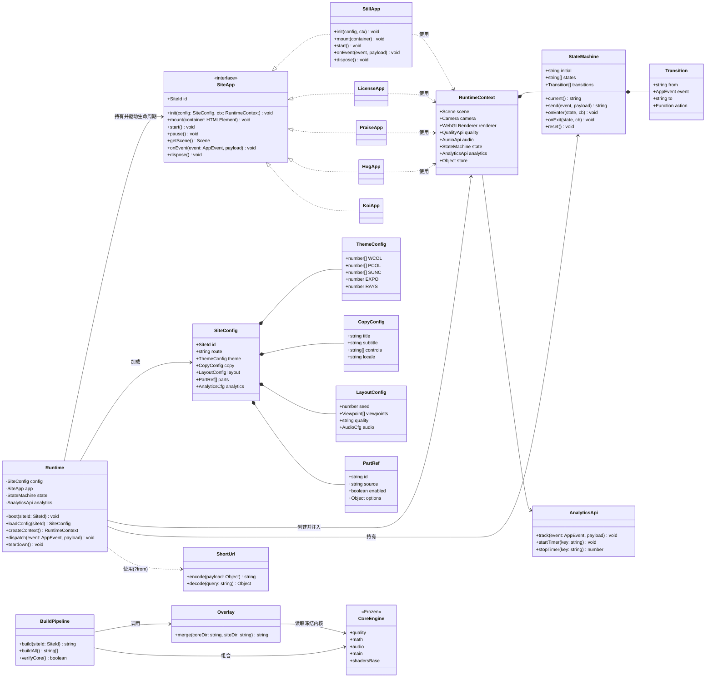
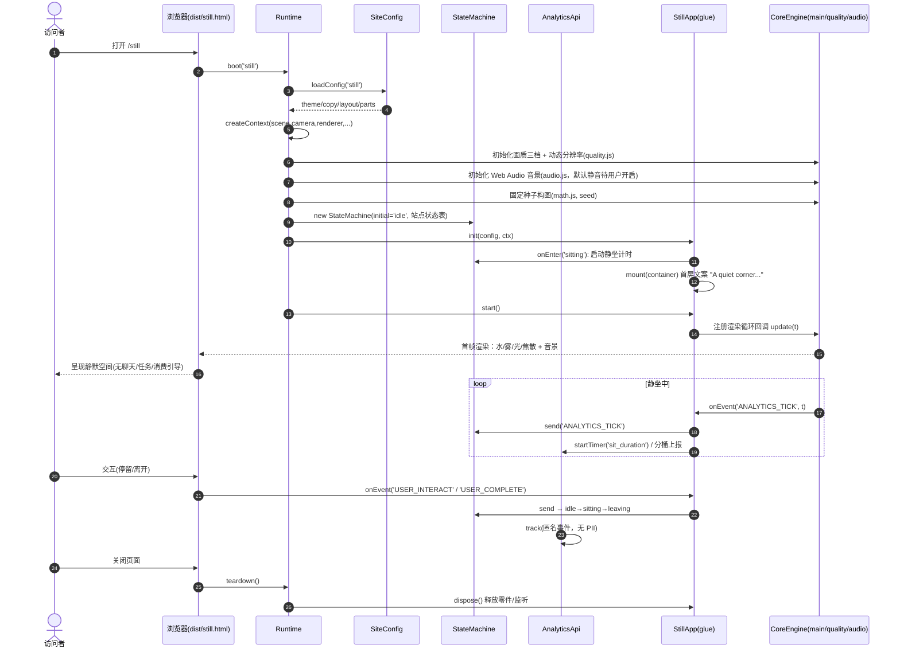
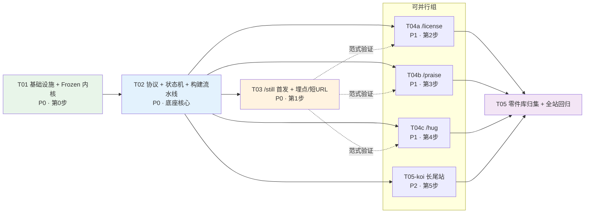

# 情绪脉冲站群 · 系统架构设计与任务分解（ARCHITECTURE）

> 版本 **v1.1** ｜ 2026-11-17 ｜ 架构师：高见远（Gao）
> 上游输入：许清楚（Xu）《PRD v1.0》、《05-代码复用与合并方案》v2.0（nodeId `UFZXF3Azu94ZxzTwxYUMTH`）、《05-代码复用脑图》
> 事实校准输入：abyssal-garden 真实源码 `github.com/Noniv/abyssal-garden @ a596354`（主理人克隆并核实，`_source_probe/abyssal-garden/source/`）
> 本文只做设计与任务分解，不含实现代码。全文简体中文。
>
> **v1.1 修订说明**（据真实源码校准落地机制，v1.0 已定稿的 Q4 裁决 / 四层目录 / 插件协议 / 任务分解均不变）：
> 1. **冲突 1 · 构建机制**：真实 `build.mjs` 无 ES module import，而是把 6 个源文件按固定 `FILES` 顺序**拼接进一个 `async IIFE` 共享作用域**（esbuild 仅作 `transformSync` 压缩，非 bundle）。据此把 overlay 从"import 解析层"改为**文件读取层同名替换**——拼接顺序不变，读每个文件时站点同名文件优先、否则取 core 原文件。
> 2. **冲突 2 · 配色落点**：真实源码 `WCOL/PCOL/SUNC` 在 `shaders.js`（WGSL `vec3f(...)` 语法），`EXPO/RAYS` 却在 `main.js`（JS 浮点字面量，与 `TANH/NEAR` 同一声明行）。裁决采用**构建期精确锚点注入**：core 文件落盘一行不改、哈希基线零例外，站点只写配置；`ThemeConfig` 仍保持 5 字段不变，仅落点拆分。

---

## 0. 设计总纲（先给结论）

用户的最硬约束只有一句：**站群 = 稳固共享底座 + 可插拔应用**；底座稳定性优先于单站交付速度；新增站点 / 换零件 / 调参数都不推翻底座；任一站点改动不影响其他站点。

文档既定的三个事实必须同时保留，不能为了"架构美观"而丢掉：

1. **单 HTML + 零外部资源**（Three.js r169 / WGSL / Web Audio 全部内联）；
2. **各站独立持有 build 后的单 HTML 产物**（不是运行时共享一份代码）；
3. **共享的是源码骨架与构建脚本，不共享 UI 外观**（文档原话："各站各自持有一份 build 后的单 HTML 产物……不共享 UI 外观"）。

因此本架构的核心命题是：**让"底座单一真相源"与"每站独立单 HTML"在构建时和解，而不是在运行时耦合。** 结论是先构建期组合、后运行期隔离。

---

## 1. 实现方案与框架选型（含 Q4 正式裁决）

### 1.1 Q4 正式裁决

> Q4：「稳固共享底座 + 可插拔应用」与文档「整仓复制、各站独立单 HTML、共享源码骨架与构建脚本」如何在架构上统一？

**裁决：采纳主理人提出的 monorepo 多入口方向，但做两处关键改良后定稿。**

| # | 主理人提案 | 我的裁决 | 理由 |
| --- | --- | --- | --- |
| 1 | monorepo 多入口构建 | ✅ 采纳 | 单一真相源 + 每站独立产物，天然同时满足"底座稳定"与"站点隔离" |
| 2 | Vite multi-page 作为备选 | ❌ 不采用，沿用并增强 **abyssal-garden 原生构建（拼接 IIFE + esbuild transform 压缩 + 模板内联）** | 单 HTML 是硬约束；真实源码 build 是"6 文件拼接 + 单个 async IIFE + `transformSync` 压缩 + `/*SCRIPT*/` 内联"，本就是零外部资源、最快最可控；Vite 的 chunk 会诱导多文件、`singlefile` 插件属额外重栈，且会破坏这套已验证的机制 |
| 3 | 底座源码"一行不改"地被复用 | ✅ v1.1 精确落地（见 §1.2） | 真实源码证实 6 文件拼接进共享作用域、无 import；改用"L1 文件读取层同名替换 + L2 构建期锚点注入"两级覆盖：`shared/core/` 落盘文件哈希锁定恒不改，站点差异全在配置或 `override/` 副本。`main.js` 的 `EXPO/RAYS` 不在 Frozen 白名单里也不需破例——由 L2 注入解决 |
| 4 | `init/mount/getScene/dispose` 插件接口 | ✅ 采纳并补全 | 补足 `start/pause/onEvent` 与统一状态机桥接，形成完整生命周期 |

**定稿方案一句话（v1.1）**：*轻量 monorepo（单一 `package.json`）+ Frozen Core 分层不变量（落盘文件哈希锁定、一行不改）+ 两级覆盖（L1 文件读取层同名替换处理结构变化，L2 构建期锚点注入处理 5 个配色参数）+ SiteApp 插件协议（站点实现接口）+ 沿用原版拼接 IIFE + esbuild transform 压缩 + `/*SCRIPT*/` 内联的单 HTML 构建（每站一个入口、一个独立产物）。*

### 1.2 底座"一行不改"如何与"按站点改配色文案"共存 —— 这是全案关键

> **v1.1 重写**：真实源码没有 JS 模块系统，我 v1.0 设想的"import 解析层 overlay"不成立。以下是贴合真实构建机制、并经源码逐行核实的落地方案。

#### 1.2.1 先看真实构建机制（事实基线）

`source/build.mjs` 的真实逻辑（已核实）：

```js
const FILES = ['quality.js','math.js','shaders.js','world.js','main.js','audio.js']; // 顺序影响作用域，不可变
let js = FILES.map(f => readFileSync(path.join(here,'src',f),'utf8')).join('\n');   // ① 按文件名拼接
const wrap = body => `(async()=>{${body}\n})().catch(...)`;                          // ② 包进单个 async IIFE
html = template.html.replace('/*SCRIPT*/', () => wrap(minify(js)));                  // ③ 内联进模板占位符
```

三个决定性事实：
1. **6 个文件拼接进同一函数作用域**，`shaders.js` 的 `const WCOL` 与 `main.js` 的 `const EXPO` 彼此直接可见——**没有 import，没有模块边界**；
2. `template.html` 只有**一个 `/*SCRIPT*/` 占位符**（含 CSS、DOM、首屏文案）；
3. esbuild 在这里只做 `transformSync`（minify + WGSL/CSS 压缩），**不是 bundle**——因为 Three.js r169 本身就是内联在 `main.js` 里的整段源码，无需打包依赖。

#### 1.2.2 裁决：两级覆盖（Structural Overlay + Constant Injection）

据此确立**两级覆盖**，把"结构变化"与"参数变化"分开处理，二者都不改 core 落盘文件：

| 级别 | 机制 | 适用场景 | core 文件是否落盘改动 |
| --- | --- | --- | --- |
| **L1 结构级 · 文件读取层同名替换** | 按 `FILES` 顺序读文件时，**站点目录同名文件优先，否则取 core 原文件** | 需要整段替换场景（如 `/still` 叠加雨效改 `world.js`、换着色器改 `shaders.js`、换首屏改 `template.html`） | ❌ 否（站点副本在 `sites/<name>/override/`） |
| **L2 参数级 · 构建期精确锚点注入** | 对**拼接后的 js 字符串**做常量字面量精确替换 | 只调配色/曝光/光束 5 个数值（`WCOL/PCOL/SUNC/EXPO/RAYS`） | ❌ 否（core 落盘恒为原值，仅产物字符串变化） |

**L1 文件读取层替换（替代 v1.0 的 import overlay）**：

```
for f of FILES:  src[f] = read( sites/<name>/override/f ?? shared/core/f )
js = src.join('\n')   // FILES 顺序、IIFE 包装、共享作用域全部保持原样
```

- 拼接顺序 `FILES` **一行不改**，IIFE 包装原样保留；
- `shared/core/` 存放 abyssal-garden 原文件（原文件名、原目录、原内容），SHA-256 锁定于 `BASELINE.sha256`，任何落盘改动即构建失败；
- 站点只在确有整段替换需求时才放同名文件到 `override/`，绝大多数站点无需放。

**L2 锚点注入（解决冲突 2：5 常量跨两文件）**：

真实源码里 5 个常量的落点是分开的（已逐行核实）：

| 常量 | 真实落点 | 语法形态 | 原值 |
| --- | --- | --- | --- |
| `WCOL` | `shaders.js:196` | WGSL 风格 `vec3f(...)`（JS 侧调用） | `vec3f(.16, .58, .90)` |
| `PCOL` | `shaders.js:198` | 同上 | `vec3f(.58, .66, .98)` |
| `SUNC` | `shaders.js:199` | 同上（**HDR 光强，可 >1**） | `vec3f(1.7, 1.6, 1.45)` |
| `EXPO` | `main.js:393` | JS 浮点字面量（与 `TANH/NEAR` 同一 `const` 声明行） | `0.62` |
| `RAYS` | `main.js:393` | JS 浮点字面量（同上） | `0.54` |

注入器 `shared/build/inject-theme.mjs` 对**拼接后的 js 字符串**按正则锚点替换，规则：

- 三条 `vec3f` 常量：锚点 `const WCOL = vec3f(...)` 整行，注入站点 `theme.WCOL` 的三个分量，**保留 `vec3f(...)` 包裹语法**；
- 两个浮点常量：锚点 `main.js` 中 `EXPO = 0.62`、`RAYS = 0.54`，注入站点 `theme.EXPO/RAYS` 数值，**只替换该数字 token，不动同一行的 `TANH=0.6/NEAR=0.1`**；
- **唯一性校验**：每个锚点必须且仅匹配 1 次，否则构建失败（防止 core 升级后锚点漂移导致静默错配）；
- **两级覆盖协同规则**：若站点确需用 L1 整段替换 `shaders.js`/`main.js`，其替换文件**必须原样保留这 5 个常量声明锚点**（只改场景逻辑、不改常量声明形态），否则 L2 注入因锚点缺失而构建失败——这是刻意设计的护栏，保证配色始终由单一真相源 `site.config.ts` 控制；实操中 P0–P1 四站均无需替换这两个文件；
- **注入只发生在内存字符串与产物**，`shared/core/*.js` 落盘文件永远是原值 → `BASELINE.sha256` **零例外、无需按站点适配**。

#### 1.2.3 为什么这样裁决（对三个备选的回应）

针对主理人给出的冲突 2 三选项：

- **(a) main.js 加入可覆盖白名单**：❌ 否决。等于让站点整份复制 400+ 行的 `main.js` 只为改 2 个数字，与"复制占比 ≥85%、自研 ≤15%"和"底座一行不改"双重目标冲突，且站点副本会随 core 升级而漂移。
- **(b) 构建期精确常量注入**：✅ **采用**。core 落盘恒不变、哈希基线零例外；站点只写 5 个配置值，`ThemeConfig` schema 保持 `WCOL/PCOL/SUNC/EXPO/RAYS` 五字段不变、仅落点拆分（前 3 个落 `shaders.js`，后 2 个落 `main.js`）；唯一性锚点 + 基线校验保证除这 2 个常量外 `main.js` 其余逻辑**不可能**被站点改动（站点根本没有 main.js 副本，且注入器只碰数字 token）。
- **(c) 其他**：L1 文件读取层替换已覆盖需要整段替换的场景，与 (b) 组合成"两级覆盖"，无需再引入第三种机制。

**净效果**：`shaders.js`/`world.js`/`template.html` 的"同名替换"是文档既有做法的忠实落地；5 个色值改由配置注入，使"调参数"这条路径连文件副本都不需要——比文档原做法更彻底地满足"调参数不推翻底座"。

### 1.3 备选方案对比（为何选它）

| 方案 | 底座单一真相源 | 单 HTML 零外链 | 改一站不影响他站 | 新增站点成本 | 结论 |
| --- | --- | --- | --- | --- | --- |
| **A. 定稿：monorepo + 两级覆盖 + esbuild transform** | ✅ 一份 Frozen Core，哈希锁定 | ✅ 拼接+压缩后内联进模板 | ✅ 各站独立构建、独立产物 | 新建站点目录 + 写配置（+ 可选 override） | **✅ 采用** |
| B. Vite multi-page + singlefile 插件 | ✅ 一份源码 | ⚠️ 需插件 + 额外处理 WGSL/Three 内联 | ⚠️ 共享 chunk 会把站点耦合进同一图 | 中 | ❌ 引入文档外重栈，背离轻量构建 |
| C. 文档原始做法：整仓复制 N 份 | ❌ N 份引擎副本，修 bug 要改 N 次，底座必然漂移 | ✅ | ✅ | 复制整仓（含引擎） | ❌ 不满足"底座一行不改"的可验证性 |
| D. symlink 符号链接共享 | ✅ | ✅ | ⚠️ 链接断裂即全站受影响 | 低 | ❌ Windows 权限 / git 兼容差，语义不清 |

方案 A 本质上是**方案 C 的现代化改良**：保留它"每站独立单 HTML"的收益，用集中式内核 + 构建期组合消除它的致命伤（N 份副本漂移）。

### 1.4 架构分层与架构模式

| 层 | 目录 | 职责 | 可变性 |
| --- | --- | --- | --- |
| L0 冻结内核 Frozen Core | `shared/core/` | 引擎：画质/噪声/音频/渲染循环/相机控制/着色器主体 | **不可变**（哈希锁定） |
| L1 协议与运行时 Contract | `shared/contract/` | SiteApp 接口、SiteConfig schema、统一状态机、Runtime、埋点、短 URL | 受控演进（底座能力） |
| L2 构建流水线 Build | `shared/build/` | 文件读取层同名替换、锚点注入、拼接+esbuild transform 压缩、模板内联、站点注册 | 受控演进（底座能力） |
| L3 零件总库 Parts Library | `shared/parts-library/` | 11 类零件的原始复制件与来源清单 | 只增不改 |
| L4 站点 Sites | `sites/<name>/` | 配置层 + 零件层 + glue + 可选覆盖 | **随意增删改，互不影响** |

架构模式：L1 采用 **插件架构（Plugin）+ 控制反转（IoC）**——Runtime 持有生命周期，站点通过实现 `SiteApp` 被"插入"；L4 内部 glue 采用 **适配器模式（Adapter）**，把形态各异的零件适配到统一接口；状态采用 **有限状态机（FSM）+ 事件驱动**。

---

## 2. 完整目录结构（文件树）

```
emopulse_station_cluster/                    # 轻量 monorepo 根
├─ package.json                              # 单一依赖声明 + scripts: build / build:all / dev / verify:core
├─ tsconfig.json                             # strict, moduleResolution=bundler
├─ .gitignore                                # 忽略 node_modules / dist / 临时文件
├─ README.md
│
├─ shared/
│  ├─ core/                                  # ★ L0 Frozen Core —— abyssal-garden/source 整仓原样（一行不改）
│  │  ├─ src/
│  │  │  ├─ quality.js                        # 三档画质 + 动态分辨率 + GPU timestamp 自适应 + localStorage
│  │  │  ├─ math.js                           # 固定种子噪声 / 随机数 / mesh 构建
│  │  │  ├─ shaders.js                        # 水/雾/光/焦散 WGSL；顶部 WCOL:196/PCOL:198/SUNC:199
│  │  │  ├─ world.js                          # 场景布局（结构级可替换）
│  │  │  ├─ main.js                           # 渲染/相机/controls/6视点；EXPO/RAYS 在 393 行
│  │  │  └─ audio.js                          # Web Audio 实时合成音景（零音频文件）
│  │  ├─ template.html                        # 单 HTML 外壳；唯一占位符 /*SCRIPT*/（含 CSS/DOM/首屏文案）
│  │  ├─ build.mjs                            # 原版构建脚本（参考基线，不执行；改造版在 shared/build/）
│  │  ├─ package.json                         # 原版依赖（three r169 内联源码等）
│  │  └─ BASELINE.sha256                      # ★ 冻结内核哈希基线：锁定上述原文件，CI/构建校验
│  │
│  ├─ contract/                              # ★ L1 插件协议 + 运行时（自研 glue 框架）
│  │  ├─ types.ts                             # SiteApp / SiteConfig / ThemeConfig / CopyConfig / LayoutConfig / PartRef
│  │  ├─ events.ts                            # 统一事件名常量（跨站点口径一致，供埋点复用）
│  │  ├─ state-machine.ts                     # 通用有限状态机实现
│  │  ├─ runtime.ts                           # 底座运行时：加载 config、驱动生命周期、桥接渲染循环
│  │  ├─ bridge.ts                            # 把 core/main.js 渲染循环桥接到 SiteApp.start/pause
│  │  ├─ analytics.ts                         # 自研③ 埋点：匿名事件上报 + 静坐计时
│  │  ├─ short-url.ts                         # 自研③ 短 URL ?from=<encoded> 编解码
│  │  └─ index.ts                             # 协议统一导出
│  │
│  ├─ build/                                 # ★ L2 构建流水线（改造自原版 build.mjs，逻辑对齐）
│  │  ├─ build.mjs                            # 入口：node build.mjs still | all；按 FILES 顺序拼接 IIFE
│  │  ├─ sites.config.mjs                     # 站点注册表：id → 目录 / 路由 / 输出名
│  │  ├─ resolve-overlay.mjs                  # L1 文件读取层同名替换：站点 override/ 优先，否则 core 原文件
│  │  ├─ inject-theme.mjs                     # L2 锚点注入：WCOL/PCOL/SUNC(vec3f) + EXPO/RAYS(浮点)，含唯一性校验
│  │  ├─ inline.mjs                           # esbuild transformSync 压缩 + 内联进 template /*SCRIPT*/ → 单 HTML
│  │  └─ verify-core.mjs                      # 哈希校验，防止 core 落盘文件被改动
│  │
│  └─ parts-library/                         # ★ L3 零件总库（11 类，按需逐步归集）
│     ├─ README.md                            # 零件索引表：零件名 / 来源 URL / 源文件 / 装到哪一站
│     ├─ micro-scenes/                        # gpt6-Astra_3.js 六微缩场景
│     ├─ forest/                              # verdant-forest（可选场景零件）
│     ├─ koi/                                 # zz85/random-sketches 三着色器
│     ├─ dandelion/                           # DandelionMeadow.ts + BlowInput.ts
│     ├─ rain-webgpu/                         # yisky: createHeightMap/createRain/createRipples/createPostPipeline
│     ├─ room-at-dawn/                        # 噪声纹理 + CPU 烘焙
│     ├─ crimson-loong/                       # 60_dragon.js 时间轴
│     ├─ sylva/                               # 指针 NDC + 平面射线
│     ├─ paper-plane/                         # clip / fold / flightPosition
│     └─ grand-atelier/                       # 击弦机联动几何
│
├─ sites/                                    # ★ L4 站点层（薄入口，彼此隔离）
│  ├─ still/                                  # /still 清静站（首发，P0）
│  │  ├─ index.ts                             # export default StillApp（实现 SiteApp）
│  │  ├─ site.config.ts                       # 配置层：theme(5色值，L2注入) / copy / layout / parts / analytics
│  │  ├─ state.ts                             # 状态定义 idle → sitting → leaving
│  │  ├─ glue.ts                              # SiteApp 实现 + 静坐计时 + 零件挂载
│  │  ├─ override/                            # L1 结构级同名替换（可选；仅放需整段替换的文件）
│  │  │  ├─ template.html                     #   首屏 "A quiet corner. Nothing to do here."
│  │  │  └─ world.js                          #   静室布局（P2 叠加 rain/koi/scene 时才放）
│  │  └─ parts/                               # 可选叠加零件（P2，默认关闭）
│  │     ├─ rain.ts / koi.ts / micro-scene.ts
│  │     └─ README.md
│  │  # 注：配色/曝光/光束走 site.config.ts 的 theme（L2 注入），无需 shaders.js 副本
│  │
│  ├─ license/                                # /license 发证机（P1）
│  │  ├─ index.ts / site.config.ts / state.ts / glue.ts
│  │  ├─ parts/
│  │  │  ├─ atelier-stamp.js                   # Grand Atelier「琴键→琴槌→制音器」改「按钮→印章→出证」
│  │  │  ├─ loong-timeline.js                  # Crimson Loong 事件表 verifying→stamping→approved
│  │  │  ├─ room-paper.js                      # Room at Dawn 公文纸纹（噪声+Canvas，不加载贴图）
│  │  │  └─ paper-plane.js                     # fold()+flightPosition() 飞走彩蛋
│  │  └─ certificate-export.ts                # 自研② Canvas 许可证导出（编号/日期/印章/宣言）
│  │
│  ├─ praise/                                 # /praise 热敏打印机（P1）
│  │  ├─ index.ts / site.config.ts / state.ts / glue.ts
│  │  ├─ parts/
│  │  │  ├─ thermal-paper.js                   # Room 热敏纸纹 + 锯齿边
│  │  │  ├─ paper-layers.js                    # 折纸 正反面双材质 + PAPER_GAP 纸层前后关系
│  │  │  ├─ pointer-part.js                    # sylva 指针 NDC + 平面射线拨开
│  │  │  └─ typewriter.js                      # 逐行吐出（复用 core 加载/UI 动画思路）
│  │  ├─ praise-engine.ts                      # 自研① 夸夸句式引擎（本地模板）
│  │  └─ ticket-export.ts                      # 自研② Canvas 小票导出
│  │
│  ├─ hug/                                    # /hug 拥抱（P1）
│  │  ├─ index.ts / site.config.ts / state.ts / glue.ts
│  │  ├─ parts/
│  │  │  ├─ DandelionMeadow.ts                 # 整段复制：ready→drifting→away + aRelease/DETACH_SECONDS
│  │  │  ├─ BlowInput.ts                       # 整文件复制：麦克风（可选，按钮兜底）
│  │  │  └─ flight.ts                          # 折纸 flightPosition(t) 弧线飞行 + 切线转向
│  │  ├─ hug-phrases.ts                        # 自研① 拥抱短句库
│  │  └─ README.md                             # ?from=<encoded> 路由 + Hug them back 闭环说明
│  │
│  └─ koi/                                    # 搜索长尾站（P2，W2，相对独立）
│     ├─ pond/  ink/  watercolor/              # 三风格整页复制，三个可搜索落地页
│     └─ site.config.ts
│
├─ content/                                   # 自研① 情绪文案库（跨站共用，Hack 点）
│  ├─ still.ts / license.ts / praise.ts / hug.ts
│  └─ README.md
│
└─ dist/                                      # ★ 构建产物：每站一个独立单 HTML，零外部资源
   ├─ still.html   license.html   praise.html   hug.html
   └─ koi-pond.html   koi-ink.html   koi-watercolor.html
```

---

## 3. 应用插件协议 / 接口定义（可插拔落地核心）

### 3.1 TypeScript 接口（等价契约，工程师可照此实现）

```ts
// ===== shared/contract/types.ts =====
import type * as THREE from 'three';

/** 站点 ID——枚举，新增站点需在此登记（唯一需要改的底座文件之一，只加不改） */
export type SiteId = 'still' | 'license' | 'praise' | 'hug'
                   | 'koi-pond' | 'koi-ink' | 'koi-watercolor';

/**
 * ① 配色常量——五字段保持不变，仅"落点"跨两个文件（v1.1 据真实源码校准）：
 *   WCOL/PCOL/SUNC → shaders.js 顶部，源码为 WGSL 风格 vec3f(r,g,b)（JS 侧调用），注入时保留 vec3f(...) 包裹；
 *   EXPO/RAYS      → main.js 第 393 行，源码为 JS 浮点字面量（与 TANH=0.6/NEAR=0.1 同一 const 声明行），注入只替换数字 token。
 *   由 shared/build/inject-theme.mjs 对拼接后的 js 字符串做锚点注入，core 落盘文件恒不变。
 */
export interface ThemeConfig {
  WCOL: [number, number, number]; // 水体主色，映射 shaders.js:196 vec3f(.16,.58,.90)，分量 0..1
  PCOL: [number, number, number]; // 粒子/焦散色，映射 shaders.js:198 vec3f(.58,.66,.98)，分量 0..1
  SUNC: [number, number, number]; // 太阳 HDR 光强，映射 shaders.js:199 vec3f(1.7,1.6,1.45)，可 >1（非普通 RGB）
  EXPO: number;                   // 曝光，映射 main.js:393 的 0.62（JS 浮点字面量）
  RAYS: number;                   // 光束强度，映射 main.js:393 的 0.54（JS 浮点字面量）
}

/** ② 首屏文案——对应 template.html */
export interface CopyConfig {
  title: string;
  subtitle: string;
  controls: string[];                 // 如 ['Sit', 'Listen', 'Leave']
  locale: 'zh' | 'en' | 'zh-en';
}

/** ③ 布局参数——对接 core 的 world.js / math.js / quality.js / audio.js */
export interface LayoutConfig {
  seed: number;                       // 固定种子，保证刷新构图一致（math.js）
  viewpoints: Viewpoint[];            // 6 视点骨架参数
  quality: 'low' | 'medium' | 'high' | 'auto'; // quality.js 三档 + 自适应
  audio: { enabled: boolean; volume: number };  // audio.js
}

/** 零件引用——glue 据此从 parts-library 装载零件 */
export interface PartRef {
  id: string;                         // 如 'atelier-stamp'
  source: string;                     // 零件总库路径，如 'grand-atelier'
  enabled: boolean;                   // 支持场景变体开关，不影响底座
  options?: Record<string, unknown>;  // 零件私有参数
}

/** 站点完整配置 schema */
export interface SiteConfig {
  id: SiteId;
  route: string;                      // '/still'
  theme: ThemeConfig;
  copy: CopyConfig;
  layout: LayoutConfig;
  parts: PartRef[];
  analytics: { enabled: boolean; sitTiming?: boolean };
}

/** 运行时上下文——Runtime 注入给站点，站点不自行 new 引擎 */
export interface RuntimeContext {
  scene: THREE.Scene;
  camera: THREE.Camera;
  renderer: THREE.WebGLRenderer;
  quality: QualityApi;                // 来自 core/quality.js
  audio: AudioApi;                    // 来自 core/audio.js
  state: StateMachine;                // 统一状态机
  analytics: AnalyticsApi;            // 埋点
  store: Record<string, unknown>;     // 站点私有数据槽
}

/** ★ 站点插件接口——所有站点必须实现，Runtime 按此契约驱动生命周期 */
export interface SiteApp {
  readonly id: SiteId;
  init(config: SiteConfig, ctx: RuntimeContext): void; // 读配置、创建零件实例
  mount(container: HTMLElement): void;                  // 挂载 UI / DOM
  start(): void;                                        // 进入渲染循环
  pause(): void;                                        // 离开渲染循环
  getScene(): THREE.Scene;                              // 暴露场景给 core 渲染
  onEvent(event: AppEvent, payload?: unknown): void;    // 统一事件入口 → 驱动状态机 → 触发零件
  dispose(): void;                                      // 释放零件/监听，保证站点热切换不泄漏
}
```

### 3.2 统一状态机设计

**关键澄清**：外层统一状态机**不替代**零件内部状态机（如蒲公英 `ready→drifting→away`、Loong 时间轴）。零件内部一行不改；glue 把零件内部状态**映射/对齐**到外层 FSM，从而统一事件名与埋点口径。这样既"统一"又不侵入零件。

```ts
// ===== shared/contract/state-machine.ts =====
export type AppEvent =
  | 'APP_INIT' | 'APP_READY' | 'APP_START' | 'APP_PAUSE' | 'APP_DISPOSE'
  | 'USER_INTERACT' | 'USER_COMPLETE' | 'USER_SHARE'
  | 'ANALYTICS_TICK'
  | `STATE_${string}`;                 // 站点自定义扩展事件

export interface Transition<S extends string = string> {
  from: S;
  event: AppEvent;
  to: S;
  action?: (payload?: unknown) => void;
}

export interface StateMachine<S extends string = string> {
  readonly initial: S;
  readonly states: readonly S[];
  readonly transitions: readonly Transition<S>[];
  current(): S;
  send(event: AppEvent, payload?: unknown): S;   // 触发转移并执行 action
  onEnter(state: S, cb: () => void): void;
  onExit(state: S, cb: () => void): void;
  reset(): void;
}
```

**各站点状态映射到统一 FSM**：

| 站点 | 外层统一状态（站点自定义） | 触发事件 | 对应零件内部状态（不改动） |
| --- | --- | --- | --- |
| /still | `idle → sitting → leaving` | `USER_INTERACT` / `ANALYTICS_TICK` | 静坐计时（crimson-loong 时间轴思路） |
| /license | `verifying → stamping → approved → flying` | `USER_INTERACT` / `USER_COMPLETE` | Loong 事件表；盖章机械；纸飞机飞走 |
| /praise | `idle → peeking → printing → exported` | `USER_INTERACT` / `USER_SHARE` | sylva 指针拨开；逐行吐出 |
| /hug | `ready → drifting → away → hug-back` | `USER_INTERACT` / `USER_SHARE` | DandelionMeadow `ready→drifting→away`；`?from=` 回赠 |

### 3.3 glue 如何接零件（适配器范式）

每个站点的 `glue.ts` 是"自研第 4 件事"的落点，遵循统一三步法，把形态各异的零件适配成 SiteApp：

| 生命周期 | glue 的动作 | 零件侧约定 |
| --- | --- | --- |
| `init()` | 读 `config.parts`，对 `enabled` 的零件调用其 `create<Part>(opts)`，拿到实例存入 `ctx.store`；装载站点状态定义 | 零件统一包装为 `createPart(opts) => { update(t), dispose() }`（包装层写在站点 `parts/`，不动零件原件） |
| `onEvent()` | `state.send(event)` → 根据 `state.current()` 调用对应零件动作（如 `dandelion.release(aRelease, DETACH_SECONDS)`、`stamp.strike()`） | 零件保留自己的私有 API |
| `start()` | Runtime 渲染循环每帧回调各零件 `update(t)`（如 `flightPosition(t)`） | 零件不改内部实现 |

以 `/hug` 为例的 glue 伪码（示意，非最终实现）：

```
init:    dandelion = createDandelion(config); blow = createBlowInput({ fallbackButton: true })
onEvent USER_INTERACT:
         state.send('BLOW')            // ready → drifting
         dandelion.release(aRelease, DETACH_SECONDS)
start:   loop(t) => { dandelion.update(t); flight.update(flightPosition(t)) }
dispose: dandelion.dispose(); blow.dispose();  // 站点切换不泄漏
```

---

## 4. 数据结构与关键类（类图）



---

## 5. 构建流程图（共享底座 + 站点配置 → 独立单 HTML）

```mermaid
flowchart TD
    A[开发者执行 npm run build -- still] --> B[verify-core.mjs<br/>校验 core 落盘文件哈希]
    B -->|不一致| BX[❌ 构建失败<br/>Frozen Core 被改动]
    B -->|一致| C[读取 sites.config.mjs<br/>解析站点注册信息]
    C --> D[加载 sites/still/site.config.ts<br/>theme 5值 / copy / layout / parts]

    D --> E[L1 resolve-overlay.mjs<br/>按 FILES 顺序逐个读文件：<br/>站点 override/ 同名优先，否则 core 原文件]
    E --> F[L2 inject-theme.mjs<br/>对拼接后 js 做锚点注入：<br/>WCOL/PCOL/SUNC(vec3f) + EXPO/RAYS(浮点)<br/>每锚点唯一性校验]
    F -->|锚点不唯一| FX[❌ 构建失败<br/>core 升级致锚点漂移]
    F --> G[按 FILES 顺序 join<br/>包进单个 async IIFE<br/>共享作用域·顺序不变]
    G --> H[inline.mjs<br/>esbuild transformSync 压缩<br/>WGSL/CSS 压缩 + 拼装 contract 运行时]
    H --> I[template.html.replace<br/>SCRIPT 占位符 ← 压缩后 code]
    I --> J[产出 dist/still.html<br/>单 HTML · 零外部资源]
    J --> K{构建全部?}
    K -->|是| L[build:all 逐站重复<br/>输出 license/praise/hug/koi*.html]
    K -->|否| M[完成]

    subgraph 隔离保证
      N[每站独立构建任务] -.->|互不读写| O[其他站点目录]
      P[改任一站点 theme/配置] -.->|core 落盘恒不变| Q[BASELINE.sha256 零例外]
    end
```

**产物隔离保证**：构建任务按站点维度独立；`/still` 的构建输入只包含 `shared/core` + `sites/still`，不读取其他站点目录；改任一站点配置不会改变其他站点产物的字节（可哈希断言）。

---

## 6. 程序调用时序图（以 /still 加载为例）



---

## 7. 有序任务列表（给工程师的执行清单）

> 受任务粒度上限约束，给出 **5 个主任务（T01–T05）**，每个任务内含子项，完整覆盖：底座骨架 → 构建流水线 → 应用协议 → /still → /license → /praise → /hug → koi 长尾 → 自研 4 件事。
> **串行主线**：T01 → T02 → T03 → T04 → T05（后者依赖前者的协议/范式验证）。
> **可并行**：T02 内「协议」与「构建脚本」两条子线；T04 内 /license、/praise、/hug 三站；T05 的 koi 只依赖 T02，可与 T04 并行推进。

### T01 · 项目基础设施与 Frozen 内核就位 【P0｜无依赖｜串行起点｜对应第 0 步】

- **涉及文件**：`package.json`、`tsconfig.json`、`.gitignore`、`shared/core/*`（整仓复制）、`shared/core/BASELINE.sha256`、`shared/build/verify-core.mjs`
- **源码来源（已克隆，无需联网）**：`C:/Users/Lenovo/WorkBuddy/2026-11-17-13-04-03/_source_probe/abyssal-garden/source/`，其中 JS 源码在 `.../source/src/`（6 文件）。工程师直接从该本地路径整仓复制即可，**不要再联网拉取或重新克隆**。
- **子项**：
  1. 建立轻量 monorepo 骨架，单一 `package.json` 声明依赖与 scripts（`build / build:all / verify:core`）；
  2. 从上述本地路径整仓复制 abyssal-garden 的 `source/` 到 `shared/core/`（含 `src/` 6 文件、`template.html`、`build.mjs`、`package.json`），**保持原文件名与内容一行不改**，`npm install && node build.mjs` 跑通原始单 HTML（第 0 步，30 分钟；B1 已解除）；
  3. 对 core 原文件生成 `BASELINE.sha256` 冻结基线，`verify-core.mjs` 实现哈希校验；
  4. 核实并记录 5 个配色常量锚点的确切文本（`shaders.js:196/198/199` 为 `const WCOL/PCOL/SUNC = vec3f(...)`；`main.js:393` 为 `const TANH=0.6,NEAR=0.1,EXPO=0.62,RAYS=0.54;`），供 T02 注入器使用。
- **验收点**：`node build.mjs` 产出可运行的单 HTML、零外部资源；画质三档自适应与音景可用；`verify:core` 通过；Frozen Core 文件与原仓 `@a596354` 逐字节一致。

### T02 · 应用插件协议 + 统一状态机 + 构建流水线 【P0｜依赖 T01｜内部两子线可并行｜底座可扩展核心】

- **涉及文件**：`shared/contract/{types,events,state-machine,runtime,bridge,analytics,short-url,index}.ts`、`shared/build/{build,sites.config,resolve-overlay,inject-theme,inline,verify-core}.mjs`
- **子项（可并行）**：
  - **子线 A 协议**：定义 SiteApp / SiteConfig（含跨两文件的 ThemeConfig）/ 统一状态机 / Runtime / 自研③埋点与短 URL；
  - **子线 B 构建**（改造自原版 `build.mjs`，逻辑对齐）：按 `FILES` 顺序拼接 IIFE + L1 文件读取层同名替换（`resolve-overlay.mjs`）+ L2 五常量锚点注入（`inject-theme.mjs`，含唯一性校验）+ esbuild `transformSync` 压缩 + `/*SCRIPT*/` 模板内联 + 站点注册。
- **验收点**：用一个 dummy 站点验证"站点 theme 配置 + 可选 override → 独立单 HTML"全链路；改 `site.config.ts` 的 5 个色值后，产物中 `WCOL/PCOL/SUNC` 的 `vec3f(...)` 与 `EXPO/RAYS` 浮点按预期变化，且 `TANH/NEAR` 与 core 其余字节不变；锚点被破坏时构建失败；实现 SiteApp 即可被 Runtime 驱动；七方法齐备；构建不产生任何外部资源引用。

### T03 · /still 首发站 + 自研基础设施接入 【P0｜依赖 T02｜串行验证 glue 范式｜对应第 1 步】

- **涉及文件**：`sites/still/{index,site.config,state,glue}.ts`、`sites/still/override/template.html`（首屏文案）、`content/still.ts`、`shared/contract/analytics.ts`（接入）
- **子项**：在 `site.config.ts.theme` 配置静室暖灰 5 值（经 L2 注入，无需 shaders.js 副本）；首屏文案放 `override/template.html`（经 L1 替换）；配置固定种子；实现 idle→sitting→leaving 状态与静坐计时；接入埋点；保留"无聊天/无任务/无消费引导"反向设计。
- **验收点**：/still 单 HTML 可运行；产物中配色与首屏文案为静室主题且 core 其余字节不变；打开即 3D 情绪化首屏；静坐计时可用；埋点事件可上报；全站零消费引导；改本站配置后其他站点产物字节不变。

### T04 · /license、/praise、/hug 三站 + 自研四项落地 【P1｜依赖 T02 协议 + T03 范式｜三站可并行｜对应第 2/3/4 步】

- **涉及文件**：
  - /license：`sites/license/*`、`content/license.ts`、`certificate-export.ts`（自研②）
  - /praise：`sites/praise/*`、`content/praise.ts`、`praise-engine.ts`（自研①）、`ticket-export.ts`（自研②）
  - /hug：`sites/hug/*`、`content/hug.ts`、`short-url.ts` 接入、`?from=` 闭环
  - 零件：`shared/parts-library/{grand-atelier,crimson-loong,sylva,paper-plane,dandelion,room-at-dawn}/*`
- **子项**：各站按 §3.3 glue 三步法接零件；Canvas 凭证导出（许可证/小票按尺寸与安全区定制）；夸夸句式引擎与拥抱短句库；`?from=<encoded>` + Hug them back 闭环；BlowInput 麦克风默认不主动授权、按钮兜底。
- **验收点**：四段交互（盖章/时间轴/纸纹/飞走；指针拨开/逐行吐出；三状态机/错峰释放/飞向对方）可跑通；两类凭证可导出为图片且与站点风格一致；回赠闭环可用；三站互不破坏底座与其他站点。

### T05 · koi 搜索长尾站 + 零件总库归集 + 全站回归 【P2｜依赖 T02｜koi 可与 T04 并行｜对应第 5 步】

- **涉及文件**：`sites/koi/{pond,ink,watercolor}/*`、`shared/parts-library/README.md`、`dist/*`、`shared/build/sites.config.mjs`（登记）、`shared/core/BASELINE.sha256`（复核）
- **子项**：整页复制 zz85 koi 三着色器 → 三个可搜索落地页；完善零件总库索引（来源 URL / 源文件 / 装到哪）；`build:all` 全站回归；Frozen Core 哈希复核。
- **验收点**：三个 koi 落地页可访问；11 类零件可定位可取用；全站单 HTML 均可独立运行；`verify:core` 通过；任一站点改动不影响其他站点产物的字节哈希。

### 7.1 任务依赖图



---

## 8. 依赖包列表（npm）

> 原则：尽可能沿用文档既有技术，不引入文档外重栈。Three.js r169 **内联进单 HTML**（构建期随 `main.js` 打入，非运行时 CDN；原版无外部依赖、非 bundle）。

| 包 | 版本 | 用途 | 来源 |
| --- | --- | --- | --- |
| `three` | `^0.169.0` | 3D 渲染 / 相机 / controls；**内联** | 文档既有（r169） |
| `esbuild` | `^0.23.0` | `transformSync` 压缩 JS/WGSL/CSS（沿用原版 build.mjs 用法；非 bundle，6 文件已拼接共享作用域） | 构建工具（非运行时栈，原版已用） |
| `typescript` | `^5.5.0` | 协议/站点层类型约束；站点 glue 编译为 JS 后参与拼接（core 为原生 JS，不编译） | 工程化 |
| `tsx` | `^4.16.0` | 开发期执行 TS 配置/脚本 | 工程化 |
| `@webgpu/types` | `^0.1.5` | WGSL/WebGPU 类型（雨效零件，可选） | 文档既有（WebGPU/WGSL） |
| `three-mesh-bvh` | `^0.7.0` | Room at Dawn 烘焙 BVH（零件自带依赖，按需） | 文档既有 |

**不引入**：React / MUI / Tailwind / Vite（站点是单 HTML 内的极简 DOM + Canvas 交互，UI 极简，无组件框架必要；这也符合"不引入文档外重栈"与"零外部资源"）。

**运行时依赖为零**：所有第三方代码在构建期内联；产物 `dist/*.html` 不引用任何外部 URL。

---

## 9. 共享知识（跨文件约定，工程师必读）

| 类别 | 约定 |
| --- | --- |
| 命名规范 | 站点 ID 全小写连字符（`still/license/praise/hug/koi-*`）；配置字段 camelCase；事件名全大写下划线（`USER_INTERACT`）；站点自定义事件 `STATE_<NAME>` |
| 配色常量顺序与落点 | 五值顺序固定 `WCOL → PCOL → SUNC → EXPO → RAYS`，`ThemeConfig` 保持 5 字段不变；**落点跨两文件**：`WCOL/PCOL/SUNC` 在 `shaders.js`（WGSL `vec3f(r,g,b)` 语法，`SUNC` 为 HDR 光强可 >1），`EXPO/RAYS` 在 `main.js:393`（JS 浮点字面量，与 `TANH/NEAR` 同一声明行）。注入时前三者保留 `vec3f(...)` 包裹，后两者只替换数字 token |
| 两级覆盖规则 | **L1 结构级**：按 `FILES` 顺序读文件，`sites/<name>/override/` 同名文件优先、否则取 `shared/core/` 原文件（仅放需整段替换的 `world.js`/`shaders.js`/`template.html`）；**L2 参数级**：`site.config.ts.theme` 的 5 值经锚点注入，无需文件副本。core 落盘恒不变 |
| 构建机制 | 沿用真实源码：6 文件按 `FILES = ['quality','math','shaders','world','main','audio'].js` 顺序 `join('\n')` → 包进单个 `async IIFE` 共享作用域 → esbuild `transformSync` 压缩 → `template.html` 的 `/*SCRIPT*/` 占位符内联；**无 import、无模块边界、非 bundle** |
| 常量注入锚点纪律 | `inject-theme.mjs` 对每个锚点（如 `const WCOL = vec3f(...)`、`EXPO = <num>`）做**唯一性校验**：匹配数必须为 1，否则构建失败；注入仅改内存字符串与产物，不回写 core 落盘文件 |
| Frozen Core 纪律 | `shared/core/` 任何文件落盘改动都需更新 `BASELINE.sha256` 并经架构评审；任何站点逻辑不得写入 core；配色/文案等参数变化一律走 L1/L2，不得改 core 原文 |
| 状态机事件名 | 通用事件：`APP_INIT/APP_READY/APP_START/APP_PAUSE/APP_DISPOSE/USER_INTERACT/USER_COMPLETE/USER_SHARE/ANALYTICS_TICK`；统一事件口径是埋点与 glue 共享的基础 |
| 零件接入约定 | 零件原件一行不改；在站点 `parts/` 写薄包装 `createPart(opts) => { update(t), dispose() }`；glue 只通过包装层调用零件 |
| 固定种子 | 所有场景构图用 `config.layout.seed` 驱动 `math.js`，保证刷新一致；不同站点用不同种子 |
| 单 HTML 产物 | 每站一个 `dist/<id>.html`，自包含、零外部资源；产物是"代码即资产"，各站独立持有、独立部署 |
| API 响应格式 | 无服务端 API；埋点为单向事件上报 `track(event, payload)`，payload 为扁平匿名对象 |
| 时间与编码 | 时间用毫秒时间戳 / 相对秒；`?from=<encoded>` 用 base64url 编码的 JSON，短 URL 纯前端解析、无后端依赖 |
| 复制占比口径 | 按"文件数 + 核心逻辑行数"双口径：Frozen Core + parts-library 复制件计入分子；自研仅 contract/runtime/build glue + content 文案 + 凭证导出；架构上保障 ≥85% |
| 零消费引导 | 全站不出现付费/购买/订阅/广告；凭证是情绪纪念品，非营销券 |

---

## 10. 待明确事项（区分阻塞 / 默认假设）

### 10.1 阻塞项：✅ 已全部解除，T01 可开工

v1.1 初稿中的两个阻塞项（B1 源码、B2 文案库）均已处置完毕，**当前无任何真正阻塞项**：

| # | 原阻塞项 | 处置结论 |
| --- | --- | --- |
| B1 | abyssal-garden 原始源码与 build 脚本 | ✅ **已解除**：源码已克隆至本地 `C:/Users/Lenovo/WorkBuddy/2026-11-17-13-04-03/_source_probe/abyssal-garden/source/`（`@a596354`），build 机制已逐行核实（6 文件拼接 IIFE + esbuild transform + 模板内联），v1.1 架构据此校准；T01 直接整仓复制即可，**无需联网拉取** |
| B2 | `03-西方文化内容库` 的英文文案文件路径 | ✅ **已明确为自撰，非阻塞**：经查资料库空间（spaceId `bU8YKJmWpEkW5Bc88IznLl`）全部节点，不存在独立《03》文档——"03"仅为 05 文档中的引用编号、源头未入库。四站文案由我方 self-authored，这本就属于文档"自研 4 件事"之一（见 §0 与 §7 T03/T04 的 `content/` 文案库），非计划外阻塞；语言策略见 §10.2 Q2 |

> 附：主理人另核对 `ai-opportunity-radar-2026-11-17`，确认 A1「本地文化母体的静默疗愈空间（零社交 / 无任务 / 无消费引导的反向设计）」为榜 A 第 1，`/still` 的 P0 优先级依据成立（与 PRD 引用 [R1] 一致）。

### 10.2 默认假设（已据此设计，不阻塞；如需调整只改配置/站点层，不动底座）

| PRD 问题 | 架构默认假设 |
| --- | --- |
| Q1 部署形态 | 5 站**同域不同路径**（`/still`→`still.html`），静态托管各 HTML 独立上传；改一站只重传那一个 HTML，天然隔离 |
| Q2 文案语言 | `copy.locale` 支持 `zh/en/zh-en`；首发 /still 用英文主文案 + 中文副文案，兼顾文档 Hack 点与中文用户 |
| Q3 基础设施 | 短 URL 采用**纯前端 `?from=` 编码**（零后端）；埋点先做本地/可插拔上报端点，先零基础设施上线，后续再接托管 |
| Q5 复制占比口径 | 按"文件数 + 核心逻辑行数"双口径统计（见 §9） |
| Q6 埋点范围与合规 | 仅匿名事件（页面进入、静坐时长分桶、分享点击、`?from=` 来源），无 PII、无隐私弹窗以保持"无打扰"体验，可配置开关 |
| Q7 麦克风授权 | 默认**不主动请求**；按钮为主交互，用户显式点击"吹气"才 `requestPermission`，拒绝后静默降级到按钮兜底 |
| Q8 koi 关键词 | 默认 `koi pond / ink koi / watercolor koi` 三词，W2 排期，不阻塞本期 |

---

## 附：交付物索引

| 文件 | 内容 |
| --- | --- |
| `ARCHITECTURE.md`（本文） | 系统架构设计 + Q4 裁决 + 协议 + 目录 + 图 + 任务分解 + 依赖 + 共享知识 + 待明确 |
| `class-diagram.mermaid` | §4 类图（独立文件，便于工具渲染） |
| `sequence-diagram.mermaid` | §6 /still 加载时序图（独立文件，便于工具渲染） |
