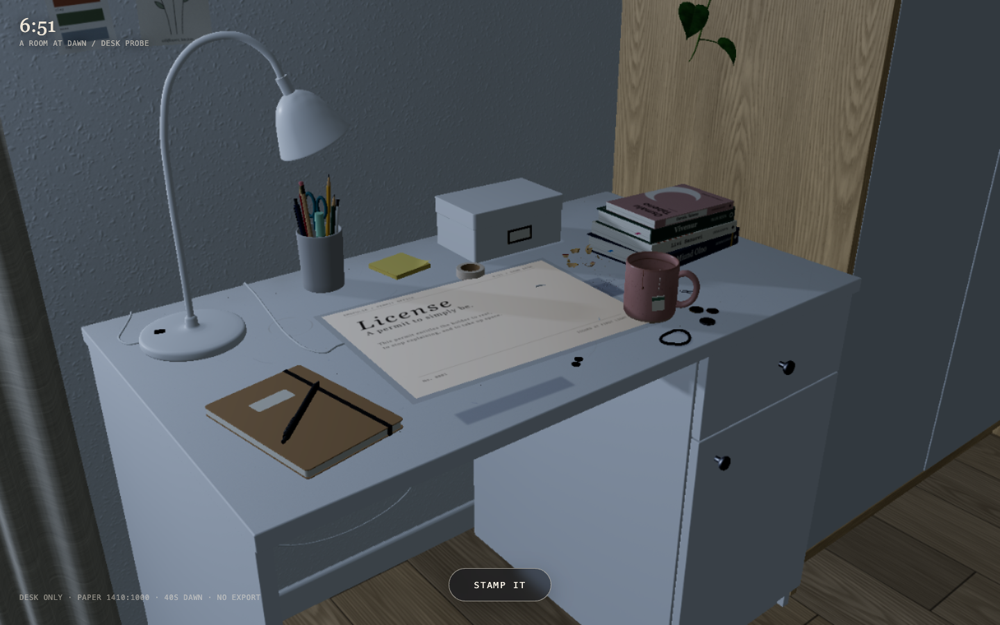
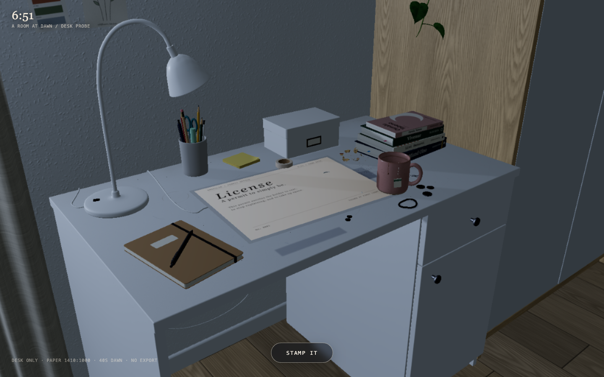
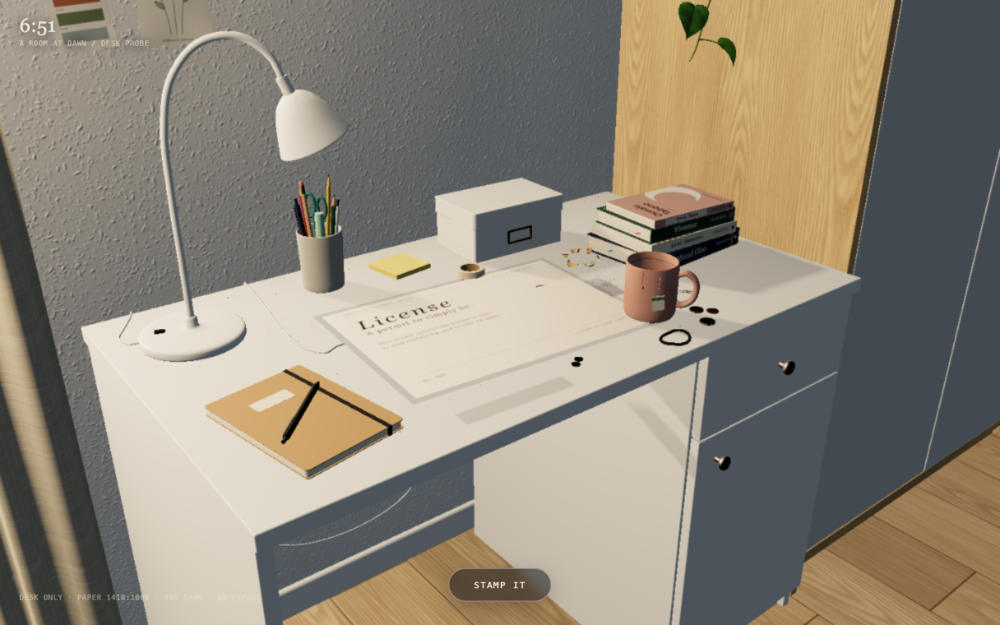
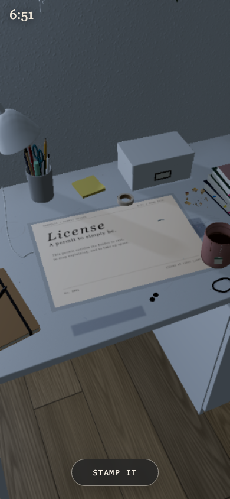

> **2026-11-21 更新**：本文记录的 49.7 万面 room-at-dawn desk-only 探针仅作存档。当前预览已改为 `studio.ts` 自建小书房 + vertical slice（胡桃木写字台、窗、绿植、挂镜、拖章/归档闭环），最新拆件与装配结论见 `docs/THIRD-PARTY-REVIEW-2026-11-21.md`。

# dawn-desk 纸面探针：go / no-go

日期：2026-11-20  
范围：`shared/stage/preview/dawn-desk`（预览专用，不是正式零件）  
上游：`6:51 — a room at dawn` / Leon Lin / MIT（见 `shared/stage/preview/dawn-desk/upstream/LICENSE`）

## 1. 结论

**Conditional GO（有条件通过）。**

desk 这一组能撑起纸面，成本也已经压到 50 万面以内；但“真实窗光阴影”还没有过，不能直接当 `/license` 的成品。

| 门槛 | 结果 | 证据 |
|---|---|---|
| 纸仍是首屏主角 | **PASS** | 1440 下纸宽 483px，占屏宽 33.5%；390 下纸宽 317px，占屏宽 81.4%。画面里唯一的大字号文字在纸面上，纸有独立边缘和透视。 |
| desk-only 成本 | **PASS（预览级）** | 1440×900：68 calls / 497,052 tris / 145 mesh / 59.9fps。390×844：61 calls / 464,564 tris / 59.9fps。 |
| 40 秒晨光有可行路径 | **PARTIAL** | A 只漂色温/曝光：冷蓝 → 暖金，成立。B 移动方向光：光带会扫过纸面，但当前没有可读的窗格/物件投影；“真实窗光阴影”还没成立。 |
| 纸 + 章唯一动作 | **PASS** | `Stamp it` / 点击画布触发一次纸面盖章；章在纸面纹理里，不做导出、不做二次面板。 |

**不通过的部分：**

- 497,052 面是“渲染口径”已经压到 50 万以内；但单文件从 769 KB 涨到 **1,019,044 B（995 KB）**，增量来自 `RectAreaLightUniformsLib` 的 LTC 表，正式站不应直接带这 250 KB。
- 没有搬 12MB 的 desk-only 烘焙 GI；窗玻璃、墙地材质、桌面小物仍是预览级近似。
- B 目前只是“光带移动”，不是“窗格影子扫过纸面”。本轮试过 `SpotLight + cookie` 和窗框投影：前者在抽屉正面投出一圈硬黑边/灯罩大影，压过纸面文字，已回退；后者没有形成可读投影。要过这一关，需要 desk-only GI 烘焙或更便宜的假投影，不能靠现有方向光硬撑。

## 2. 怎么打开

```bash
npm run preview:dawn-desk
# 浏览器直接打开 dist/preview/dawn-desk.html
```

单文件、零外部请求、`file://` 可开。query：

- `?dawn=color`：只漂色温/曝光（默认）
- `?dawn=light`：移动方向光，光带跟着走
- `?t=0..40&freeze=1`：定点看 0s / 40s
- `?clean=1`：隐藏调试条，只留产品画面
- `?full=1`：恢复 exterior 和被裁 fixture，看完整版（不恢复椅子/笔电/叶片，仍是桌面构图）

## 3. 测了什么

### 3.1 纸是不是主角

- 1440×900：纸的屏幕矩形 `x=462.9, y=374.8, w=483.1, h=199.2`；宽占 33.5%，高占 22.1%。
- 390×844：纸的屏幕矩形 `x=52.8, y=329.7, w=317.4, h=190.6`；宽占 81.4%，高占 22.6%。
- 纸是 3D 平面，不是 DOM 贴图；`License / A permit to simply be.` 直接烘在纸面 canvas 上，所以透视、受光、盖章都在同一张纸上。
- 首屏只保留：左上角 `6:51` 标、纸面 H1/hook、底部 `Stamp it`。没有侧栏、没有第二按钮、没有导出。




### 3.2 成本

| 视口 | calls | triangles | meshes | fps | 纸宽占比 |
|---|---:|---:|---:|---:|---:|
| 1440×900 | 68 | 497,052 | 145 | 59.9 | 33.5% |
| 390×844 | 61 | 464,564 | 145 | 59.9 | 81.4% |
| `?full=1` 1440 | 81 | 906,140 | 205 | — | 33.5% |

**模块可见几何（`measure` 按全部实例计，不是渲染提交数）：**

| 模块 | meshes | tris |
|---|---:|---:|
| room | 30 | 169,790 |
| sky | 1 | 960 |
| fixtures | 66 | 147,468 |
| exterior | 0 | 0 |
| desk | 32 | 141,150 |
| plants | 16 | 153,938 |

**裁面账：**

- 默认不建 `exterior`：模块口径 409,088 面（窗外树/房子/远景）不进入 desk 机位。
- `fixtures` 默认隐藏 `radiator` 32,242 + `nightstand` 26,838 + `rug` 6,996 + `ceilingLight` 12,412 = **78,488**。
- 桌面构图隐藏 `chairShell/chairLegs/chairFeet/chairBase` = **28,264**，以及笔电/手机/散落物/尺子。
- `plants` 隐藏 `leaves3` = **20,688**；保留五档叶片，绿萝仍有体积。
- 结果：渲染三角面从 97.7 万降到 **497,052**，draw calls 从 92 降到 68，1440/390 都稳 59.9fps。

这 49.7 万不是纸或桌子本身，主要还是 `room`、`fixtures`、`plants` 的细碎几何。`desk` 只占 14.1 万；纸是 2 个三角面。

**判断：** 预览级通过。正式站若沿用这组模块，应当保留“默认裁 exterior + 隐藏不可见 fixture”的策略；49.7 万仍不是免费，但已经在 50 万目标内，且没有牺牲纸的屏幕占比。

### 3.3 40 秒晨光 A/B

- **A（`?dawn=color`）**：太阳位置不动，只把光色从 `(0.56,0.70,0.98)` 冷蓝推到 `(1.0,0.74,0.47)` 暖金，同时抬曝光。0s 与 40s 的色温差异明显，纸始终可读。
- **B（`?dawn=light`）**：太阳从低角度移到高角度，纸面上的亮带从左侧扫向右侧；但这不是窗格影子，只是区域光 + 方向光形成的亮带。40s 时纸面右半被提亮，正文仍可读，但没有“影子横过纸面”的硬证据。
- 本轮试过两条更“像窗光”的路，都回退了：
  - `RectAreaLight` 直接做窗形填充：颜色和墙地纹理成立，但没有阴影；这是当前采用版本。
  - `SpotLight + cookie` 做四格窗：窗格条影会压到 `License` 正文，灯罩还会在抽屉正面投出大块椭圆，产品上不可接受。
  - 窗框 `winFrame/winSash` 开 `castShadow`：没有形成可读条影，只增加 shadow pass 成本，已回退。





**限制：** 当前是 `RectAreaLight` + 低强度方向光 + 平坦 GI fallback，不是 room 上游的窗光烘焙。A 成立；B 只成立到“亮带会走”，还没有成立到“窗格影子会走”。正式站前要二选一：做 desk-only 的 GI 烘焙，或用接触阴影/假投影补出可读的窗格影子。

### 3.4 纸 + 章

- 章是纸面 canvas 的一部分，位置在右下，红色圆章 `APPROVED / NO COPY KEPT.`；只在 `Stamp it` 或点击画布时出现。
- 没有导出、没有表单、没有“再来一次”面板；第二次点击会取消章（预览便于对比）。
- 盖章后纸的纹理、受光、透视不变，说明“纸 + 章”可以是一个世界内动作，不需要切 DOM。




## 4. 装了什么，没装什么

**装了：**

- `room` 的 room shell + `sky`
- `fixtures` 只保留 `curtains`、`wardrobe`、`sillThings`、`prints`
- `desk` 的桌、灯、书架、桌面物件（隐藏笔电、手机、散落物、尺子、椅子，给纸让位）
- `plants` 的一盆绿萝（隐藏 `leaves3`）
- 窗形 `RectAreaLight`：1.3 × 1.4 m，位置在窗右侧边缘，朝桌面斜射

**没装（默认）：**

- `exterior` 的窗外树/房子/远景（`?full=1` 才建）
- `fixtures` 的暖气片、床头柜、地毯、吊灯
- `bed`、`clutter`、`decor`
- 12MB 的 `gi.bin` 烘焙（没有假装它对 desk-only 有效）
- room 的 `render/pipeline.js`、`film`、音频
- 正式站的 `paper-ink`、`pixel-post`、`/license` DOM

**口径：** 这不是把 `room-at-dawn` 整个项目包成一个零件，而是把它的 `desk` 这一组场景件装进一个预览 world 件。正式装配仍然只允许一个 `world`/`gl` 件；`desk`、`fixtures`、`plants` 不能各自注册成四个 `PartV2`。

## 5. 对正式站的建议

1. **先做 `license-desk` 一个 world 件**，而不是把四个 `WorldFeature` 拆成四个 `PartV2`。如果确实要在 world 内部装多个子件，先把 `WorldFeature` 写进 `shared/stage/contract.ts`；当前契约没有这个槽位。
2. **光要单独做一次决定**：`RectAreaLight` 已经证明“窗形填充 + 色温漂移”可行，但它没有阴影，而且单文件多 250 KB。正式站优先做 desk-only GI 烘焙；如果工期不允许，就用一张假窗格投影/接触阴影补 B，不要直接把 LTC 表带进 `/license`。
3. **裁面策略已经验证**：默认不建 exterior、隐藏 radiator/nightstand/rug/ceilingLight、隐藏椅子与 `leaves3`，可以把 97.7 万压到 49.7 万，且不降纸的屏幕占比。正式站沿用这套“不可见就不装”的默认，而不是先全量再靠 LOD 救。
4. **纸的最终形态**：预览用 0.42×0.297m 的放大纸（比 A4 大），因为桌面机位下 A4 会偏小；正式站要回到 `/license` 的真实纸张比例，并重新定机位，不能直接抄这个尺寸。

## 6. 改动边界

- 只新增：`shared/stage/preview/dawn-desk/**`、`dist/preview/dawn-desk.html`（构建产物）、本报告与截图。
- 只改预览基础设施：`shared/stage/preview/build.mjs`（preset + `chrome` 插槽）、`shared/stage/preview/host.ts`（`data-cue` 接线、`?clean=1`）、`tests/preview-build.mjs`（`dawn-desk` 的 GL 期望）。
- **没有**改 `shared/parts`、`shared/sites`、`/license`、正式 `dist` 站点。
- 上游代码只在预览目录内，MIT + `UPSTREAM.md` 标注；没有音频、没有 bake 数据。

## 7. 复现命令

```bash
npm run preview:dawn-desk
npm run verify:preview   # 625/625 PASS
npx tsc --noEmit         # 0 errors
```

截图取自本机 Chrome（macOS），1440×900 / 390×844，DPR=1，70 帧后截；`?clean=1` 隐藏调试条。原始快照见 `dist/preview/dawn-desk.html` 页内 `__dawnDesk`。
